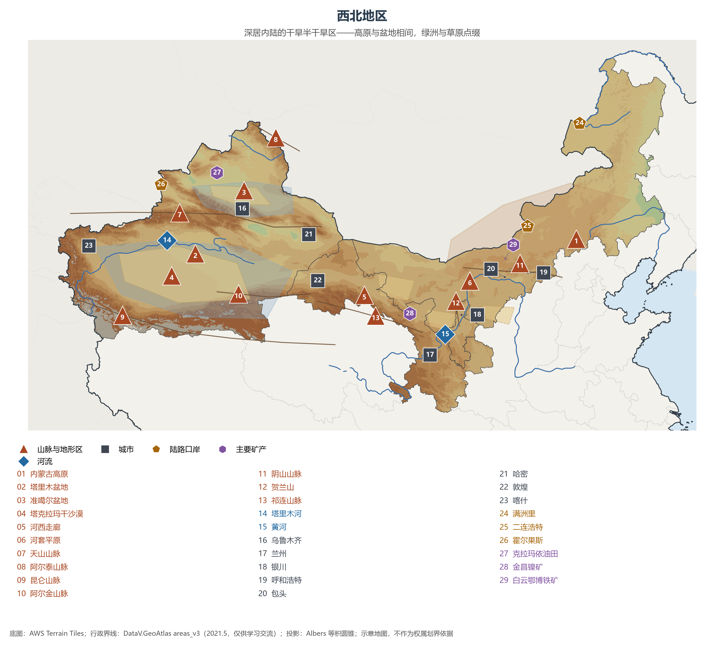
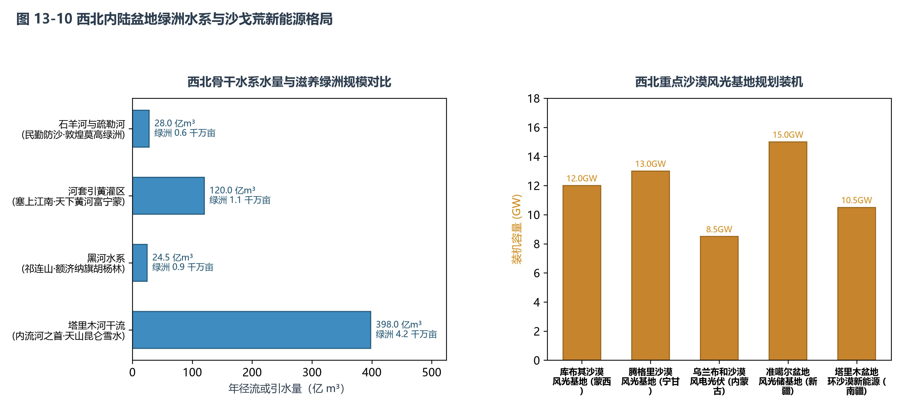

# 13.4 西北地区

西北地区深居欧亚大陆腹地，涵盖内蒙古自治区、甘肃省、宁夏回族自治区与新疆维吾尔自治区共 4 个省级行政区，陆地总面积达 333.9 万 km²（约占全国总面积的 34.6%），常住人口约 8188 万（占全国 5.7%），2023 年全区地区生产总值约 6.1 万亿元。在这片辽阔广袤的土地上，苍茫的温带草原、高耸雪峰阻隔下的干旱盆地、浩瀚连绵的流动沙海与清泉润泽的灌溉绿洲交相辉映，构成了中国最纵深的资源能源宝库、国家陆疆安全屏障与新时代共建“一带一路”向西开放的前沿门户。

## 一、区域范围与行政单元概况

西北地区面积广袤但人口稀疏，内部各行政单元在地理地貌与战略分工上特点鲜明：

| 省级行政区 | 陆地面积（km²） | 常住人口（万，2023） | GDP（亿元，2023） | 行政中心 | 核心地理与战略定位 |
|:---|:---:|:---:|:---:|:---|:---|
| **内蒙古自治区** | 1,183,000 | 2,396 | 24,627 | 呼和浩特 | 横跨东北、华北、西北，中国北方重要生态安全屏障与国家重要能源和战略资源基地（煤电、稀土、风光），农畜产品生产基地 |
| **甘肃省** | 425,800 | 2,465 | 11,864 | 兰州 | “玉如意”狭长版图，黄河上游生态屏障，河西走廊丝路咽喉，金昌镍都、酒泉风电与航天发射中心 |
| **宁夏回族自治区** | 66,400 | 729 | 5,315 | 银川 | 黄河流域生态保护和高质量发展先行区，“塞上江南”贺兰山东麓葡萄酒与现代煤化工基地，全国“东数西算”宁夏枢纽 |
| **新疆维吾尔自治区** | 1,664,900 | 2,598 | 19,126 | 乌鲁木齐 | 陆地面积全国第一（占全国六分之一），“三山夹两盆”，优质棉花与特色林果基地，国家深地油气战略基地，丝绸之路经济带核心区 |

**图 13-5 西北地区专题图**：三大地形单元、沙漠与绿洲、主要矿产与陆路口岸分布。

## 二、干旱自然地理的深层成因与地貌骨架

极端干旱是西北地区最根本的自然地理底色。其干旱机制是由**超级大陆度、大地形屏蔽与下沉气流**三重物理过程严密锁定的结果：
1. **海陆位置极度深远**：新疆乌鲁木齐号称世界上距离海洋最遥远的大城市（距最近的大洋印度洋与北冰洋均在 2500 km 以上），来自太平洋与大西洋的水汽在数千公里的陆路旅程中消耗殆尽；
2. **巨型高山圈闭阻隔**：青藏高原的隆升如同一道高达 4000 米以上的天然风墙，彻底阻断了印度洋暖湿西南季风北上；天山、阿尔泰山、阴山与贺兰山等巨型山系层层设卡，水汽极难逾越；
3. **副热带与西风带下沉气流**：内陆盆地在地形逆温与局地下沉气流控制下，对流极难发生，相对湿度常年偏低。

降水量与自然景观由东向西呈现严格的**经度地带性梯度递变**：
- **半湿润至半干旱草原带**（大兴安岭西麓至呼伦贝尔、锡林郭勒）：年降水量 300—400 mm 以上，发育着茂密肥沃的草甸草原与典型草原，是中国最优质的天然牧场；
- **半干旱荒漠草原带**（鄂尔多斯高原、乌兰察布、同心）：降水量降至 150—250 mm，植被以耐旱的小禾草、针茅、珍珠猪毛菜为主；
- **极端干旱荒漠带**（河西走廊西部、阿拉善高原、塔里木盆地、吐鲁番盆地）：年降水量普遍低于 50 mm（吐鲁番托克逊年均降水量仅 8.9 mm），而年潜在蒸发量高达 2000—3500 mm，地表广泛分布裸露砾石（戈壁）与连绵沙丘。

宏观地貌由**两大高原盆地大系与一条战略走廊**交织构成：
- **内蒙古高原**：中国第二大高原，地势坦荡辽阔，平均海拔 1000—1400 m，高原内部镶嵌着巴丹吉林沙漠（拥有高逾 400 米的世界最高沙峰与密集沙漠咸淡水湖群）、腾格里沙漠、乌兰布和沙漠与库布其沙漠；
- **新疆“三山夹两盆”**：北为雄浑的阿尔泰山，中有天山横贯东西（将新疆划分为南疆与北疆），南为昆仑山与阿尔金山。两山之间为两大巨型盆地：
  - **准噶尔盆地**（面积约 38 万 km²）：地势向西微开口，能接受部分大西洋与北冰洋水汽西风深入，内部古尔班通古特沙漠为中国最大的固定与半固定沙漠；
  - **塔里木盆地**（面积约 53 万 km²，中国最大内陆盆地）：完全被高山圈闭，中心横亘着约 33.7 万 km² 的**塔克拉玛干沙漠**（世界第二大流动沙漠，维吾尔语意为“进得去出不来”）；
- **河西走廊**：祁连山北麓长达 1000 余公里的断陷冲积扇平原，因地处黄河以西而得名，石羊河、黑河、疏勒河三大内陆河自祁连山冰川奔涌而下，造就了武威、张掖、酒泉、敦煌四大绿洲，自古为联通中原与西域的“丝绸之路咽喉”。

**图 13-10 西北内陆盆地绿洲水系与沙戈荒新能源格局**：左图比较骨干水系的年径流或引水量，条端列示对应绿洲耕地面积；右图比较重点沙漠风光基地的规划装机容量。

## 三、内流水系与绿洲农牧业人地智慧

在极度干旱的西北，“水是生命的源泉，水决定了一切”：
- **冰雪融水补给的内流水系**：西北地区除额尔齐斯河（自阿尔泰山发源，向西北流经哈萨克斯坦注入北冰洋）与黄河干流过境段外，绝大部分属于内流流域。河流以高山冰川积雪融水和山地降水为主要补给源，具有明显的“春汛微弱、夏汛集中、冬春断流、沿途蒸发下渗严重”的水文特征：
  - **塔里木河**：由阿克苏河、叶尔羌河与和田河三源汇合而成，全长约 2179 km，是中国最长的内陆河。塔里木河流域分布着世界上规模最大、保存最完好的原始天然胡杨林（保护面积近 400 万亩），国家自 2000 年起实施数十次生态输水，使下游濒临干涸的大西海子水库与台特玛湖重获新生；
  - **黑河**：中国第二大内陆河，流经甘肃张掖平原，注入内蒙古额济纳旗东、西居延海，通过全流域统一水量调度，阻击了额济纳绿洲的沙漠化。
- **绿洲灌溉人地适应与现代农业**：
  - **“塞上江南”宁夏与河套平原**：黄河干流在内蒙古与宁夏拐成巨型“几”字弯，地势平坦。秦汉以来修筑秦渠、汉延渠、唐徕渠，发展出无坝自流引黄灌溉系统（列入世界灌溉工程遗产），成为干旱区罕见的水稻、春小麦、枸杞与优质饲草高产沃土；
  - **古代坎儿井与现代滴灌体系**：新疆各族人民利用山麓倾斜地形，创造了由竖井、暗渠、明渠和涝坝组成的**坎儿井**系统（长达数千公里），免除了高温烈日下的地表蒸发；当代新疆更成为全国现代农业节水技术先锋，大面积推广膜下滴灌与水肥一体化技术，不仅建成了全国最大、产量占全国超 90% 的优质棉花生产基地，番茄酱、葡萄干、库尔勒香梨、阿克苏“冰糖心”苹果、吐鲁番哈密瓜享誉海内外。

## 四、战略矿产、能源基地与新质算力高地

西北不仅是传统的“聚宝盆”，更是新时代国家能源转型与新质生产力落子的关键板块：
- **化石能源与深地工程**：鄂尔多斯盆地富集千亿立方米级致密砂岩天然气与亿吨级低硫动力煤；塔里木盆地与准噶尔盆地是中国深层与超深层油气开发的主战场——深地塔科 1 井在塔克拉玛干腹地钻探深度突破 10000 米大关，刷新亚洲最深井纪录；西气东输一、二、三、四线工程以塔里木和准噶尔为起点，横贯中国直抵上海、广州与香港，累计输送天然气超数千亿立方米。
- **稀有战略矿产**：包头白云峨博矿床是全球已知规模最大的轻稀土伴生矿床（稀土氧化物储量占全国 80% 以上，占世界重要份额）；金昌镍矿床为全球第三大硫化铜镍矿床，被誉为中国“镍都”；甘肃酒泉与白银拥有雄厚的有色金属与核工业基础。
- **“沙戈荒”风光大基地与东数西算枢纽**：
  - **绿电基地**：西北拥有年日照时数 3000 小时以上的极致光能与狭管效应下澎湃的风能资源。国家在库布其、乌兰布和、腾格里与新疆盆地边缘规划建设 4.5 亿千瓦“沙戈荒”大型风电光伏大基地，探索“板上发电、板下修复土壤、板间发展养殖”的光伏生态治沙新路径，配套特高压直流通道外送华东华中；
  - **国家算力枢纽**：依托干燥凉爽的气候环境与充足廉价的绿电供应，内蒙古（和林格尔）、宁夏（中卫）与甘肃（庆阳）被确立为全国一体化大数据中心算力枢纽节点，承担全国大规模人工智能离线训练与后台渲染需求。

## 五、生态治理奇迹与丝绸之路核心走廊

- **生态屏障攻坚与沙漠治理奇迹**：西北是北方风沙灾害的主要源区。自 1978 年启动“三北”防护林体系建设工程以来，历经 40 余载接续奋斗，中国在包兰铁路沙坡头地段首创“麦草方格”机械固沙法（荣获联合国“全球500佳”环境奖）；毛乌素沙地大部分实现泛绿治理；目前正全力打好科尔沁与浑善达克沙地歼灭战、黄河“几字弯”攻坚战、塔克拉玛干沙漠边缘阻击战（实现 3046 公里环沙漠锁边全面合拢），实现由“沙进人退”向“绿进沙退”的历史性转折。
- **新时代丝路核心区与陆权复兴**：依托连霍高速、兰新高铁与密集的中欧班列通道，新疆阿拉山口、霍尔果斯双口岸成为全国通行班列数量最多的陆上战略枢纽（经新疆进出境中欧班列占全国半数以上）；中国—中亚天然气管道、中巴经济走廊公路全线联通。西北正从历史上的内陆腹地与防务末梢，蝶变为联通中亚、西亚、欧洲的大型陆路国际枢纽前沿。

## 参考与数据来源

1. 面积与人口：国家统计局《中国统计年鉴 2024》各省区常住人口与陆地面积公报。
2. 农业与棉花数据：国家统计局《2024 年全国棉花生产情况公告》（新疆棉花单产与全国占比超 90%）；农业农村部灌溉农业统计。
3. 水资源与生态治理：水利部《中国水资源公报 2023》（西北诸河水资源总量、塔里木河生态输水成效）；国家林业和草原局《三北防护林体系建设工程总体规划实施评估报告》。
4. 能源与深地科技：中国石油天然气集团《塔里木油田超深层油气勘探技术进展》（深地塔科 1 井万米突破）；国家能源局“沙戈荒”大型风光基地实施方案。
