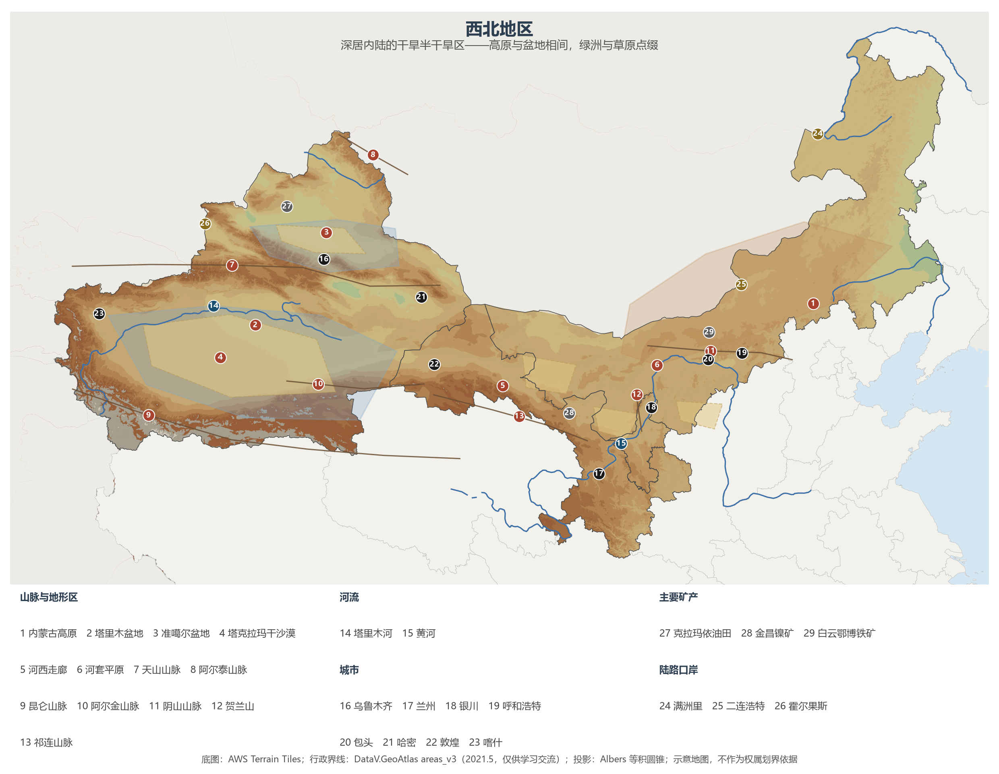
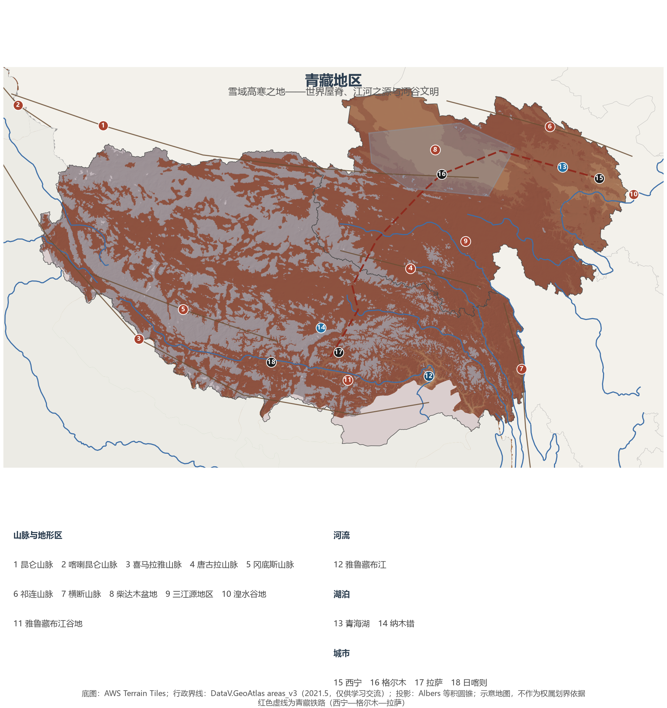

# 13.4 西北地区与青藏地区

西北（内蒙古、甘肃、宁夏、新疆 4 个省级行政区）与青藏（青海、西藏 2 个省级行政区）合计面积约 529 万 km²——超过全国一半，常住人口却只有约 9 100 万（占 6.4%），2023 年地区生产总值合计约 6.7 万亿元（占 5.1%）。这两个区域常被并称"西部"，但逻辑截然不同：**西北的问题是水**——深居内陆带来的干旱塑造了绿洲与草原的世界；**青藏的问题是高度**——平均 4 000 m 以上的海拔塑造了高寒的世界。一个是降水线以西，一个是海拔线以上。

## 一、行政区划范围

| 西北地区 | 面积（km²） | 常住人口（万，2023） | 行政中心 |
|---------|------------|--------------------|---------|
| 内蒙古自治区 | 1 183 000 | 2 396 | 呼和浩特 |
| 甘肃省 | 425 800 | 2 465 | 兰州 |
| 宁夏回族自治区 | 66 400 | 729 | 银川 |
| 新疆维吾尔自治区 | 1 664 900 | 2 598 | 乌鲁木齐 |

| 青藏地区 | 面积（km²） | 常住人口（万，2023） | 行政中心 |
|---------|------------|--------------------|---------|
| 青海省 | 722 300 | 594 | 西宁 |
| 西藏自治区 | 1 228 400 | 365 | 拉萨 |

## 二、西北：干旱的艺术

西北的干旱有三个成因：深居欧亚大陆腹地、四周高山阻隔水汽、再加上青藏高原对西风带与季风的扰动。年降水量自东部的 400 mm 递减至塔里木盆地腹地的不足 50 mm，蒸发量却高达数千毫米——这里是中国内流区的大本营，塔里木河是中国最长的内流河（约 2 179 km），罗布泊曾是其终点。

**图 13-5 西北地区**：三大地形单元、沙漠与绿洲、主要矿产与陆路口岸（编号说明见图下）。

地貌格局可以用三句话概括：**内蒙古高原**坦荡开阔，呼伦贝尔、锡林郭勒、河套一带的草原是中国最大的牧区；**新疆"三山夹两盆"**——阿尔泰山、天山、昆仑山之间夹着准噶尔与塔里木两大盆地，塔克拉玛干沙漠（约 33 万 km²）是世界第二大流动沙漠，吐鲁番盆地则以"火洲"之称包揽中国最热纪录；**河西走廊**斜贯甘肃西部，祁连山冰雪融水串起武威、张掖、酒泉、敦煌一连串绿洲，自古是中原通往西域的咽喉——丝绸之路的命脉正是这条走廊。

有水的地方就有绿洲文明：**河套平原与宁夏平原**靠黄河自流灌溉，"黄河百害，唯富一套"，并称"塞上江南"，是西北的粮仓；天山南北的绿洲带则盛产棉花、瓜果——吐鲁番的葡萄、哈密的甜瓜都是极端大陆性气候（日照强、温差大）的礼物，古老的路引则是**坎儿井**——把雪山渗水引入绿洲的地下渠系。地下是另一重财富：内蒙古的煤与稀土（白云鄂博）、新疆的石油天然气（准噶尔、塔里木，"西气东送"的起点）、金昌的镍（见 11.3 节）。满洲里、二连浩特、霍尔果斯等陆路口岸与中欧班列，让古丝绸之路以铁路的速度复活（见 12.3 节）；兰新高铁则把新疆纳入全国高铁网。

## 三、青藏：世界屋脊上的生命

青藏高原平均海拔超过 4 000 m，是地球上最高、最年轻的大高原（见 3.2 节）。这里的气候只有一句话：高寒——大气层薄、太阳辐射强（拉萨因此得名"日光城"）、气温低、生长期短。垂直分异取代了水平地带：谷地种青稞，山坡是草甸，雪线之上是冰川。

**图 13-6 青藏地区**：山脉、河流、湖泊与青藏铁路（编号说明见图下）。

青藏是中国的"水塔"：长江、黄河、澜沧江、怒江、雅鲁藏布江、恒河、印度河均发源于此或流经边缘，第二次青藏科考量算"亚洲水塔"冰川约 11 万条、冰储量约 10 万亿 m³；中国境内的 4.86 万条冰川（面积约 5.2 万 km²）绝大部分在这里。三江源国家公园（2021 年正式设立）守护着长江、黄河、澜沧江的正源（见 7.2 节）。农业只能在河谷里寻找温度：**雅鲁藏布江谷地**（"一江两河"——雅鲁藏布江、拉萨河、年楚河中部流域）与**湟水谷地**是两大河谷农业带，青稞与春小麦在这里创造了世界高海拔种植纪录；牧业以耐寒的牦牛、藏绵羊为主。人口向河谷集聚——拉萨河谷与湟水谷地（西宁）承载了两省区的大部分城镇人口。交通以公路先行——川藏、青藏、新藏、滇藏四条进藏公路翻越千山——青藏铁路（2006 年全线通车）终结了西藏没有铁路的历史，拉林铁路已延伸至林芝，川藏铁路正在施工（见 12.3 节）。柴达木盆地在高原上自成一格：察尔汗盐湖的钾肥、冷湖的石油、戈壁上的光伏电站，让它名副其实地被称为"聚宝盆"。

## 四、生态屏障与国家战略

西北与青藏的共同身份是**中国的生态屏障**：三北防护林工程主要在西北锁住风沙（见 7.2 节），三江源与祁连山国家公园涵养水源，青藏高原的冻土与冰川还是全球变化的敏感指示器——近 50 年"亚洲水塔"冰储量减少约两成，冰川退缩直接影响下游十余个国家的用水。发展战略上，西部大开发、对口援疆援藏、"一带一路"核心区（新疆）与生态功能区定位，共同构成了这两个区域的当代叙事。

## 五、世界视角：第三极

青藏高原被称为地球"第三极"——它是南极、北极之外全球最大的冰雪储库，也因冰储量约 10 万亿 m³ 被称为"亚洲水塔"，直接滋养下游近 20 亿人口。放眼世界干旱带，西北与撒哈拉、阿拉伯半岛、中亚同处北纬 15°—35° 的副热带干旱区，唯独中国的西北因青藏高原的隆起而兼具高山雪水补给，才有了绿洲农业的千年延续——可以说，没有青藏高原，就没有河西走廊与天山绿洲，丝绸之路也会是另一副模样。

## 参考与数据来源

1. 面积、人口：附录 A 口径（《中国统计年鉴 2024》，2023 年末常住人口）；GDP 分省合计口径见 13.1 节。
2. 塔里木河长度与内流区格局：水利部及流域机构公开资料（见 5.4 节）。
3. "亚洲水塔"与中国冰川：第二次青藏高原综合科学考察研究成果（2017—）；中国第二次冰川编目（冰川 48 571 条、约 5.2 万 km²）。
4. 国家公园与生态工程：国家公园管理局、国家林业和草原局公开资料（见 7.2 节）。
5. 底图：AWS Terrain Tiles；行政界线：DataV.GeoAtlas areas_v3（2021.5，仅供学习交流）。
