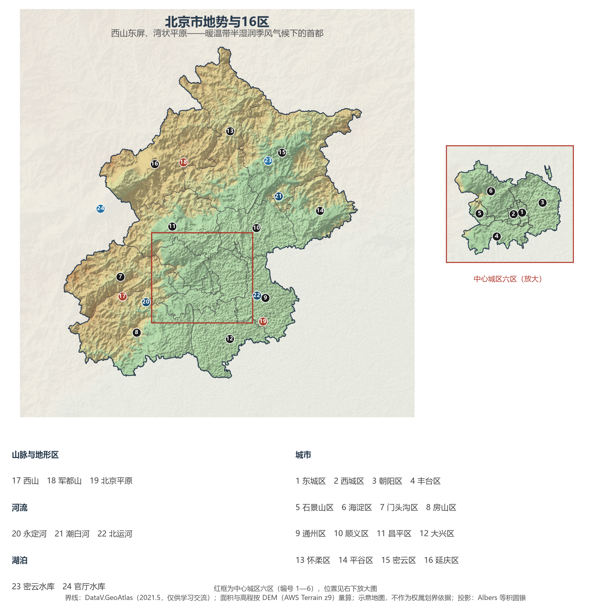
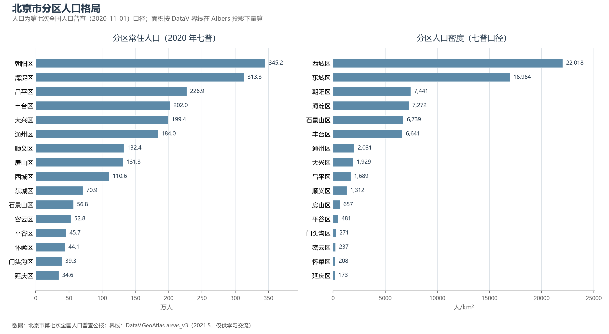

# 13.5.1 北京市

北京是共和国首都、四个直辖市之一，也是本书分省详述的第一站。它坐在华北平原西北端那张"湾状"的座椅上——西有西山，北有军都山，东南面向平原开口，永定河与潮白河从群山中奔涌而出——古人所谓"幽州之地，左环沧海，右拥太行，北枕居庸，南襟河济"，正是这座城市的地理底稿。3 000 多年建城史、870 余年建都史，都叠写在这 16 410 km² 的土地上。

## 一、省情速览

| 指标 | 数值 |
|------|------|
| 面积 | 16 410 km² |
| 常住人口 | 2 189.3 万（2020 年七普）；2 185.8 万（2023 年末） |
| 常住人口城镇化率 | 约 87.8%（2023 年末，居全国省级行政区前列） |
| 地区生产总值 | 43 760.7 亿元（2023）；49 843.1 亿元（2024，增长 5.2%） |
| 人均地区生产总值 | 约 22.8 万元（2024，居全国省级行政区首位） |
| 行政区划 | 16 个市辖区 |
| 简称 | 京 |

放在全国坐标里：北京 GDP 在 34 个省级行政区中列第 13 位，与河北、安徽同一量级；但人均 GDP 高居榜首——一市之力约相当于瑞典（2023 年口径粗折），人口则与斯里兰卡相当。放回世界城市坐标系，北京是世界遗产最多的城市之一：2024 年北京中轴线申遗成功后，全市世界遗产达到 8 处，居全球城市前列。这座城市的真正特殊性在于"首都功能"：全国政治中心、文化中心、国际交往中心、科技创新中心的定位，决定了它的人口、产业与空间秩序都服从一套独特的逻辑。

**图 13-7 北京市地势与 16 区**：z9 级 DEM 晕渲（300 m 分辨率），编号说明见图下。

## 二、自然地理

**地形**上，北京的山与川几乎对半分：西部西山属太行山脉，北缘军都山属燕山山脉，两山在南口附近交汇，围出一个人口与城市所在的东南平原——山地约占六成，平原约占四成。市域最高点为门头沟区的**东灵山**（2 303 m），最低处位于通州东南隅，海拔仅约 8 m。西山在地质上做过文章：周口店的龙骨山埋着北京猿人，石花洞与云水洞是华北喀斯特的代表（见 3.5 节）。

**气候**属暖温带半湿润季风气候：1 月均温 −4 ℃ 上下，7 月约 26 ℃，年降水量 500—600 mm 且七、八两月占去大半——春旱、夏涝、冬燥交替上演。2023 年 7 月末的"23·7"流域性特大洪水（海河流域）是几十年来对这座城市水利体系最重的一次检验。

**水**是最紧的约束。北京属海河流域，自西向东有拒马河、永定河、北运河、潮白河、泃河五系过境，但人均水资源量长期不足全国平均的十分之一；密云水库与官厅水库两大"水缸"常年告急，直到 2014 年底南水北调中线进京——累计受水已超百亿立方米——才真正缓过来。永定河经多年生态补水于 2021 年实现全线通水，断流近 30 年的河道重新有水，是华北地下水超采治理的标志事件。

## 三、建置沿革与人文

北京的建城史可上溯至西周燕都蓟城；1153 年金中都在此第一次把北京推上一统王朝的都城之位，1272 年元大都奠定今天城市的中轴格局，1421 年明成祖迁都，明清两代经营出紫禁城—皇城—内城—外城的层级秩序。1928 年国都南迁后北京降格为"北平特别市"，1949 年 10 月 1 日中华人民共和国在此定都。

今天挂在北京城头的世界遗产有八处：故宫、长城（八达岭—慕田峪等）、天坛、颐和园、明清皇家陵寝（十三陵）、周口店北京人遗址、大运河（北京段）与 2024 年列入名录的**北京中轴线**——一条南起永定门、北至钟鼓楼、全长 7.8 km 的"理想都城秩序"之轴。城市记忆的另一半写在胡同与四合院里，写在"三山五园"的皇家园林区里，也写在 798 的旧厂房里。

## 四、经济与区域战略

北京的经济是典型的**首都经济**：第三产业占 GDP 比重超过八成，信息传输与软件服务业、金融业两大支柱合计贡献逾三分之一；中关村国家自主创新示范区是全市创新的发动机，金融街管理着全国金融资产的清算命脉。工业则主动"瘦身健体"——首钢搬离石景山，老厂房变成冬奥赛场与工业遗址公园（2022 年冬奥会让北京成为全球首座"双奥之城"）。

空间战略一言以蔽之："**疏解**"。2015 年以来，京津冀协同发展把非首都功能向河北与城市副中心疏解：行政办公机构东迁通州（城市副中心），一批批发市场与制造环节外迁，北京自 2017 年起常住人口连续减量——七普 2 189.3 万已低于 2016 年约 2 195 万的峰值，中心城区人口比重随之下降，这是超大城市里罕见的"逆城市化"操作。交通上，北京是全国铁路网的中心（京沪、京广、京哈、京包、京九诸干线的原点）与双国际机场城市（首都机场、大兴机场，年旅客吞吐量合计超 1 亿人次）。

**图 13-8 北京市分区人口格局**：左为分区常住人口（七普），右为分区人口密度——西城区以约 2.2 万人/km² 居首，延庆区仅 173 人/km²。

## 五、分区地理：16 区与四大功能板块

按《北京城市总体规划（2016—2035 年）》，16 区分为四大功能板块。

**首都功能核心区（东城、西城）**——东城区 70.9 万人，面积 41.8 km² 为全市最小；故宫、天坛、王府井与大批中央机关所在，是政治与文化心脏。西城区 110.6 万人，金融街以不足 3 km² 的街面贡献了全国金融资产管理的核心功能，2024 年全区 GDP 6 038.0 亿元；什刹海与胡同保护区在此与摩天楼共存。

**中心城区其余四区（朝阳、海淀、丰台、石景山）**——朝阳区 345.2 万人，全市人口第一大区：CBD 商务区、使馆区与 798 艺术区，2024 年 GDP 9 230.1 亿元居第二。海淀区 313.3 万人，中关村、清华北大与"三山五园"所在，2024 年 GDP 12 907.1 亿元，以一区之力占全市约四分之一，连续多年居各区之首。丰台区 202.0 万人，北京南站与丽泽金融商务区撑起南城脊梁。石景山区 56.8 万人，首钢工业遗址转型的样板——冬奥滑雪大跳台就建在群明湖畔。

**平原新城（通州、顺义、大兴、昌平、房山）**——通州区 184.0 万人，城市副中心：市级机关新驻地、环球影城与大运河森林公园。顺义区 132.4 万人，首都机场临空经济区与航空产业带。大兴区 199.4 万人，北京大兴国际机场"凤凰展翅"，临空经济区与生物医药基地并进。昌平区 226.9 万人，未来科学城与明十三陵同在一线，"回天地区"是全市最大的居住组团。房山区 131.3 万人，周口店遗址、良乡大学城与燕山石化并存。

**生态涵养区（门头沟、平谷、怀柔、密云、延庆）**——五区占全市面积约六成、人口仅一成，是首都的"后花园"与水源地。门头沟区 39.3 万人，西山永定河文化带与京西古道，2024 年 GDP 304.4 亿元（生态涵养区首次突破 300 亿）；平谷区 45.7 万人，金海湖与"农业中关村"；怀柔区 44.1 万人，怀柔科学城的大科学装置集群与雁栖湖国际会都；密云区 52.8 万人，密云水库是华北最大水库、首都的"大水缸"；延庆区 34.6 万人（全市最少），八达岭长城与冬奥延庆赛区所在地。

## 六、省内之最

| 项 | 值 |
|----|----|
| 最高点 | 东灵山（门头沟区），2 303 m |
| 最低点 | 通州区东南隅，约 8 m |
| 面积最大 / 最小的区 | 密云区 2 229 km² / 东城区 41.8 km² |
| 人口最多 / 最少的区（七普） | 朝阳区 345.2 万 / 延庆区 34.6 万 |
| 人口密度最高（七普） | 西城区，约 2.2 万人/km² |
| GDP 首位区 | 海淀区 12 907.1 亿元（2024，占全市约 1/4） |
| 世界遗产 | 8 处，居全球城市前列 |

## 参考与数据来源

1. 面积、人口、GDP 总量：附录 A 口径（《中国统计年鉴 2024》）；2024 年 GDP 及人均为北京市 2024 年国民经济和社会发展统计公报口径。
2. 分区人口：北京市第七次全国人口普查公报（2021）；分区面积按 DataV 界线在 Albers 投影下量算，与官方公布面积差在 2% 以内。
3. 分区 GDP：海淀区、朝阳区、西城区、门头沟区 2024 年国民经济和社会发展统计公报；其余各区未逐一收录。
4. 功能板块：《北京城市总体规划（2016—2035 年）》；中轴线：联合国教科文组织世界遗产名录（2024）。
5. 地势图 DEM：AWS Terrain Tiles z9（300 m 分辨率量算）；界线：DataV.GeoAtlas areas_v3（2021.5，仅供学习交流）。
