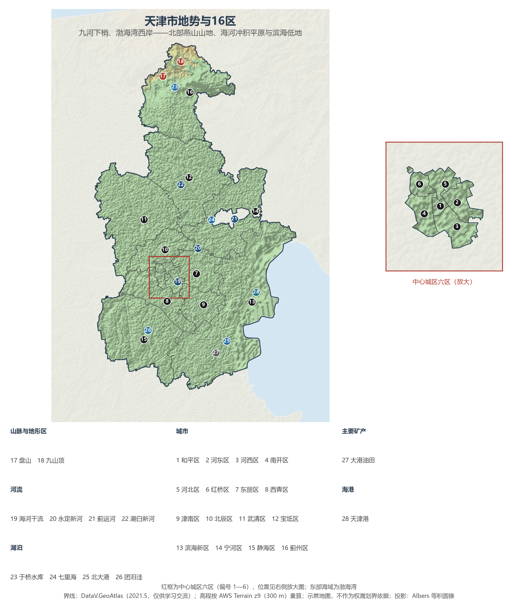
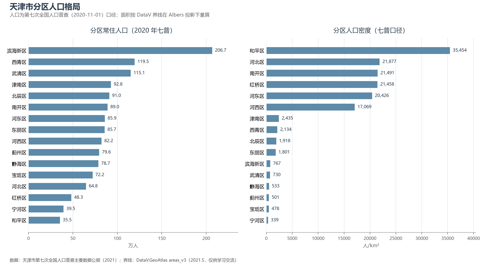

# 13.5.2 天津市

天津是四个直辖市中最贴近海的那个。它坐在华北平原东北端、海河水系五大支流汇流的尾闾上——北面燕山余脉收住了平原的尽头，东面渤海湾张开怀抱，"九河下梢天津卫"这句老话，道尽了这座城市的地理宿命：水从这里入海，船从这里靠岸，城因漕运与海港而生。自 1404 年明廷设"天津卫"起，六百余年里，它从天子津渡的军事卫所，长成北方最大的港口城市与综合交通枢纽，又作为京津冀城市群的"双城"之一，与北京共同构成北方经济的核心。

## 一、省情速览

| 指标 | 数值 |
|------|------|
| 面积 | 11 966 km² |
| 常住人口 | 1 386.6 万（2020 年七普）；1 364 万（2023 年末） |
| 常住人口城镇化率 | 约 85.5%（2023 年末） |
| 地区生产总值 | 16 737.3 亿元（2023）；18 024.3 亿元（2024，增长 5.1%） |
| 人均地区生产总值 | 约 13.2 万元（2024，居全国省级行政区前列） |
| 行政区划 | 16 个市辖区 |
| 简称 | 津 |

放在全国坐标里：天津陆地面积在 34 个省级行政区中仅大于上海与港澳，GDP 总量居第 23 位——但这一万多亿元的经济体量折算约 2 530 亿美元，与新西兰全国（2024 年口径）大体相当；常住人口也比比利时全国还多约 180 万。这是一座"小而重"的城市：以全国不足 0.13% 的土地，承载着北方国际航运核心区与全国先进制造研发基地的功能。天津港 2024 年完成集装箱吞吐量 2 328 万标准箱，稳居世界港口前十，接近鹿特丹与洛杉矶两大港之和的量级；货物吞吐量 4.93 亿吨创历史新高（天津港集团口径）。

**图 13-9 天津市地势与 16 区**：z9 级 DEM 晕渲（300 m 分辨率），中心城区六区放大见插图，编号说明见图下。

## 二、自然地理

**地势**北高南低，像一段缓坡从燕山滑向渤海。北部蓟州区是全市唯一的低山丘陵区，属燕山山脉南麓，盘山、八仙山、九山顶诸峰并列，最高点**九山顶**海拔 1 078.5 m；山地丘陵合计不足全市面积的 5%。由此向南，地势一路铺开为广阔的海河冲积平原与滨海平原，大部分地面海拔仅 2—5 m，滨海一带降到 2 m 以下——全市约九成半的土地是平原，这在省级行政区中仅次于江苏、上海一类的纯平原省份。

**气候**属暖温带半湿润季风气候：1 月均温 −4 ℃ 上下，7 月约 26—27 ℃，年降水量 520—660 mm 且集中于六至八月。春季干旱多风、夏季炎热多雨、秋季短暂、冬季干冷，是典型的北方沿海气候。台风极少直接登陆，但风暴潮是渤海湾最主要的海洋灾害——2018 年以来渤海湾沿岸的风暴潮预警多次波及滨海新区。

**水**是天津城市叙事的主角。海河流域的五大支流——北运河、永定河、大清河、子牙河、南运河——在天津附近汇成海河干流，自三岔河口向东 72 km 注入渤海；此外还有独流减河、永定新河、潮白新河、蓟运河等多条人工与天然入海河道。"九河下梢"既带来漕运之利，也带来洪水之患：1963 年海河大水后，上游水库与下游减河体系逐步建成，构成今天"分区防守、分流入海"的防洪格局。城市供水经历了两次历史性转折——1983 年**引滦入津**工程通水，滦河水经于桥水库穿燕山暗渠入城；2014 年底南水北调中线进津后，形成滦河、长江双水源格局。

渤海湾西岸还给天津留下了两类独特资源。一是**湿地**：宁河七里海是世界上最典型的古潟湖湿地之一，与北大港、团泊洼、于桥水库等共同构成候鸟迁徙线上的驿站，天津古海岸与湿地国家级自然保护区内的牡蛎礁与贝壳堤，是研究渤海湾岸线变迁的世界级剖面。二是**盐与油**：长芦盐区自古是全国最大的海盐产区，大港油田与渤海湾海上油气田则支撑起石化产业。

## 三、建置沿革与人文

天津的建城时间在名城中格外精确：明永乐二年（1404 年 12 月）设天津卫——"天子津渡"之意，这是中国唯一有确切建城时间记录的古代城市。金代在此置直沽寨，元代设海津镇，已是漕运枢纽；明代设卫筑城后，"天津卫"成为城市的文化胎记。清雍正年间改州升府，1860 年第二次鸦片战争后开埠，英、法、美、德、日、俄、奥、意、比九国相继设立租界——今天五大道与意式风情区里的两千多座小洋楼，就是那段历史的建筑存档，天津也因此被称为"万国建筑博览会"。1895 年创办的北洋大学堂（今天津大学）是中国第一所现代大学；南开大学由严修、张伯苓创办于 1919 年，周恩来即其首届学生。

20 世纪的天津几经沉浮：1928 年设天津特别市；1949 年后为中央直辖市；1958 年并入河北省并成为省会，1967 年恢复直辖市至今。1984 年天津经济技术开发区在盐碱滩上奠基，是第一批国家级开发区；2006 年滨海新区开发开放纳入国家整体战略，2009 年撤销塘沽、汉沽、大港三区设立滨海新区行政区。

市民文化的底色是码头与市井：相声、时调在茶馆里生长，杨柳青年画、泥人张彩塑、风筝魏风筝出自乡土匠人之手，狗不理包子与煎饼馃子则把"卫嘴子"的讲究写进了日常。天津方言自带幽默基因，老城厢、古文化街、天后宫（北方现存最大的妈祖庙）共同保存着漕运时代的城市记忆。世界遗产有两处——长城（黄崖关段）与大运河（天津段），分别镇守北山与城下。

## 四、经济与区域战略

天津的经济骨架是**港口 + 制造**。天津港是世界航道等级最高的人工深水港之一，30 万吨级船舶可乘潮进出，港内铁路与航空（滨海国际机场）共同构成"海陆空铁"多式联运体系；依托港口的石化、装备制造与贸易物流，撑起了滨海新区约占全市四成的经济总量。制造业则呈"上天入海"之势：空客 A320 系列飞机天津总装线是欧洲之外唯一的空客单通道总装基地，直升机与无人机产业聚集于空港；海上，渤海湾油气开采与船舶海工装备南北呼应；地面，汽车（一汽丰田）、石油化工、信创产业（飞腾 CPU、麒麟操作系统）与生物医药构成新支柱。2015 年挂牌的中国（天津）自由贸易试验区是北方第一个自贸区。

在京津冀协同发展战略中，天津的定位是"**一基地三区**"：全国先进制造研发基地、北方国际航运核心区、金融创新运营示范区、改革开放先行区。与北京的"疏解"相对，天津的关键词是"承接"——"十四五"期间滨海新区承接非首都功能重大项目 278 个、总投资 2 734 亿元，中国石化、国家管网等央企二三级机构相继落户。城市空间形成"津城""滨城"双城格局：中心城区保留金融、商贸与科教文化职能，滨海新区承担港口、先进制造与开放试验功能。也要看到转型的压力：2017 年以来常住人口持续小幅净流出，经济总量被苏浙鲁粤等省份拉开，从昔日"北方的上海"回到"北方的枢纽"——这是天津当下最真实的地理叙事。

**图 13-10 天津市分区人口格局**：左为分区常住人口（七普），右为分区人口密度——和平区以约 3.5 万人/km² 居首，宁河区仅 339 人/km²。

## 五、分区地理：16 区与四个圈层

天津 16 区习惯上按"中心城区—环城四区—滨海新区—远郊五区"四个圈层理解。

**中心城区六区**（七普合计 405.7 万，占全市 29.3%）——和平区面积仅 9.98 km²，是全国最小的市辖区，却装着 35.5 万人与全市最密的商业金融街面（小白楼、南京路），人口密度约 3.5 万人/km²，居全国县级行政区前列；五大道小洋楼区在其西南。河东区 85.9 万人，天津站与海河东岸的老工业带所在。河西区 82.2 万人，市政府驻地与友谊路金融街、梅江居住区。南开区 89.0 万人，南开大学、天津大学与水上公园同在一区。河北区 64.8 万人，意式风情区与"天津之眼"摩天轮跨海河而立。红桥区 48.3 万人，三岔河口与天津西站——京沪高铁在北方的始发枢纽之一。

**环城四区**（389.0 万）——东丽区 85.7 万人，天津滨海国际机场与空港经济区所在；西青区 119.5 万人，七普以来人口增长全市最快，杨柳青年画的故乡与高校聚集的第三高教区在此并存；津南区 92.8 万人，海河教育园区与国家会展中心（天津）落地于此；北辰区 91.0 万人，高端装备制造与医药产业带。

**滨海新区**（206.7 万，面积 2 270 km²）——全国第一个整合设立的国家级新区行政区，天津港、于家堡金融区、大港油田、中新天津生态城都在其域内，经济总量约占全市四成；1984 年的开发区、2006 年的国家战略、2015 年的自贸区，三代开放政策叠加于一身。

**远郊五区**（385.2 万）——武清区 115.1 万人，卡在北京与天津之间，京津城际的"武清站经济"与佛罗伦萨小镇使其成为京津冀通勤带上的节点；宝坻区 72.2 万人，京唐城际与高铁宝坻枢纽重塑了这片"京东"之地；静海区 78.7 万人，团泊湖畔的健康产业园与昔日"华夏第一村"大邱庄同在；宁河区 39.5 万人，七里海湿地是华北平原上难得的生态留白；蓟州区 79.6 万人，全市唯一山区，盘山、黄崖关长城、于桥水库与八仙山构成天津的"后花园"与水源地。

## 六、省内之最

| 项 | 值 |
|----|----|
| 最高点 | 九山顶（蓟州区），1 078.5 m |
| 最低点 | 东部滨海一带，近海平面（约 0 m） |
| 面积最大 / 最小的区 | 滨海新区约 2 270 km² / 和平区 9.98 km²（全国最小的市辖区） |
| 人口最多 / 最少的区（七普） | 滨海新区 206.7 万 / 和平区 35.5 万 |
| 人口密度最高（七普） | 和平区，约 3.5 万人/km² |
| GDP 首位区 | 滨海新区（约占全市四成） |
| 港口 | 天津港：2024 年集装箱 2 328 万标准箱，居世界前十 |
| 世界遗产 | 2 处（长城黄崖关段、大运河天津段） |

## 参考与数据来源

1. 面积、人口、GDP 总量：附录 A 口径（《中国统计年鉴 2024》）；2024 年 GDP 及增速为天津市 2024 年国民经济和社会发展统计公报口径。
2. 分区人口：天津市第七次全国人口普查主要数据公报（2021，含中心城区、环城四区、滨海新区、远郊五区分组）；分区面积按 DataV 界线在 Albers 投影下量算，多数区与官方公布值差在 2% 以内，滨海新区因海岸滩涂口径差异偏大，正文采用官方面积。
3. 天津港吞吐量：天津港集团 2024 年发布数据（货物 4.93 亿吨、集装箱 2 328 万标准箱）；世界排名参照交通运输部与国际港口协会口径。
4. 引滦入津（1983）、九国租界、北洋大学堂（1895）、滨海新区沿革：天津市志与官方党史文献口径；滨海新区承接项目数与投资额：天津市委老干部局发布的"十四五"总结（2025）。
5. 地势图 DEM：AWS Terrain Tiles z9（300 m 分辨率量算）；界线：DataV.GeoAtlas areas_v3（2021.5，仅供学习交流）。
