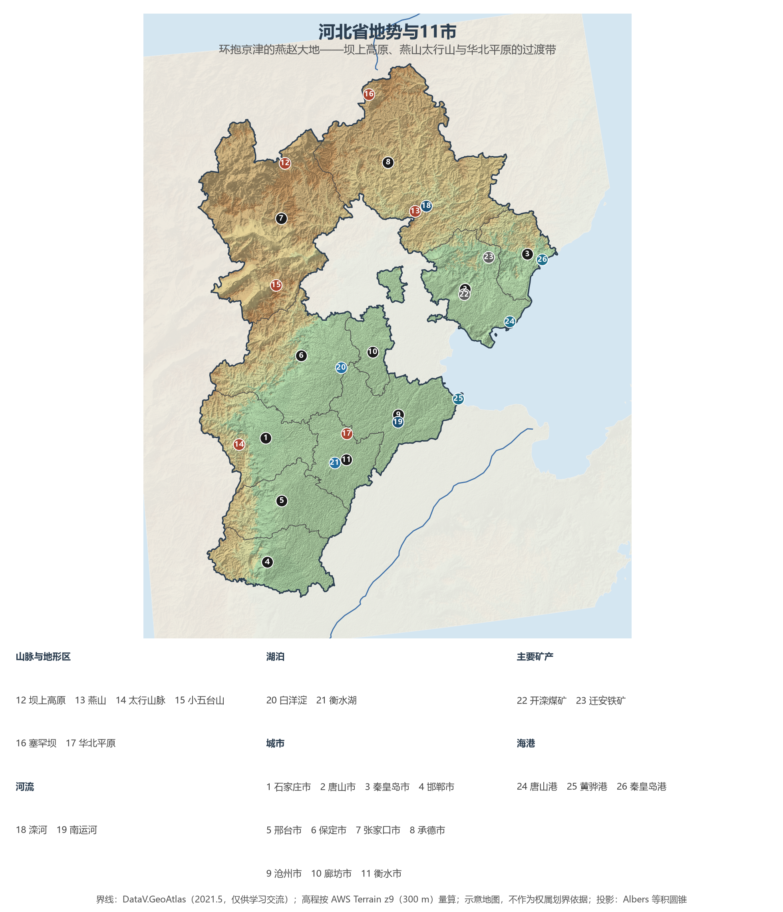
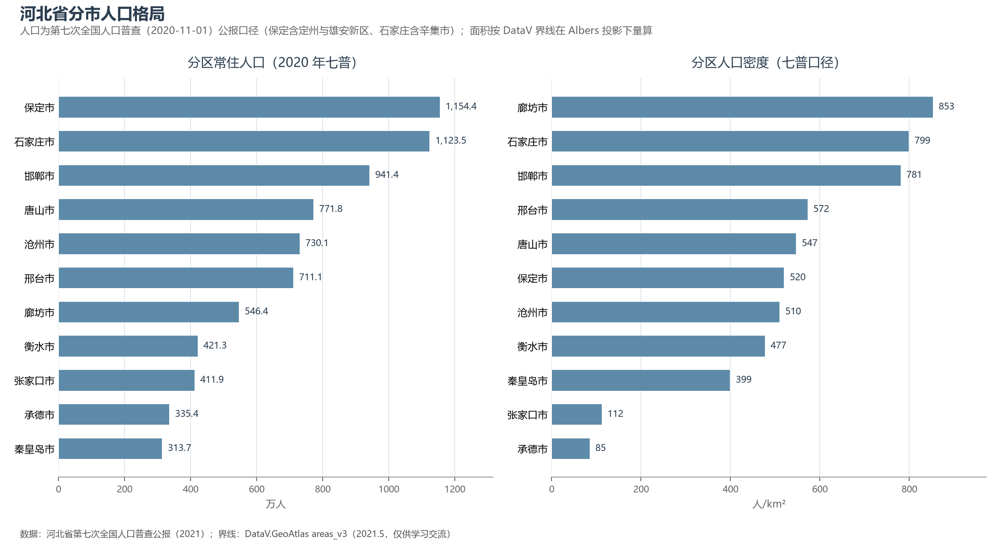

# 13.5.3 河北省

河北是中国唯一"环抱"两大直辖市的省份——北京、天津两座大城嵌在它东北部的腹地里，把 18.88 万 km² 的省域分成环京津平原、冀北山坝与冀东滨海三大块。这里是燕赵故地：燕山与太行山像两条臂弯圈住华北大平原的北缘，"慷慨悲歌"的地域性格，正生于山地与平原交界的边疆感。从坝上草原的塞罕坝林海，到白洋淀的芦苇荡，再到唐山港 8 亿吨级的泊位，河北浓缩了中国北方几乎全部的地貌与产业类型。

## 一、省情速览

| 指标 | 数值 |
|------|------|
| 面积 | 188 800 km²（不含京津） |
| 常住人口 | 7 461.0 万（2020 年七普）；7 393 万（2023 年末，全国第 6） |
| 常住人口城镇化率 | 约 63%（2023 年末） |
| 地区生产总值 | 43 944.3 亿元（2023）；47 526.9 亿元（2024，增长 5.4%） |
| 人均地区生产总值 | 约 6.4 万元（2024） |
| 行政区划 | 11 个地级市（另辖定州、辛集 2 个省直辖县级市，雄安新区） |
| 简称 | 冀 |

放在全国坐标里：河北 GDP 总量与北京大体相当（2024 年分别为 4.75 万亿元与 4.98 万亿元），但 7 400 万人口摊到人均只有约 6.4 万元，不足全国平均（9.57 万元）的七成——人口体量略多于泰国，经济总量约 6 700 亿美元，与欧洲中等强国相当。真正让河北站上世界坐标的是钢铁：全省粗钢产量长期保持在 2 亿吨上下、约占全国五分之一，一省之钢超过除中国外任何一个国家的全国产量。2022 年北京冬奥会雪上项目在张家口崇礼举行，让"河北"第一次以主办地的身份进入全球视野。

**图 13-11 河北省地势与 11 市**：z9 级 DEM 晕渲（300 m 分辨率），编号说明见图下；北京、天津为省域环抱的两块"空窗"。

## 二、自然地理

河北是全国地貌类型最完整的省份之一：高原、山地、丘陵、盆地、平原、湖泊、海滨兼而有之，像一部缩编的中国北方地貌志。**坝上高原**是内蒙古高原的南缘，海拔 1 300—1 600 m，草原与风沙并存；其南的**燕山**与西来的**太行山脉**在怀来附近交会，构成环抱京津的弧形山系，全省最高点**小五台山**（2 882 m）即太行山北段主峰；山地的东南麓之下，是海拔大都在 100 m 以下、占全省面积约三成的**河北平原**——华北平原的核心部分。

**气候**属温带季风气候，但内部梯度极大：坝上年均温仅 1—4 ℃，长城沿线 6—9 ℃，南部平原可达 13 ℃；年降水量从坝上的 400 mm 上下递增到燕山南麓的 700 mm 以上——燕山、太行山的迎风坡是华北的降水高值区，也是海河各支流洪水的主要来源，1963 年与 1996 年海河流域特大洪水皆由此发端。2023 年"23·7"流域性特大洪水中，涿州等地受灾严重，再次提示这座城市群脚下的洪水地理。

**水系**以海河流域为主，永定河、大清河、子牙河、漳卫南运河、北运河诸系自西向东穿省入津；冀东的**滦河**（干流 877 km）则是独立入海的第二大水系，潘家口、大黑汀两库由此向天津、唐山供水。湖泊以**白洋淀**最为著名——华北平原现存最大的淡水湖泊群，约 366 km²，143 个淀泊由 3 700 多条沟壕连通，如今是雄安新区的"生态之肾"；衡水湖是华北平原单体面积最大的内陆淡水湖之一。坝上与冀北山地的生态修复是河北的另一张名片：塞罕坝机械林场三代人把荒原种成百万亩林海，2017 年获联合国"地球卫士奖"。

## 三、建置沿革与人文

"燕赵"之名来自战国：北为燕，南为赵，中部还有战国"第八雄"中山国。赵都邯郸自建城至今 3 000 年城名不改，"胡服骑射""完璧归赵""负荆请罪"等一千五百多条成语从这里走出，令其得名"成语之都"。元明清三代，河北是京畿门户——元属中书省，明清为直隶，保定坐镇直隶总督署两百余年；1909 年詹天佑主持建成京张铁路，是中国人自建的第一条干线铁路，而 1881 年的唐胥铁路与开滦煤矿，则让唐山成为中国近代工业的摇篮。1928 年直隶省改称河北省；省会历经天津—保定之迁，1968 年定于石家庄。

文物与遗产密度居北方前列：**世界遗产 4 处**——长城（山海关"天下第一关"、滦平金山岭等）、承德避暑山庄及周围寺庙（1994 年列入，清代塞外陪都与民族会盟的舞台）、明清皇家陵寝（遵化清东陵、易县清西陵）与大运河（沧州段）。民间文化同样 rooted 在山水之间：吴桥杂技、沧州武术、蔚县剪纸、武强年画、正定常山战鼓，以及承德、廊坊一带深厚的满族聚居文化。

## 四、经济与区域战略

河北的经济关键词是"**重**"与"**环**"。重，指重化工业：钢铁、石化、建材构成工业主干，粗钢约占全国五分之一，唐山一市 GDP 在 2024 年突破 1 万亿元（10 003.9 亿元），成为河北首座"万亿之城"；迁安铁矿—首钢基地与开滦煤矿仍在运转，沿海的曹妃甸则是依托深水大港再造的重工业区。环，指环京津的区位：11 个设区市中，廊坊、保定、张家口、承德、唐山、沧州 6 市直接毗邻京津，高铁半小时至一小时圈覆盖大半省域。三重国家级战略叠加于此——**京津冀协同发展**（承接京津产业与公共服务转移，北京大兴国际机场横跨京廊）、**雄安新区**（2017 年设立，定位北京非首都功能疏解集中承载地，中国星网等央企总部与四所北京高校已落地）、**北京冬奥会**遗产（崇礼冰雪产业与可再生能源示范区）。

沿海是河北的"开放前沿"：秦皇岛港是北方能源下水大港，唐山港 2024 年货物吞吐量 8.62 亿吨、居全国港口第二位，黄骅港则是邯黄铁路直通的综合性枢纽。与之相对，冀北的张承两市是京津冀的生态涵养区——人口密度仅约 100 人/km²，为冀中南平原市（廊坊、石家庄 800 人/km² 上下）的八分之一，"一省两世界"的空间反差在河北格外鲜明。

**图 13-12 河北省分市人口格局**：左为分市常住人口（七普），右为分市人口密度——廊坊 853 人/km² 居首、承德仅 85 人/km²，最大差距达十倍。

## 五、分区地理：11 市

**冀中南平原四市**——石家庄市（省会，1 123.5 万人，含辛集市）：因正太铁路与京汉铁路交会而兴的"火车拉来的城市"，西柏坡在其域内平山县，医药（华北制药）与纺织曾是城市名片。邯郸市（941.4 万人）：晋冀鲁豫四省交界中心，钢铁、煤化工重镇。邢台市（711.1 万人）：殷商古都邢所在地，元代科学家郭守敬故里。衡水市（421.3 万人）：衡水湖所在，基础教育名闻全国。

**环京津四市**——保定市（1 154.4 万人，全省第一，含定州市与雄安新区）：直隶旧省会，白洋淀与雄安新区在其域内。廊坊市（546.4 万人）：京津走廊节点，北三县（三河、大厂、香河）是与本土分离的"飞地"，与北京通州仅一河之隔。张家口市（411.9 万人）：塞外山城，张库大道故道与 2022 冬奥赛区，可再生能源示范区。承德市（335.4 万人）：避暑山庄与塞罕坝所在，京津冀水源涵养功能区。

**冀东两市**——唐山市（771.8 万人）：河北经济第一市，近代工业摇篮与钢铁之城，1976 年大地震后重建，今辖曹妃甸与京唐两大港区。秦皇岛市（313.7 万人，全省最少）：北戴河海滨、山海关与秦皇岛港所在地，最早的沿海开放城市之一。

**冀东南枢纽**——沧州市（730.1 万人）：大运河穿城，铁狮子、吴桥杂技与黄骅港并称，是冀中南最近的出海口。

## 六、省内之最

| 项 | 值 |
|----|----|
| 最高点 | 小五台山（张家口市蔚县），2 882 m |
| 最低点 | 渤海湾海平面（沿海滩涂一带近 0 m） |
| 面积最大 / 最小的市 | 承德市 39 512 km² / 廊坊市 6 429 km² |
| 人口最多 / 最少的市（七普） | 保定市 1 154.4 万（含定州、雄安）/ 秦皇岛市 313.7 万 |
| 人口密度最高 / 最低（七普） | 廊坊市 853 人/km² / 承德市 85 人/km² |
| GDP 首位市 | 唐山市 10 003.9 亿元（2024，河北首座万亿之城） |
| 港口 | 唐山港货物吞吐量 8.62 亿吨（2024），居全国港口第二 |
| 世界遗产 | 4 处（长城、避暑山庄及周围寺庙、明清皇家陵寝、大运河） |

## 参考与数据来源

1. 面积、人口、GDP 总量：附录 A 口径（《中国统计年鉴 2024》）；2024 年 GDP 及人均为河北省 2024 年国民经济和社会发展统计公报口径。
2. 分市人口：河北省第七次全国人口普查公报（2021），保定市含定州市与雄安新区、石家庄市含辛集市（公报代管口径）；分市面积按 DataV 界线在 Albers 投影下量算，与官方公布值差多在 2% 以内。
3. 唐山 GDP（10 003.9 亿元，2024）：唐山市统计局；唐山港、秦皇岛港吞吐量：交通运输部港口统计口径；粗钢占比依据中国钢铁工业协会历年数据（约五分之一）。
4. 雄安新区承接高校与央企名单：雄安新区管委会公开信息（2023—2025）；塞罕坝"地球卫士奖"：联合国环境规划署（2017）；世界遗产名录：联合国教科文组织。
5. 地势图 DEM：AWS Terrain Tiles z9（300 m 分辨率量算）；界线：DataV.GeoAtlas areas_v3（2021.5，仅供学习交流）。
