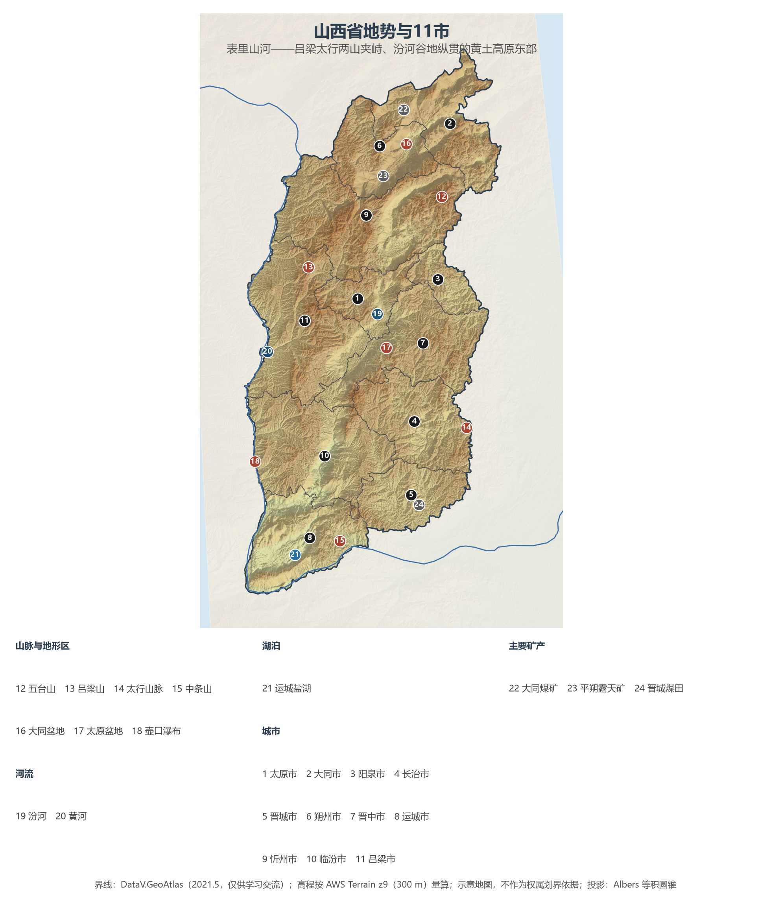
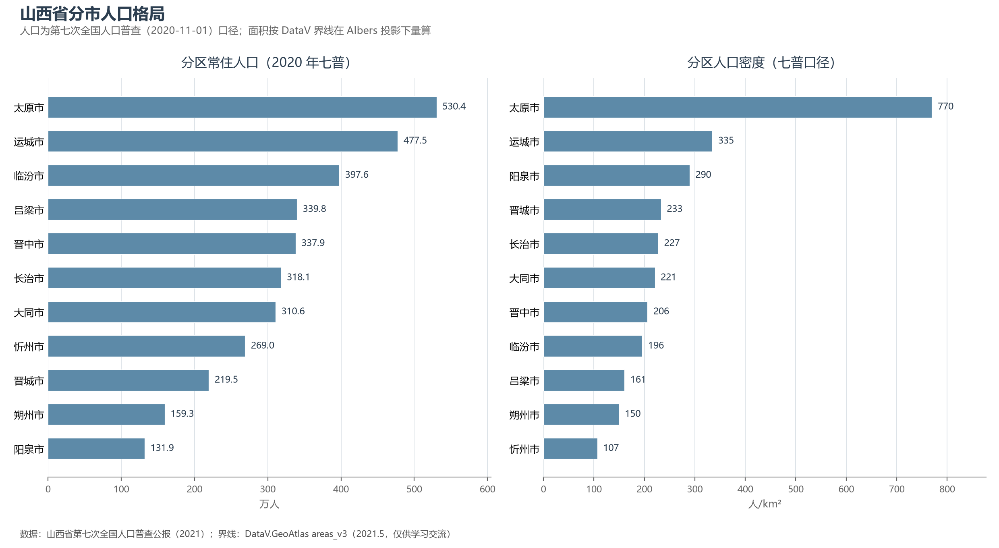

# 13.5.4 山西省

山西的地形是一副天然的"城防图"：东太行、西吕梁两列大山南北纵贯，中间夹着一串珍珠般的断陷盆地，黄河在晋陕峡谷中沿西界奔流南下——古人谓之"表里山河"。这个买卖从未亏过的险固之地，正是华夏文明早期的舞台：尧都平阳、舜都蒲坂、禹都安邑，皆在今日晋南。而今天的山西更有一重世界级身份——全国第一产煤大省，一年 12.7 亿吨的原煤产量，比除中国外的世界第二大产煤国印度的全国产量还多出两成。

## 一、省情速览

| 指标 | 数值 |
|------|------|
| 面积 | 156 700 km² |
| 常住人口 | 3 491.6 万（2020 年七普）；3 466 万（2023 年末）；3 446 万（2024 年末） |
| 常住人口城镇化率 | 约 65%（2023 年末） |
| 地区生产总值 | 25 666.2 亿元（2023）；25 494.7 亿元（2024，实际增长 2.3%） |
| 人均地区生产总值 | 约 7.4 万元（2024） |
| 行政区划 | 11 个地级市 |
| 简称 | 晋 |

放在全国坐标里：山西 GDP 总量居全国中游，2024 年名义值因煤价下行微降，但人均 7.4 万元仍高于河南、河北等平原人口大省；人口比六普十年间减少 2.2%，是资源型省份人口外流的典型样本。它真正的分量在能源账本上：原煤产量约占全国四分之一，大秦铁路一年运出 4 亿吨级煤炭供应环渤海电厂群——中国东部每一盏灯的背后，都有几克晋煤在燃烧。

**图 13-13 山西省地势与 11 市**：z9 级 DEM 晕渲（300 m 分辨率），编号说明见图下。

## 二、自然地理

山西是黄土高原的东部隆起，全省海拔多在 1 000—2 000 m，山地丘陵占八成，是名副其实的"山地省份"。地质上，这是一块被断裂围限的隆起地块：东侧**太行山脉**以近千米的陡崖俯瞰华北平原，西侧**吕梁山**与黄河晋陕峡谷平行南行，南部**中条山**横亘于运城盆地与黄河之间，北端**五台山**的五座台顶托出华北最高峰——北台叶斗峰 3 061 m，"华北屋脊"由此得名。两山之间，桑干河、滹沱河、汾河、涑水河沿断陷带依次排开**大同、忻定、太原（晋中）、临汾、运城**诸盆地，串成一条纵贯南北的"走廊"，山西的城市与耕地几乎全部排布在这条走廊里。

**气候**属温带大陆性季风气候，晴日多、日照足，年降水量 400—650 mm 且集中于七、八月，春季少雨多风。黄土广布、坡陡雨急，使山西长期处于水土流失的前沿——三川河、昕水河等入黄支流的泥沙治理是全国样板；汾河则经 20 年治理重现清流，2020 年以来干流全线达到Ⅳ类水质以上。

**水与煤**构成山西的地下两种底色。汾河干流 713 km，是黄河第二大支流与山西的母亲河，但全省人均水资源量不足全国平均的六分之一，2002 年万家寨**引黄入晋**工程通水后，太原等中心城市才多了黄河水这道保险。地下则是全国最富的煤仓：沁水、大同、宁武、西山、霍西、河东六大煤田几乎覆盖全省，保有储量逾两千亿吨，煤层气（瓦斯）储量与产量均居全国首位；晋东南的无烟煤是全球稀缺的高品质煤种。黄河壶口瀑布——世界上最大的黄色瀑布——恰在晋陕界河上，是这块黄土地最响亮的注脚。

## 三、建置沿革与人文

西周初年周成王"桐叶封弟"，唐叔虞建国于晋水之阳，晋国由此发端；春秋时晋文公称霸中原，战国初"三家分晋"（韩、赵、魏）直接开启战国时代——"三晋"由此成为山西的雅号。北魏曾建都平城（大同）近百年，云冈石窟即皇家工程；明清五百年，晋商执全国商界牛耳，1823 年平遥西大街的**日升昌**票号开中国金融汇兑业之先河，"汇通天下"的票号网络北至恰克图、南抵广州，平遥古城与祁县、太谷的晋商大院是这段商业文明的空间遗存。

山西的文物密度在全国首屈一指：**世界遗产 4 处**（平遥古城、云冈石窟、五台山、长城雁门关段），全国重点文保单位 531 处居各省之首；元代以前木构建筑占全国八成以上——1056 年建成的应县木塔是世界现存最高的古代木塔，"地下文物看陕西，地上文物看山西"所言非虚。抗战时期，这里是晋察冀、晋绥、晋冀鲁豫三大根据地的腹地，平型关大捷、百团大战皆发生于此；洪洞大槐树则是明初十八次大移民的出发地，"问我祖先在何处"的民谣传遍华北。

## 四、经济与区域战略

山西的经济结构用两个字概括：**能源**。煤炭之外，焦化、电力（晋电外送）、铝土（储量全国第一）与太钢不锈钢（"手撕钢"等高端产品）构成产业主干；2010 年起国家在山西设立全省域的资源型经济转型综合配套改革试验区，2019 年又将其列为全国首个能源革命综合改革试点——从"挖煤"到"输电、输气、输氢"与装备制造、文旅康养转型，是山西近十五年的主叙事。

交通格局与煤共生长：同蒲铁路纵贯南北百年，大秦、朔黄、瓦日三条重载煤运专线东出渤海；2020 年底的郑太高铁补上晋东南一翼，2021 年 6 月吕梁开行动车组后全省实现"市市通动车"，2024 年底集大原高铁通车，朔州接入高铁网，晋蒙之间首次有了直通高铁。大同—西安、太原—北京的一小时至三小时圈重塑了盆地走廊的时空。文化上，"地上文物看山西"正转化为旅游资产：大同古城、平遥国际摄影展、五台山朝圣与沿黄一号旅游公路，让"古建第一省"出圈为全国文旅热点。

**图 13-14 山西省分市人口格局**：左为分市常住人口（七普），右为分市人口密度——太原 770 人/km² 一枝独秀，忻州仅 107 人/km²。

## 五、分区地理：11 市

**省会与晋北**——太原市（省会，530.4 万人，全省人口第一市）：汾河谷地北端的 2 500 年古城晋阳所在，晋祠、太钢与山西转型综改示范区同处一城。大同市（310.6 万人）：北魏都城与"煤都"，云冈石窟、悬空寺、应县木塔构成晋北文旅金三角，大秦铁路自此处东出。朔州市（159.3 万人）：平朔安太堡露天矿是中国最早的现代化露天煤矿，右玉县七十年种树治沙的精神从这里闻名全国。忻州市（269.0 万人，全省面积最大市）：五台山、雁门关所在，"晋北锁钥"。

**晋中与晋东**——阳泉市（131.9 万人，全省人口最少市）：1947 年建市的"中共第一城"，无烟煤基地，科幻作家刘慈欣在娘子关电厂写出了《三体》。吕梁市（339.8 万人）：吕梁山核心区，红枣之乡与杏花村汾酒故里。晋中市（337.9 万人）：晋商故里，平遥古城与乔家、王家诸大院云集。长治市（318.1 万人）：上党古郡，太行山大峡谷所在。晋城市（219.5 万人）：全国最大无烟煤基地，皇城相府与太行山水并存。

**晋南两盆**——临汾市（397.6 万人）：尧都平阳所在，壶口瀑布与洪洞大槐树皆在其域，陶寺遗址被认为与最早的"中国"有关。运城市（477.5 万人，全省人口第二市）：河东盐池有 4 600 余年开发史，解州关帝庙是全国最大关帝庙，盆地粮棉丰饶，素称"山西粮仓"。

## 六、省内之最

| 项 | 值 |
|----|----|
| 最高点 | 五台山北台叶斗峰（忻州市），3 061 m，华北最高峰 |
| 最低点 | 运城市垣曲县黄河谷地，约 180 m |
| 面积最大 / 最小的市 | 忻州市 25 150 km² / 阳泉市 4 554 km² |
| 人口最多 / 最少的市（七普） | 太原市 530.4 万 / 阳泉市 131.9 万 |
| 人口密度最高 / 最低（七普） | 太原市 770 人/km² / 忻州市 107 人/km² |
| GDP 首位市 | 太原市（占全省约 1/5） |
| 能源 | 原煤产量 12.7 亿吨（2024），连续多年居全国第一 |
| 世界遗产 | 4 处（平遥古城、云冈石窟、五台山、长城） |

## 参考与数据来源

1. 面积、人口、GDP 总量：附录 A 口径（《中国统计年鉴 2024》）；2024 年 GDP 及人均为山西省统计局 2025 年 1 月发布口径（实际增速 2.3%）。
2. 分市人口：山西省第七次全国人口普查公报·第二号（2021）；分市面积按 DataV 界线在 Albers 投影下量算，与官方公布值差多在 2% 以内。
3. 原煤产量（2024 年 12.7 亿吨）：山西省统计局；大秦铁路运量：中国铁路太原局集团历年公报；煤层气：山西省自然资源厅口径。
4. 世界遗产与全国重点文保单位数量：国家文物局（2024）；日升昌票号（1823）、应县木塔（1056）：文物部门考订口径。
5. 地势图 DEM：AWS Terrain Tiles z9（300 m 分辨率量算）；界线：DataV.GeoAtlas areas_v3（2021.5，仅供学习交流）。
