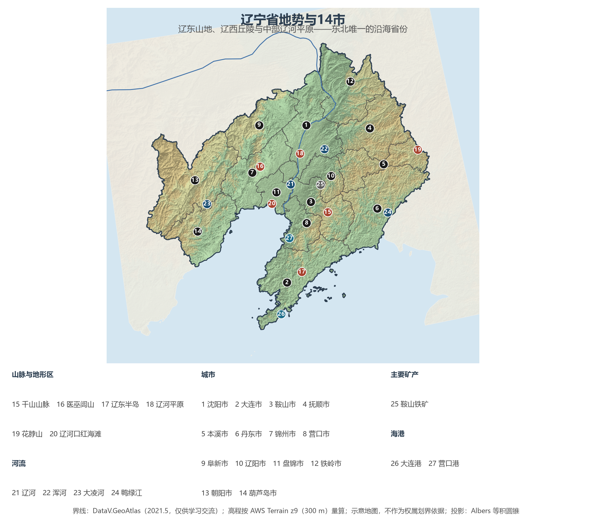
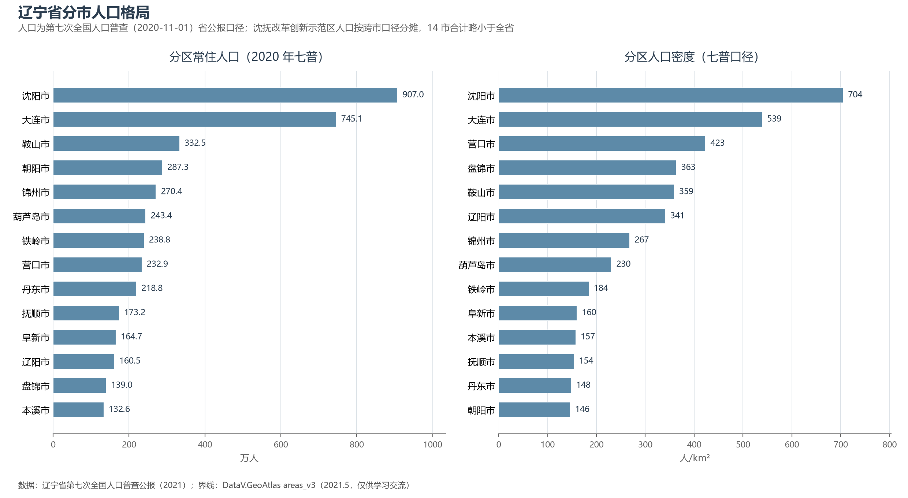

# 13.5.5 辽宁省

辽宁是东北的"门户省"：东连长白余脉千山，西倚辽西丘陵，辽河携浑河、太子河在中部冲出沃野千里的辽河平原，最终以辽东湾为出口汇入渤海——山海关外，这片土地是东北面向海洋的唯一前厅。它有"共和国长子"的产业史：新中国第一炉钢水、第一架喷气式歼击机、第一艘万吨巨轮都从这里诞生；也有东北最完整的海陆格局——沈阳与大连"双核"分执腹地与港口，沈大经济走廊串起辽中南城市群。

## 一、省情速览

| 指标 | 数值 |
|------|------|
| 面积 | 148 700 km² |
| 常住人口 | 4 259.1 万（2020 年七普）；4 182 万（2023 年末） |
| 常住人口城镇化率 | 约 73.5%（2023 年末，居东北三省之首） |
| 地区生产总值 | 30 209.4 亿元（2023）；32 612.7 亿元（2024，增长 5.1%） |
| 人均地区生产总值 | 约 7.8 万元（2024） |
| 行政区划 | 14 个地级市 |
| 简称 | 辽 |

放在全国坐标里：辽宁 GDP 折算约 4 580 亿美元，与越南全国大体相当；城镇化率 73.5% 显著高于全国平均（67.9%），是中国城市化最深的老工业省份。2024 年增速 5.1% 领跑东北三省，沈阳（9 027.1 亿元）与大连（9 516.9 亿元）双核合计占全省近六成——"一个省、两座万亿前夜之城"是它当下的基本盘。人口的另一面则更加冷峻：十年间全省常住人口减少约 115 万，仅沈阳、大连两市保持净流入。

**图 13-15 辽宁省地势与 14 市**：z9 级 DEM 晕渲（300 m 分辨率），编号说明见图下。

## 二、自然地理

辽宁的地形骨架是"**六山一水三分田**"的变体：东部是千山山脉纵贯的**辽东山地丘陵**，森林覆盖率高、降水丰沛，最高点花脖山（1 336 m）藏在本溪桓仁的群峰之间；西部是努鲁儿虎山与松岭构成的**辽西山地丘陵**，医巫闾山孤峰临平原，朝阳一带干旱少雨、水土流失敏感；两山之间，辽河及其支流浑河、太子河冲积出**辽河平原**——东北平原的南端，也是全省城市与铁路最密集的走廊；再往南，辽东半岛以约 300 km 的长度楔入黄渤海之间，老铁山角是渤海与黄海的天然分界。

**气候**属温带季风气候，但因海陆与地形分异明显：辽东半岛沿岸温和湿润，年降水 600—1 100 mm；辽河平原 500—700 mm；辽西北不足 500 mm 且春旱频发。全省 1 月均温 −4 ℃ 至 −14 ℃ 由南向北递减，是东北三省中最"暖"的一个——大连港终年不冻，这正是它在近代成为东北大门的地理理由。

**水系**以辽河为干（干流 1 345 km，与浑河、太子河同注辽东湾），辽西有大凌河、小凌河，东部鸭绿江沿中朝边界入黄海。沿海湿地是辽宁的生态王牌：辽河口湿地分布着全球面积最大的滨海芦苇沼泽与"红海滩"碱蓬草景观，是黑嘴鸥的主要繁殖地；渤海辽东湾还是斑海豹在中国唯一的繁殖区。辽河油田（全国重要油气区之一）与红沿河核电站——东北第一座核电站——共同构成全省能源版图。

## 三、建置沿革与人文

辽宁的文明史比中原传说更早一页实物证据：朝阳凌源的**牛河梁遗址**把红山文化推到 5 500 年前，坛、庙、冢的组合被称为"中华文明的曙光"。战国燕设辽东郡，此后两千年这里始终是中原王朝经略东北的桥头堡与民族融合的前线：高句丽在桓仁五女山上筑起第一座都城（世界遗产高句丽王城遗存），辽金以辽阳为东京，明代辽东镇长城东端起于丹东虎山。1616 年努尔哈赤在新宾赫图阿拉建后金，1625 年迁都沈阳，皇太极改国号为清——沈阳故宫、福陵、昭陵与抚顺清永陵共同构成世界遗产"明清皇宫""明清皇家陵寝"的关外篇章。

近代的辽宁是东北亚矛盾的焦点：1894 年甲午战争战火烧至旅顺，1904 年日俄两国在中国土地上开战，1931 年九一八事变自沈阳北大营起，东北十四年沦陷由此开始。1948 年辽沈战役后东北全境解放，"一五"时期全国 156 项重点工程近六分之一布局辽宁，鞍钢、沈飞、大连造船、沈阳机床在这一时期点亮"共和国长子"的名号。民俗文化同样厚重：全省满族人口约占全国一半，锡伯族家庙在沈阳，二人转、评书与大连的足球城文化交织成辽海风物。

## 四、经济与区域战略

辽宁经济的骨架是**装备制造 + 石化 + 钢铁**：沈阳的机床、机器人（新松）与航空发动机，大连的造船、机车与石化（长兴岛恒力 2 000 万吨炼化一体化），鞍山—本溪的钢铁（鞍本重组后鞍钢集团粗钢产量居世界第三），构成三条全国级产业链。软件与集成电路装备（沈阳 IC 装备、大连软件外包）是新增长极；粮食上，铁岭、阜新一带的玉米带使辽宁稳居全国产粮大省，盘锦大米、东港草莓、大连苹果则是特色农业名片。

空间战略自 2003 年东北振兴起层层加码：**辽宁沿海经济带**（大连—营口—盘锦—锦州—葫芦岛五港联动，大连东北亚国际航运中心）、**沈阳经济区**与 2022 年获批的**沈阳都市圈**、辽西北转型攻坚（阜新、朝阳）。交通上，哈大高铁纵贯、沈白高铁在建，大连港与营口港整合为辽港集团，货物吞吐量稳居北方港口前列；丹东则是东北东部铁路与中朝贸易的门户。改革的深水区同样在辽宁：国企改革、人口回流与营商环境的重塑，决定着"长子"能否真正归来。

**图 13-16 辽宁省分市人口格局**：左为分市常住人口（七普），右为分市人口密度——沈阳 704 人/km² 居首，辽西北的朝阳市仅 146 人/km²。

## 五、分区地理：14 市

**沈大双核**——沈阳市（省会，907.0 万人，全省唯一超 900 万市）：东北中心城市之一，故宫与中街的一环是清文化发轫地，铁西区的机床厂、鼓风机厂记录着共和国工业的童年，浑南的软件园与宝马工厂则是它的现在。大连市（745.1 万人，计划单列市）：东北第一大港与金融中心，星海广场、日俄时期建筑群与足球城文化并存，造船、石化、软件构成支柱。

**辽中南工业走廊**——鞍山市（332.5 万人）："钢都"，鞍钢所在，千山风景区在其东南。辽阳市（160.5 万人）：辽阳石化与古城襄平。抚顺市（173.2 万人）：从"煤都"转型为石化基地，雷锋精神从这里走向全国。本溪市（132.6 万人）：钢铁与枫叶之城，本溪水洞为世界最长可乘船游览的地下暗河之一。营口市（232.9 万人）：百年商埠与辽河老街，鲅鱼圈港区是东北最近的出海口之一。盘锦市（139.0 万人）：辽河油田总部，红海滩与盘锦大米让它成为"湿地工业城"的独特样本。

**辽西四市**——锦州市（270.4 万人）：辽西走廊咽喉，辽沈战役的主战场，笔架山"天桥"奇观。葫芦岛市（243.4 万人）：兴城古城（明代保存最完整的四座古城之一）与造船基地。朝阳市（287.3 万人）：牛河梁红山文化与鸟化石群所在地，"世界上第一只鸟飞起的地方"。阜新市（164.7 万人）：煤电枯竭型城市转型的国家试点，海州露天矿已变身矿山公园。

**辽东北门户**——丹东市（218.8 万人）：全国最大边境城市，与朝鲜新义州隔鸭绿江相望，断桥、虎山长城（明长城东端起点）与东港草莓闻名。铁岭市（238.8 万人）：辽北粮仓与"大城市"的幽默叙事并存。

## 六、省内之最

| 项 | 值 |
|----|----|
| 最高点 | 花脖山（本溪市桓仁县），1 336 m |
| 最低点 | 渤海海平面（辽东湾沿海近 0 m） |
| 面积最大 / 最小的市 | 朝阳市 19 699 km² / 盘锦市 4 071 km² |
| 人口最多 / 最少的市（七普） | 沈阳市 907.0 万 / 本溪市 132.6 万 |
| 人口密度最高 / 最低（七普） | 沈阳市 704 人/km² / 朝阳市 146 人/km² |
| GDP 首位市 | 大连市 9 516.9 亿元（2024） |
| 核电 | 红沿河核电站：东北第一座核电站（2013 年商运） |
| 世界遗产 | 4 项（长城、明清皇宫·沈阳故宫、明清皇家陵寝·清永陵福陵昭陵、高句丽王城·五女山城） |

## 参考与数据来源

1. 面积、人口、GDP 总量：附录 A 口径（《中国统计年鉴 2024》）；2024 年 GDP 及增速为辽宁省地区生产总值统一核算结果（辽宁省统计局，2025 年 1 月）；沈阳、大连 GDP 为两市 2024 年统计公报。
2. 分市人口：辽宁省第七次全国人口普查公报·第二号（2021）；沈抚改革创新示范区人口按跨市口径分摊，14 市合计略小于全省；分市面积按 DataV 界线在 Albers 投影下量算，与官方公布值差多在 2% 以内。
3. 海岸线与港口：交通运输部港口统计口径；红沿河核电站：中国广核集团；鞍钢集团产量：世界钢铁协会（2024）。
4. 世界遗产：联合国教科文组织名录（长城、明清皇宫、明清皇家陵寝、高句丽王城王陵及贵族墓葬）；牛河梁遗址：国家文物局"考古中国"口径。
5. 地势图 DEM：AWS Terrain Tiles z9（300 m 分辨率量算）；界线：DataV.GeoAtlas areas_v3（2021.5，仅供学习交流）。
