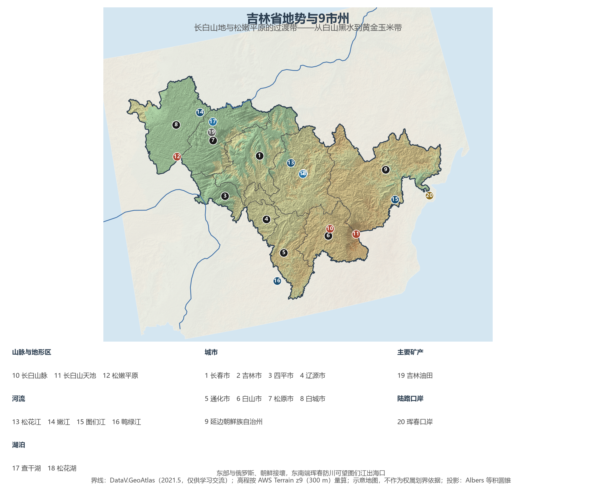
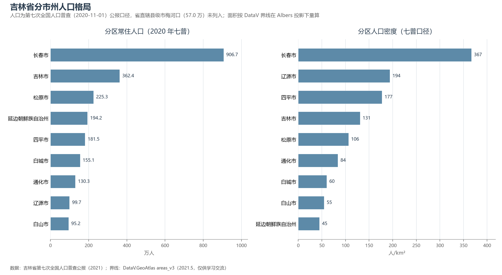

# 13.5.6 吉林省

吉林的版图像一片斜放的枫叶：东南是长白山撑起的莽莽林海，西北是松嫩平原与科尔沁草原交界的无垠玉米带，松花江自天池奔流而下，串起全省近八成的人口与城市。它是新中国汽车、电影、化工与光学四项"第一"的诞生地——第一辆解放牌卡车、第一座电影制片厂、第一批化肥与染料、第一台红宝石激光器都出自这里。今天，这片黑土地仍是全国最重要的商品粮基地之一，而"长白山"三个字，则是它面向世界的自然名片。

## 一、省情速览

| 指标 | 数值 |
|------|------|
| 面积 | 187 400 km² |
| 常住人口 | 2 407.3 万（2020 年七普）；2 339 万（2023 年末） |
| 常住人口城镇化率 | 约 65%（2023 年末） |
| 地区生产总值 | 13 531.2 亿元（2023）；14 361.2 亿元（2024，增长 4.3%） |
| 人均地区生产总值 | 约 6.2 万元（2024） |
| 行政区划 | 8 个地级市 + 1 个自治州（延边朝鲜族自治州），另有省直辖县级市梅河口 |
| 简称 | 吉 |

放在全国坐标里：吉林 GDP 折算约 2 000 亿美元，与匈牙利等欧洲中等经济体同一量级；粮食年产量超 830 亿斤（约 4 150 万吨），稳居全国前五，而单产常年位居粮食主产省前列——横贯中西部的松辽"黄金玉米带"一省的玉米产量，即超过法国、德国等任何欧洲国家的全国产量。人口是它最深的痛点：六普到七普十年间减少 339 万（−12.3%），降幅居全国之首，全省人口向长春一市集中。

**图 13-17 吉林省地势与 9 市州**：z9 级 DEM 晕渲（300 m 分辨率），编号说明见图下。

## 二、自然地理

吉林的地势自东南向西北如阶梯般三级下降：第一级是**长白山脉**——火山喷发堆出的巨型盾状山地，主峰白头山的天池湖面海拔 2 189 m、最深处 373 m，是中国最深的湖泊，也是松花江、图们江、鸭绿江"三江之源"；中国境内的最高峰白云峰海拔 2 691 m。从山脚到山顶，红松阔叶林、云冷杉林、岳桦林与高山苔原依次排开，是东北亚最完整的山地垂直带谱。第二级是低山丘陵与**松辽平原**过渡带，波状起伏的黑土台地上铺着中国最肥沃的耕地。第三级是西北部**松嫩平原**与草原湿地——查干湖、向海、莫莫格等湿地是丹顶鹤、白鹤迁徙线上的关键驿站。

**气候**属温带季风气候向寒温带过渡的类型：冬季漫长严寒，1 月均温 −11 ℃ 至 −18 ℃，长白山天池气象站曾录得 −44 ℃ 的极端低温；年降水自东南 1 000 mm 以上骤降至西北 400 mm 以下——同省之内，"林海雪原"与"瀚海风沙"仅隔三百公里。严寒塑造了两个奇观：松花江畔的吉林雾凇（与桂林山水、云南石林、长江三峡并称中国四大自然奇观），以及黑土地上冬季厚达半米的季节性冻土。

**黑土与黑金**是吉林的两种地下财富。世界三大黑土带之一的东北黑土区在吉林中部延伸成"黄金玉米带"，梨树县的保护性耕作"梨树模式"已上升为国家黑土地保护的技术标准；地下石油则集中于松原一带的吉林油田。长白山优质的天然矿泉水与全国六成产量的人参，让"长白山"成为品质农业的地理标志。

## 三、建置沿革与人文

先秦肃慎人已在长白山下列土而居；汉代夫余、唐代渤海国（上都敦化）先后兴盛；金代"直抵黄龙府"的黄龙府即今农安，是宋辽金对峙的前线。清代以长白山为"龙兴之地"封禁两百年，柳条边墙横贯省界——直到 1860 年开禁后"闯关东"移民潮涌入，吉林的农耕格局才真正奠定。1907 年清设吉林行省；1931 年九一八后，长春被伪满洲国定为"新京"；1954 年省会由吉林市迁往长春。

新中国的工业化在吉林留下了四座里程碑：1953 年奠基的**中国第一汽车集团**（1956 年驶出第一辆解放牌卡车，红旗轿车至今是国事用车的代名词）；**长影**——新中国电影的摇篮；**吉化**——染料、化肥、电石"三大化"撑起新中国化学工业的起步；**中科院长春光机所**——1961 年研制出中国第一台红宝石激光器。今天，中车长客的车间里驶出的高铁动车组奔行于全国大半高铁网，长光卫星的"吉林一号"百星星座在轨组网，让老工业基地长出了商业航天的新枝。朝鲜族聚居的延边带来双语双文化的社会图景，农乐舞与辣白菜是延吉街头的日常。

## 四、经济与区域战略

吉林经济的三个支点是**汽车、农业与化工**。汽车：一汽集团年销量超 300 万辆，一汽-大众等合资体系占长春工业的半壁江山，新能源转型（红旗新能源、奥迪新能源基地）正在推进；农业：肉牛、玉米、人参、矿泉水构成"秸秆变肉"与特产经济；化工与新材料：吉化转型升级、吉林化纤的碳纤维（全国最大原丝基地之一）代表传统产业的新方向。冰雪经济是近年最大变量——北大湖、松花湖滑雪场与"冰雪丝路"让冬季旅游人次连创新高。

空间战略的主轴是"一主六双"：以长春为中心的长春现代化都市圈（含公主岭、梅河口两翼），西部"陆上风光三峡"（白城—松原的国家级风电光伏基地），东部沿边开放（珲春海洋经济示范区借港出海，俄罗斯扎鲁比诺港合作已通航）。交通上，京哈高铁纵贯，长白山高铁直通景区，长春龙嘉机场是全国少有的"空铁联运"枢纽。

**图 13-18 吉林省分市州人口格局**：左为分市州常住人口（七普），右为分市州人口密度——长春 367 人/km² 一城独大，延边州仅 45 人/km²。

## 五、分区地理：9 市州

**省会与中部走廊**——长春市（省会，906.7 万人，占全省 38%）：汽车城、电影城、科教文化城与"森林城"，2020 年扩容划入公主岭市后面积超 2.4 万 km²。吉林市（362.4 万人，全国唯一省市同名城市）：松花江畔的化工重镇与雾凇之都，松花湖、北大湖滑雪场集聚冰雪经济。四平市（181.5 万人）：东北粮仓腹地与"四战四平"英雄城，梨树黑土地保护模式发源地。辽源市（99.7 万人，全省人口最少市）：煤城转型样板，东北袜业园年产袜子数十亿双。

**东部山区**——通化市（130.3 万人）：长白山药材集散地与"医药城"，山葡萄酒名闻遐迩。白山市（95.2 万人）：长白山西坡门户，矿泉水与林下经济。延边朝鲜族自治州（194.2 万人）：全国唯一的朝鲜族自治州，州府延吉以双语市井与网红美食出圈，珲春防川"一眼望三国"是中国最独特的边境景观之一。

**西部草原**——松原市（225.3 万人）：吉林油田所在，查干湖冬捕的"祭湖醒网"延续了千年渔猎文明。白城市（155.1 万人）：瀚海变"风光海"的国家新能源基地，向海湿地丹顶鹤之乡。

## 六、省内之最

| 项 | 值 |
|----|----|
| 最高点 | 长白山白云峰（延边州），2 691 m |
| 最低点 | 图们江出海口附近（珲春防川），约 5 m |
| 面积最大 / 最小的市州 | 延边州 43 309 km² / 辽源市 5 140 km² |
| 人口最多 / 最少的市州（七普） | 长春市 906.7 万 / 白山市 95.2 万 |
| 人口密度最高 / 最低（七普） | 长春市 367 人/km² / 延边州 45 人/km² |
| GDP 首位市 | 长春市 7 632.2 亿元（2024，约占全省一半） |
| 湖泊 | 长白山天池：最深处 373 m，中国最深的湖泊 |
| 王牌 | 粮食超 830 亿斤居全国第 5；人参产量约占全国六成 |

## 参考与数据来源

1. 面积、人口、GDP 总量：附录 A 口径（《中国统计年鉴 2024》）；2024 年 GDP 为吉林省 2024 年国民经济和社会发展统计公报（初步核算）；长春 GDP 为长春市 2024 年统计公报。
2. 分市州人口：吉林省第七次全国人口普查公报·第二号（2021，梅河口市 57.0 万单列未计入 9 市州）；分市州面积按 DataV 界线在 Albers 投影下量算，与官方公布值差多在 2% 以内。
3. 粮食产量与单产：吉林省农业农村厅口径（2023—2024）；梨树模式：农业农村部黑土地保护技术规范；人参产量占比：吉林省特产部门历年口径。
4. 一汽（1953）、长影、吉化、长春光机所（1961 激光器）、中车长客、"吉林一号"星座：企业与院所公开史料。
5. 地势图 DEM：AWS Terrain Tiles z9（300 m 分辨率量算）；界线：DataV.GeoAtlas areas_v3（2021.5，仅供学习交流）。
