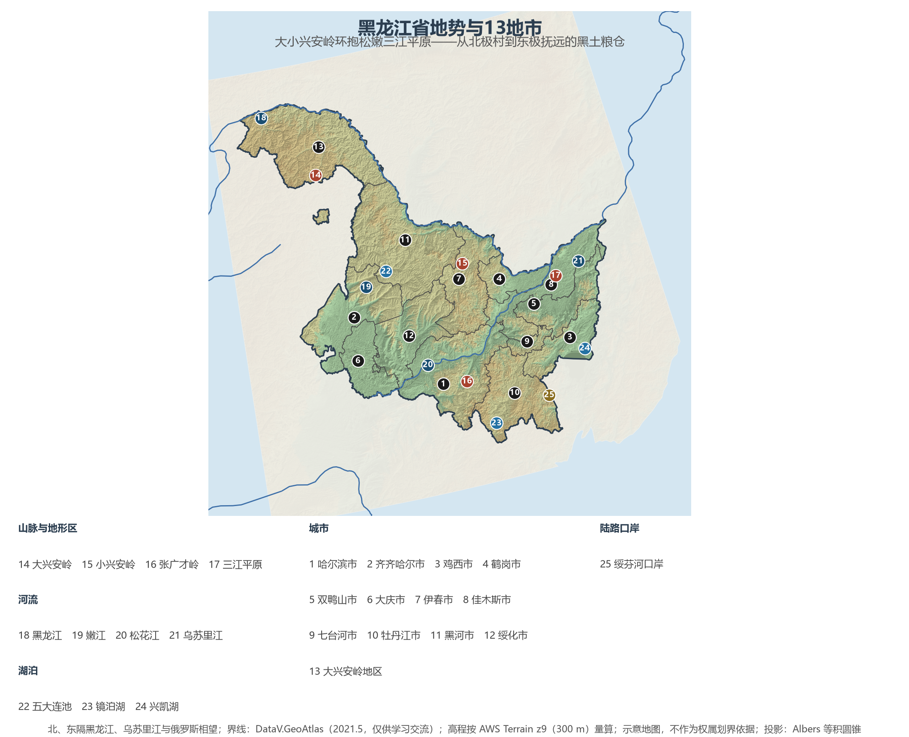
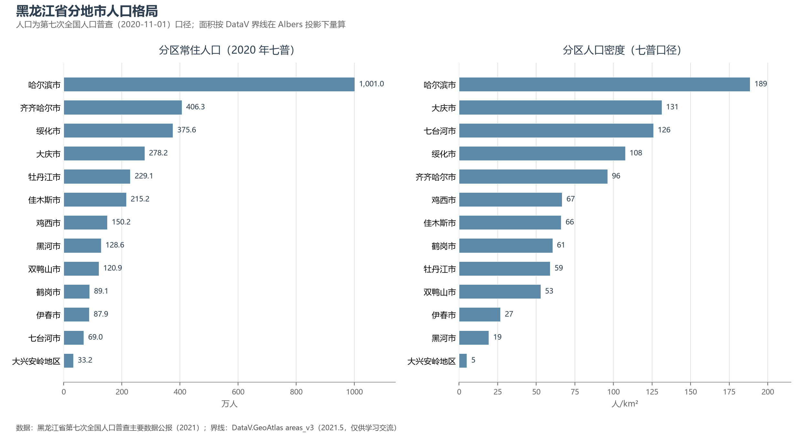

# 13.5.7 黑龙江省

黑龙江是中国位置最北、纬度最高的省份，也是形态最"天然"的一个——北与东以黑龙江、乌苏里江两条界河与俄罗斯相望，西偎大兴安岭，中嵌小兴安岭，张广才岭与完达山环抱出松嫩、三江两大平原。47.3 万 km² 的土地比整个日本还要大。这里有中国最冷的村庄（漠河北极村，极端最低气温 −52.3 ℃）与最早的日出（抚远"东极"），也有全国最丰饶的黑土地——2024 年粮食产量首次突破 1 600 亿斤，连续 14 年居全国第一，一省之粮超过法国全国的产量。

## 一、省情速览

| 指标 | 数值 |
|------|------|
| 面积 | 473 000 km²（全国第 6，比日本全国还大） |
| 常住人口 | 3 185.0 万（2020 年七普）；3 029 万（2024 年末） |
| 常住人口城镇化率 | 约 66%（2024 年末） |
| 地区生产总值 | 15 883.9 亿元（2023）；16 476.9 亿元（2024，增长 3.2%） |
| 人均地区生产总值 | 54 394 元（2024） |
| 行政区划 | 12 个地级市 + 1 个地区（大兴安岭地区，行政公署驻加格达奇） |
| 简称 | 黑 |

放在全国坐标里：黑龙江人均 GDP 5.44 万元，处在全国省级行政区的后列；六普到七普十年人口减少 646 万（−16.9%），降幅为全国之最——"人口外流"是它绕不开的叙事。但账本还有另一面：这里是全国最大的商品粮基地与最重要的能源、林业存量省，大庆油田累计生产原油超 25 亿吨，北大荒集团经营着全国最大的农垦耕地群；哈尔滨冰雪旅游在 2023—2025 年间的"出圈"，则让世界重新看见这座"东方莫斯科"。

**图 13-19 黑龙江省地势与 13 地市**：z9 级 DEM 晕渲（300 m 分辨率），编号说明见图下。

## 二、自然地理

黑龙江的地形像一只"摊开的手掌"：小兴安岭、张广才岭、完达山自西北向东南依次排布如指，指间捧出**松嫩平原**与**三江平原**两片黑土沃野；西北角是大兴安岭的莽莽林海，东北角则被黑龙江、松花江、乌苏里江冲积成"三江低地"。全省最高点是张广才岭主峰**大秃顶子山**（1 690 m，哈尔滨五常市境内），最低处是抚远的沿江低地——高差不足 1 700 m 的省域，却容纳了从寒温带针叶林到温带草原的完整景观序列。

**气候**属寒温带与中温带大陆性季风气候：冬季漫长严寒，大部分地区 1 月均温低于 −18 ℃，漠河曾录得 −52.3 ℃ 的中国极端最低气温；年降水 400—700 mm 集中于夏季，雨热同期正是黑土地的"天赋"。冰雪是气候的馈赠：亚布力滑雪场、雪乡、松花江冰上活动与"冰雪大世界"，把严寒变成全球级的旅游资产。

**水与湿地**是另一重底色。黑龙江干流自洛古河村入境，沿北界东流 3 000 余公里至抚远与乌苏里江汇合；松花江横贯腹地，嫩江、牡丹江皆为支流。湖泊各有传奇：镜泊湖是中国最大的堰塞湖，吊水楼瀑布冬季冰帘与夏季飞瀑同框；五大连池是火山熔岩堰塞成的湖群，保存着世界最典型的休眠火山地貌（世界地质公园）；中俄界湖兴凯湖烟波浩渺，大湖面积 4 000 余 km²。扎龙湿地是全球最大的丹顶鹤繁殖地——"鹤城"齐齐哈尔因它得名。

## 三、建置沿革与人文

先秦肃慎、汉魏挹娄、唐渤海国、宋金女真一脉相承——金朝第一座都城上京会宁府就在哈尔滨阿城区（1115—1153 年），"白山黑水"是这片土地最古老的称谓。清代这里是龙兴封禁之地，也是国运的伤疤：1858 年《瑷珲条约》与 1860 年《北京条约》割走了黑龙江以北、乌苏里江以东 100 余万平方公里。20 世纪的黑龙江三次改写国家史：1903 年中东铁路通车，哈尔滨崛起为远东国际都会，二十余国侨民聚居，留下中央大街与索菲亚教堂；1931 年后沦为伪满腹地；1950 年代，十万转业官兵开进北大荒，"棒打狍子瓢舀鱼"的亘古荒原变成 4 000 多万亩国营农场，1960 年大庆石油会战又摘掉了"中国贫油"的帽子——铁人王进喜的名言至今刻在大庆的城市基因里。

民族文化同样独具：赫哲族沿乌苏里江渔猎为生，一曲《乌苏里船歌》唱遍全国；鄂伦春族、达斡尔族、蒙古族、朝鲜族与满族共同构成多民族家园。哈尔滨工业大学被誉为中国航天人才的摇篮，2025 年第九届亚洲冬季运动会在哈尔滨举办，是这座冰城百年冰雪传统的最新注脚。

## 四、经济与区域战略

黑龙江经济的支柱是"**粮、油、装、旅**"四字。粮食：松嫩、三江两大平原贡献全国约九分之一的粮食，绿色有机食品认证面积全国第一，"中华粮仓"名副其实。能源：大庆油田保持原油 3 000 万吨级稳产并向页岩油与新能源转型，哈电集团的发电设备装备了三峡等国内外大型电站。装备：中国一重（齐齐哈尔）的重型压力容器与轧钢设备是"国之重器"，哈飞、东安的直升机与航空发动机别具一格。旅游：冰雪经济一枝独秀，2024 年初哈尔滨旅游人次与收入创历史纪录，"尔滨"成为现象级文旅品牌。

空间战略沿"两个扇面"展开：向南融入东北振兴与京津冀协作（哈大齐工业走廊、哈长城市群），向北向西沿边开放——黑河公路大桥（2022 年通车）连通布拉戈维申斯克，绥芬河是中欧班列"东通道"的重要节点，抚远黑瞎子岛在 2008 年中俄东段划界后一半回归，"一岛两国"的格局独一无二。生态上，大小兴安岭重点国有林区全面停止商业性采伐，从"伐木者"转向"看树人"，是黑龙江最深刻的转型。

**图 13-20 黑龙江省分地市人口格局**：左为分地市常住人口（七普），右为分地市人口密度——哈尔滨 189 人/km² 居首，大兴安岭地区仅 5 人/km²。

## 五、分区地理：13 地市

**省会与哈大齐走廊**——哈尔滨市（省会，1 001.0 万人，全省唯一千万级城市）：冰城、音乐之城与"东方莫斯科"，装备制造（哈电）、食品与文旅构成支柱，GDP 约占全省三分之一。齐齐哈尔市（406.3 万人）："鹤城"，扎龙湿地与中国一重所在地。大庆市（278.2 万人）：油都，油田累计产油超 25 亿吨，正建设页岩油新基地与"绿色油化之都"。绥化市（375.6 万人）：寒地黑土核心区，全国重要的玉米、奶牛基地。

**东部煤城与口岸**——鸡西市（150.2 万人）、双鸭山市（120.9 万人）、鹤岗市（89.1 万人）、七台河市（69.0 万人）四座煤城沿完达山一线排布，正经历煤电向新材料、石墨与农业服务的转型；牡丹江市（229.1 万人）：镜泊湖与雪乡所在地，绥芬河口岸是全省对俄陆路贸易的枢纽；佳木斯市（215.2 万人）：三江平原中心城市与农垦重镇，东极抚远在其域内。

**北部沿边林区**——黑河市（128.6 万人）：中俄双子城，公路大桥直通对岸。伊春市（87.9 万人）："林都"，红松之乡与森林康养转型的样本。大兴安岭地区（33.2 万人，全国人口最少的地级行政区之一）：漠河北极村是中国大陆最北的村庄，全域是生态功能区与森林防火重地。

## 六、省内之最

| 项 | 值 |
|----|----|
| 最高点 | 大秃顶子山（哈尔滨市五常市），1 690 m |
| 最低点 | 抚远市黑瞎子岛一带沿江低地，约 40 m |
| 面积最大 / 最小的地市 | 黑河市 66 803 km² / 七台河市 6 221 km² |
| 人口最多 / 最少的地市（七普） | 哈尔滨市 1 001.0 万 / 大兴安岭地区 33.2 万 |
| 人口密度最高 / 最低（七普） | 哈尔滨市 189 人/km² / 大兴安岭地区 5 人/km² |
| GDP 首位市 | 哈尔滨市（约占全省三分之一） |
| 粮食 | 2024 年产量首破 1 600 亿斤（约 8 000 万吨），连续 14 年全国第一 |
| 气候 | 漠河 −52.3 ℃，中国极端最低气温纪录（1969） |

## 参考与数据来源

1. 面积、人口、GDP 总量：附录 A 口径（《中国统计年鉴 2024》）；2024 年 GDP、人均与年末人口为黑龙江省 2024 年国民经济和社会发展统计公报。
2. 分地市人口：黑龙江省第七次全国人口普查主要数据公报（2021）；分地市面积按 DataV 界线在 Albers 投影下量算，与官方公布值差多在 2% 以内。
3. 粮食产量：国家统计局黑龙江调查总队（2024）；大庆油田累计产量：中国石油大庆油田公司（2022 年累计突破 25 亿吨）；黑河公路桥：中俄两国政府通报（2022 年通车）。
4. 瑷珲条约、中东铁路、北大荒开发、大庆会战：党史与地方志公开文献；亚冬会：哈尔滨亚冬会组委会（2025）。
5. 地势图 DEM：AWS Terrain Tiles z9（300 m 分辨率量算）；界线：DataV.GeoAtlas areas_v3（2021.5，仅供学习交流）。
