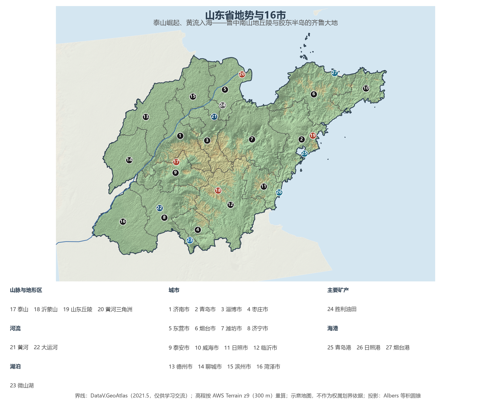
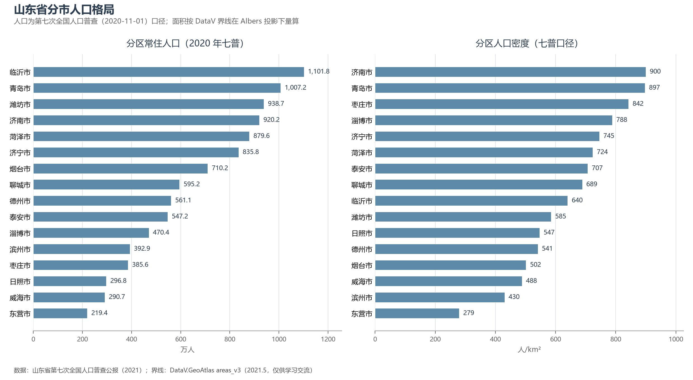

# 13.5.8 山东省

山东的地图像一枚探入黄海的"大拇指"：鲁中南山地以泰山为脊隆起，胶东半岛三面环海向东伸出，黄河在东营注入渤海，把最后一段泥沙堆成共和国最年轻的土地。这里有"一山一水一圣人"的千年家底——泰山、黄河与孔子构成了中华文明的精神原点；也有最硬核的当代实力：全国唯一的"全工业门类"省份，GDP 常年稳居全国第三，2025 年成为北方第一个突破十万亿元的经济大省。

## 一、省情速览

| 指标 | 数值 |
|------|------|
| 面积 | 157 900 km² |
| 常住人口 | 10 152.7 万（2020 年七普，全国第 2）；10 123 万（2023 年末） |
| 常住人口城镇化率 | 约 65.3%（2023 年末） |
| 地区生产总值 | 92 068.7 亿元（2023）；98 565.8 亿元（2024，增长 5.7%，全国第 3） |
| 人均地区生产总值 | 97 575 元（2024） |
| 行政区划 | 16 个地级市 |
| 简称 | 鲁 |

放在世界坐标里，山东是个"国家级"的存在：GDP 折算约 1.38 万亿美元，与印度尼西亚全国相当；人口约 1 亿，与越南不相上下。粮食产量 1 142 亿斤（2024，全国第 3）、农林牧渔总产值长期居全国首位；山东港口集团年货物吞吐量突破 20 亿吨、居全球港口集团之首；高铁运营里程 3 000 余公里、居全国第 1——农业、港口、制造、基建四张榜单上，山东都写着"第一梯队"。

**图 13-21 山东省地势与 16 市**：z9 级 DEM 晕渲（300 m 分辨率），编号说明见图下。

## 二、自然地理

山东的地形分三块：**鲁中南山地丘陵**是全省的脊梁——泰山主峰玉皇顶海拔 1 545 m，虽不算高，却因平地拔起、俯瞰齐鲁而封"五岳之首"；其东的沂蒙山群峰连绵，孟良崮战役就发生在其间。**山东半岛**（胶东丘陵）海拔多在 200—500 m，海岸线曲折绵长，大陆岸线 3 345 km 居全国前列，崂山、蓬莱阁点缀其间。**鲁西北平原**是华北平原的一部分，黄河自西南向东北斜贯 600 余公里，在东营造出年均数平方公里的新生湿地——黄河三角洲，全国最年轻的土地与最完整的暖温带湿地生态系统。

**气候**属暖温带季风气候，年降水 550—950 mm 自西北向东南递增；半岛沿岸受海洋调节，夏季凉爽、冬季少酷寒，是北方最宜居的滨海地带。春旱、夏涝与干热风是农业的三大天敌，而黄河下游"地上悬河"的防洪与生态补水，则关系着鲁西北的安澜。

**水与海**是山东的两大生命线。黄河之外，京杭大运河纵贯鲁西，济宁段"南旺分水枢纽"是古代水利工程的高峰；南四湖（微山湖等）是华北大型淡水湖群，也是南水北调东线的调蓄枢纽。海上，山东坐拥渤海与黄海之间的"黄金海域"——国家级海洋牧场示范区数量居全国首位，青岛港自动化码头曾九次刷新集装箱装卸效率世界纪录。

## 三、建置沿革与人文

山东是中华文明最重要的发源地之一：大汶口文化与龙山文化（章丘城子崖）把东方文明史推到 5 000 年前，蛋壳黑陶冠绝一时。西周分封，姜太公建齐于临淄、周公建鲁于曲阜——齐尚功利、鲁尊礼乐，两条文化基因并行三千年。春秋战国，临淄是天下第一大都会，稷下学宫开百家争鸣之先河；曲阜诞生的孔子，其学说塑造了此后两千年东亚的精神秩序，孟子、墨子、孙子、鲁班亦皆出于此。两汉魏晋，山东又是书圣王羲之、智圣诸葛亮、算圣刘洪的故乡——"一个临沂城，走出三位圣贤"。

自秦至清，山东始终是王朝的粮仓、海防与漕运重地。近代史则在此写下屈辱与抗争：1894 年甲午海战败于威海刘公岛，1897 年德国强租胶州湾，1919 年"山东问题"直接点燃五四运动；1938 年台儿庄大捷是抗战正面战场首次重大胜利，沂蒙山区则是抗战与解放战争的战略根据地。泰山（1987 年，世界首例文化与自然双遗产之一）、曲阜孔庙孔林孔府（1994）、齐长城（长城遗产点）与大运河山东段，构成 4 处世界遗产的厚重底色。

## 四、经济与区域战略

山东经济的关键词是"**全**"与"**重**"。全省拥有全部 41 个工业大类、207 个中类，是名副其实的"工业全家桶"：青岛的海尔、海信、青岛啤酒与中车四方（全国近半数高铁动车组出自其手），烟台的万华化学（MDI 产能全球第一）与张裕，潍坊的潍柴动力与歌尔股份，滨州的魏桥创业（世界最大铝企之一），共同织成世界级制造网络。农业更不必说：寿光一个县级市供应着全国冬季"菜篮子"的重要一环，烟台苹果、金乡大蒜、胶东海珍品皆是全国地标——"寿光模式"甚至输出到了俄罗斯远东。

空间战略以"**群**"为纲：胶东经济圈（青岛为核心，含烟台、威海、潍坊、日照）、省会经济圈（济南强省会战略，2020 年合并莱芜后 GDP 破万亿）、鲁南经济圈（临沂商贸物流之都、济宁孔孟文化与能源基地、菏泽电商新贵）。国家级平台叠加：新旧动能转换综合试验区（2018）、中国—上合组织地方经贸合作示范区（青岛）、自贸试验区三片区。交通是山东的新王牌——2024 年高铁运营里程跃居全国第一，市市通高铁；山东港口集团一体化运营青岛、日照、烟台等港口，吞吐量全球第一。

**图 13-22 山东省分市人口格局**：左为分市常住人口（七普），右为分市人口密度——临沂以 1 101.8 万人口居全省第一，济南、青岛密度几乎并列（900 与 897 人/km²）。

## 五、分区地理：16 市

**胶东经济圈**——青岛市（1 007.2 万人，计划单列市，全省经济第一市，2024 年 GDP 约 1.67 万亿元）：红瓦绿树与啤酒之城，港口、家电、海洋科研（全国海洋科技资源约三分之一集聚于此）构成三张王牌。烟台市（710.2 万人）：仙境海岸与苹果之乡，万华化学、裕龙岛炼化撑起重化工新版图。潍坊市（938.7 万人）：世界风筝之都，寿光蔬菜、潍柴动力、歌尔电子三张名片。威海市（290.7 万人）：全国最宜居城市之一，刘公岛铭刻甲午记忆。日照市（296.8 万人）：年轻的地级市，"阳光海岸"与钢铁精品基地并举。

**省会经济圈**——济南市（920.2 万人）：泉城，72 名泉滋养的千年府城，2019 年合并莱芜后携新旧动能转换起步区重振省会担当。淄博市（470.4 万人）：齐国故都与工业重镇，2023 年烧烤"出圈"成为现象级文旅城市。泰安市（547.2 万人）：泰山所在，"国泰民安"的文化地标。聊城市（595.2 万人）：江北水城、运河古都。德州市（561.1 万人）：京津冀协同发展的山东门户。滨州市（392.9 万人）：魏桥创业的铝业王国与沿黄粮仓。东营市（219.4 万人，全省人口最少市）：胜利油田与黄河入海口，"因油而建、因河而兴"。

**鲁南经济圈**——临沂市（1 101.8 万人，全省人口第一大市）：沂蒙精神之乡与"中国市场名城"，物流网络通达全国所有县级以上城市。济宁市（835.8 万人）：孔孟之乡、运河之都，微山湖与南水北调枢纽在列。枣庄市（385.6 万人）：铁道游击队故乡，台儿庄古城重建为运河文化名片。菏泽市（879.6 万人）：牡丹之都，曹县汉服与电商产业让它成为全国县域经济的"现象级选手"。

## 六、省内之最

| 项 | 值 |
|----|----|
| 最高点 | 泰山玉皇顶（泰安市），1 545 m |
| 最低点 | 黄河三角洲新生滩涂（东营市），近海平面 |
| 面积最大 / 最小的市 | 临沂市 17 191 km² / 枣庄市 4 564 km² |
| 人口最多 / 最少的市（七普） | 临沂市 1 101.8 万 / 东营市 219.4 万 |
| 人口密度最高 / 最低（七普） | 济南市 900 人/km² / 东营市 279 人/km² |
| GDP 首位市 | 青岛市约 1.67 万亿元（2024，计划单列市） |
| 港口 | 山东港口集团年吞吐量超 20 亿吨，居全球港口集团首位 |
| 世界遗产 | 4 处（泰山、曲阜孔庙孔林孔府、长城齐长城段、大运河山东段） |

## 参考与数据来源

1. 面积、人口、GDP 总量：附录 A 口径（《中国统计年鉴 2024》）；2024 年 GDP 及人均为山东省 2024 年国民经济和社会发展统计公报；青岛、济南 GDP 为两市统计公报口径（青岛为初步核算数）。
2. 分市人口：山东省第七次全国人口普查公报（2021）；分市面积按 DataV 界线在 Albers 投影下量算，与官方公布值差多在 2% 以内。
3. 港口吞吐量：山东省港口集团（2024）；高铁里程：山东省交通运输厅（2024 年末）；粮食产量：国家统计局分省数据（2024）。
4. 工业门类、海洋牧场数量：山东省工业和信息化厅、农业农村厅公开口径；世界遗产：联合国教科文组织名录。
5. 地势图 DEM：AWS Terrain Tiles z9（300 m 分辨率量算）；界线：DataV.GeoAtlas areas_v3（2021.5，仅供学习交流）。
