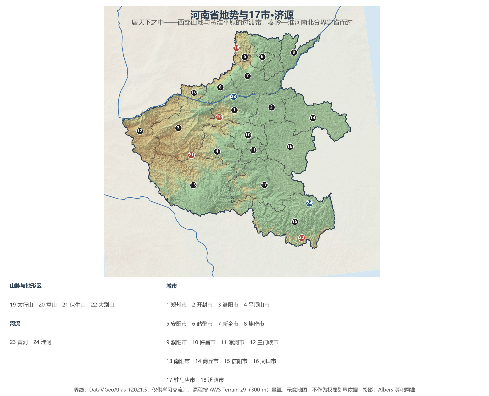
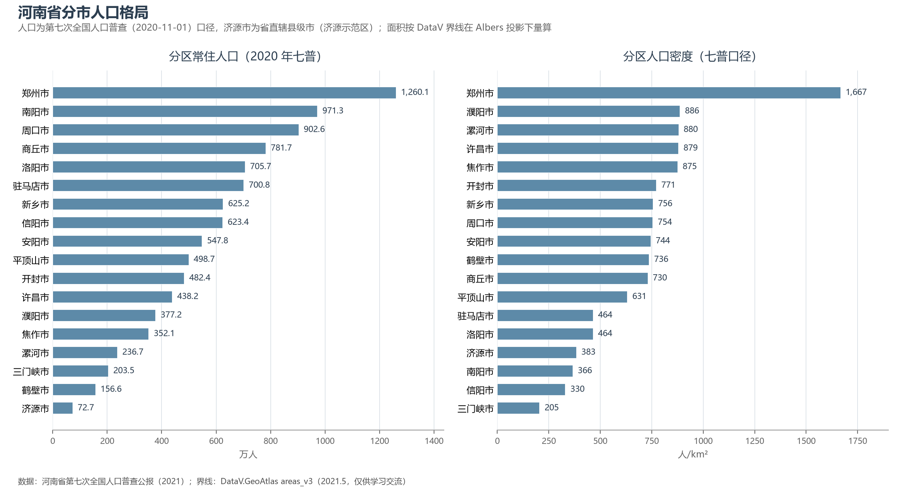

# 13.5.9 河南省

河南是中国地理的"原点"省份：西有秦岭余脉伏牛山与王屋—太行，东面一马平川的黄淮大平原，黄河、淮河、海河、长江四大水系在此境内各有流域，秦岭—淮河南北分界线恰好穿省而过——"居天下之中"的"中州"由此得名。八大古都，河南独占其四（郑州、洛阳、开封、安阳）；青铜器何尊铭文"宅兹中国"，"中国"一词最早的指向正是这片河洛之地。今天，它以全国第 3 的人口与第 6 的经济体量，扛着"中原粮仓、国人厨房"的国家责任。

## 一、省情速览

| 指标 | 数值 |
|------|------|
| 面积 | 167 000 km² |
| 常住人口 | 9 936.6 万（2020 年七普，全国第 3）；9 815 万（2023 年末） |
| 常住人口城镇化率 | 约 58%（2023 年末） |
| 地区生产总值 | 59 132.4 亿元（2023）；63 590.0 亿元（2024，增长 5.1%，全国第 6） |
| 人均地区生产总值 | 约 6.5 万元（2024） |
| 行政区划 | 17 个地级市 + 省直辖县级济源市（济源产城融合示范区） |
| 简称 | 豫 |

放在全国与世界坐标里：河南 GDP 折算约 8 900 亿美元，与波兰全国相当；常住人口约相当于越南全国——而户籍人口超过 1.1 亿，数以千万计的中原人在外务工经商，使河南成为全国最大的人口输出省份。粮食是它最重的一块砝码：用全国约 1/16 的耕地生产了全国约 1/10 的粮食与超过 1/4 的小麦，2024 年粮食产量 1 343.9 亿斤居全国第 2——河南一省的小麦产量，超过法国全国的收成。

**图 13-23 河南省地势与 17 市·济源**：z9 级 DEM 晕渲（300 m 分辨率），编号说明见图下。

## 二、自然地理

河南的地势西高东低，像一张向东北展开的"斜面"：西部是秦岭东延的褶皱山地——崤山、熊耳山、伏牛山一路铺向南阳盆地，北缘王屋山—太行山以断崖俯瞰豫北平原，全省最高点**老鸦岔垴**（2 413.8 m，三门峡灵宝市小秦岭）就藏在这段山系中；东部则是广袤的黄淮海平原，黄河横贯北中部 711 km，淮河沿南部东流，嵩山孤峰拔起于平原西缘，是为"中岳"。

**气候**正处于中国南北过渡带上：伏牛山—淮河一线以南属亚热带湿润季风气候，以北属暖温带半湿润季风气候——信阳种稻、豫北种麦，一省之内可以同时看到南北方的大地景观。降水 500—1 100 mm 由南向北递减；黄河"地上悬河"段（开封一带河床高出城区近 10 m）是全省最大的防洪忧患，2021 年 7 月郑州特大暴雨（小时雨强 201.9 mm，创中国大陆纪录）则提醒人们极端天气在这片平原的破坏力。

**水**是河南最复杂的命题：境内黄河、淮河、海河、长江四大流域俱全，全国罕见。黄河将大量泥沙留在下游、水却留给上游，豫北豫东水资源极度紧张；为此，**南水北调中线工程**的渠首设在南阳淅川陶岔，一渠清水经郑州西侧穿黄北送，北京城区七成以上的供水来自丹江口——河南既是水源地，也是受水区。

## 三、建置沿革与人文

华夏文明的主脉在中原展开：舞阳贾湖遗址的骨笛把音乐史推到 9 000 年前；渑池仰韶村（1921 年）是中国现代考古学的起点；偃师二里头被多数学者视为夏都斟鄩，郑州商城、安阳殷墟相继确认了商的都城——殷墟甲骨文是中国最早的成熟文字，后母戊鼎是最重的青铜礼器。此后三千年，洛阳十三朝、开封八朝的建都史把"逐鹿中原"写成了成语：龙门石窟、白马寺（中国第一古刹）、少林寺（禅宗祖庭）、开封宋都与清明上河图长卷，皆是这段历史的实景。

河南的文化输出同样深刻：五大名窑中汝、官、钧三窑在豫；太极拳发源于焦作温县陈家沟，2020 年列入人类非物质文化遗产代表作名录；豫剧是中国最大的地方剧种；洛阳牡丹、信阳毛尖、南阳"四圣"（科圣张衡、医圣张仲景、智圣诸葛亮、商圣范蠡）各自成章。1942 年的大饥荒与 1975 年板桥水库溃坝、1958—1960 的艰难岁月，也让这片土地承载着最沉重的历史记忆——理解中原，就是理解中国。

## 四、经济与区域战略

河南的经济底色是"**粮 + 工 + 枢纽**"。农业之上生长出"国人厨房"：漯河双汇是全球最大的猪肉加工企业，郑州三全、思念把速冻食品送到千家万户，卫龙辣条从这里走向世界。工业则以郑州为中心聚合：2013 年设立的郑州航空港经济综合实验区是全国首个以航空经济为主题的国家级新区，富士康郑州园区使这里成为全球最大的智能手机制造基地之一；洛阳作为省域副中心，中信重工等装备制造企业支撑"大国重器"；许昌则藏着一个全球最大的假发产业带。交通是河南最锋利的竞争武器——郑州建成全国唯一的"米字形"高铁枢纽，2 小时高铁圈覆盖 4 亿人口，郑州航空港的货邮吞吐量稳居中部首位。

区域战略的核心词是"**中心带动、多点支撑**"：郑州国家中心城市与郑州都市圈（含开封、新乡、焦作、许昌）构成主引擎，洛阳副中心独当豫西，南阳承担南水北调水源保护与豫西南中心，安阳红旗渠精神、信阳大别山革命老区、周口与驻马店的粮食基地各安其位。2021 年以来黄河流域生态保护和高质量发展成为贯穿全省的国家战略，从"治黄"转向"安澜、生态、文化"三位一体。

**图 13-24 河南省分市人口格局**：左为分市常住人口（七普），右为分市人口密度——郑州以 1 667 人/km² 一骑绝尘，豫东平原诸市普遍在 700—890 人/km²。

## 五、分区地理：17 市 + 济源

**郑州都市圈**——郑州市（省会，1 260.1 万人，全省唯一超千万市）：商都遗址与"米字形"枢纽叠加的国家中心城市。开封市（482.4 万人）：八朝古都，宋文化与大运河枢纽，郑开同城化东翼。新乡市（625.2 万人）：郑新一体化前沿，平原示范区承接郑州外溢。焦作市（352.1 万人）：云台山世界地质公园与太极拳故里。许昌市（438.2 万人）：曹魏故都与全球假发之都。漯河市（236.7 万人）：双汇与卫龙所在的中国食品名城。

**洛阳与豫西**——洛阳市（705.7 万人，省域副中心）：十三朝古都，龙门石窟、白马寺与"牡丹花城"，现代装备制造重镇。三门峡市（203.5 万人）：黄河三门峡大坝、函谷关与冬季白天鹅栖息地。济源市（72.7 万人，省直辖县级市）：愚公移山寓言的原型地，小浪底水利枢纽所在。

**豫北与豫东**——安阳市（547.8 万人）：殷墟、中国文字博物馆与红旗渠所在。鹤壁市（156.6 万人，全省人口最少的地级市）：《诗经》淇水之滨，商都朝歌故地。商丘市（781.7 万人）：商文化发源地之一，豫鲁苏皖交界枢纽。周口市（902.6 万人）：羲皇故都淮阳、老子故里鹿邑，平原农业大市。

**豫南与豫西南**——驻马店市（700.8 万人）：中原粮仓核心区，嵖岈山奇石嶙峋。信阳市（623.4 万人）：信阳毛尖与"北国江南"，大别山革命老区首府所在地。南阳市（971.3 万人，全省人口第二市）：四圣故里、中国月季之乡，南水北调中线渠首在其域内淅川县。

## 六、省内之最

| 项 | 值 |
|----|----|
| 最高点 | 老鸦岔垴（三门峡市灵宝市），2 413.8 m |
| 最低点 | 固始县淮河出境处，约 23 m |
| 面积最大 / 最小的市 | 南阳市 26 509 km² / 济源市 1 931 km² |
| 人口最多 / 最少的市（七普） | 郑州市 1 260.1 万 / 济源市 72.7 万 |
| 人口密度最高 / 最低（七普） | 郑州市 1 667 人/km² / 三门峡市 205 人/km² |
| GDP 首位市 | 郑州市 14 532.1 亿元（2024） |
| 粮食 | 1 343.9 亿斤（2024，全国第 2），小麦产量约占全国 1/4 |
| 古都 | 中国八大古都占四：郑州、洛阳、开封、安阳 |

## 参考与数据来源

1. 面积、人口、GDP 总量：附录 A 口径（《中国统计年鉴 2024》）；2024 年 GDP 为河南省地区生产总值统一核算结果（河南省统计局，2025 年 1 月）；郑州 GDP 为郑州市统计局发布口径。
2. 分市人口：河南省第七次全国人口普查公报（2021），济源市为省直辖县级市（济源示范区）；分市面积按 DataV 界线在 Albers 投影下量算，与官方公布值差多在 2% 以内。
3. 粮食与小麦占比：河南省农业农村厅、国家统计局分省数据（2024）；"米字形"高铁：中国铁路郑州局集团（2022 年全面建成）；南水北调中线：中国南水北调集团。
4. 郑州特大暴雨雨强：中国气象局灾情调查报告（2021）；世界遗产与人类非遗：联合国教科文组织名录（太极拳，2020）。
5. 地势图 DEM：AWS Terrain Tiles z9（300 m 分辨率量算）；界线：DataV.GeoAtlas areas_v3（2021.5，仅供学习交流）。
