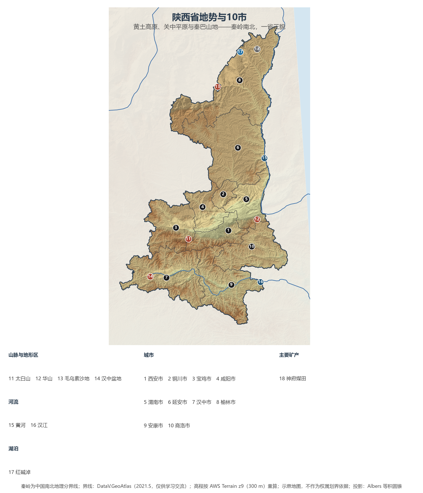
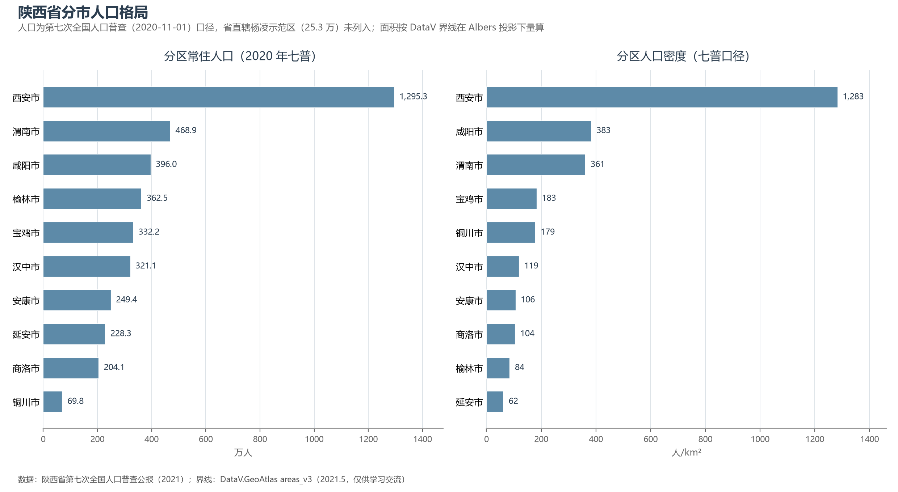

# 13.5.10 陕西省

陕西的版图是一枚狭长的"腰牌"：从陕北毛乌素沙地的边缘到陕南汉江谷地，南北纵跨 870 公里，秦岭横亘其中，把一省劈成三种地貌、三样气候、三重性格——黄土高原的苍茫、关中平原的厚重、秦巴山地的灵秀。这里是周秦汉唐四代雄风的舞台，"中国"一词最早的文字记载（宝鸡出土何尊铭文"宅兹中国"）就诞生在这片土地上；今天，它又以能源重镇与"硬科技之都"的双重身份，站在"一带一路"向西开放的第一排。

## 一、省情速览

| 指标 | 数值 |
|------|------|
| 面积 | 205 600 km² |
| 常住人口 | 3 952.9 万（2020 年七普）；3 952 万（2023 年末） |
| 常住人口城镇化率 | 约 64.5%（2023 年末） |
| 地区生产总值 | 33 792.7 亿元（2023）；35 538.8 亿元（2024，增长 5.3%） |
| 人均地区生产总值 | 约 9.0 万元（2024） |
| 行政区划 | 10 个地级市（另设省直辖杨凌农业高新技术产业示范区） |
| 简称 | 陕 / 秦 |

放在全国坐标里：陕西 GDP 折算约 5 000 亿美元，与菲律宾全国相当；人均约 9 万元，高于中西部的河南、四川，仅次于全国平均水平。经济版图高度集中——西安一市占全省近四成，榆林再占约五分之一；人口的分布同样如此，关中五市聚集了全省六成人口。真正的世界级名片是农业与古都：陕西苹果产量约占全国四分之一、世界的七分之一，"全球每七个苹果就有一个产自陕西"；而西安与罗马、雅典、开罗并称世界四大古都，建都史逾 1 100 年。

**图 13-25 陕西省地势与 10 市**：z9 级 DEM 晕渲（300 m 分辨率），编号说明见图下。

## 二、自然地理

陕西地势南北高中间低，自北而南是截然不同的三个世界。**陕北黄土高原**属黄土高原核心区，沟壑纵横、塬梁峁交错，海拔 900—1 500 m，北缘与毛乌素沙地相接——曾是全国水土流失最严重的地区之一，1999 年以来退耕还林让延安的植被覆盖度从 46% 提高到 81%，"黄土地变绿洲"是全球生态修复的样本工程；榆林则以"塞上森林城"的姿态完成毛乌素沙地陕西段的治理。**关中平原**（渭河平原）即"八百里秦川"，渭河自西向东贯流，土地平旷、灌溉悠久，周秦汉唐的都城皆择址于此。**陕南秦巴山地**中，秦岭主峰**太白山**（3 771.2 m）是青藏高原以东的著名高峰，华山以"奇险天下第一山"独秀；汉江蜿蜒于秦岭大巴山之间，汉中盆地、安康谷地串珠分布。

**秦岭**是理解陕西的钥匙：它是中国南北方的地理分界线、气候分界线与长江黄河分水岭，一山之隔，陕南已是亚热带常绿阔叶林的世界。这座"国家中央公园"庇护着"秦岭四宝"——大熊猫（秦岭亚种）、金丝猴、羚牛与朱鹮：1981 年在洋县重新发现的 7 只朱鹮，如今已繁衍到全球万余只，是人类濒危物种保护史上最成功的案例之一。**水**的格局同样戏剧化：黄河沿晋陕峡谷南下（壶口瀑布为晋陕共享的奇观），渭河是黄河最大支流；而汉江陕西段承担了南水北调中线约七成的水源——"一泓清水永续北上"是陕南的最高使命。

## 三、建置沿革与人文

陕西是人类活动的古老现场：115 万年前的蓝田人、6 000 年前的半坡聚落依次登场。西周建丰镐二京，秦以咸阳为都横扫六合，西汉、隋、唐相继营建长安——盛唐长安是当时世界上最大的城市，朱雀大街宽逾百米，108 坊容纳百万人口，丝绸之路自此西行三万里。1963 年宝鸡出土的何尊，铭文中"宅兹中国"是"中国"一词的最早文字记录；1974 年临潼农民打井挖出的兵马俑，则让"世界第八大奇迹"惊艳全球。

近代以来，陕西再度成为历史转折点：1935—1947 年中共中央驻延安十三年，宝塔山下走出新中国的政治班底，"延安精神"由此命名。文化上，秦腔是梆子腔的鼻祖，信天游、安塞腰鼓、华阴老腔唱尽黄土高原的苍凉豪迈；肉夹馍、羊肉泡馍与 Biángbiáng 面把面食文明推向极致。世界遗产三项——秦始皇陵及兵马俑坑（1987）、长城（榆林镇北台号称"万里长城第一台"）、丝绸之路"长安—天山廊道"（2014，陕西境内 7 处遗产点含张骞墓）。

## 四、经济与区域战略

陕西经济的两极是"**挖出来的**"与"**造出来的**"。陕北是国家能源基地：神府煤田是世界级优质动力煤矿区，榆林集煤、气、油、盐于一身，2024 年原煤产量逾 6 亿吨、GDP 约占全省五分之一，是我国"西煤东运""西气东输"的核心源头之一。关中则是创新高地：西安的军工、航天、半导体（三星西安工厂）与新能源汽车（比亚迪西安基地年产能达百万辆级）构成"硬科技"版图，2021 年启动的"秦创原"创新平台与西咸新区（2014 年获批的国家级新区）正在整合科教资源——西安交大、西北工业大学等高校在校生逾百万，科教综合实力居全国前列。农业上，洛川苹果、周至猕猴桃、陕南茶叶各领风骚，设施农业与"3+X"特色产业体系让黄土高原变成"果盘子"。

开放通道借"一带一路"重启：中欧班列"长安号"年开行量稳居全国第一方阵，西安咸阳国际机场是西北航空枢纽。生态与文化是另两条主线：秦岭保护条例以最严立法守护"中央水塔"，陕南三市为南水北调水源地牺牲开发速度换取生态价值；而大唐不夜城、长安十二时辰等文旅 IP 让"汉唐气象"成为全国文旅的顶流叙事。

**图 13-26 陕西省分市人口格局**：左为分市常住人口（七普），右为分市人口密度——西安 1 283 人/km² 遥遥领先，延安市仅 62 人/km²。

## 五、分区地理：10 市

**关中五市**——西安市（省会，1 295.3 万人，全省唯一超千万市）：国家中心城市与十三朝古都，兵马俑、城墙、大雁塔与"硬科技"产业共冶一炉。咸阳市（396.0 万人）：秦都故地，与西安同城化构成"西咸一体"。宝鸡市（332.2 万人）：青铜器之乡与炎帝故里，何尊出土之地，陇海与宝成铁路的枢纽。渭南市（468.9 万人）：华山与关中粮仓所在，富平柿子、大荔冬枣闻名。铜川市（69.8 万人，全省人口最少市）：煤城转型的样本，药王孙思邈故里。

**陕北两市**——榆林市（362.5 万人）：能源新都，镇北台与毛乌素治沙见证"由黄到绿"。延安市（228.3 万人）：革命圣地，宝塔山、杨家岭与退耕还林第一市。

**陕南三市**——汉中市（321.1 万人）：刘邦封汉王由此定天下，"汉家发祥地"，洋县朱鹮与油菜花海是两张生态名片。安康市（249.4 万人）：汉江生态经济带与南水北调核心水源地，紫阳富硒茶名闻遐迩。商洛市（204.1 万人）：商山洛水，作家贾平凹的故乡，秦岭最美是商洛。

## 六、省内之最

| 项 | 值 |
|----|----|
| 最高点 | 太白山拔仙台（宝鸡市太白县），3 771.2 m |
| 最低点 | 白河县汉江出境处（安康市），约 170 m |
| 面积最大 / 最小的市 | 榆林市 42 920 km² / 铜川市 3 882 km² |
| 人口最多 / 最少的市（七普） | 西安市 1 295.3 万 / 铜川市 69.8 万 |
| 人口密度最高 / 最低（七普） | 西安市 1 283 人/km² / 延安市 62 人/km² |
| GDP 首位市 | 西安市 13 317.8 亿元（2024，占全省近四成） |
| 能源 | 榆林 2024 年原煤产量逾 6 亿吨，全国地级市前列 |
| 世界遗产 | 3 项（秦始皇陵及兵马俑坑、长城、丝绸之路长安—天山廊道） |

## 参考与数据来源

1. 面积、人口、GDP 总量：附录 A 口径（《中国统计年鉴 2024》）；2024 年 GDP 为陕西省地区生产总值统一核算结果（陕西省统计局，2025 年 1 月）；西安 GDP 为西安市统计局发布口径。
2. 分市人口：陕西省第七次全国人口普查公报（2021），杨凌示范区 25.3 万人未计入 10 市；分市面积按 DataV 界线在 Albers 投影下量算，多数市与官方公布值差在 2% 以内。
3. 苹果、猕猴桃产量占比：陕西省果业中心（2023—2024）；榆林原煤产量：榆林市统计局；延安植被覆盖度：延安市退耕还林工程公报；朱鹮种群：陕西汉中朱鹮国家级自然保护区（2024）。
4. 何尊铭文、兵马俑发现、长安建都史：国家博物馆与陕西省考古研究院公开资料；世界遗产：联合国教科文组织名录。
5. 地势图 DEM：AWS Terrain Tiles z9（300 m 分辨率量算）；界线：DataV.GeoAtlas areas_v3（2021.5，仅供学习交流）。
