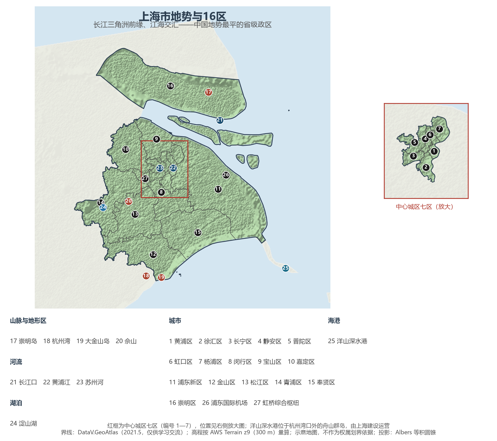
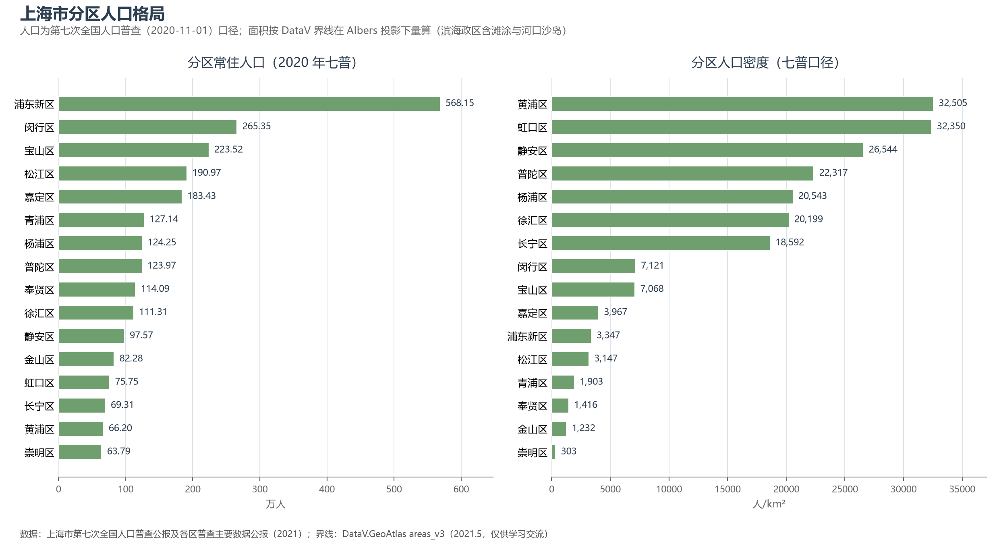
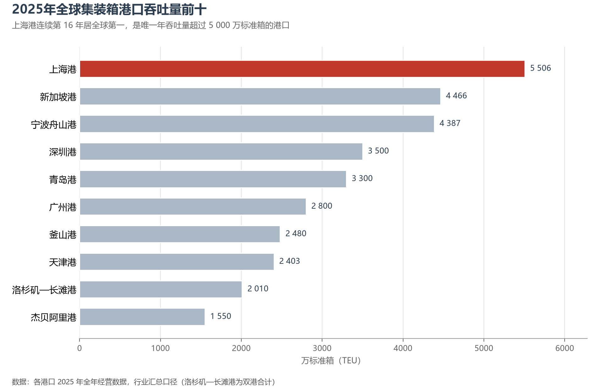

# 13.5.11 上海市

上海是中国江海交汇的第一门户。长江用上万年的时光在东海之滨堆出这片三角洲，把最年轻、最平坦的土地留给了这座城市——全市平均海拔仅 2.2 米，最高点竟是杭州湾里一座 103.7 米的小岛。就在这张三角洲前缘的沙盘上，上海从 1292 年的一座江南县城，长成今天吞吐全球五分之一集装箱的国际航运中心，和一座 2 480 万人的超级都市。

## 一、省情速览

| 指标 | 数值 |
|------|------|
| 面积 | 6 340.5 km²（省级行政区中最小，港澳除外） |
| 常住人口 | 2 487.1 万（2020 年七普）；2 480.3 万（2024 年末） |
| 常住人口城镇化率 | 89.85%（2024 年末，居全国省级行政区首位） |
| 地区生产总值 | 47 218.7 亿元（2023）；53 926.71 亿元（2024，增长 5.0%） |
| 人均地区生产总值 | 约 21.7 万元（2024，居全国省级行政区第 2 位，仅次于北京） |
| 行政区划 | 16 个市辖区 |
| 简称 | 沪（别称申） |

放在全国坐标里：上海以不足全国千分之一的国土，承载了约 1.8% 的常住人口，人口密度约 3 900 人/km² 为全国省级行政区之最；2024 年 GDP 53 926.71 亿元，一举超过湖南、由上年的第 11 位跃居全国第 9 位。放回世界视角：上海的人口与澳大利亚全国相当，经济规模粗折约 7 600 亿美元——约为瑞士全国的八成，超过比利时与瑞典，在全球城市中位居前列。这座城市的全部经济地理都系于"口岸"二字：背靠长江黄金水道，面向西太平洋主航道，是全球少数集"江海中转"于一身的枢纽。

**图 13-101 上海市地势与 16 区**：z9 级 DEM 晕渲（300 m 分辨率），编号说明见图下——中心城区七区过密，另设放大插图。

## 二、自然地理

**成陆与地形**是理解上海的起点。全境属长江三角洲冲积平原，西缘"冈身"一线是 6 000 多年前的古海岸沙脊，其以东的广袤土地大半是此后才淤积成陆的；崇明岛自唐代武德年间（7 世纪初）露出水面，至今仍以每年数十米的速度向东淤涨，江口的九段沙更是长江仍在"生长"的最新沙洲——浦东新区按现代界线的量算面积明显大于陆地统计口径，多出的部分正是这些滩涂沙岛。全市平均海拔 2.19 米，为全国省级行政区最低；最高点是杭州湾北部的大金山岛（103.7 米），陆上最高点为松江境内的天马山（98.2 米），平原上只点缀着佘山等少数基岩残丘。

**气候**属亚热带季风气候：1 月均温 4—5 ℃，7 月约 28—29 ℃，年降水量约 1 170 毫米，梅雨与台风交替登场。1872 年建站的徐家汇观象台已有 150 余年不间断观测，是中国连续观测最久的气象台站之一。2024 年 9 月，台风"贝碧嘉"以 14 级风力在浦东临港登陆，成为 1949 年以来登陆上海的最强台风——这座地势低平的滨海城市，比任何内陆省区都更直接地面对海洋的考验。

**水**的格局是"一江一河一岛群"。长江自崇明岛与南汇嘴之间分汊入海；黄浦江自淀山湖蜿蜒而下、于吴淞口汇入长江，这条约 113 公里的"母亲河"既是航运干道，也是外滩天际线的舞台；苏州河（吴淞江）是她最著名的支流，淀山湖则是全市最大的天然湖泊。上海本地水资源并不宽裕，但长江过境水量巨大——在长兴岛西端江心建起的青草沙水库，承担着全市约一半的原水供应，把"守着大江缺好水"的困局变成了江心取水的典范。崇明岛面积 1 267 km²，是中国第三大岛（仅次于台湾岛、海南岛），与长兴、横沙二岛同属崇明区，岛北水道对岸即是江苏。

## 三、建置沿革与人文

春秋时上海属吴，相传战国楚相春申君黄歇受封于此，"申"与"黄浦"之名由此而来。唐天宝十年（751 年）设华亭县（今松江），宋末置上海镇，元至元二十九年（1292 年）析华亭东北五乡设上海县，县城与建置的骨架就此奠定；1685 年清廷在沪设江海关，上海已是江南对外贸易的门户。1843 年开埠是真正的转折：英、法、美租界相继设立，"十里洋场"在半个多世纪里把上海推上远东第一大都市的位置，也留下外滩建筑群与石库门里弄这两份气质迥异的城市遗产。1921 年中国共产党第一次全国代表大会在望志路一幢石库门民居中召开；1927 年设上海特别市，直辖建制自此确立；1949 年 5 月上海解放，1958 年江苏省十县相继划入，市域扩至今天的规模。

1990 年中央宣布开发开放浦东，1993 年浦东新区成立，陆家嘴从阡陌农田长成与外滩隔江相望的金融城；2010 年世界博览会、2013 年全国首个自由贸易试验区、2021 年浦东建设社会主义现代化建设引领区——每一个节点，都是国家战略在上海的一次落子。多元移民、中西杂糅塑造了"海派文化"：沪剧与滑稽戏、本帮菜的浓油赤酱、豫园的江南园林与朱家角的水乡街市，同这座城市的摩天楼群一起，构成传统与现代的双面叙事。

## 四、经济与区域战略

上海的经济是典型的枢纽经济：第三产业占 GDP 的 78.2%（2024），金融、商贸与航运服务是支柱；制造业则向高端收拢——集成电路、生物医药、人工智能三大先导产业总规模已达 1.8 万亿元，其中集成电路占全国两成以上；中国商飞在浦东总装的 C919 大飞机已投入商业运营，江南造船的船坞排满全球订单。证券交易所、期货交易所、外汇交易中心等金融要素市场在此集聚，承担着全国最重要的定价与清算功能。"国际经济、金融、贸易、航运、科技创新"五个中心，是国家给这座城市的总体定位。

**图 13-102 上海市分区人口格局**：左为分区常住人口（七普），右为分区人口密度——黄浦区以约 3.3 万人/km² 居首，崇明区仅约 300 人/km²。

空间战略的关键词是"龙头"。对内，2017 年版城市总体规划确立"主城区—五个新城—新市镇"体系，嘉定、青浦、松江、奉贤、南汇五个新城定位为"独立的综合性节点城市"，承接中心城区功能疏解；青浦、吴江、嘉善交界的长三角生态绿色一体化发展示范区（2019）探索跨省域制度创新，临港新片区对标国际最高水平的自由贸易园区，崇明整建制建设世界级生态岛。对外，上海是长三角世界级城市群的龙头：虹桥综合枢纽把高铁、航空与城市轨道叠在同一屋檐下，浦东、虹桥两场年旅客吞吐量达亿人次级，2002 年通车的磁浮示范线至今仍是世界唯一商业运营的高速磁浮线路。

航运是上海地理禀赋的极致发挥。上海港 2024 年成为全球首个年集装箱吞吐量突破 5 000 万标准箱的港口，2025 年达 5 506 万标准箱，连续 16 年居世界第一；建于杭州湾外舟山群岛的洋山深水港（行政上属浙江，由上海建设运营）四期，是全球规模领先的自动化集装箱码头。黄浦江内的老港区已整体外移，外高桥与洋山组成集装箱主体港区，吴淞口国际邮轮港成为中国最繁忙的邮轮母港——长江黄金水道的驳船与远洋干线的巨轮，在这里完成"江海换装"。

**图 13-103 2025 年全球集装箱港口吞吐量前十**：上海港以 5 506 万标准箱连续第 16 年居全球第一，是唯一超过 5 000 万标准箱的港口。

## 五、分区地理：16 区与三个层次

按《上海市城市总体规划（2017—2035 年）》，16 区大体分三个层次（编号见图 13-101）。

**中心城区七区（1—7）**——面积不足全市 5%，却住着约 670 万人。黄浦区（1）20.5 km² 为全市最小，人口密度最高，外滩—人民广场—豫园一线是这座城市的原点；徐汇区（2）的衡复历史风貌区与西岸滨江、静安区（4）的南京西路商圈，是高端商业与历史街区的经典组合；长宁区（3）依托虹桥开发区与国际社区，普陀区（5）沿苏州河的工业岸线已转型为创意水岸；虹口区（6）的北外滩正在再造一个航运服务集聚区，与外滩、陆家嘴构成"黄金三角"；杨浦区（7）聚集复旦、同济，百年工业遗存所在的杨浦滨江已成"世界级会客厅"。

**主城拓展区（8—9）**——闵行区 265.35 万人、宝山区 223.52 万人，密度均约 7 100 人/km²，构成主城的外圈：闵行有紫竹高新区与虹桥枢纽南翼，宝山则是宝武钢铁的母厂与吴淞口邮轮港所在。

**新城与远郊区（10—16）**——松江区（13）坐拥佘山与松江大学城，是 G60 科创走廊的源头；嘉定区（10）的汽车城承载着从整车制造到 F1 中国大奖赛的完整汽车文化；青浦区（14）淀山湖畔的国家会展中心每年 11 月迎来进博会；奉贤区（15）以"东方美谷"美妆产业立区；浦东新区（11）以 568.15 万人居各区之首，陆家嘴金融城、张江科学城、金桥、外高桥与临港新片区由内向外依次展开，2024 年 GDP 17 752.28 亿元、约占全市三分之一——一区之力超过海南、宁夏、青海、西藏任何一个省区，三大先导产业规模合计突破 8 000 亿元。金山区（12）的石化基地镇守杭州湾北岸；崇明区（16）63.79 万人、人口密度仅约 300 人/km²，与一江之隔的黄浦区相差百倍，是这座巨型城市刻意保留的生态底色。

## 六、省内之最

| 项 | 值 |
|----|----|
| 最高点 | 大金山岛（金山区），103.7 m；陆上最高为天马山（松江区），98.2 m |
| 平均海拔 | 约 2.2 m，全国省级行政区最低 |
| 面积最大 / 最小的区（量算） | 崇明区 2 102 km²（含滩涂沙岛）/ 黄浦区 20.4 km² |
| 人口最多 / 最少的区（七普） | 浦东新区 568.15 万 / 崇明区 63.79 万 |
| 人口密度最高（七普量算） | 黄浦区约 3.3 万人/km²，虹口区以毫厘之差紧随其后 |
| GDP 首位区 | 浦东新区 17 752.28 亿元（2024，约占全市 1/3） |
| 世界之最 | 港口集装箱吞吐量连续 16 年全球第一，全球首个超 5 000 万标准箱大港 |

## 参考与数据来源

1. 面积、人口、GDP 总量：附录 A 口径（《中国统计年鉴 2024》）；2024 年 GDP、三次产业构成、城镇化率与年末常住人口为《2024 年上海市国民经济和社会发展统计公报》。
2. 分区人口：上海市第七次全国人口普查公报及各区普查主要数据公报（2021）；中心城区、浦东新区、郊区分组据《上海市第七次全国人口普查主要数据公报（第二号）》。分区面积按 DataV 界线在 Albers 投影下量算，崇明、浦东、奉贤、金山等滨海政区计入滩涂与河口沙岛，量算值大于陆地统计口径（《上海统计年鉴 2022》表 2.2）。
3. 分区 GDP 与先导产业：浦东新区、黄浦区 2024 年国民经济和社会发展统计公报；三大先导产业规模据上海市 2024 年国民经济和社会发展计划执行情况报告。
4. 港口与航运：上港集团经营数据、交通运输部及行业汇总口径（2024—2025）；洋山深水港行政属浙江省舟山市，由上海市建设运营。
5. 台风"贝碧嘉"：新华社报道（2024-09-16）；平均海拔：上海市第一次地理国情普查公报（2017）。
6. 地势图 DEM：AWS Terrain Tiles z9（300 m 分辨率量算）；界线：DataV.GeoAtlas areas_v3（2021.5，仅供学习交流）。
