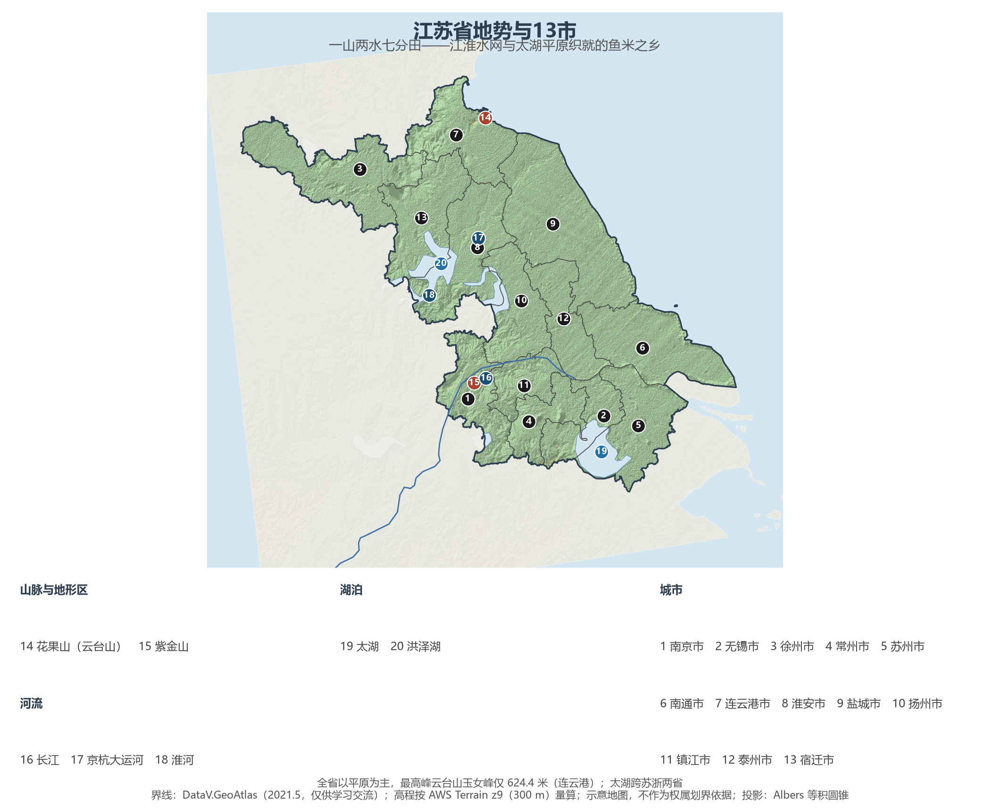
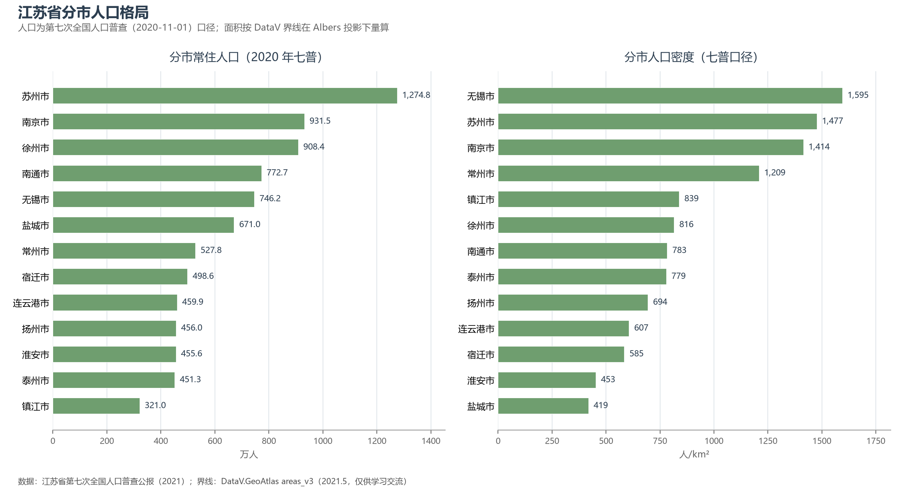
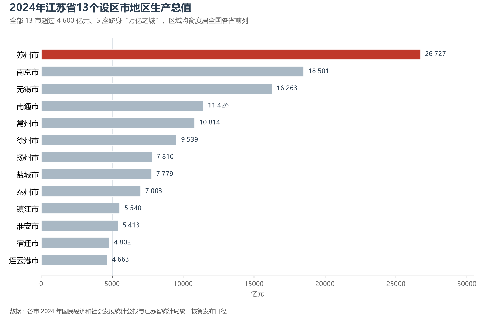

# 13.5.12 江苏省

江苏是中国经济密度最高的省份。长江横贯东西，京杭大运河纵穿南北，两大动脉在扬州—镇江一线十字相交，把 10.7 万平方公里的土地织成一张水网——"一山两水七分田"，平原占绝对主体，最高峰云台山玉女峰只有 624.4 米。就是这张平坦的水网，养育了全国最密集的城市群：13 个设区市全部跻身全国百强，苏州一座城市的人口超过千万、经济总量超过 2.6 万亿元。

## 一、省情速览

| 指标 | 数值 |
|------|------|
| 面积 | 107 200 km² |
| 常住人口 | 8 474.8 万（2020 年七普）；8 526 万（2024 年末） |
| 常住人口城镇化率 | 75.5%（2024 年末） |
| 地区生产总值 | 128 222 亿元（2023）；137 008.0 亿元（2024，增长 5.8%），居全国第 2 位 |
| 人均地区生产总值 | 约 16.1 万元（2024，居全国省级行政区第 3 位） |
| 行政区划 | 13 个设区市 |
| 简称 | 苏 |

放在全国坐标里：江苏 GDP 连续多年稳居全国第二，2024 年 13.7 万亿元的体量与广东同处 14 万亿元量级，经济增量居全国第一；人均 GDP 仅次于京沪。放回世界视角：全省常住人口与德国全国相当，经济规模粗折约 1.9 万亿美元——与韩国全国大致相当、超过澳大利亚。更难得的是均衡：全省 13 市经济总量全部超过 4 600 亿元，最末位的宿迁市（4 801.85 亿元）也超过青海、西藏任何一个省区，苏州、南京、无锡、南通、常州五座"万亿之城"并列全国省域第一。

**图 13-104 江苏省地势与 13 市**：z9 级 DEM 晕渲（300 m 分辨率），编号说明见图下。

## 二、自然地理

江苏是全国地势最低平的省份之一，平原占绝对主体，大部分地面海拔不足 50 米——西南一隅的宁镇丘陵、苏南零星的山体与东北角的云台山，是这片大平原上仅有的起伏。省域最高点玉女峰（624.4 米）孤悬连云港海滨，古称"郁州苍梧"，李白笔下"海客谈瀛洲"的意象正来自这里。

**水**才是江苏的地理主角。长江自西南入境、横贯 425 公里入海，把全省分为苏南与苏北；淮河故道横穿苏北，1855 年黄河北徙后，淮河失去独立入海通道，改经洪泽湖汇入长江——"治淮"由此成为江苏水利史的主线，苏北灌溉总渠与入海水道正是为它而建。太湖是全国第三大淡水湖（2 425 km²），湖面全境在苏，与阳澄、淀泖等湖群构成江南水乡的腹地；洪泽湖（约 1 577 km²）是全国第四大淡水湖，高邮湖、骆马湖列峙其间。京杭大运河纵贯近 700 公里，串联起全省八个设区市，至今仍是北煤南运的活水道；位于江都的南水北调东线源头泵站，每年把长江水沿运河一路送到山东——江都水利枢纽因此被称为"远东之心脏"。沿海是绵延 954 公里的海岸线与全国最大的沿海滩涂带——盐城黄海湿地每年迎接全球近半数的勺嘴鹬等候鸟，2019 年成为中国首个滨海湿地类世界自然遗产。

**气候**以淮河—苏北灌溉总渠为界：以北是暖温带季风气候，以南属亚热带季风气候，年降水量 700—1 100 毫米自西北向东南递增，梅雨与台风是江南片区的季节注脚。淮河一线正是中国南北方的地理分界，跨过这条线，稻田让位于旱作，"南船北马"在此换乘。尽管平原上城市与工厂鳞次栉比，江苏仍是全国粮食主产省——粮食总产连续多年稳定在 700 亿斤以上，"鱼米之乡"并非虚名。

## 三、建置沿革与人文

江苏的文明底稿由三个地理单元分别写就：太湖流域的吴文化——前 514 年伍子胥"相土尝水"筑阖闾大城，苏州建城已逾 2 500 年；淮海地区的两汉文化——汉高祖刘邦起于沛县，徐州一域汉墓、汉俑、汉画像石"汉代三绝"俱全；江淮之间的金陵王气——南京先后为六朝与明初京师，明孝陵肇建于此。隋代大运河全线贯通后，扬州扼漕运咽喉，盐商与文人把这座城建成了唐代的"世界级都会"。清代康熙六年（1667 年）江南省分治，取江宁、苏州二府首字得名"江苏"，省界沿用至今。

近代史的几处关键节点都落在江苏：南通张謇以"父教育、母实业"建设"中国近代第一城"，无锡荣氏兄弟的面粉与纺织帝国开民族工商业之先，1912 年中华民国临时政府在南京成立。当代序列里，20 世纪 80 年代乡镇企业从苏南的田埂上异军突起，"苏南模式"与温州模式、珠江模式并列为中国农村工业化三大样本；1990 年浦东开发带动苏南外向型升级，1994 年中新合作的苏州工业园区成为全国开发区的样板，昆山则从自费开发区干成全国最强县级市。世界遗产四类六处：苏州古典园林、明孝陵、大运河（江苏段）、盐城黄海湿地；昆曲与古琴艺术列入人类非物质文化遗产代表作名录——"百戏之祖"昆曲正诞生于太仓、昆山一带的水磨腔里。

## 四、经济与区域战略

江苏的经济底盘是**制造业**：规模以上制造业规模连续多年居全国首位，电子信息、装备制造、纺织服装、石油化工四大支柱之外，新能源、生物医药、物联网正在换挡升级——常州以动力电池与光伏产业集群立起"新能源之都"，无锡的物联网与集成电路、苏州的生物医药与纳米技术各擅胜场。2024 年全省 GDP 迈上 13.7 万亿元台阶，苏州（26 727 亿元，全国城市第 6）、南京、无锡、南通、常州五市过万亿，扬州与盐城仅差 30 亿元的"腰部竞赛"、淮安以 7.1% 增速领跑全省，都是这份均衡成绩单的注脚。农业同样举足轻重：阳澄湖大闸蟹、盱眙小龙虾、兴化垛田与洞庭碧螺春，让"苏"字在餐桌与茶园里都有名有姓。

空间战略沿江梯度展开：**苏南**率先转型创新，苏锡常都市圈与南京都市圈分别对接上海与安徽；**苏中**跨江融合，沪苏通铁路把南通纳入上海一小时圈；**苏北**承接转移、追赶突破，徐州建设淮海经济区中心城市，连云港依托亚欧大陆桥东桥头堡与石化基地，宿迁从"经济洼地"长出电商产业。长江天堑之上，已建成的过江通道超过 20 处，把江南江北缝合成一体。交通上，京沪、沪蓉、沿海三大通道交汇，南京禄口与无锡硕放双机场协作，"轨道上的长三角"让全省 13 市全部接入高铁网。

**图 13-105 江苏省分市人口格局**：左为分市常住人口（七普），右为分市人口密度——无锡市以约 1 595 人/km² 居首，盐城市仅 419 人/km²。

## 五、分区地理：苏南、苏中、苏北（编号见图 13-104）

**苏南五市（1—5、11）**——南京（1）931.5 万人，六朝古都、科教重镇，紫金山—玄武湖围出"山水城林"的城市骨架，长江大桥与禄口机场扼守国家通道；苏州（5）1 274.8 万人为全省第一，GDP 2.67 万亿元居全国城市第 6，古典园林与工业园区在古城东西两端对望，所辖昆山是全国最强县级市；无锡（2）746.2 万人，人口密度全省最高，物联网与集成电路产业规模居全国前列，郭沫若笔下"太湖佳绝处"的鼋头渚在其境内；常州（4）以新能源产业跻身"万亿之城"；镇江（11）321.0 万人，全省面积与人口双料最小，却坐拥"城市山林"与运河入江口的西津渡。

**苏中三市（6、10、12）**——南通（6）772.7 万人，张謇故里、"建筑铁军"之乡，靠江靠海靠上海，沪苏通长江公铁大桥通车后融入上海一小时圈，通州湾正建设长江集装箱运输新出海口；扬州（10）运河原点城市，唐时"扬一益二"的繁华凝结在瘦西湖与个园里，淮扬菜发源于此；泰州（12）的中国医药城是国家级医药高新区，早茶文化自成一派。

**苏北五市（3、7、8、9、13）**——徐州（3）908.4 万人居全省第三，两汉文化与徐工重工并举，是淮海经济区的中心城市，京沪与陇海两大铁路动脉在此十字相交；连云港（7）面海依山，花果山下是新亚欧大陆桥的东端起点与国家级石化基地；淮安（8）是周恩来故乡与"运河之都"，当代台资集聚示范高地；盐城（9）全省面积最大（量算 16 018 km²），丹顶鹤与麋鹿两个国家级自然保护区守着太平洋西岸最完整的滩涂湿地；宿迁（13）西楚霸王项羽的故乡，如今以电商与光伏电池重构产业版图，2024 年 GDP 增长 6.8%。

**图 13-106 2024 年江苏省 13 个设区市地区生产总值**：苏州 26 727 亿元居首，13 市全部超过 4 600 亿元，苏州、南京、无锡、南通、常州 5 座城市跻身“万亿之城”。

## 六、省内之最

| 项 | 值 |
|----|----|
| 最高点 | 云台山玉女峰（连云港市），624.4 m |
| 面积最大 / 最小的市（量算） | 盐城市 16 018 km² / 镇江市 3 826 km² |
| 人口最多 / 最少的市（七普） | 苏州市 1 274.8 万 / 镇江市 321.0 万 |
| 人口密度最高 / 最低（七普量算） | 无锡市 1 595 人/km² / 盐城市 419 人/km² |
| GDP 首位市 | 苏州市 26 727 亿元（2024，全国城市第 6） |
| "万亿之城" | 5 座（苏州、南京、无锡、南通、常州），与浙江并列省域第一 |
| 湖泊之最 | 太湖 2 425 km² 全国第三大淡水湖；洪泽湖约 1 577 km² 全国第四 |

## 参考与数据来源

1. 面积、人口、GDP 总量：附录 A 口径（《中国统计年鉴 2024》）；2024 年 GDP、三次产业、城镇化率与年末人口为《2024 年江苏省国民经济和社会发展统计公报》。
2. 分市人口：江苏省第七次全国人口普查公报（2021），13 市数据精确到人并与全省合计核对。分区面积按 DataV 界线在 Albers 投影下量算，与各市公布陆地面积略有出入。
3. 分市 GDP：各设区市 2024 年国民经济和社会发展统计公报与江苏省统计局统一核算发布口径。
4. 世界遗产：联合国教科文组织世界遗产名录与人类非物质文化遗产代表作名录；勺嘴鹬等鸻鹬类水鸟承载数：盐城黄海湿地世界遗产申报材料口径。
5. 地势图 DEM：AWS Terrain Tiles z9（300 m 分辨率量算）；界线：DataV.GeoAtlas areas_v3（2021.5，仅供学习交流）。
