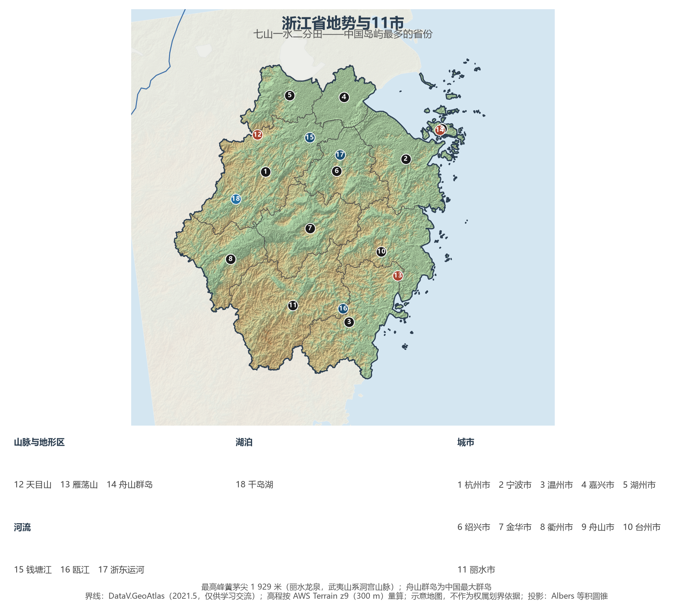
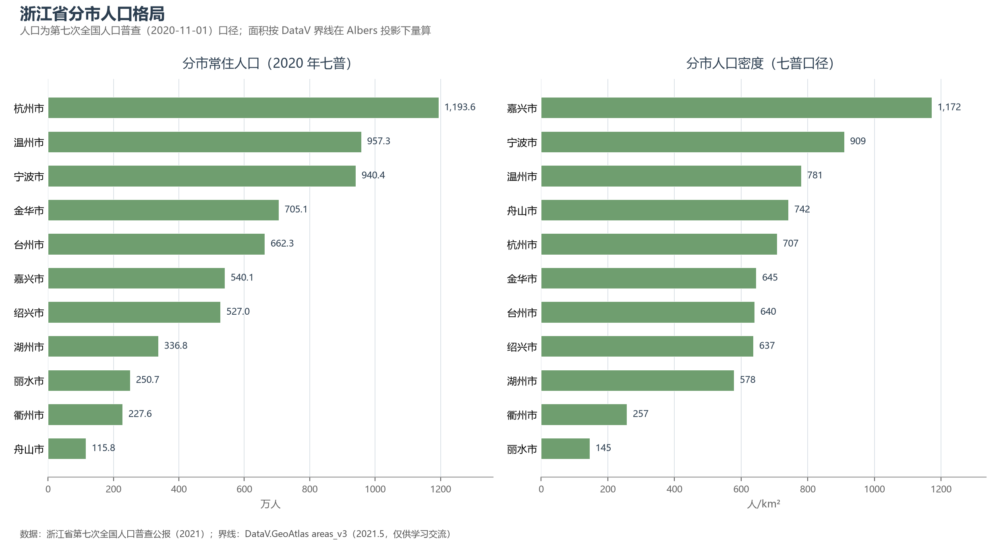
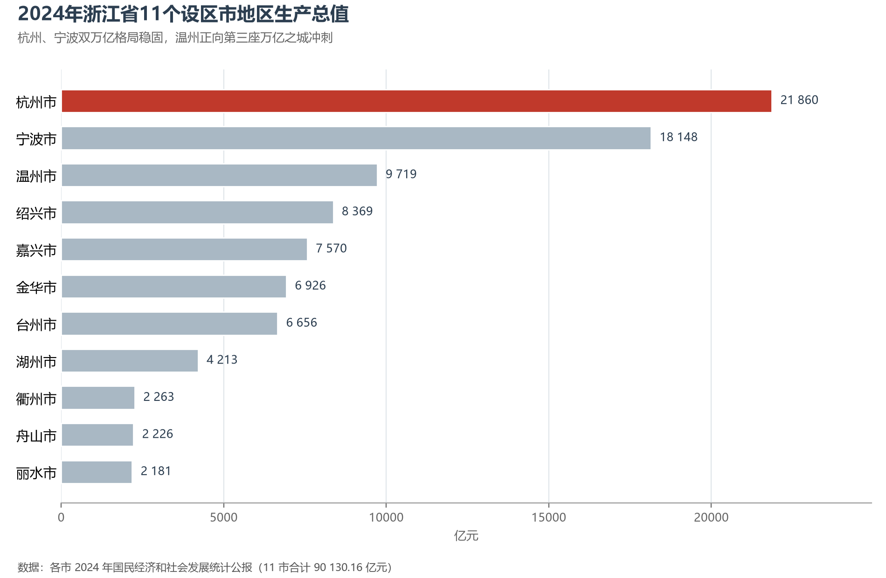

# 13.5.13 浙江省

"七山一水二分田"——浙江用一句民谚把自己的家底交代得干干净净：山地丘陵占了四分之三，平原只有杭嘉湖、宁绍与温台沿海的几条带状绿洲。正是这片"资源小省"，在山海之间做出了全国最大的港口、最多的民营企业和最活跃的数字经济——宁波舟山港的货物吞吐量连续 16 年居世界第一，而杭州的云计算与小商品之城义乌，把浙江缝合进全球市场的毛细血管。

## 一、省情速览

| 指标 | 数值 |
|------|------|
| 面积 | 105 500 km² |
| 常住人口 | 6 456.8 万（2020 年七普）；6 670 万（2024 年末） |
| 常住人口城镇化率 | 75.5%（2024 年末） |
| 地区生产总值 | 82 553 亿元（2023）；90 131 亿元（2024，增长 5.5%），居全国第 4 位 |
| 人均地区生产总值 | 约 13.5 万元（2024，居全国省级行政区第 5 位） |
| 行政区划 | 11 个设区市 |
| 简称 | 浙 |

放在全国坐标里：浙江 GDP 稳居全国第四，民营经济贡献了全省约三分之二的经济总量，全国民营企业 500 强数量连续多年居各省首位。放回世界视角：全省常住人口与英国相当，经济规模粗折约 1.27 万亿美元——超过荷兰、沙特阿拉伯任何一个国家的全国体量。省名取自钱塘江的古称"浙江"，江道曲折如"之"字，故又有"之江"之名。

**图 13-107 浙江省地势与 11 市**：z9 级 DEM 晕渲（300 m 分辨率），编号说明见图下。

## 二、自然地理

浙江地势自西南向东北倾斜：洞宫、雁荡、天目诸山构成"七山"的骨架，全省最高峰**黄茅尖**（1 929 米）雄踞龙泉，属武夷山系；浙北的杭嘉湖与宁绍平原是"二分田"所在，河网密度居全国前列。海岸线曲折漫长，近 2 000 公里大陆海岸线外，星罗棋布的海岛数量居全国首位——**舟山群岛**是中国最大的群岛，1 000 余座岛屿散布于长江口与杭州湾外，深水岸线绵延不绝，正是"世界第一大港"的天然泊位。

**水系**短促而有力：钱塘江自皖南山区奔流而下，在杭州湾口掀起农历八月十八的海宁潮——这一潮汐奇观由喇叭形河口造就，涌潮高度可达数米；瓯江、灵江、甬江各自独流入海；新安江上于 1959 年建成的中国第一座自行设计的大型水电站，蓄出了 1 078 座岛屿的**千岛湖**，如今是华东最重要的优质水源地。京杭大运河在杭州拱宸桥画上南端句点，浙东运河再向东把水路与宁波港、海上丝绸之路连成一线。

**气候**属亚热带季风气候，年均温 15—18 ℃，年降水量 1 000—1 800 毫米自北向南递增；梅雨之后，夏秋的台风常常正面登陆温台沿海，"利奇马""烟花"都曾在此留下深刻记忆。海洋是浙江最大的空间资源：26 万平方公里的海域约为陆域的两倍半，舟山渔场曾是中国最大的渔场，大黄鱼、带鱼与东海梭子蟹至今仍是浙江餐桌的底色；潮汐、波浪与近海风能的开发潜力，使这片海域同时成为新能源的试验场。土地却是稀缺品——耕地仅占全省约两成，"山水林田湖海"的空间权衡，是浙江每一版国土规划的底层约束。

## 三、建置沿革与人文

浙江的文明序列足够古老：余姚河姆渡遗址把稻作农业推到 7 000 年前，良渚古城（前 3300—前 2300 年）以宏大的水利系统与玉礼器实证了中华五千年文明，2019 年列入世界遗产名录。春秋时越王勾践卧薪尝胆的会稽，即今绍兴；东晋南朝衣冠南渡，江南始成财赋渊薮；南宋定都临安（1138 年），杭州成为当时世界上最繁华的城市之一，马可·波罗笔下"世界上最美丽华贵之天城"即指此，明州（宁波）则是海上丝绸之路的东方大港，高丽、日本的商船在此进出。明清两代浙江布政使司辖区与今日省域大体重合；1844 年宁波按《南京条约》开埠，是最早的一批通商五口之一。

当代的三张文化名片各有出处：1978 年后从温州生长出来的"温州模式"——家庭工业与专业市场相结合的民营化道路；1982 年起步的义乌小商品市场，从鸡毛换糖做成"世界超市"；2003 年提出的"八八战略"确立山海协作与生态立省，"绿水青山就是金山银山"于 2005 年在安吉余村首次提出。全省森林覆盖率超过六成，居全国前列。世界遗产三处：西湖文化景观（2011）、大运河（2014）、良渚古城遗址（2019）；龙泉青瓷烧制技艺列入人类非物质文化遗产名录，普陀山为中国佛教四大名山之一，越剧、龙井茶制作技艺同样是国家级的文化标识。

## 四、经济与区域战略

浙江的经济引擎是**民营经济与数字经济**的双轮：民营经济贡献全省约三分之二的 GDP、八成以上的就业；数字经济核心产业增加值占 GDP 比重居全国前列，杭州集聚了电商、云计算、人工智能与数字支付的完整生态，2025 年初"杭州六小龙"（DeepSeek、宇树科技、游戏科学等）集体出圈，被视为中国创新经济的地标事件。浙江县域经济的另一张面孔是"块状产业"——嵊州领带、诸暨袜业、永康五金、海宁皮革、温州鞋革，一县一品的专业市场把乡镇车间与全球买家直接相连，义乌则以 210 万种商品常年吸引着全世界的采购商。**宁波舟山港**2024 年货物吞吐量 13.77 亿吨、连续 16 年全球第一，集装箱吞吐量 4 387 万标准箱居全球第三——它不是一座城市港口，而是宁波、舟山两港一体化的产物，中国第一个跨行政区的港口整合样本。2021 年，浙江成为全国首个**共同富裕示范区**；2022 年杭州举办第 19 届亚运会。交通上，杭州湾跨海大桥（2008 年建成通车时为世界最长跨海大桥）把沪杭甬三角缝成闭环，全省 11 市全部通高铁。

**图 13-108 浙江省分市人口格局**：左为分市常住人口（七普），右为分市人口密度——嘉兴市以约 1 172 人/km² 居首，丽水市仅 145 人/km²。

## 五、分区地理：环杭州湾、温台沿海与金衢丽内陆（编号见图 13-107）

**环杭州湾五市（1—6）**——杭州（1）1 193.6 万人居全省第一，西湖、大运河、良渚三处遗产环绕一城，钱塘江自城东南入海，数字经济与文旅之外，2024 年 GDP 21 860 亿元居全国城市第 8；宁波（2）940.4 万人，港口与制造业"单项冠军"之城，余姚的河姆渡与王阳明故居同在一域，天一阁是中国现存最古老的私家藏书楼；嘉兴（4）540.1 万人，南湖红船是中共一大闭幕地，人口密度全省最高，乌镇与西塘是江南水乡的当代名片；湖州（5）"两山"理念发源地，莫干山与安吉竹海是长三角的生态后院，太湖之名便出自这座滨湖之城；绍兴（6）鲁迅故里与黄酒之乡，越国故都的文脉未断，兰亭雅集与沈园题壁皆在城内。

**温台沿海（3、10）**——温州（3）957.3 万人为全省第二，"温州模式"的发祥地，瓯江入海口的大罗山下一度造出全国最活跃的民间金融，雁荡山与楠溪江守着山水诗的源头——谢灵运正是在永嘉写下了中国第一批山水诗；台州（10）662.3 万人，从吉利汽车起步的民营制造业重镇，天台山是佛教天台宗祖庭，2024 年 GDP 6 656 亿元。两市的人口密度均约 640—780 人/km²，在山海之间挤出的平原上创造出惊人密度。

**金衢丽与舟山（7—9、11）**——金华（7）705.1 万人，下辖的义乌是全球最大的小商品市场，"义新欧"中欧班列从义乌直抵马德里，东阳横店影视城号称"东方好莱坞"，2024 年 GDP 名义增速居全省第一并反超台州；衢州（8）四省通衢，孔氏南宗家庙所在，钱江源国家公园在其境内开化；丽水（11）全省面积最大（量算 17 258 km²）、人口密度最低，是华东重要的生态屏障，龙泉青瓷与宝剑自宋代名扬海外；舟山（9）115.8 万人为全省最少，这座群岛城市以绿色石化与江海联运服务中心立身，中国（浙江）自由贸易试验区舟山片区聚焦油气全产业链，普陀山香火与深水锚地同在。

**图 13-109 2024 年浙江省 11 个设区市地区生产总值**：杭州、宁波双万亿格局稳固，温州正向全省第三座万亿之城冲刺。

## 六、省内之最

| 项 | 值 |
|----|----|
| 最高点 | 黄茅尖（丽水龙泉），1 929 m |
| 面积最大 / 最小的市（量算） | 丽水市 17 258 km² / 舟山市 1 561 km² |
| 人口最多 / 最少的市（七普） | 杭州市 1 193.6 万 / 舟山市 115.8 万 |
| 人口密度最高 / 最低（七普量算） | 嘉兴市 1 172 人/km² / 丽水市 145 人/km² |
| GDP 首位市 | 杭州市 21 860 亿元（2024，全国城市第 8） |
| 港口之最 | 宁波舟山港货物吞吐量 13.77 亿吨（2024），连续 16 年全球第一 |
| 岛屿之最 | 舟山群岛为中国最大群岛；千岛湖有 1 078 座岛屿 |

## 参考与数据来源

1. 面积、人口、GDP 总量：附录 A 口径（《中国统计年鉴 2024》）；2024 年 GDP、城镇化率与年末常住人口为《2024 年浙江省国民经济和社会发展统计公报》。
2. 分市人口：浙江省第七次全国人口普查公报（2021）。分区面积按 DataV 界线在 Albers 投影下量算。
3. 分市 GDP：各设区市 2024 年国民经济和社会发展统计公报（11 市合计 90 130.16 亿元）；金华、台州位次变化据浙江省统计局发布。
4. 港口数据：宁波舟山港集团年度经营数据（2024）；"两山"理念、共同富裕示范区、亚运会：新华社及浙江省人民政府公开报道。
5. 地势图 DEM：AWS Terrain Tiles z9（300 m 分辨率量算）；界线：DataV.GeoAtlas areas_v3（2021.5，仅供学习交流）。
