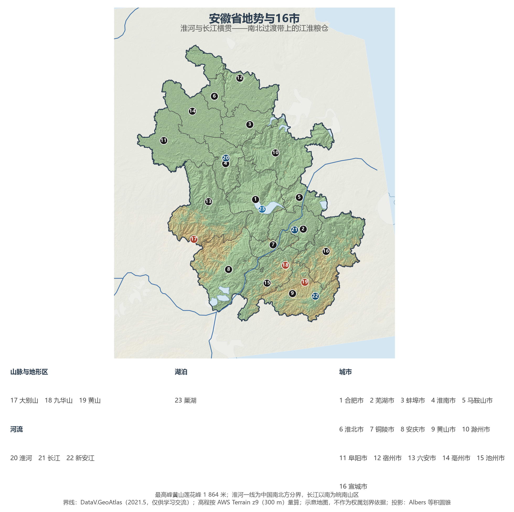
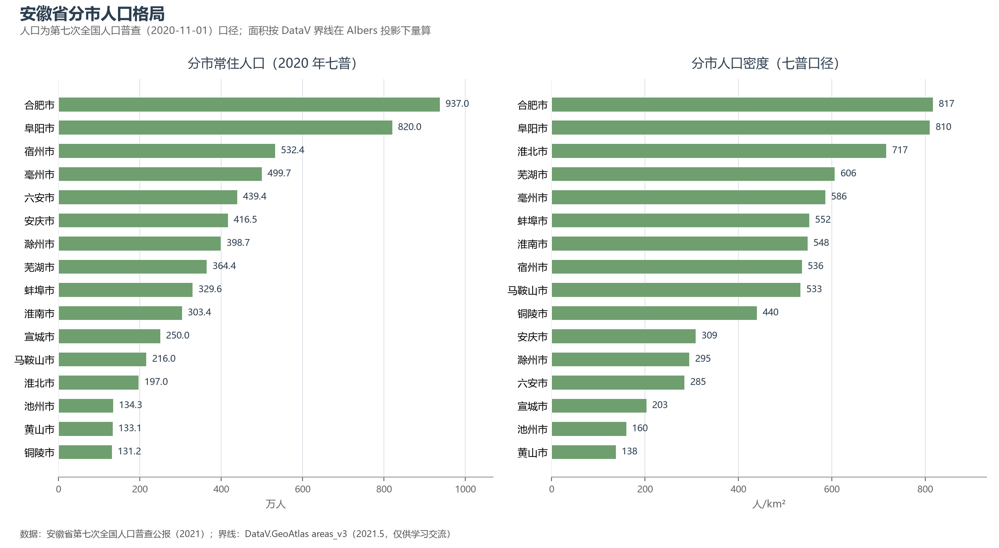
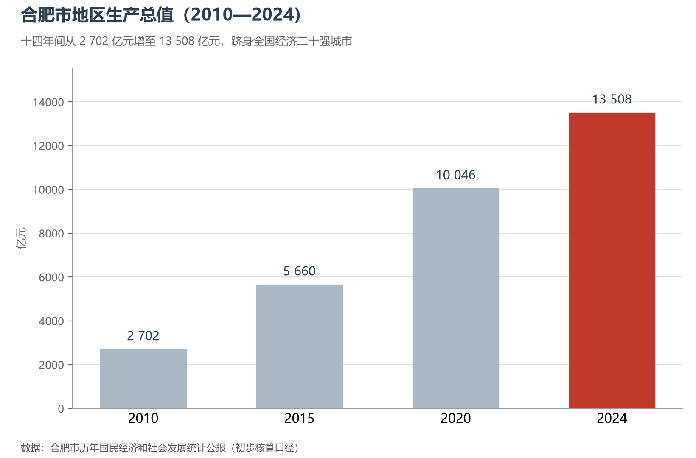

# 13.5.14 安徽省

安徽是被两条大河"分割"出来的省份：淮河横贯北境，是中国南北方的天然分界；长江斜穿中南部，江左江右各成世界。皖北是华北平原延伸过来的大粮仓，皖中巢湖之滨坐落着中国成长最快的省会城市，皖南的群山里藏着徽商五百年的财富记忆与黄山—西递宏村的粉墙黛瓦。1978 年，凤阳小岗村的十八个红手印在这里按响农村改革的先声；四十多年后，合肥又以"最牛风投城市"的名号站上中国科技产业的前排。

## 一、省情速览

| 指标 | 数值 |
|------|------|
| 面积 | 140 100 km² |
| 常住人口 | 6 102.7 万（2020 年七普）；6 123 万（2024 年末） |
| 常住人口城镇化率 | 62.57%（2024 年末） |
| 地区生产总值 | 47 051 亿元（2023）；50 625 亿元（2024，增长 5.8%），居全国第 11 位 |
| 人均地区生产总值 | 约 8.3 万元（2024） |
| 行政区划 | 16 个设区市 |
| 简称 | 皖 |

放在全国坐标里：安徽 GDP 居全国第 11 位，与上海、湖南同处 5 万亿元量级；人均 GDP 仍低于全国平均，是长三角三省一市中的追赶者。放回世界视角：全省常住人口略多于意大利，经济规模粗折约 7 100 亿美元——超过瑞典与比利时的全国体量，正逼近波兰。2019 年长三角一体化上升为国家战略后，安徽全域纳入长三角，结束了长期"不东不西"的尴尬定位，皖江城市带承接产业转移示范区（2010 年设立，全国首个）由此升格为国家级战略纵深。

**图 13-110 安徽省地势与 16 市**：z9 级 DEM 晕渲（300 m 分辨率），编号说明见图下。

## 二、自然地理

安徽的地貌是整个中国的缩影：北部淮北平原属黄淮海平原的南缘，一望无际；中部江淮丘陵起伏其间，巢湖（约 770 km²）位列中国五大淡水湖；长江以南，皖南山区骤然隆起——**黄山**以莲花峰（1 864 米）冠绝全省，花岗岩峰林、怪石、云海与奇松被徐霞客叹为"登黄山天下无山"；大别山盘踞皖西，是长江与淮河的分水岭，天堂寨的瀑布群至今人迹罕至。气候恰跨暖温带与亚热带：淮河以北年降水 700—900 毫米、旱作物为主，以南骤增至 1 200—1 700 毫米、稻作与茶山连绵，"橘逾淮而北为枳"的古老观察正发生在这条线上。

**水**的故事有喜有忧。长江过境约 416 公里，"八百里皖江"串起安庆、铜陵、芜湖、马鞍山四座沿江城市；淮河则是中国最难治理的河流之一——王家坝闸号称"千里淮河第一闸"，蒙洼蓄洪区一次次以开闸蓄洪保全下游，2020 年特大洪水中的第 16 次开闸至今令人记忆犹新。发源于休宁的新安江顺流而下注入千岛湖，2012 年起皖浙两省在这里建立了全国首个跨省流域生态补偿机制——"亿元对赌水质"成为中国生态文明制度创新的样本。

**矿产**曾经定义了安徽的另一半经济地理：两淮煤田（淮南、淮北）是华东地区最重要的能源基地，淮南矿区累计探明储量逾百亿吨；铜陵的铜、马鞍山的铁自青铜时代起就进入中原文明的物料清单，"古铜都"与"钢城"之名延续至今。进入新能源时代，这些老工业城市正把煤电基础转换为电力与储能的新赛道。

## 三、建置沿革与人文

清康熙六年（1667 年）江南省分治，取安庆、徽州二府首字得名"安徽"，与江苏的得名同一时刻。此前这片土地从未构成完整的行政单元，却贡献了影响深远的两股力量：其一，**徽商**——明清之际称雄商界数百年，"无徽不成镇"，扬州的盐业、江南的典当、沿江的茶木皆有其手笔，致富之后回乡营造的粉墙黛瓦马头墙，让西递、宏村在 2000 年整体列入世界遗产；其二，**文房与学问**——泾县宣纸的制作技艺列入人类非物质文化遗产名录，桐城派主宰清代文坛两百年，老庄哲学、建安文学、新安理学在此层层叠写。

20 世纪的两声惊雷同样来自安徽：1978 年小岗村农民按下大包干红手印，拉开中国农村改革的序幕；1970 年中国科学技术大学南迁合肥，为这座内陆省会埋下科学的种子——2017 年合肥成为继上海之后第二个综合性国家科学中心，"墨子号"量子卫星、全超导托卡马克"人造太阳"从这里升空与点火。黄梅戏从安庆采茶调长成全国五大剧种之一，徽剧则进京催生了京剧；胡适、陈独秀、邓稼先……近代以降的皖籍学人与科学家，在这片"辫子与算盘、宣纸与实验台"交织的土地上层出不穷。

## 四、经济与区域战略

安徽这十年的主线是"**融长**"与"**科创**"。产业上，"芯屏汽合"四个字概括了合肥的打法：长鑫存储补上DRAM芯片的国产短板，京东方把合肥变成全球最大的新型显示基地之一，蔚来中国总部落户江淮之滨，2024 年全省汽车产量约 357 万辆、跃居全国第 2 位，奇瑞（芜湖）则连续多年蝉联中国乘用车出口第一。合肥的崛起堪称教科书级：2010 年 GDP 2 702 亿元，2015 年 5 660 亿元，2020 年破万亿，2024 年达 13 508 亿元、约占全省四分之一强，跻身全国城市二十强——政府以国资平台押注京东方、蔚来等产业的"风投"打法，被视为中国产业政策的城市样本。全省 2024 年 GDP 50 625 亿元，芜湖首破 5 000 亿元，滁州跨上 4 000 亿元台阶，亳州以 13.8% 的名义增速反超宿州，铜陵的实际增速（6.5%）居全省之首。

农业的分量常被科创叙事掩盖：皖北平原贡献了全国第四位的粮食产量，阜阳、宿州、亳州的粮仓地位延续了千年；亳州同时是全国最大的中药材集散地。交通上，京沪、京港（台）、沪汉蓉三大高铁通道在合肥十字交汇，"米"字形高铁网让合肥到省内任一设区市不超过一小时；芜湖人多年前流传的"过江难"，如今已被十余座皖江大桥与过江隧道化解。

**图 13-111 安徽省分市人口格局**：左为分市常住人口（七普），右为分市人口密度——合肥市以约 817 人/km² 居首，黄山市仅 138 人/km²。

## 五、分区地理：皖北、皖中、皖江与皖南（编号见图 13-110）

**皖北平原（6、11、12、14、3）**——阜阳（11）820.0 万人为全省人口第二大市，京九铁路与商合杭高铁在此交汇，是劳务输出与农业机械化的双重样本，粮、肉、菜产量均居全省前列；亳州（14）是曹操、华佗故里与"中华药都"，全国最大的中药材交易市场每年吸引数十万药商；宿州（12）以"云都"著称的云计算产业园让这座农业大市多了数字名片，砀山酥梨与符离集烧鸡自成一格；淮北（6）从煤炭城市转型为山水生态城市，采煤塌陷区变成了湿地公园；蚌埠（3）扼淮河中游，玻璃新材料工业设计研究全球闻名，双墩遗址与禹会村遗址把淮河文明推向上古。

**皖中与江淮（1、4、10、13）**——合肥（1）936.99 万人居全省第一，三国逍遥津、包公祠与科学岛同在一城；淮南（4）以"火电三峡"著称，八公山下的寿县古城是淝水之战古战场；滁州（10）与南京一河之隔，琅琊山因欧阳修《醉翁亭记》名传千古；六安（13）大别山革命老区，六安瓜片茶香与淠史杭灌区的人工天河并存。

**沿江与皖南（2、5、7、8、15、16、9）**——芜湖（2）364.4 万人，皖江明珠，奇瑞汽车的故乡；马鞍山（5）因钢设市，采石矶留下李白捞月的传说；铜陵（7）"中国古铜都"，采冶史逾三千年；安庆（8）1760—1938 年间的安徽省会，桐城"六尺巷"的礼让故事传为美谈；池州（15）以九华山佛教朝圣与贵池傩戏立身；宣城（16）文房四宝之乡，李白笔下桃花潭水在此；黄山（9）全省人口最少、密度最低的市，旅游收入却居全省前列——黄山、西递宏村、徽州古城构成中国最完整的古徽州文化圈。

**图 13-112 合肥市地区生产总值（2010—2024）**：十四年间从 2 702 亿元增至 13 508 亿元，合肥跻身全国经济二十强城市。

## 六、省内之最

| 项 | 值 |
|----|----|
| 最高点 | 黄山莲花峰（黄山市），1 864 m |
| 面积最大 / 最小的市（量算） | 六安市 15 441 km² / 淮北市 2 748 km² |
| 人口最多 / 最少的市（七普） | 合肥市 937.0 万 / 铜陵市 131.2 万 |
| 人口密度最高 / 最低（七普量算） | 合肥市 817 人/km² / 黄山市 138 人/km² |
| GDP 首位市 | 合肥市 13 507.7 亿元（2024，约占全省 1/4） |
| 湖泊之最 | 巢湖约 770 km²，中国五大淡水湖之一 |
| 改革地标 | 凤阳小岗村——中国农村改革第一村 |

## 参考与数据来源

1. 面积、人口、GDP 总量：附录 A 口径（《中国统计年鉴 2024》）；2024 年 GDP、城镇化率与年末常住人口为《2024 年安徽省国民经济和社会发展统计公报》。
2. 分市人口：安徽省第七次全国人口普查公报（2021），16 市数据精确到人并与全省合计核对。分区面积按 DataV 界线在 Albers 投影下量算。
3. 分市 GDP：合肥市、芜湖市、滁州市、亳州市、宿州市 2024 年国民经济和社会发展统计公报及安徽省统计局统一核算发布口径；汽车产量据安徽省及行业公开统计。
4. 新安江生态补偿、小岗村、综合性国家科学中心：新华社及安徽省人民政府公开报道。
5. 地势图 DEM：AWS Terrain Tiles z9（300 m 分辨率量算）；界线：DataV.GeoAtlas areas_v3（2021.5，仅供学习交流）。
