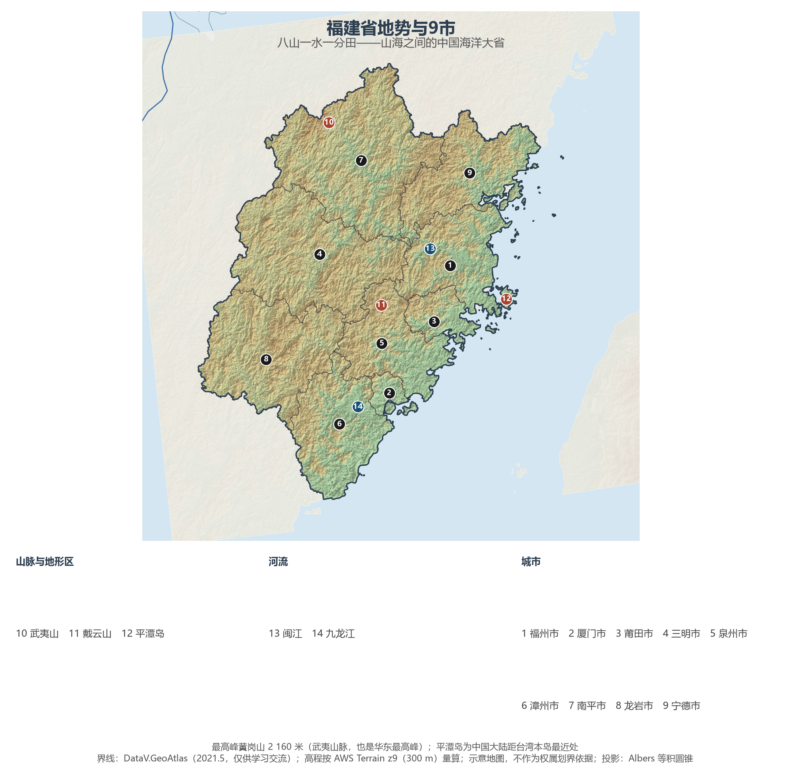
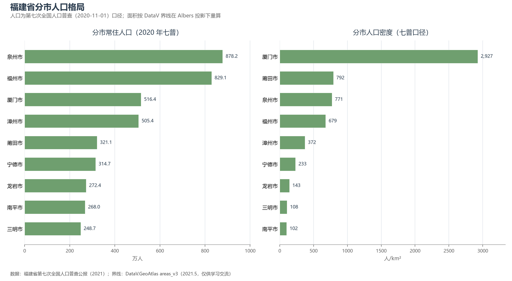
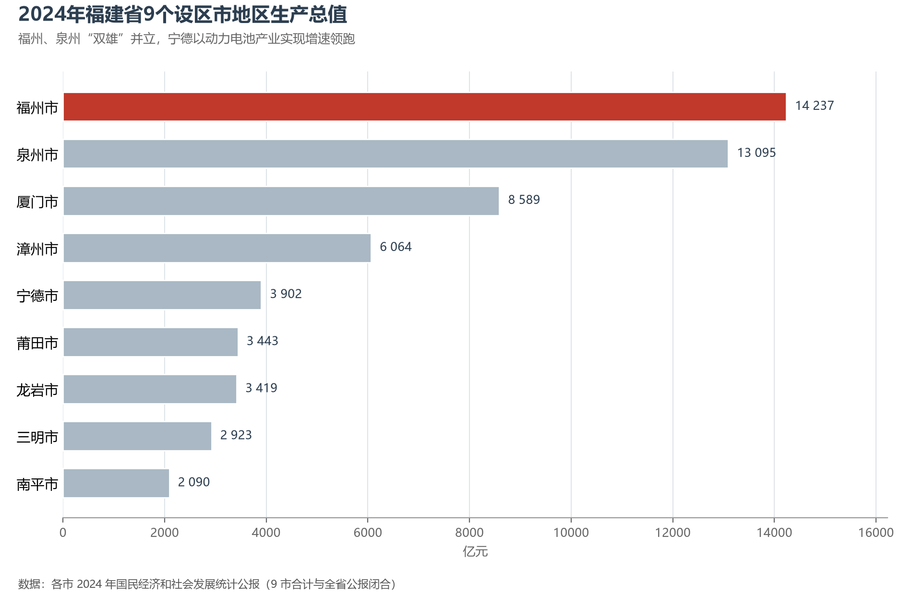

# 13.5.15 福建省

"八山一水一分田"，福建把最贫瘠的山水家底做成了最开放的经济答卷。武夷山脉像一道高墙把闽地与内陆隔开，先民于是向海洋讨生活：宋元之际，泉州刺桐港是马可·波罗笔下与亚历山大港齐名的世界大港；今天的宁德，则产出了全球近四成的动力电池。全省森林覆盖率 65.12%、连续四十余年居全国第一，海岸线长度居全国第二——山有多封闭，海就有多开放，这是理解福建地理的全部钥匙。

## 一、省情速览

| 指标 | 数值 |
|------|------|
| 面积 | 124 000 km² |
| 常住人口 | 4 153.9 万（2020 年七普）；4 193 万（2024 年末） |
| 常住人口城镇化率 | 71.80%（2024 年末） |
| 地区生产总值 | 54 369 亿元（2023）；57 761 亿元（2024，增长 5.5%），居全国第 8 位 |
| 人均地区生产总值 | 137 920 元（2024，居全国省级行政区第 4 位） |
| 行政区划 | 9 个设区市 |
| 简称 | 闽 |

放在全国坐标里：福建 GDP 居全国第 8，人均 GDP 仅次于北京、上海、江苏，是唯一跻身人均前四的非直辖市省份；"七普"十年间人口增长 12.6%，是东部人口吸引力最强的省份之一。放回世界视角：全省常住人口与加拿大全国相当，经济规模粗折约 8 100 亿美元，超过阿根廷、瑞典的全国体量。省内多山少田，却是中国最大的"海洋牧场"与茶叶之乡——安溪铁观音、武夷岩茶、福州茉莉花茶名满天下。

**图 13-113 福建省地势与 9 市**：z9 级 DEM 晕渲（300 m 分辨率），编号说明见图下。

## 二、自然地理

福建的地形骨架是两列大山与一条窄窄的海岸平原：西北的**武夷山脉**绵延 500 余公里，主峰黄岗山（2 160 米）是华东最高峰，1999 年武夷山以"文化+自然"双遗产列入世界遗产名录；中部的戴云山脉把闽江、九龙江切割出深谷。山地丘陵占全省八成以上，耕地仅约一成，平原只散布在漳州、福州、兴化与泉州湾四处河口三角洲——"八山一水一分田"由此而来。海岸线长达 3 700 余公里、居全国第二，曲折率冠绝全国，因此港湾深锁：三都澳、湄洲湾、厦门港、罗源湾都是天然深水良港，**平潭岛**是中国大陆距台湾本岛最近的地方，隔海相望新竹仅 68 海里。

**水系**独流入海、短促湍急：闽江为全省第一大河，流域面积几乎囊括闽北半壁；九龙江滋养漳州平原；汀江出闽入粤，是客家先民南迁的"母亲河"。气候属亚热带海洋性季风气候，年降水 1 400—2 000 毫米，夏秋台风频繁正面登陆——2016 年"莫兰蒂"重创厦门的记忆犹新。多山多雨的福建因此成为全国最绿的省份：森林覆盖率连续四十余年居全国第一，三明、龙岩的林海是华东最重要的碳汇库。

**海洋**是福建另一张隐形国土：13.6 万平方公里的管辖海域约为陆域的 1.1 倍，闽东渔场、闽中渔场与台湾海峡渔场养育了全国前列的水产品产量，大黄鱼人工养殖使宁德重回"中国大黄鱼之都"；海岸带上的滩涂与渔村（霞浦的紫菜架、连江的海带田）在摄影师的镜头里已成中国海洋美学的代名词。风能同样取之不竭——平潭、福清外海的海上风电场让福建成为海上风电装机大省。

## 三、建置沿革与人文

"福建"之名始于唐开元年间设福建经略使，取福州、建州（今建瓯）首字而成——与江苏、安徽一样，是"拼字省"。秦汉之际闽越国在此立国；宋代泉州港崛起，成为"东方第一大港"，刺桐城的蕃商云集写下了海上丝绸之路的黄金篇章；明初郑和七下西洋，每次都在长乐太平港候风开洋；清初台海统一后台湾一度隶属福建省，1885 年方才建省；近代福州船政学堂（1866 年）开中国近代海军与造船教育之先河。1980 年厦门成为首批经济特区，2014 年福建被定位为 21 世纪海上丝绸之路核心区，2023 年中央支持福建建设两岸融合发展示范区——向海而生的开放基因一脉相承。

福建也是中国的"世遗大省"与世界级民间信仰之乡：武夷山（1999）、福建土楼（2008）、鼓浪屿（2017）、泉州"宋元中国的世界海洋商贸中心"（2021）四处世界遗产串联古今；妈祖信俗与南音列入人类非物质文化遗产名录，湄洲岛的妈祖祖庙是全球三亿信众的朝圣中心。朱熹在武夷山麓讲学著述数十年，"东周出孔丘，南宋有朱子"——闽学由此成为宋以后中国思想的主流谱系。近代以降，"下南洋"的闽籍移民把闽南话、妈祖与骑楼带到东南亚各地，如今祖籍福建的海外华侨华人达一千余万人，"侨"是福建连通世界最深的纽带；台湾同胞中约八成祖籍在福建，闽南话、客家话与闽东话至今横跨海峡两岸。

## 四、经济与区域战略

福建的经济是典型的"群众性民营经济"：晋江的晋江经验以"爱拼才会赢"著称，安踏、特步、361°、鸿星尔克把这座县级市做成全国运动鞋服之都；德化陶瓷行销 190 多个国家，沙县小吃在全国开出 8 万余家门店。"数字福建"自 2000 年提出以来深耕二十余年，数字经济增长值占 GDP 比重居全国前列——这座城市级别的远见，孕育了后来福州的软件谷与厦门的软件园。近十年的现象级增长来自**宁德**——宁德时代（CATL）2024 年动力电池装车量 339.3 GWh、占全球 37.9%，连续第八年全球第一，把一座闽东小城推上世界新能源版图的中心；福耀玻璃供应了全球约三分之一的汽车玻璃。2024 年全省 GDP 57 761 亿元，福州（14 236.76 亿元）与泉州（13 094.87 亿元）"双雄"并立，厦门以人均 GDP 16.1 万元居全省第一。

对台区位是福建独有的战略资产：平潭综合实验区实行两岸共同规划管理，厦门经济特区与金门近在咫尺，"小三通"与厦金大桥的远景规划持续牵引两岸融合。交通上，全省 9 市全部通高铁，福州、厦门双机场格局加速成形，厦门港集装箱吞吐量超 1 200 万标准箱、居全球前列，"丝路海运"联盟已联结全球 300 多个港口。

**图 13-114 福建省分市人口格局**：左为分市常住人口（七普），右为分市人口密度——厦门市以约 2 927 人/km² 居首，南平市仅约 102 人/km²。

## 五、分区地理：沿海四市与内陆三市（编号见图 13-113）

**沿海五市（1—3、5—6）**——泉州（5）878.2 万人为全省人口第一大市，宋元"东方第一大港"的 22 处遗产点散布全城，清净寺与开元寺比邻而立见证多元信仰，下辖晋江、石狮、南安、惠安包揽了全省民营经济的半壁江山；福州（1）829.1 万人，三坊七巷被誉为"里坊制度活化石"，马尾船政与中国近代史深刻缠绕，滨海新城与长乐机场构成东进的新骨架；厦门（2）516.4 万人，面积全省最小而人口密度全省最高，鼓浪屿、厦门大学与自贸片区构成"海上花园"，金砖国家领导人会晤在此举行；莆田（3）是妈祖故里与鞋服产业重镇；漳州（6）土楼群与水仙花乡，古雷半岛的石化基地正向台湾海峡南口铺开。

**内陆三市与宁德（4、7—9）**——南平（7）面积全省最大（量算 26 271 km²）、人口密度全省最低，武夷山的茶园与朱子理学遗迹是其两张名片；三明（4）的沙县小吃与林改经验同样发轫于基层创造；龙岩（8）是古田会议召开地与客家祖地，上杭紫金山矿区的金铜产量居全国前列；宁德（9）从"老少边岛穷"起步，凭一座时代工厂完成了中国地级市最戏剧性的产业逆袭，2024 年 GDP 增速多年领跑全省。

**图 13-115 2024 年福建省 9 个设区市地区生产总值**：福州、泉州“双雄”并立，宁德以动力电池产业实现增速领跑。

## 六、省内之最

| 项 | 值 |
|----|----|
| 最高点 | 黄岗山（南平市，武夷山脉），2 160 m，华东最高峰 |
| 面积最大 / 最小的市（量算） | 南平市 26 271 km² / 厦门市 1 764 km² |
| 人口最多 / 最少的市（七普） | 泉州市 878.2 万 / 三明市 248.7 万 |
| 人口密度最高 / 最低（七普量算） | 厦门市 2 927 人/km² / 南平市 102 人/km² |
| GDP 首位市 | 福州市 14 236.76 亿元（2024） |
| 生态之最 | 森林覆盖率 65.12%，连续四十余年全国第一 |
| 世遗之最 | 武夷山、土楼、鼓浪屿、泉州城，4 处 |

## 参考与数据来源

1. 面积、人口、GDP 总量：附录 A 口径（《中国统计年鉴 2024》）；2024 年 GDP、人均 GDP、城镇化率与年末常住人口为《2024 年福建省国民经济和社会发展统计公报》。
2. 分市人口：福建省第七次全国人口普查公报（2021）。分区面积按 DataV 界线在 Albers 投影下量算。
3. 分市 GDP：各设区市 2024 年国民经济和社会发展统计公报（9 市合计 57 761.00 亿元，与全省公报闭合）。
4. 宁德时代装机数据：SNE Research 2024 年全球动力电池装车量统计；港口与"丝路海运"：厦门港务与福建省交通运输厅公开数据。
5. 世界遗产与非遗：联合国教科文组织名录；祖籍口径据国台办与福建省公开表述。
6. 地势图 DEM：AWS Terrain Tiles z9（300 m 分辨率量算）；界线：DataV.GeoAtlas areas_v3（2021.5，仅供学习交流）。
