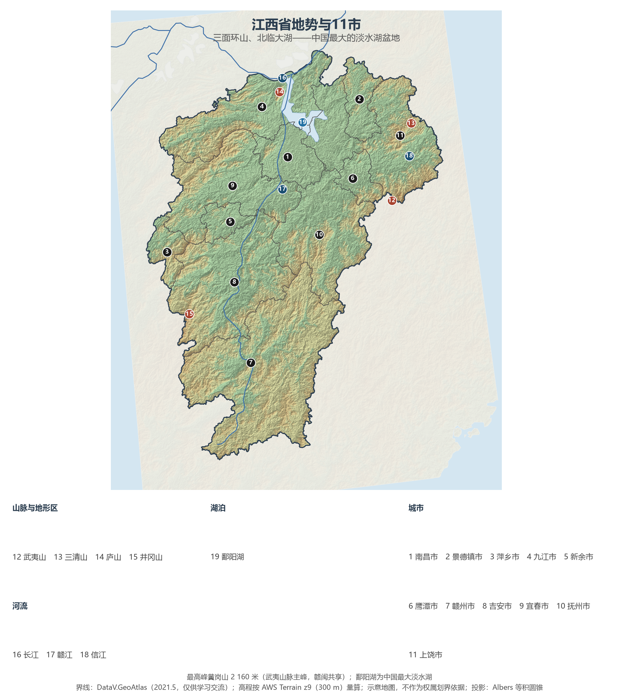
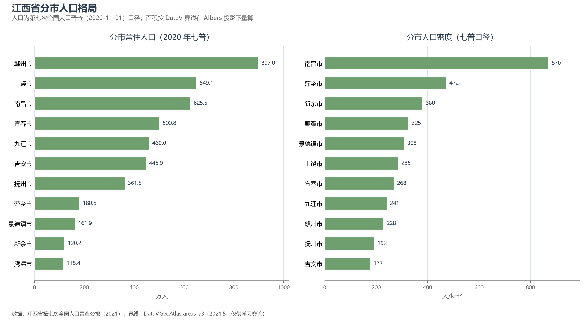
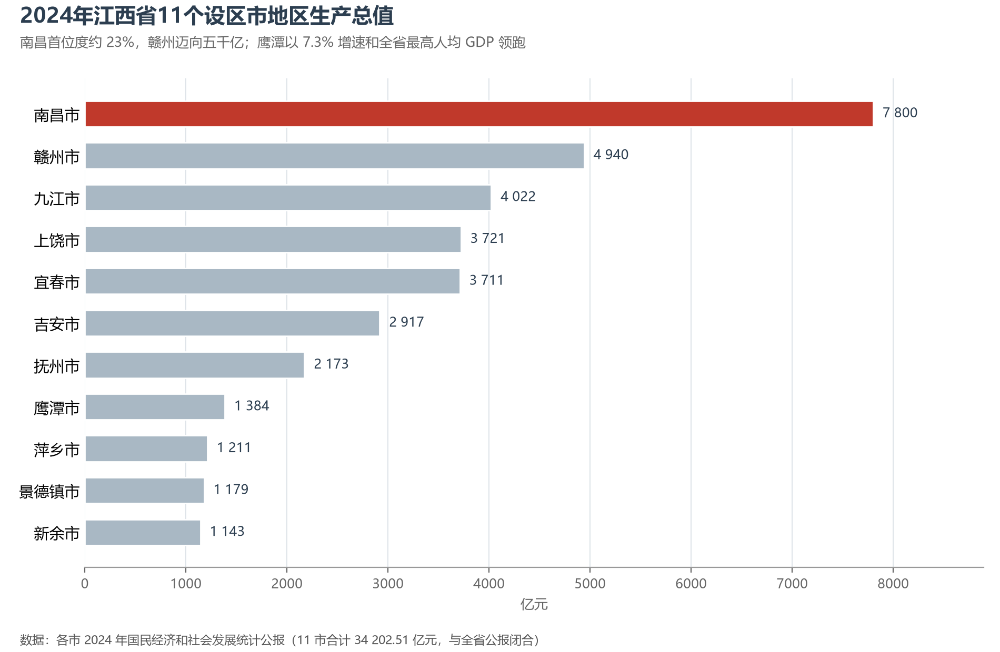

# 13.5.16 江西省

江西的地形像一只向北张开的簸箕：东有武夷山、西有罗霄山、南有南岭余脉，只有北面敞开一个巨大的湖口——鄱阳湖经赣江与长江相连。山把这里围成了相对独立的"赣鄱盆地"，也围出了它在中国史上的独特节奏：宋明两代人文鼎盛、冠盖满朝，近代却成了革命策源地——南昌打响第一枪，井冈山点燃星星之火，瑞金建起红色政权，长征从于都河畔出发。

## 一、省情速览

| 指标 | 数值 |
|------|------|
| 面积 | 166 900 km² |
| 常住人口 | 4 518.9 万（2020 年七普）；4 502.0 万（2024 年末） |
| 常住人口城镇化率 | 63.77%（2024 年末） |
| 地区生产总值 | 32 200 亿元（2023）；34 202.5 亿元（2024，增长 5.1%），居全国第 15 位 |
| 人均地区生产总值 | 75 862 元（2024） |
| 行政区划 | 11 个设区市 |
| 简称 | 赣 |

放在全国坐标里：江西 GDP 居全国第 15 位，是中部六省中的追赶者——人口在 2024 年净流出 13 万，向长三角与珠三角输出了数以百万计的务工者。放回世界视角：全省常住人口与阿尔及利亚相当，经济规模粗折约 4 800 亿美元，超过捷克、芬兰的全国体量。这座"低调"的省份握着几张世界级底牌：中国最大的淡水湖、亚洲最大的露天铜矿、储量世界第一的黑钨，以及"千年瓷都"景德镇。

**图 13-116 江西省地势与 11 市**：z9 级 DEM 晕渲（300 m 分辨率），编号说明见图下。

## 二、自然地理

江西三面环山、一面临江：东北的怀玉山托出**三清山**的花岗岩峰林（2008 年列入世界自然遗产），东部武夷山脉的主峰黄岗山（2 160 米）为赣闽共享，西缘罗霄山脉的**井冈山**既是地理分界，更是中国革命的圣地，南岭余脉大庾岭上的梅关古道，曾是中原通往岭南的千年孔道。四山夹出的赣鄱平原上，**鄱阳湖**作为中国最大淡水湖演绎着极端的水文节律：丰水期湖面超过 4 000 km²，枯水期可缩至数百平方公里，滩涂上越冬的白鹤占全球总数的九成以上——"候鸟天堂"由此成为江西生态的国际名片。

**五河归湖、一湖入江**是水系的全部骨架：赣江（省名之源——章水、贡水在赣州汇合始称赣江）、抚河、信江、饶河、修水自东、南、西三面注入鄱阳湖，湖水经湖口汇入长江，江西以约 152 公里的长江岸线与外界相连，九江市因此成为全省唯一的沿江港口城市。这条水系也记录着中国治水最沉重的篇章之一：1998 年长江全流域特大洪水中，九江大堤溃口、数十万军民堵口抢险的画面成为一代人的集体记忆；2020 年鄱阳湖流域又遭遇超历史洪水。气候属亚热带湿润季风气候，梅雨与伏旱相接，南昌的酷热使其位列长江"火炉"城市之一。

## 三、建置沿革与人文

江西的人类活动史可以追到万年仙人洞——这里出土了约两万年前世界最早的陶器之一，栽培稻遗存同样居于最早之列。汉代灌婴筑豫章城，唐开元二十一年（733 年）设江南西道，"江西"由此得名。两宋是江西的黄金时代：欧阳修、王安石、曾巩占得唐宋八大家中的三席，晏殊、文天祥、汤显祖相继而出，"隔河两宰相，五里三状元"的临川才子现象冠绝全国；白鹿洞、白鹭洲、豫章诸书院林立，朱熹在白鹿洞书院手订学规，成为后世书院制度的范本；龙虎山正一道与禅宗"一花开五叶"的祖庭群，让江西同时是道与禅的重镇。景德元年（1004 年）设置的景德镇窑火不熄，御窑厂在明清两代烧出了中国瓷器的巅峰——"匠从八方来，器成天下走"。明清之际"江西填湖广"的大移民，把赣地宗族与方言的种子撒到了长江中游。

红色史迹是江西的另一座富矿：1927 年 8 月 1 日南昌起义打响武装反抗第一枪，同年秋毛泽东率部上了井冈山开辟第一个农村革命根据地，1931 年中华苏维埃共和国在瑞金成立（"红色故都"），1934 年 10 月中央红军从于都集结渡河开始长征。今日的江西世界遗产四处：庐山（1996，文化景观）、三清山（2008）、龙虎山·龟峰（2010，中国丹霞）与铅山武夷山（2017，武夷山扩展项目）。

## 四、经济与区域战略

江西的产业地图是"**有色**"与"**绿色**"的双拼：德兴铜矿是亚洲最大的露天铜矿之一，江西铜业的阴极铜产量居全国首位，鹰潭依托铜冶炼做到全省最高的人均 GDP；赣州"世界钨都"的黑钨储量世界第一，赣南离子型稀土是中国中重稀土的核心产地；宜春凭借锂云母矿引来宁德时代、国轩高科，要做"亚洲锂都"。电子信息与中医药是两支新军：吉安、赣州的电子制造承接湾区转移，樟树"中国药都"的中药材集散延续千年，热敏灸、江中药业把传统医学做成现代产业。绿色名片则是茶与橙：庐山云雾、婺源绿茶之外，赣南脐橙的种植面积与产量均居世界第一。2024 年全省 GDP 34 202.5 亿元，南昌（7 800.37 亿元）首位度约 23%，赣州逼近 5 000 亿元大关，鹰潭以 7.3% 的增速领跑全省。人口持续外流是最大的隐忧——全省常住人口在 2024 年减少 13 万，"昌九一体化"与赣深高铁（2021 年通车，赣州至深圳约 2 小时）承担着把人流、物流重新接入两大湾区市场的使命。

**图 13-117 江西省分市人口格局**：左为分市常住人口（七普），右为分市人口密度——南昌市以约 870 人/km² 居首，吉安市仅约 177 人/km²。

## 五、分区地理：赣北、赣中与赣南（编号见图 13-116）

**赣北（1、2、4、6、11）**——南昌（1）625.5 万人，滕王阁下赣江穿城，"世界 VR 产业大会"落户于此；九江（4）460.0 万人，"三江之口、七省通衢"，白鹿洞书院曾居天下四大书院之首；景德镇（2）千年瓷都，御窑遗址与"景漂"创客并存；鹰潭（6）龙虎山道教祖庭与铜产业共生；上饶（11）649.1 万人，婺源篁岭的晒秋与三清山、龟峰串起赣东北旅游金三角。

**赣中（3、5、8、9、10）**——宜春（9）500.8 万人，明月山温汤的富硒温泉名动华东；新余（5）以钢铁立市，仙女湖是七仙女传说的故乡；抚州（10）汤显祖故里，"临川四梦"与文昌里历史街区相映；吉安（8）446.9 万人，庐陵文化孕育了文天祥"人生自古谁无死"的气节；萍乡（3）的安源路矿工人运动纪念馆记录着中国工人运动的起点。

**赣南（7）**——赣州（7）897.0 万人口、39 342 km² 面积皆为全省第一，客家先民南迁的第一站：围屋、宋城墙与古浮桥保存完好，瑞金、于都的红色地标与赣南脐橙的橙海在同一片丘陵上交叠，赣州国际陆港的中欧班列已通达中亚与欧洲。

**图 13-118 2024 年江西省 11 个设区市地区生产总值**：南昌首位度约 23%，赣州迈向 5 000 亿元；鹰潭以 7.3% 的增速和全省最高的人均 GDP 领跑。

## 六、省内之最

| 项 | 值 |
|----|----|
| 最高点 | 黄岗山（武夷山脉主峰，赣闽共享），2 160 m |
| 面积最大 / 最小的市（量算） | 赣州市 39 342 km² / 新余市 3 165 km² |
| 人口最多 / 最少的市（七普） | 赣州市 897.0 万 / 鹰潭市 115.4 万 |
| 人口密度最高 / 最低（七普量算） | 南昌市 870 人/km² / 吉安市 177 人/km² |
| GDP 首位市 | 南昌市 7 800.37 亿元（2024） |
| 湖泊之最 | 鄱阳湖为中国最大淡水湖，全球九成以上白鹤在此越冬 |
| 物产之最 | 赣南脐橙种植面积与产量世界第一；黑钨储量世界第一 |

## 参考与数据来源

1. 面积、人口、GDP 总量：附录 A 口径（《中国统计年鉴 2024》）；2024 年 GDP、人均 GDP、城镇化率与年末常住人口为《2024 年江西省国民经济和社会发展统计公报》。
2. 分市人口：江西省第七次全国人口普查公报（2021），11 市数据精确到人并与全省合计核对。分区面积按 DataV 界线在 Albers 投影下量算。
3. 分市 GDP：各设区市 2024 年国民经济和社会发展统计公报（11 市合计 34 202.51 亿元，与全省公报闭合）。
4. 白鹤越冬与鄱阳湖：江西鄱阳湖国家级自然保护区管理局公开口径；世界遗产：联合国教科文组织名录。
5. 地势图 DEM：AWS Terrain Tiles z9（300 m 分辨率量算）；界线：DataV.GeoAtlas areas_v3（2021.5，仅供学习交流）。
