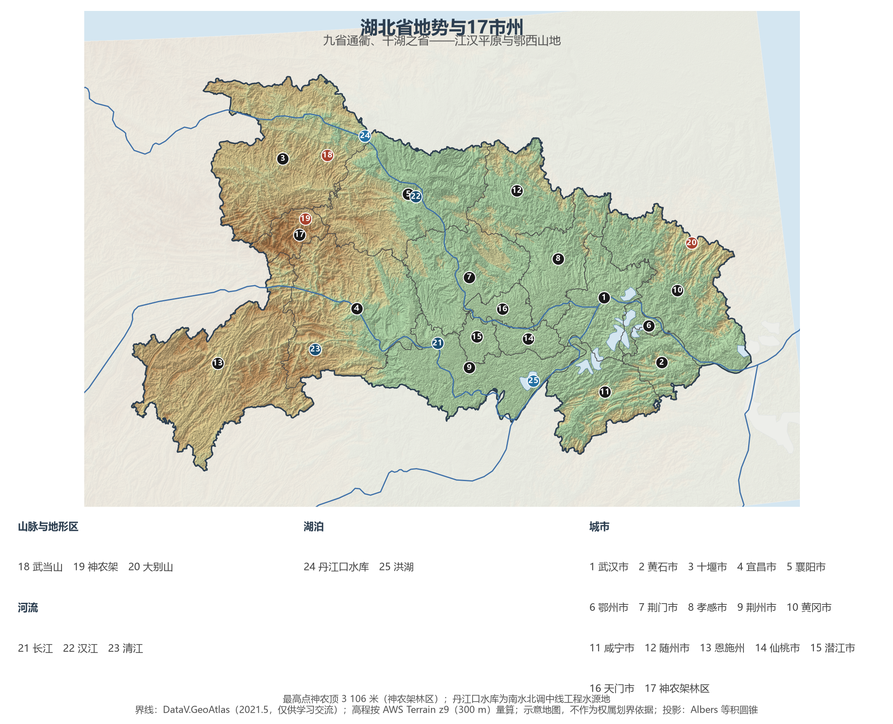
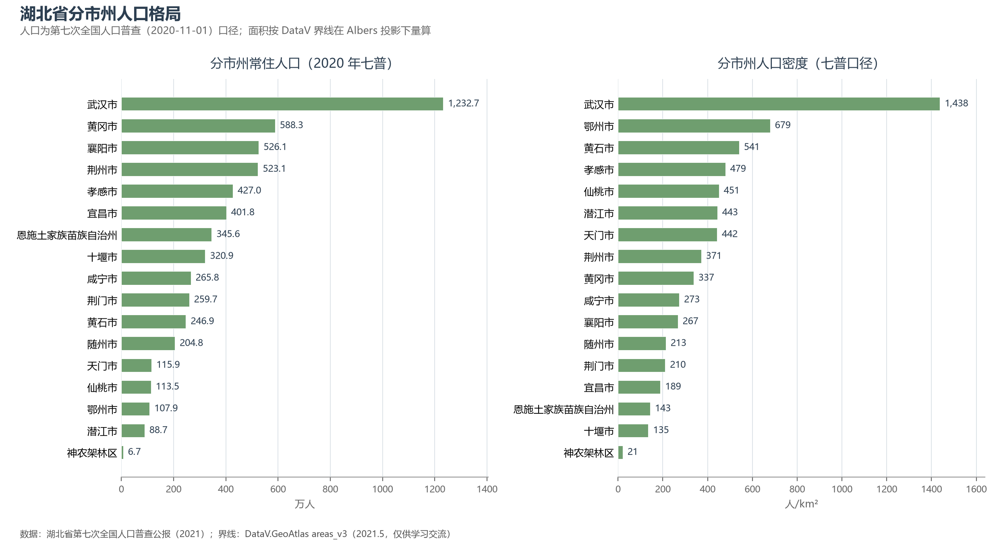
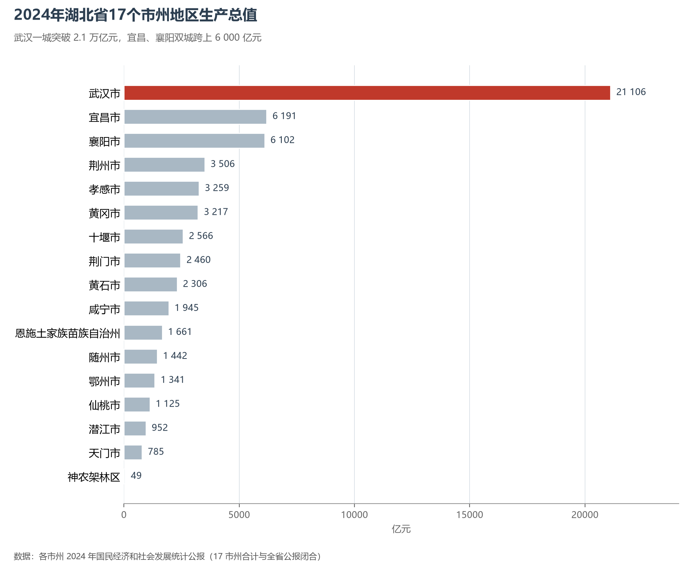

# 13.5.17 湖北省

湖北的地理身份写在两个字里：**江**与**湖**。长江横贯全省 1 061 公里，是长江干流流经最长的省份；星罗棋布的湖泊为它赢得"千湖之省"的旧称，江汉平原上每一座城市都枕水而居。武汉雄踞长江与汉江的交汇点，自古"九省通衢"——今天，这里既是辛亥革命的首义之地、中国重要的光电子与汽车产业基地，也坐拥亚洲第一座专业货运枢纽机场。鄂西的武当仙山、神农密林与三峡平湖，则为这片平原大省立起了另一重海拔近 3 100 米的脊梁。

## 一、省情速览

| 指标 | 数值 |
|------|------|
| 面积 | 185 900 km² |
| 常住人口 | 5 775.3 万（2020 年七普）；5 834 万（2024 年末） |
| 常住人口城镇化率 | 66.35%（2024 年末） |
| 地区生产总值 | 55 803.6 亿元（2023）；60 012.97 亿元（2024，增长 5.8%），居全国第 7 位 |
| 人均地区生产总值 | 约 10.3 万元（2024） |
| 行政区划 | 12 个地级市、1 个自治州、3 个省直辖县级市、1 个林区 |
| 简称 | 鄂 |

放在全国坐标里：湖北 GDP 迈上 6 万亿元台阶、居全国第 7 位，是中部崛起的支点省份；人均 GDP 高于全国平均。放回世界视角：全省常住人口与意大利全国相当，经济规模粗折约 8 400 亿美元——超过比利时、瑞典，接近波兰。省内行政版图别具一格：仙桃、潜江、天门三个县级市与神农架林区由省直辖，是全国少见的直辖县试点，17 个市州同列一表。

**图 13-119 湖北省地势与 17 市州**：z9 级 DEM 晕渲（300 m 分辨率），编号说明见图下。

## 二、自然地理

湖北地势西高东低、三面环山：鄂西的武陵山—巫山—大巴山一线最雄浑，**神农架**主峰神农顶（3 106.2 米）为全省之巅，这片北纬 31 度的原始森林是金丝猴的家园，2016 年整体列入世界自然遗产；鄂东北的大别山、鄂东南的幕阜山夹出低山丘陵，中部则是坦荡的**江汉平原**——长江与汉江冲积出的膏腴之地，湖群密布，洪湖为全省最大湖泊。先秦典籍中的"云梦泽"曾覆盖江汉平原大部，此后泥沙淤积与围垦把巨泽切成千万个湖泊，"千湖之省"的名号在 20 世纪一度褪色，退田还湖之后又渐渐名副其实——湖泊数量与面积的变化，本身就是一部人湖关系史。

**两江**是湖北的命脉。长江自川渝入境，横贯 1 061 公里至黄梅出省，流程居沿江各省之首；1998 年特大洪水中簰洲湾溃口的教训，催生了此后二十余年的堤防整治与退田还湖。宜昌三斗坪的**三峡工程**是世界最大的水利枢纽（装机 2 250 万千瓦），上游拦洪、下游发电、船闸通航，重新定义了长江中游的水文秩序；汉江上的丹江口水库则是南水北调中线工程的源头——2014 年通水以来，一库清水已持续润泽华北。气候属亚热带季风气候，梅雨、伏旱与"火炉"武汉的高温都属典型；2020 年又一场超历史洪水，检验了三峡与堤防体系成色。

## 三、建置沿革与人文

湖北是**楚文化**的腹地：春秋战国八百年，楚国以郢都（今荆州纪南城）为中枢，庄王问鼎、屈子行吟；荆州博物馆的战国丝绸与漆器、随州曾侯乙墓的 65 件编钟（1978 年出土，至今仍能奏响完整乐律），展示着这个浪漫瑰丽文明的高度。三国故事的一半发生在湖北——赤壁、荆州、当阳皆是战场。近代转折同样书写于此：张之洞督鄂十八年，汉阳铁厂、汉阳兵工厂开启中国近代工业，武昌在 1911 年 10 月 10 日打响辛亥革命第一枪；1927 年武汉三镇合并为武汉市，1958 年武钢出铁，"共和国钢都"自此起步。1998 年抗洪与 2020 年武汉抗疫（封城 76 天），让这座城市两次成为国家记忆的现场。

世界遗产四处：武当山古建筑群（1994，道教宫观与"金顶"），钟祥明显陵（2000，明清皇家陵寝），咸丰唐崖土司城（2015，土司遗址），神农架（2016）。人文谱系上，秭归的屈原、蕲春的李时珍、英山的毕昇各领一脉，黄鹤楼则承载着"昔人已乘黄鹤去"的千年吟咏。

## 四、经济与区域战略

湖北的经济骨架是"**一主两副**"：武汉一城独大又多极支撑。武汉的**光谷**（东湖高新区）是全球最大的光纤光缆制造基地——中国第一根石英光纤在这里拉出，长江存储的 3D 闪存芯片在此量产，东风汽车从十堰大山里走出后，武汉已成为全国最重要的汽车基地之一；2024 年武汉 GDP 21 106.23 亿元、约占全省三分之一，在校大学生超百万的"大学之城"为光电子信息、生物医药提供人力引擎。两个省域副中心同台竞技：**宜昌**以磷化工与清洁能源立身，2024 年 GDP 6 191.12 亿元、时隔多年反超襄阳重回全省第二；**襄阳**则以汽车与装备制造紧随其后（6 102.41 亿元）。县域经济特色鲜明：潜江的小龙虾做成"中国虾城"，仙桃的无纺布产量占全国四成以上，十堰是"中国卡车之都"，恩施靠"世界硒都"的富硒农业与文旅突围。2024 年全省 GDP 60 012.97 亿元、增长 5.8%。交通上，武汉"米"字形高铁网 4 小时可达全国主要城市，2022 年通航的鄂州花湖机场是亚洲首座专业货运枢纽机场，与天河机场构成客货"双枢纽"。

**图 13-120 湖北省分市州人口格局**：左为分市州常住人口（七普），右为分市州人口密度——武汉市以约 1 438 人/km² 居首，神农架林区仅约 21 人/km²。

## 五、分区地理：武汉城市圈、鄂西与两副中心（编号见图 13-119）

**武汉城市圈（1、2、6、8、10、11、14—16）**——武汉（1）1 232.7 万人一城独秀，黄鹤楼与东湖之间是大学与实验室的海洋；鄂州（6）面积全省最小（量算 1 590 km²）却拥有花湖机场；黄石（2）从矿冶之城转型电子基板，孝感（8）的汉孝一体化提速，黄冈（10）588.3 万人口居全省第二、黄冈中学名闻全国，咸宁（11）以温泉与桂花立市，仙桃、潜江、天门三直管市组成江汉平原的县域方阵。

**两副中心与鄂西（3、4、5、7、9、12、13、17）**——襄阳（5）扼汉江中游，古城墙下的汽车走廊绵延百里；宜昌（4）锁长江三峡门户，三峡大坝与葛洲坝梯级相连；十堰（3）武当山下"东风"故里；荆州（9）古城与纪南城遗址承载楚文化的记忆；荆门（7）的通用航空与农谷并进，随州（12）是编钟故里与专用汽车之都；恩施州（13）土家族苗族的聚居地，恩施大峡谷与硒茶出山；神农架林区（17）6.7 万人口、密度仅约 21 人/km²，是全国唯一的林区建制。

**图 13-121 2024 年湖北省 17 个市州地区生产总值**：武汉一城突破 2.1 万亿元，宜昌、襄阳双城跨上 6 000 亿元台阶。

## 六、省内之最

| 项 | 值 |
|----|----|
| 最高点 | 神农顶（神农架林区），3 106.2 m |
| 面积最大 / 最小的市州（量算） | 恩施州 24 089 km² / 鄂州市 1 590 km² |
| 人口最多 / 最少的市州（七普） | 武汉市 1 232.7 万 / 神农架林区 6.7 万 |
| 人口密度最高 / 最低（七普量算） | 武汉市 1 438 人/km² / 神农架林区 21 人/km² |
| GDP 首位市 | 武汉市 21 106.23 亿元（2024，约占全省 1/3） |
| 长江之最 | 干流湖北段 1 061 km，为沿江各省最长 |
| 工程之最 | 三峡工程装机 2 250 万千瓦，为世界最大水电站 |

## 参考与数据来源

1. 面积、人口、GDP 总量：附录 A 口径（《中国统计年鉴 2024》）；2024 年 GDP、三次产业、城镇化率与年末常住人口为《湖北省 2024 年国民经济和社会发展统计公报》。
2. 分市州人口：湖北省第七次全国人口普查公报（第二号），17 市州数据精确到人并与全省合计核对。分区面积按 DataV 界线在 Albers 投影下量算。
3. 分市州 GDP：各市州 2024 年国民经济和社会发展统计公报（17 市州合计与全省公报闭合）。
4. 三峡工程、南水北调中线、花湖机场：水利部长江水利委员会、中国民用航空局及新华社公开报道；世界遗产：联合国教科文组织名录。
5. 地势图 DEM：AWS Terrain Tiles z9（300 m 分辨率量算）；界线：DataV.GeoAtlas areas_v3（2021.5，仅供学习交流）。
