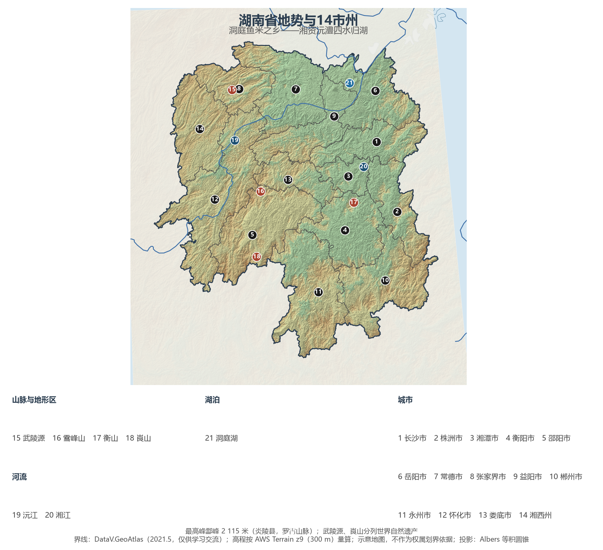
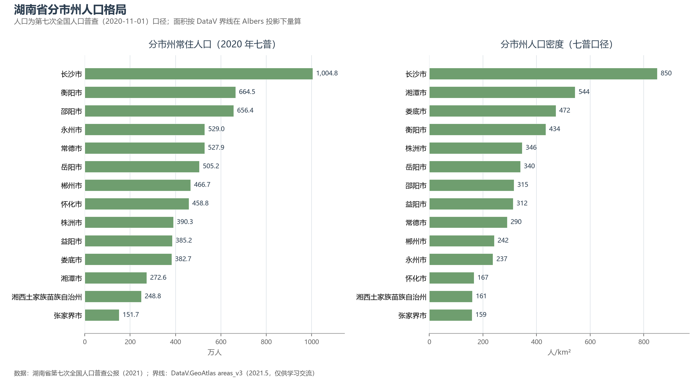
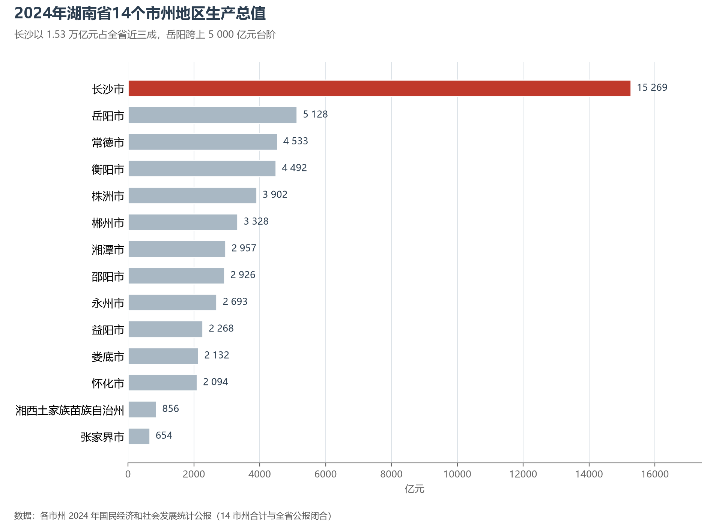

# 13.5.18 湖南省

湖南的地理公式是"**四水一湖**"：湘、资、沅、澧四条大河从东、南、西三面的山地奔流而下，尽数注入北端的洞庭湖，再由城陵矶汇入长江。这个向北开口的"马蹄形"盆地，北纳长江洪水、南接岭南潮气，养育了"湖广熟、天下足"的鱼米之乡，也养出了"惟楚有材、于斯为盛"的湖湘性格——从岳麓书院的千年弦歌，到韶山冲走出的一代伟人，再到今天长沙的工程机械与电视文创，湖南始终站在中国的风口上。

## 一、省情速览

| 指标 | 数值 |
|------|------|
| 面积 | 211 800 km² |
| 常住人口 | 6 644.5 万（2020 年七普）；6 539 万（2024 年末） |
| 常住人口城镇化率 | 62.07%（2024 年末） |
| 地区生产总值 | 50 012.3 亿元（2023）；53 230.99 亿元（2024，增长 4.8%），居全国第 10 位 |
| 人均地区生产总值 | 约 8.1 万元（2024） |
| 行政区划 | 13 个地级市、1 个自治州 |
| 简称 | 湘 |

放在全国坐标里：湖南 GDP 居全国第 10 位，2024 年被上海反超、退居其后；四年间常住人口减少逾百万，劳务输出规模居全国前列。放回世界视角：全省常住人口与坦桑尼亚相当，经济规模粗折约 7 500 亿美元——超过比利时，约为瑞士全国经济规模的八成。省内经济高度集中于长株潭：长沙一市占全省 GDP 近三成，而湘西州、张家界两市州合计不足全省 3%，"东强西弱"的梯度是这个中部省份最鲜明的空间特征。

**图 13-122 湖南省地势与 14 市州**：z9 级 DEM 晕渲（300 m 分辨率），编号说明见图下。

## 二、自然地理

湖南东、南、西三面山地环抱：东缘罗霄山脉与江西分界，主峰**酃峰**（2 115 米）为全省之巅，炎帝陵即在其脚下的炎陵县；南岭横亘湘粤桂之间，五岭之一的骑田岭道自古是南北交通的隘口；西北武陵山脉深处的**武陵源**，以 3 000 余座石英砂岩峰林立世，1982 年在此建立了中国第一个国家森林公园，1992 年列入世界自然遗产。中部的雪峰山把全省分成东西两半——抗战最后一战"雪峰山会战"与芷江受降（1945 年）就发生在这条山脉两侧。北部的**洞庭湖**是中国第二大淡水湖，从清代"八百里洞庭"的 6 000 余平方公里萎缩到今天的约 2 600 平方公里，是中国湖泊萎缩史最沉重的注脚；候鸟按季抵达，麋鹿重新野放，退田还湖让"人退湖进"再现转机。

**四水归湖**是水系总纲：湘江纵贯南北，串起永州、衡阳、株洲、湘潭、长沙、岳阳六城，是湖南的"母亲河"与经济主轴；资水、沅江、澧水各自切割出西部的山地河谷。气候属亚热带季风气候，长沙位列长江"四大火炉"，梅雨与伏旱之后，台风残余环流偶可深入湘南。2022 年的极端夏秋干旱使洞庭湖水位创下历史新低，枯水期的湖床草原成为新的生态景观，也敲响了水资源管理的警钟。

## 三、建置沿革与人文

湖南的人文史从传说走向实证：炎帝崩葬于炎陵，舜帝南巡崩于九嶷山；1972 年长沙马王堆汉墓出土的素纱襌衣与帛书帛画，让世界看见了西汉长沙国的物质与精神世界。北宋岳麓书院（976 年）创立，"惟楚有材，于斯为盛"的门联悬至今日；周敦颐开理学之先，朱熹、张栻会讲于岳麓，湖湘学派自此以"经世致用"为魂。近代湖南更是人才井喷：曾国藩、左宗棠的湘军改写晚清政局，谭嗣同、黄兴、蔡锷接力变法与共和，毛泽东、刘少奇、彭德怀等一大批革命者从这片土地走上历史前台——秋收起义在浏阳文家市转兵，井冈山的火种亦有半个湖南。抗战时期长沙四次会战寸土不让，芷江受降为十四年抗战画上句点。

世界遗产三处：武陵源（1992）、崀山（2010，中国丹霞）、永顺老司城（2015，土司遗址）。岳阳楼下"先天下之忧而忧"的名句、沈从文笔下的凤凰古城、浏阳的千年花炮与湘绣的鬅毛针法，共同构成湖湘文化的经纬。

## 四、经济与区域战略

湖南的产业名片写在**长沙**与**株洲**两城：长沙是"世界工程机械之都"，三一重工、中联重科、铁建重工、山河智能四家企业跻身全球工程机械 50 强，混凝土机械产量全球第一；马栏山视频文创园聚集了湖南广电与芒果系，"电视湘军"转型"中国 V 谷"。株洲则是"中国电力机车之都"，中车株机的机车与城轨车辆行驶在世界数十个城市，航空发动机与硬质合金同为其王牌。区域板块分化明显：岳阳（5 127.66 亿元）依托城陵矶港成为湖南唯一的通江达海口岸；常德、衡阳居四五千亿梯队；大湘西的怀化以国际陆港对接西部陆海新通道，张家界、湘西州则以旅游与精准扶贫立身——花垣县十八洞村是"精准扶贫"理念的首倡地（2013 年），大湘西的脱贫故事由此写进国家叙事。2024 年全省 GDP 53 230.99 亿元、增长 4.8%。交通上，京广与沪昆两大高铁动脉在长沙十字交汇，黄花机场旅客吞吐量居中部前列，"米"字形高铁网正在成形。

**图 13-123 湖南省分市州人口格局**：左为分市州常住人口（七普），右为分市州人口密度——长沙市以约 850 人/km² 居首，张家界市仅约 159 人/km²。

## 五、分区地理：长株潭、环洞庭湖、湘南与湘中、大湘西（编号见图 13-122）

**长株潭（1—3）**——长沙（1）1 004.8 万人为全省唯一千万级城市，岳麓山、橘子洲与梅溪湖串起山水洲城；株洲（2）火车拉来的城市，电力机车与航空动力双引擎；湘潭（3）以 5 014 km² 为全省面积最小，毛泽东故居韶山在其境内，三市以全国最早的区域一体化试验缝合为"长株潭都市圈"。

**环洞庭湖（6、7、9）**——岳阳（6）扼长江与洞庭湖交汇口，城陵矶新港区是湖南出海的咽喉；常德（7）"桃花源里的城市"，洞庭湖平原的粮仓；益阳（9）黑茶之乡，安化千两茶与竹海闻名。

**湘南与湘中（4、5、10、11、13）**——衡阳（4）664.5 万人口居全省第二，南岳衡山香火千年；郴州（10）的有色金属与东江湖大数据中心并进；永州（11）舜帝陵与江永女书藏于潇水之滨；邵阳（5）与娄底（13）构成湘中工矿带，冷水江锑都的锑产量曾占全球半壁。

**大湘西（8、12、14）**——张家界（8）以山立市，是全球知名的旅游目的地；怀化（12）"火车拖来的城市"，湘黔铁路时代的枢纽正向国际陆港转型；湘西州（14）土家族苗族自治州，凤凰古城、老司城与十八洞村同在一片武陵山中。

**图 13-124 2024 年湖南省 14 个市州地区生产总值**：长沙以 1.53 万亿元占全省近三成，岳阳跨上 5 000 亿元台阶。

## 六、省内之最

| 项 | 值 |
|----|----|
| 最高点 | 酃峰（株洲市炎陵县），2 115 m |
| 面积最大 / 最小的市州（量算） | 怀化市 27 551 km² / 湘潭市 5 014 km² |
| 人口最多 / 最少的市州（七普） | 长沙市 1 004.8 万 / 张家界市 151.7 万 |
| 人口密度最高 / 最低（七普量算） | 长沙市 850 人/km² / 张家界市 159 人/km² |
| GDP 首位市 | 长沙市 15 268.78 亿元（2024，占全省近三成） |
| 湖泊之最 | 洞庭湖为中国第二大淡水湖（约 2 600 km²） |
| 产业之最 | 工程机械 4 家企业跻身全球 50 强，混凝土机械产量全球第一 |

## 参考与数据来源

1. 面积、人口、GDP 总量：附录 A 口径（《中国统计年鉴 2024》）；2024 年 GDP、三次产业、城镇化率与年末常住人口为《湖南省 2024 年国民经济和社会发展统计公报》。
2. 分市州人口：湖南省第七次全国人口普查公报（第二号），14 市州数据精确到人并与全省合计核对。分区面积按 DataV 界线在 Albers 投影下量算。
3. 分市州 GDP：各市州 2024 年国民经济和社会发展统计公报（14 市州合计 53 230.90 亿元，与全省公报闭合）。
4. 十八洞村精准扶贫、芷江受降：新华社及湖南省人民政府公开报道；世界遗产：联合国教科文组织名录。
5. 地势图 DEM：AWS Terrain Tiles z9（300 m 分辨率量算）；界线：DataV.GeoAtlas areas_v3（2021.5，仅供学习交流）。
