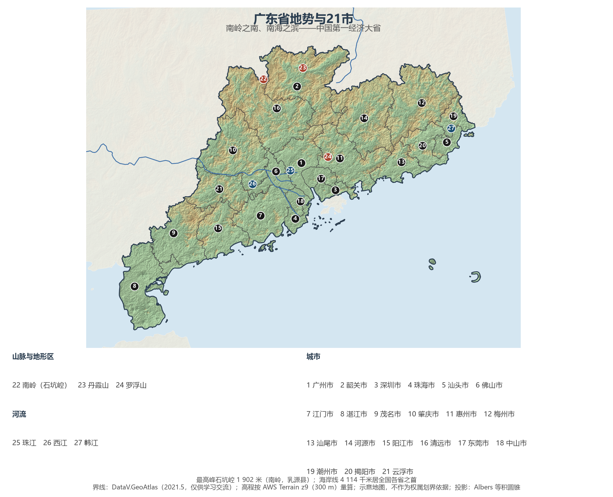
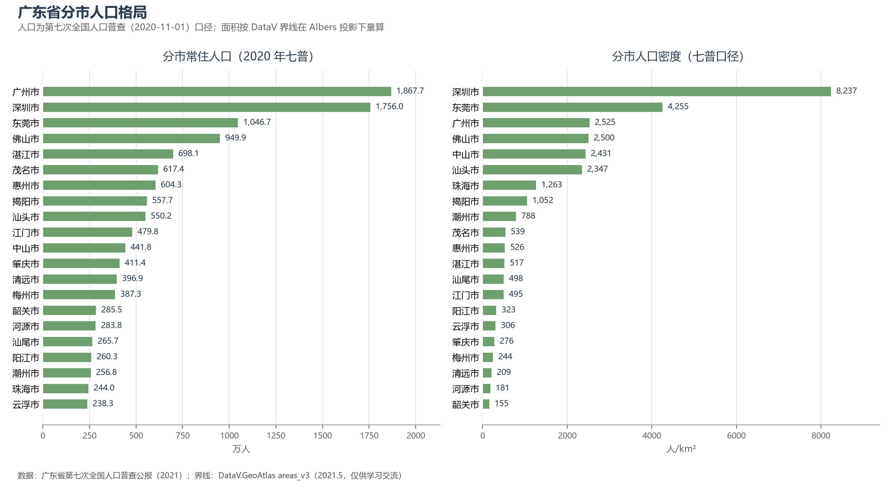
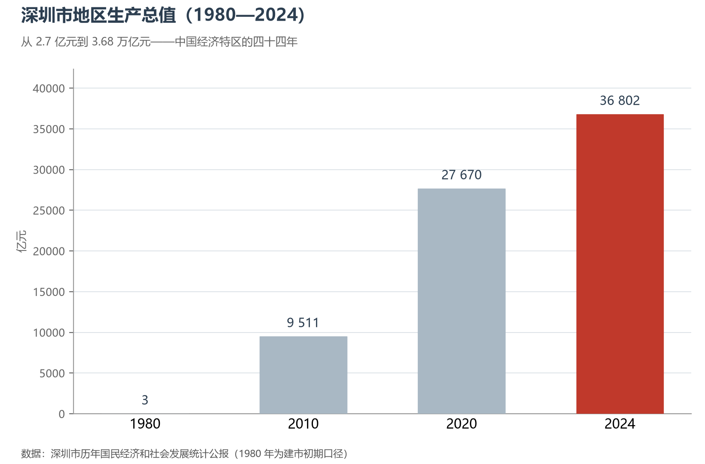

# 13.5.19 广东省

南岭把广东与中原隔开，南海又把它推向世界——这道地理的双面刃，塑造了中国最"外向"的省份。两千年前徐闻、合浦的帆影从这里驶向南海，明清十三行垄断了帝国的全部外贸，今天，珠三角以全世界罕见的城市密度继续制造与出口：GDP 连续 36 年居全国第一，人口超过日本全国，深圳用四十四年从边陲渔镇长成 3.68 万亿元的科创之城。

## 一、省情速览

| 指标 | 数值 |
|------|------|
| 面积 | 179 800 km² |
| 常住人口 | 12 601.3 万（2020 年七普，全国第 1）；12 780 万（2024 年末） |
| 常住人口城镇化率 | 75.91%（2024 年末，居全国各省首位） |
| 地区生产总值 | 135 673.2 亿元（2023）；141 633.81 亿元（2024，增长 3.5%），连续 36 年居全国第 1 |
| 人均地区生产总值 | 约 11.1 万元（2024） |
| 行政区划 | 21 个地级市 |
| 简称 | 粤 |

放在全国坐标里：广东以一省之力贡献了全国约十分之一的经济总量，深圳、广州、佛山、东莞四座万亿城市合计约占全省六成；外贸进出口总额 2024 年达 9.1 万亿元、连续 39 年居全国第一。放回世界视角：全省常住人口 1.278 亿，超过日本全国；经济规模粗折约 2.0 万亿美元——超过韩国，逼近俄罗斯。粤港澳大湾区与纽约、旧金山、东京湾区并称世界四大湾区，人口与经济总量在其中首屈一指。

**图 13-125 广东省地势与 21 市**：z9 级 DEM 晕渲（300 m 分辨率），编号说明见图下。

## 二、自然地理

广东的地形是"依山面海"的教科书样本：北部的**南岭**横亘湘赣粤之间，主峰石坑崆（1 902 米）为全省之巅，五岭的隘口自古是中原移民南下与岭南文化北传的走廊；中部珠江由西江、北江、东江汇流成网，冲出一片河汊纵横的**珠江三角洲**——珠江年径流量居全国江河第二，三角洲上的"桑基鱼塘"曾是循环农业的世界典范；南部的**雷州半岛**直插热带北缘，与海南岛隔琼州海峡相望。全省海岸线长 4 114 公里、居全国各省之首，沿海岛屿逾千，港湾深嵌——从汕头湾到湛江港，几乎每一座城市都是港口城市。

**丹霞山**（韶关）是"丹霞地貌"的国际命名地，2010 年以"中国丹霞"系列列入世界自然遗产。气候横跨南亚热带与热带：全年无冬的雷州半岛种着全国最北的椰林，而夏秋频繁登陆的台风也让广东成为中国台风灾害防御的第一线。

## 三、建置沿革与人文

秦平岭南置南海郡，秦末赵佗建南越国；唐设岭南道，宋分广南东路，"广东"由此得名。明清两代的广州是中国面向世界的唯一正门——1757 年起"一口通商"八十五年，十三行富甲天下；1839 年林则徐虎门销烟，鸦片战争在珠江口打响，中国近代史从此页开始。近代广东再执思想之牛耳：康有为、梁启超发动维新，孙中山领导辛亥革命，1924 年黄埔军校在长洲岛创立。1979 年，深圳、珠海、汕头与厦门同列全国首批经济特区；1988 年海南脱离广东建省；2019 年《粤港澳大湾区发展规划纲要》发布，深圳同年获建"中国特色社会主义先行示范区"——每个关键节点，广东都是改革的试验田。

广府、客家、潮汕三大民系在同一省内并行：粤语的粤语流行曲、客家围屋与梅州"世界客都"、潮汕的工夫茶与拜老爷，各自成体系又相互交融。开平碉楼（2007 年列入世界文化遗产）是华侨文化最立体的注脚；粤剧列入人类非物质文化遗产名录，潮汕英歌舞则在近年重新"出圈"。"食在广州"的粤菜与早茶，把这座省份的生活哲学端上了桌面。

## 四、经济与区域战略

广东的产业地图以**电子信息**为纲：规上电子信息产业规模连续多年居全国首位，深圳集聚了华为、腾讯、大疆、比亚迪——2024 年比亚迪新能源汽车销量居全球第一，大疆占据全球消费级无人机市场约七成；佛山顺德是"中国家电之都"，美的、格力从这里走向世界。外贸与制造业深度绑定：全省 2024 年进出口 9.1 万亿元，"广东制造"经由盐田、南沙、蛇口的码头发往全球。空间战略以**粤港澳大湾区**为纲——"9+2"城市群以全国不到 0.6% 的国土创造约九分之一的经济总量，港珠澳大桥（2018 年通车，世界最长跨海大桥）与深中通道（2024 年通车）把珠江口东西两岸缝合成一小时圈层。2024 年全省 GDP 141 633.81 亿元、增长 3.5%，深圳（36 801.87 亿元，全国城市第 3）与广州（31 032.50 亿元）双核引领，佛山、东莞同破万亿。

**图 13-126 广东省分市人口格局**：左为分市常住人口（七普），右为分市人口密度——深圳市以约 8 237 人/km² 高居全国城市前列，韶关市仅约 155 人/km²。

## 五、分区地理：珠三角、粤东、粤西与粤北（编号见图 13-125）

**珠三角九市（1、3—7、16—18）**——广州（1）1 867.7 万人为省会与国家中心城市，千年商都的白云机场与南沙港吞吐不息；深圳（3）1 756.0 万人、人口密度全省第一，从边陲到科创之城的四十四年是中国的改革缩影；东莞（17）"世界工厂"转型先进制造；佛山（6）家电与陶瓷，惠州（11）石化与电子，珠海（4）浪漫的特区与横琴粤澳深度合作区，中山（18）、江门（7，侨乡碉楼）、肇庆（10）各守一方。

**粤东四市（5、19、20、13）**——汕头（5）经济特区与省域副中心，潮汕文化的出海口；潮州（19）工夫茶与广济桥；揭阳（20）玉都与五金；汕尾（13）的滨海旅游与海上风电正在起步。

**粤西三市（8、9、15）**——湛江（8）南海舰队的母港与华南重要的钢铁、石化基地；茂名（9）石化与"中国荔枝第一镇"根子镇；阳江（15）"中国刀剪之都"，海上风电装机居全国前列。

**粤北五市（2、12、14、16、21）**——韶关（2）丹霞山与南华寺（禅宗六祖惠能驻锡之地）；清远（16）北江明珠与长隆森林度假区；梅州（12）"世界客都"；河源（14）万绿湖是华南最大人工湖；云浮（21）石材之乡，六祖惠能的故里新兴县在其境内。粤北五市是全省的生态屏障，人口密度全部低于 310 人/km²。

**图 13-127 深圳市地区生产总值（1980—2024）**：从 1980 年建市之初的 2.7 亿元，到 2024 年的 3.68 万亿元，深圳是中国经济特区四十余年的缩影。

## 六、省内之最

| 项 | 值 |
|----|----|
| 最高点 | 石坑崆（南岭，韶关市乳源县），1 902 m |
| 面积最大 / 最小的市（量算） | 清远市 19 026 km² / 中山市 1 817 km² |
| 人口最多 / 最少的市（七普） | 广州市 1 867.7 万 / 云浮市 238.3 万 |
| 人口密度最高 / 最低（七普量算） | 深圳市 8 237 人/km² / 韶关市 155 人/km² |
| GDP 首位市 | 深圳市 36 801.87 亿元（2024，全国城市第 3） |
| 海岸之最 | 海岸线 4 114 km，居全国各省之首 |
| 经济之最 | GDP 连续 36 年全国第一；4 座万亿城市与全国第一的外贸规模 |

## 参考与数据来源

1. 面积、人口、GDP 总量：附录 A 口径（《中国统计年鉴 2024》）；2024 年 GDP、城镇化率与年末常住人口为《2024 年广东省国民经济和社会发展统计公报》。
2. 分市人口：广东省第七次全国人口普查公报（2021），21 市数据以公报为准。分区面积按 DataV 界线在 Albers 投影下量算。
3. 分市 GDP：深圳市、广州市、佛山市、东莞市、惠州市、珠海市、中山市、茂名市 2024 年国民经济和社会发展统计公报及省统计局统一核算发布口径。
4. 比亚迪、大疆市场数据：企业年报与行业统计（2024）；大湾区与大桥工程：粤港澳大湾区建设领导小组办公室及新华社公开报道；世界遗产：联合国教科文组织名录。
5. 地势图 DEM：AWS Terrain Tiles z9（300 m 分辨率量算）；界线：DataV.GeoAtlas areas_v3（2021.5，仅供学习交流）。
