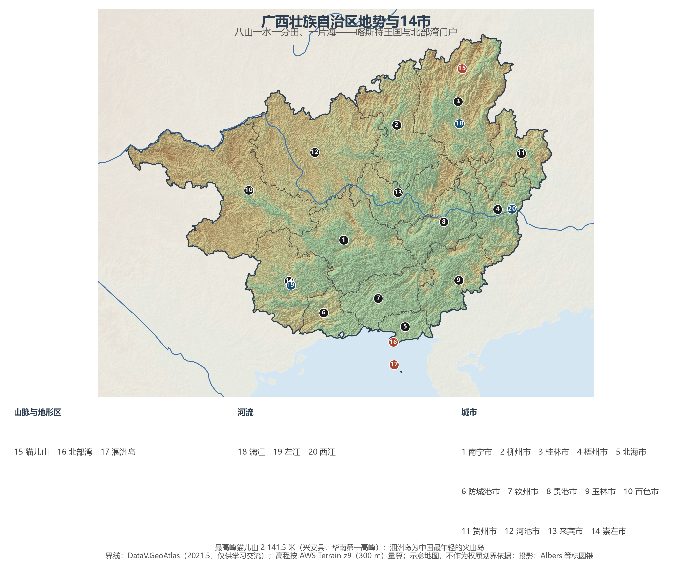
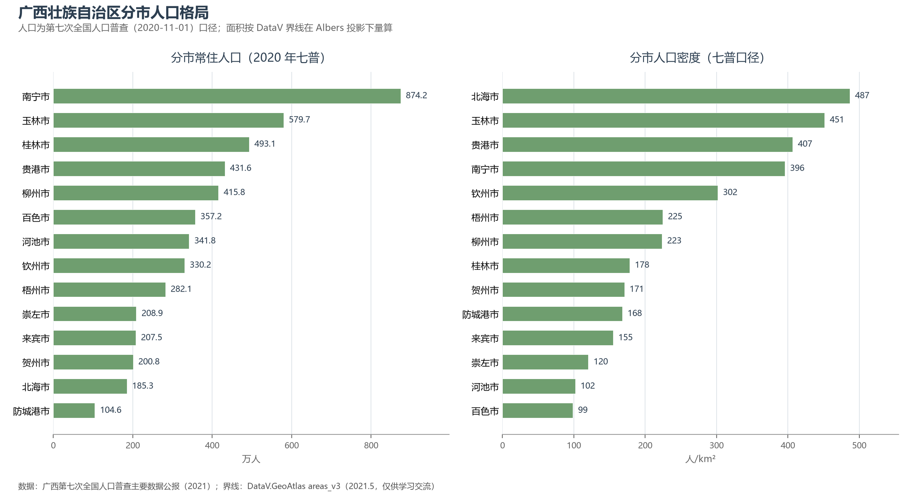
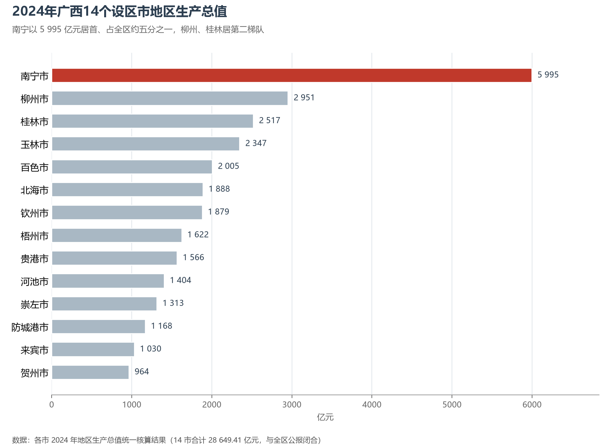

# 13.5.20 广西壮族自治区

"桂林山水甲天下"只是广西的一页。这片土地的更大底色是**喀斯特**——全区约四成的国土是石峰、洼地、天坑与溶洞，是世界了解岩溶地貌的第一现场；而南端 1 595 公里的海岸线又把它接进北部湾，面向东南亚打开另一扇门。壮族的歌圩、左江的花山岩画、灵渠两千年的流水与平陆运河的工地，共同讲述着一个边境自治区从"南疆边陲"走向"开放门户"的故事。

## 一、区情速览

| 指标 | 数值 |
|------|------|
| 面积 | 237 600 km² |
| 常住人口 | 5 012.7 万（2020 年七普）；5 013 万（2024 年末） |
| 常住人口城镇化率 | 57.39%（2024 年末） |
| 地区生产总值 | 27 202.4 亿元（2023）；28 649.40 亿元（2024，增长 4.2%），居全国第 19 位 |
| 人均地区生产总值 | 57 071 元（2024） |
| 行政区划 | 14 个设区市 |
| 简称 | 桂 |

放在全国坐标里：广西 GDP 居全国第 19 位，人均 GDP 约为全国平均的六成，是西部面向海洋的追赶者。放回世界视角：全区常住人口与韩国相当，经济规模粗折约 4 000 亿美元，超过捷克。这里是全国少数民族人口最多的自治区——壮族约 1 570 万人，加上瑶、苗、侗、仫佬等共 12 个世居民族，"三月三"歌圩是全区最盛大的节日。

**图 13-128 广西壮族自治区地势与 14 市**：z9 级 DEM 晕渲（300 m 分辨率），编号说明见图下。

## 二、自然地理

广西的骨架是"**八山一水一分田、一片海**"：西北云贵高原边缘、东北南岭山地、中部喀斯特峰林平原、南部北海滨平原与北部湾。**桂林—阳朔**的峰林峰丛是全球热带喀斯特的典范，2014 年作为"中国南方喀斯特"二期列入世界遗产；乐业的百朗大石围天坑群深逾 600 米，是"天坑"这一地貌术语的命名地；中越边境的**德天瀑布**横跨归春河，是亚洲最大的跨国瀑布。全区最高峰**猫儿山**（2 141.5 米）立于兴安，是华南第一高峰，漓江、资江均发源于此。北部湾海水清澈，涠洲岛是中国最年轻的火山岛，冬春季节布氏鲸群在斜阳岛外海出没，成为全国罕见的近岸鲸群观赏地。

**水**系隶属珠江流域：西江干流横贯梧州而出，红水河—黔江—浔江串联桂西北与桂东南；灵渠（公元前 214 年凿成）沟通湘江与漓江，让长江与珠江两大水系在兴安握手，是世界上最古老的运河之一。石山地区的**石漠化**曾是生态之痛，二十余年的封山育林与综合治理让河池、百色的石山重新披绿。气候属亚热带季风气候，南部的防城港、北海已近热带边缘，光温水条件撑起了全国最大的蔗糖与亚热带水果基地。

## 三、建置沿革与人文

广西先民是百越中的西瓯、骆越。公元前 214 年秦凿灵渠、置桂林郡，岭南纳入中原版图；汉代合浦港是海上丝绸之路最早的始发港之一，"珠还合浦"的典故生于此地。北宋设广南西路，"广西"得名；明清土司制度在此延续数百年，左江花山岩画的赭红色人像（2016 年列入世界遗产，中国首个岩画类世遗）记录着骆越人的祭祀场景。近代史页悲壮：1851 年洪秀全金田起义于桂平，1885 年冯子材镇南关大捷重创法军，1929 年邓小平发动百色起义，1934 年湘江战役成为红军长征中最惨烈的一战。1958 年广西壮族自治区成立；2004 年起中国—东盟博览会永久落户南宁，2019 年西部陆海新通道上升为国家战略，2022 年平陆运河开工——这条 134 公里、沟通西江与北部湾的"新中国第一条通江达海大运河"预计 2026 年主体建成。

壮族的文化标识鲜明：歌圩对歌与"歌仙"刘三姐、世界的铜鼓、四大名锦之一的壮锦、干栏式建筑与花山岩画一脉相承；柳州螺蛳粉从街头小吃做成年销售数百亿元的大产业，则是当代广西最出圈的味觉名片。

## 四、经济与区域战略

广西的经济版图由三支力量构成。其一是"**甜蜜的事业**"：蔗糖产量约占全国六成，崇左号称"中国糖都"，百色的芒果、武鸣的沃柑让"果园经济"四季不断。其二是**柳州的工业**——上汽通用五菱的新能源小车走遍城乡，柳工的装载机居世界前列，"螺蛳粉+汽车+钢铁"让这座工业重镇出圈。其三是**向海经济**：北部湾港集装箱吞吐量 2024 年突破 900 万标准箱，钦州自动化码头与海铁联运班列把西部陆海新通道的货物直送东盟，平陆运河建成后将使南宁经由水路直出北部湾、缩短入海里程 560 余公里。2024 年全区 GDP 28 649.40 亿元、增长 4.2%，南宁（5 995.36 亿元）一城独大，柳州、桂林居第二梯队；对东盟进出口连续多年居边境省区首位。交通上，贵南高铁（2023 年通车）打通北上大通道，南宁吴圩国际机场联结东盟十余个城市。

**图 13-129 广西壮族自治区分市人口格局**：左为分市常住人口（七普），右为分市人口密度——北海市以约 487 人/km² 居首，百色市仅约 99 人/km²。

## 五、分区地理：北部湾、桂北、桂东南与桂西北（编号见图 13-128）

**北部湾与首府（1、5—7、14）**——南宁（1）874.2 万人口居全区第一，"绿城"的东盟博览会、国际铁路港与五象新区是开放前沿；北海（5）银滩与涠洲岛旅游立市；钦州（7）自动化码头吞吐向千万标箱迈进；防城港（6）104.6 万人为全区人口最少，钢铁与粮油加工倚港而兴；崇左（14）"中国糖都"，德天瀑布与友谊关镇守边境。

**桂北与桂中（2、3）**——桂林（3）"山水甲天下"的国际旅游名城，漓江保护更是全国江河治理的样本；柳州（2）以汽车、钢铁、机械三大产业立市，工业总产值居全区之首。

**桂东南（4、8、9、11）**——玉林（9）579.7 万人口居全区第二，商贸传统深厚；贵港（8）荷城与内河大港；梧州（4）百年商埠，骑楼城里粤语与粤菜流淌，六堡茶外销南洋；贺州（11）长寿之乡与碳酸钙产业并进。

**桂西北（10、12、13）**——百色（10）"中国铝都"与芒果之乡，革命老区的红色记忆与右江河谷的现代农业并存；河池（12）是世界长寿之乡巴马的所在地，红水河梯级电站点亮华南；来宾（13）蔗糖与锰业撑起桂中腹地。

**图 13-130 2024 年广西 14 个设区市地区生产总值**：南宁以 5 995 亿元居首、占全区约五分之一，柳州、桂林位居第二梯队。

## 六、区内之最

| 项 | 值 |
|----|----|
| 最高点 | 猫儿山（桂林市兴安县），2 141.5 m，华南第一高峰 |
| 面积最大 / 最小的市（量算） | 百色市 36 240 km² / 北海市 3 807 km² |
| 人口最多 / 最少的市（七普） | 南宁市 874.2 万 / 防城港市 104.6 万 |
| 人口密度最高 / 最低（七普量算） | 北海市 487 人/km² / 百色市 99 人/km² |
| GDP 首位市 | 南宁市 5 995.36 亿元（2024，占全区约 1/5） |
| 物产之最 | 蔗糖产量约占全国六成；芒果、沃柑等亚热带水果四季出产 |
| 通道之最 | 平陆运河 134.2 km 在建，为新中国第一条通江达海的大运河 |

## 参考与数据来源

1. 面积、人口、GDP 总量：附录 A 口径（《中国统计年鉴 2024》）；2024 年 GDP、人均 GDP、城镇化率与年末常住人口为《2024 年广西壮族自治区国民经济和社会发展统计公报》。
2. 分市人口：广西第七次全国人口普查主要数据公报（2021），14 市数据精确到人并与全区合计核对。分区面积按 DataV 界线在 Albers 投影下量算。
3. 分市 GDP：各市 2024 年地区生产总值统一核算结果（14 市合计 28 649.41 亿元，与全区公报闭合）。
4. 平陆运河、北部湾港、糖业与螺蛳粉产业：广西壮族自治区人民政府及新华社公开报道；世界遗产：联合国教科文组织名录。
5. 地势图 DEM：AWS Terrain Tiles z9（300 m 分辨率量算）；界线：DataV.GeoAtlas areas_v3（2021.5，仅供学习交流）。
