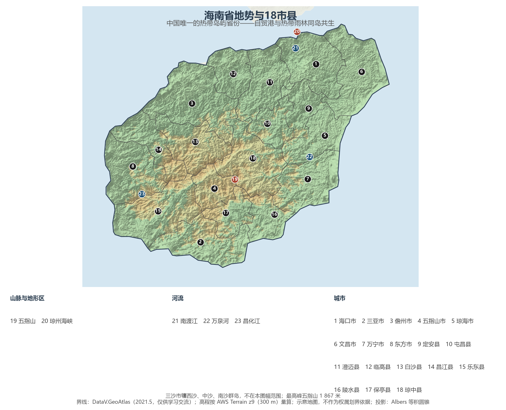
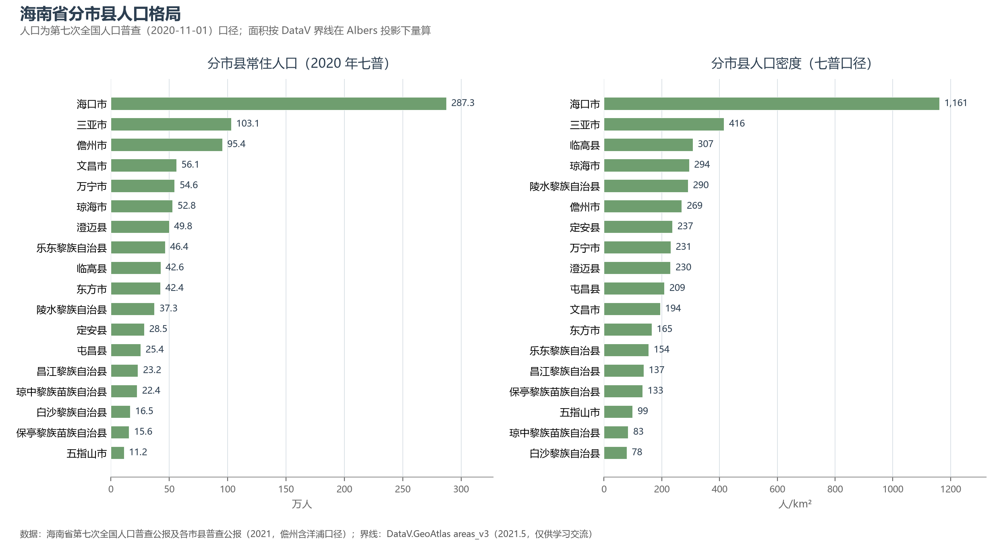

# 13.5.21 海南省

海南是中国最年轻的省份，也是最"热"的省份——不只是纬度，更是制度试验的热度。1988 年建省办经济特区，2018 年宣布建设自由贸易港，2025 年 12 月 18 日全岛封关运作，这座北隔琼州海峡的第二大岛，正在把整个省变成一个"境内关外"的开放体。而在制度的表层之下，是这片土地亘古的底色：中国面积最大的热带雨林、放射状的三大江河，以及黎族三千年的织锦。

## 一、省情速览

| 指标 | 数值 |
|------|------|
| 面积 | 35 400 km²（陆地） |
| 常住人口 | 1 008.1 万（2020 年七普）；1 048 万（2024 年末） |
| 常住人口城镇化率 | 63.08%（2024 年末） |
| 地区生产总值 | 7 551.2 亿元（2023）；7 935.69 亿元（2024，增长 3.7%），居全国第 28 位 |
| 人均地区生产总值 | 约 7.6 万元（2024） |
| 行政区划 | 4 个地级市、15 个省直辖县级行政单位 |
| 简称 | 琼 |

放在全国坐标里：海南 GDP 居全国第 28 位，经济体量不大，但七普十年人口增长 16.26%、居全国前列，是全国人口吸引力最强的省份之一。放回世界视角：全省常住人口与捷克相当，经济规模粗折约 1 100 亿美元，超过加纳的全国体量。全省 4 个地级市与 15 个省直辖县级行政单位并行——市县直管全国的独一份建制，源自 1988 年"小政府、大社会"的建省初心。

**图 13-131 海南省地势与 18 市县**：z9 级 DEM 晕渲（300 m 分辨率），编号说明见图下——三沙市辖西沙、中沙、南沙群岛，不在本图幅范围。

## 二、自然地理

海南岛呈**雪花样**的同心圆结构：中央是五指山、鹦哥岭隆起的中山地带，南渡江、昌化江、万泉河呈放射状奔流入海，外围环绕着丘陵、台地与滨海平原。最高峰**五指山**（1 867 米）因五峰如指得名，山体所覆盖的**海南热带雨林国家公园**（4 269 km²）是中国分布最集中、保存最完好的岛屿型热带雨林——全球最濒危的灵长类之一海南长臂猿就栖身于海拔千米之上的沟谷雨林中，种群已从最低谷的不足 10 只恢复到 7 群 40 只左右，被誉为"世界保护奇迹"。北隔**琼州海峡**（最窄处约 19.4 公里）与雷州半岛相望，这条黄金水道至今仍靠轮渡联通，跨海通道的论证随自贸港建设而升温。

**气候**是全国唯一的热带岛屿型：长夏无冬，海口年均温约 24 ℃，三亚约 25.5 ℃，雨季集中于 5—10 月；夏秋台风频繁登陆——2014 年"威马逊"是 41 年来登陆华南的最强台风，而冬季的"候鸟"人口（东北等地过冬人群）则构成海南独特的人口季节现象。四面环海赋予它阳光、沙滩与椰林，也让它成为中国冬季旅游与康养的第一目的地。

## 三、建置沿革与人文

汉武帝元封元年（前 110 年）设珠崖、儋耳二郡，海南始入版图；南北朝冼夫人安抚百越、请命置崖州，被尊为"岭南圣母"。北宋绍圣年间苏轼贬谪儋州，在载酒堂讲学明道，"海南万里真吾乡"——东坡书院至今犹存。明代海口人海瑞以刚直名世，丘濬则位列明代四大理学家。1950 年 4 月，人民解放军以木帆船横渡琼州海峡解放海南岛；1988 年 4 月，海南建省并成为全国最大的经济特区；2018 年 4 月，中央宣布支持海南全岛建设自由贸易试验区、逐步探索建设中国特色自由贸易港；2020 年《海南自由贸易港建设总体方案》发布；2025 年 12 月 18 日，海南自由贸易港**全岛封关运作**正式启动——"零关税、低税率、简税制"的制度框架全岛落地，海南成为中国开放能级最高的关税领土。

人文谱系以**黎族**最为古老：这个海南最早的居民把木棉与海岛棉织成黎锦，黎族传统纺染织绣技艺 2009 年列入人类非物质文化遗产名录，被誉为中国纺织史的"活化石"；船型屋、三月三与军坡节延续着岛的血脉。文昌鸡位列海南四大名菜之首，"文昌椰子半海南"；海口骑楼老街与火山口公园相邻，博鳌亚洲论坛（2001 年创立）则让琼海小镇成为亚洲对话的客厅。

## 四、经济与区域战略

自贸港政策重塑了海南的产业逻辑："**旅游业、现代服务业、高新技术产业、热带特色高效农业**"四大主导产业贡献了八成左右的经济增量。旅游业是门面——三亚亚龙湾、蜈支洲岛与离岛免税购物构成"度假+购物"的双引擎；高新技术产业三箭齐发：**南繁硅谷**（全国七成以上的农作物品种经过三亚南繁选育）、**深海科技**（崖州湾科技城的载人深潜与深海装备）与**航天科技**（文昌航天发射场是中国唯一的滨海发射场，长征五号、嫦娥五号、天问一号由此升空，2024 年海南商业航天发射场实现首飞）。2024 年全省 GDP 7 935.69 亿元、增长 3.7%，海口以约占全省 31% 的体量居首，儋州（含洋浦）与三亚居千亿元梯队。交通上，**全球首条环岛高铁**（2015 年全线贯通）与 2023 年通车的 988 公里环岛旅游公路把全岛海岸串成闭环，美兰、凤凰双机场与洋浦港、新海港构成海空门户。

**图 13-132 海南省分市县人口格局**：左为分市县常住人口（七普，儋州含洋浦口径），右为分市县人口密度——海口市以约 1 161 人/km² 居首，白沙县仅约 78 人/km²。

## 五、分区地理：南北双城、东西两翼与中部生态核心（编号见图 13-131）

**北部与南部双城（1、2）**——海口（1）287.3 万人的省会与自贸港门户，骑楼老街、江东新区与美兰机场构成"港城一体"；三亚（2）103.1 万人的国际旅游城，崖州湾科技城把种业与深海实验室建在古城之侧。

**东西两翼（3—9、11、14—16）**——儋州（3）是苏东坡讲学之地，洋浦港的石化与保税维修撑起西部工业极；文昌（6）的航天发射场与椰林同框；琼海（5）的博鳌小镇承担亚洲论坛；万宁（7）日月湾是中国冲浪之都；澄迈（11）的海南生态软件园与老城开发区对接海口；东方（8）、临高（12）、乐东（15）、昌江（14，核电基地）各擅其一。

**中部生态核心（4、10、13、17、18）**——五指山（4）、琼中（18）、白沙（13）、保亭（17）与屯昌（10）组成的山区市县，人口密度全部低于 150 人/km²，是热带雨林国家公园的主体与全省的"绿色心脏"。

## 六、省内之最

| 项 | 值 |
|----|----|
| 最高点 | 五指山（五指山市），1 867 m |
| 面积最大 / 最小的市县（量算） | 儋州市 3 547 km² / 五指山市 1 136 km²（不含三沙市） |
| 人口最多 / 最少的市县（七普） | 海口市 287.3 万 / 五指山市 11.2 万 |
| 人口密度最高 / 最低（七普量算） | 海口市 1 161 人/km² / 白沙县 78 人/km² |
| GDP 首位市 | 海口市（2024，约占全省 31%） |
| 岛屿之最 | 海南岛为中国第二大岛（33 900 km²） |
| 制度之最 | 2025 年 12 月 18 日起全岛封关运作，为中国开放能级最高的关税领土 |

## 参考与数据来源

1. 面积、人口、GDP 总量：附录 A 口径（《中国统计年鉴 2024》）；2024 年 GDP、城镇化率与年末常住人口为《2024 年海南省国民经济和社会发展统计公报》。
2. 分市县人口：海南省第七次全国人口普查公报及各市县普查公报（2021），儋州采用含洋浦口径。分区面积按 DataV 界线在 Albers 投影下量算。
3. 自贸港封关运作、离岛免税、南繁与文昌航天：新华社、海南自由贸易港官方网站公开报道；海南长臂猿种群数量：海南热带雨林国家公园管理局公开口径。
4. 世界遗产与人类非遗：联合国教科文组织名录（黎族传统纺染织绣技艺，2009）。
5. 地势图 DEM：AWS Terrain Tiles z9（300 m 分辨率量算）；界线：DataV.GeoAtlas areas_v3（2021.5，仅供学习交流）。
