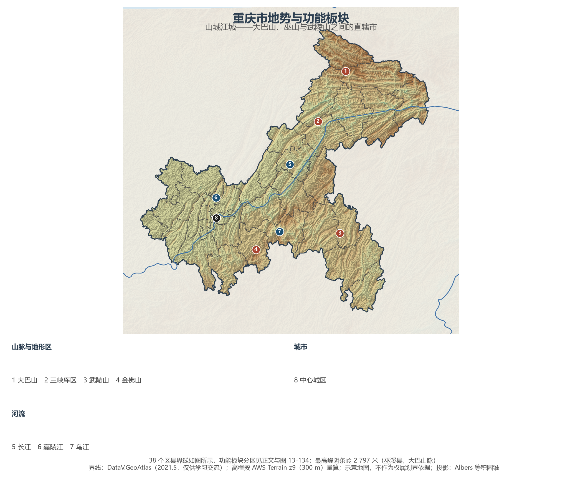
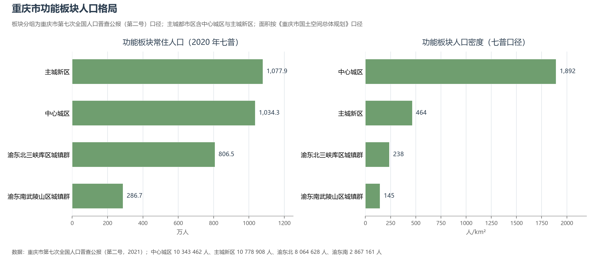
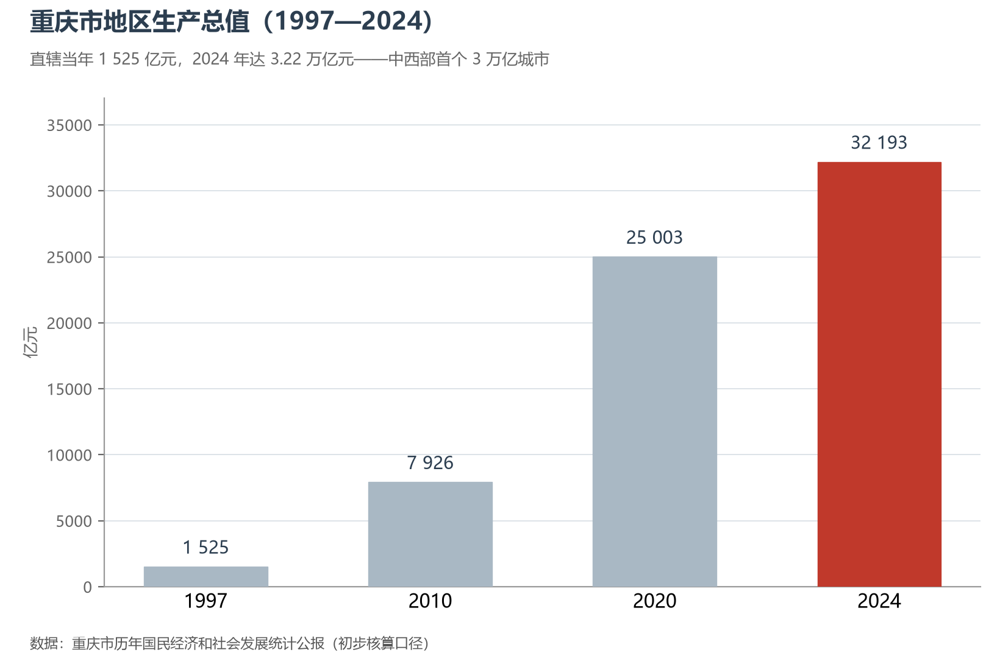

# 13.5.22 重庆市

重庆是被江河"雕刻"出来的城市：长江与嘉陵江在朝天门交汇，大巴山、巫山与武陵山从北、东、南三面围合，30 多条北东走向的山脊如手指般平行排列——这是世界上规模最大的平行岭谷。中西部第一座直辖市就生长在山的褶皱与江的回水之间：它有 3 190 万人口、8.24 万平方公里的土地，是全球辖区面积最大、人口最多的"城市"；它也用二十七年的时间，把直辖时的 1 525 亿元 GDP 做成了 3.22 万亿元。

## 一、省情速览

| 指标 | 数值 |
|------|------|
| 面积 | 82 400 km² |
| 常住人口 | 3 205.4 万（2020 年七普）；3 190.5 万（2024 年末） |
| 常住人口城镇化率 | 72.14%（2024 年末） |
| 地区生产总值 | 30 145.79 亿元（2023）；32 193.15 亿元（2024，增长 5.7%） |
| 人均地区生产总值 | 100 889 元（2024） |
| 行政区划 | 26 个区、8 个县、4 个自治县 |
| 简称 | 渝 |

放在全国坐标里：重庆 2024 年 GDP 超过广州，成为继上海、北京、深圳之后的"GDP 第四城"，也是中西部首个跨过 3 万亿元的省级行政区；人均 GDP 首次站上 10 万元，高于全国平均。放回世界视角：全市常住人口超过澳大利亚全国，经济规模粗折约 4 500 亿美元，超过捷克。辖区之广使"重庆"兼具省与城的双重身份——38 个区县按主城都市区（21 区，占全市人口 65.9%）、渝东北三峡库区城镇群（25.2%）、渝东南武陵山区城镇群（8.9%）三大功能板块展开。

**图 13-133 重庆市地势与功能板块**：z9 级 DEM 晕渲（300 m 分辨率），38 个区县界线如图所示，编号说明见图下。

## 二、自然地理

重庆的地貌由三幕构成。**渝西平行岭谷**是主角：华蓥山、铜锣山、明月山等数十条背斜山与向斜谷整齐排布，长江与嘉陵江横切山岭，切出朝天门、猫儿峡、铜锣峡等"江峡相拥"的奇观，城市就叠建在岭谷之间——"山城"与"桥都"的地名由此而来。**渝东北**是大巴山与巫山的世界：长江在此切开巫山，成就瞿塘峡、巫峡的雄奇，三峡水库蓄水后，"高峡出平湖"的库区纵贯全境，全市最高峰阴条岭（2 797 米）雄踞巫溪。**渝东南**属武陵山区，乌江沿褶皱深切，濯水、龚滩的古镇挂在崖壁上。长江干流重庆段约 665 公里，占三峡库区岸线的绝大头，"库区生态"因此成为重庆地理的关键词。

**气候**属亚热带湿润季风气候：冬暖夏热、多云多雾——"雾都"的旧称来自年平均数十天的雾日，"火炉"之名则源于夏季的酷热。烧烤般的夏夜正是重庆火锅与夜经济的气候注脚。2020 年夏季的长江特大洪水让两江水位创历史新高，山地城市的防洪韧性由此提上议程。

## 三、建置沿革与人文

重庆的建城史从巴国江州算起，已有三千年；隋置渝州，"渝"字取自嘉陵江古称渝水；南宋淳熙十六年（1189 年），宋光宗先封恭王、后登帝位，"双重喜庆"之下恭州升府改名**重庆**——这个名字已用了八百多年。近代的三次高光铸就城市性格：1891 年开埠，成为长江上游对外门户；抗战时期作为战时首都（陪都），与全国共赴国难；1997 年 6 月 18 日第三次直辖，成为中西部唯一的直辖市，承担起三峡百万移民（113 万余人）搬迁安置的历史任务。大足石刻（1999 年列入世界遗产）被誉为中国石窟艺术的最后丰碑；武隆喀斯特（2007）与金佛山（2014）相继列入世界自然遗产；涪陵白鹤梁题刻以一千二百年的长江枯水位记录，被称为"世界第一古代水文站"。

"湖广填四川"的移民底色、抗战内迁的八方来客与三峡移民的新一代迁徙，让重庆成为移民城市的活标本：码头号子、麻辣火锅、吊脚楼与 8D 魔幻地形共同构成"山城叙事"，轻轨穿楼的李子坝与崖壁上的洪崖洞，把地形约束变成了城市美学。

## 四、经济与区域战略

重庆的产业以"**汽车+电子**"双引擎著称：汽车产量长期居全国前列，长安、赛力斯的新能源转型让"问界"成为现象级品牌；西永微电园曾建成全球最大的笔记本电脑生产基地，今天正向集成电路与智能终端升级。区位战略是"**联结两大通道**"：顺长江而下是东部沿海出海通道，向西北则是 2011 年全国首发的中欧班列（渝新欧）——重庆因此成为同时拥有长江黄金水道、中欧班列与西部陆海新通道三种运输走廊的城市，果园港"水铁公"联运枢纽由此成型。2020 年成渝地区双城经济圈上升为国家战略，重庆与成都的"双核"开始共同承担西部高质量发展的引擎。2024 年全市 GDP 32 193.15 亿元、增长 5.7%；渝北区以约占全市 8% 的体量居各区县之首。交通上，江北国际机场旅客吞吐量居全国前列，成渝、郑渝、渝贵高铁成网，轨道交通以"单轨穿楼"闻名世界。

**图 13-134 重庆市功能板块人口格局**：左为功能板块常住人口（七普），右为板块人口密度——中心城区以约 1 892 人/km² 居首，渝东南仅约 145 人/km²。

## 五、分区地理：三大功能板块（编号见图 13-133）

**主城都市区（21 区）**——中心城区九区（渝中、大渡口、江北、沙坪坝、九龙坡、南岸、北碚、渝北、巴南）以 5 467 km² 承载 1 034.3 万人，渝中区人口密度超 2.4 万人/km²，是全国最拥挤的城区之一；渝北区两江新区集聚汽车与电子产业，沙坪坝是文教重镇。主城新区十二区（江津、合川、永川、涪陵等）承接产业扩散，江津的消费品工业、涪陵的页岩气与材料、合川的网络安全各成特色。

**渝东北三峡库区城镇群（11 区县）**——万州（156.4 万，七普口径）是库区经济中心，云阳、奉节、巫山沿江串联出"三峡旅游金三角"，城口、巫溪的大巴山深处则是全市生态最完好的腹地。

**渝东南武陵山区城镇群（6 区县）**——黔江为区域中心，石柱、秀山、酉阳、彭水、武隆以土家族苗族聚居著称，濯水古镇、桃花源与天生三桥让武陵山水成为文旅名片，武隆喀斯特更已是世界自然遗产。

**图 13-135 重庆市地区生产总值（1997—2024）**：直辖当年 1 525 亿元，2024 年达 3.22 万亿元，成为中西部首个 3 万亿级城市。

## 六、区内之最

| 项 | 值 |
|----|----|
| 最高点 | 阴条岭（巫溪县，大巴山脉），2 797 m |
| 面积最大 / 最小的区县（量算） | 酉阳土家族苗族自治县 5 175 km² / 渝中区 24 km² |
| 人口最多 / 最少的区县（七普） | 渝北区 219.2 万 / 城口县 19.9 万 |
| 人口密度最高 / 最低（七普量算） | 渝中区约 2.45 万人/km² / 城口县约 74 人/km² |
| GDP 首位区 | 渝北区（2024，约占全市 8%） |
| 江河之最 | 长江干流重庆段约 665 km，三峡库区岸线主体在渝 |
| 通道之最 | 全国首条中欧班列（渝新欧，2011）始发地 |

## 参考与数据来源

1. 面积、人口、GDP 总量：附录 A 口径（《中国统计年鉴 2024》）；2024 年 GDP、人均 GDP、城镇化率与年末常住人口为《2024 年重庆市国民经济和社会发展统计公报》。
2. 功能板块人口：重庆市第七次全国人口普查公报（第二号，2021）——中心城区 10 343 462 人、主城新区 10 778 908 人、渝东北三峡库区城镇群 8 064 628 人、渝东南武陵山区城镇群 2 867 161 人；板块面积按《重庆市国土空间总体规划（2021—2035 年）》口径。
3. 直辖当年 GDP、中欧班列、三峡移民：新华社及重庆市人民政府公开报道；世界遗产：联合国教科文组织名录。
4. 地势图 DEM：AWS Terrain Tiles z9（300 m 分辨率量算）；界线：DataV.GeoAtlas areas_v3（2021.5，仅供学习交流）。
