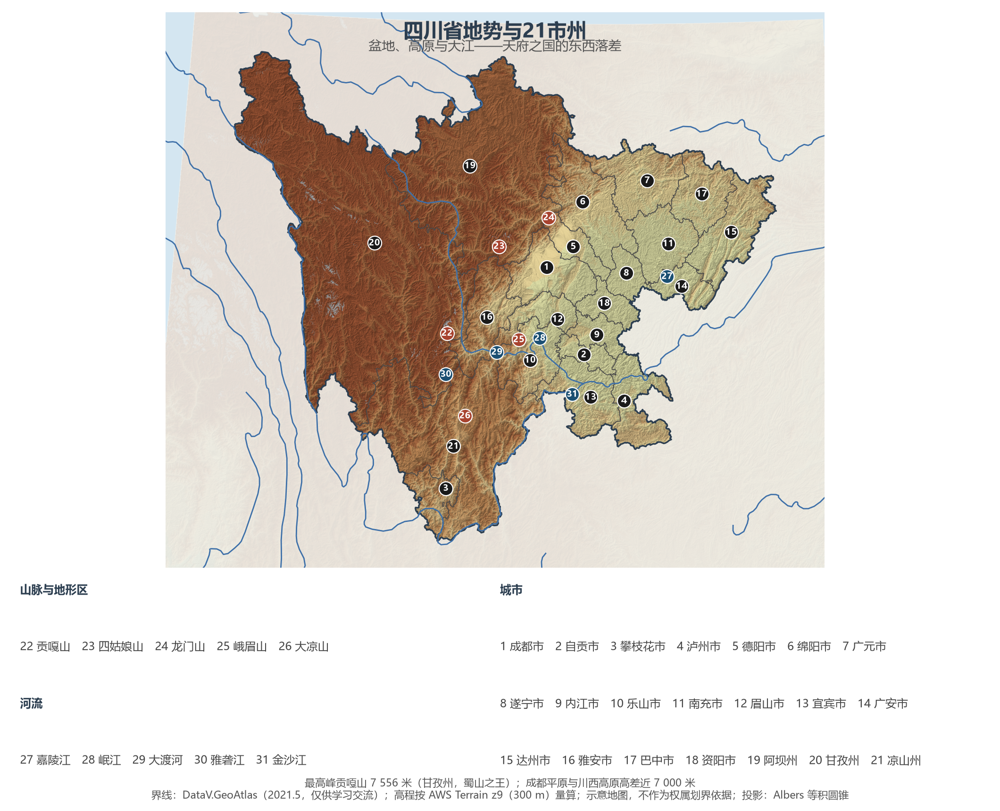
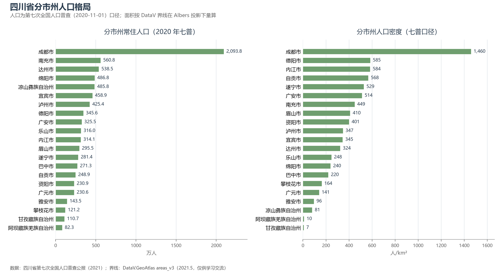
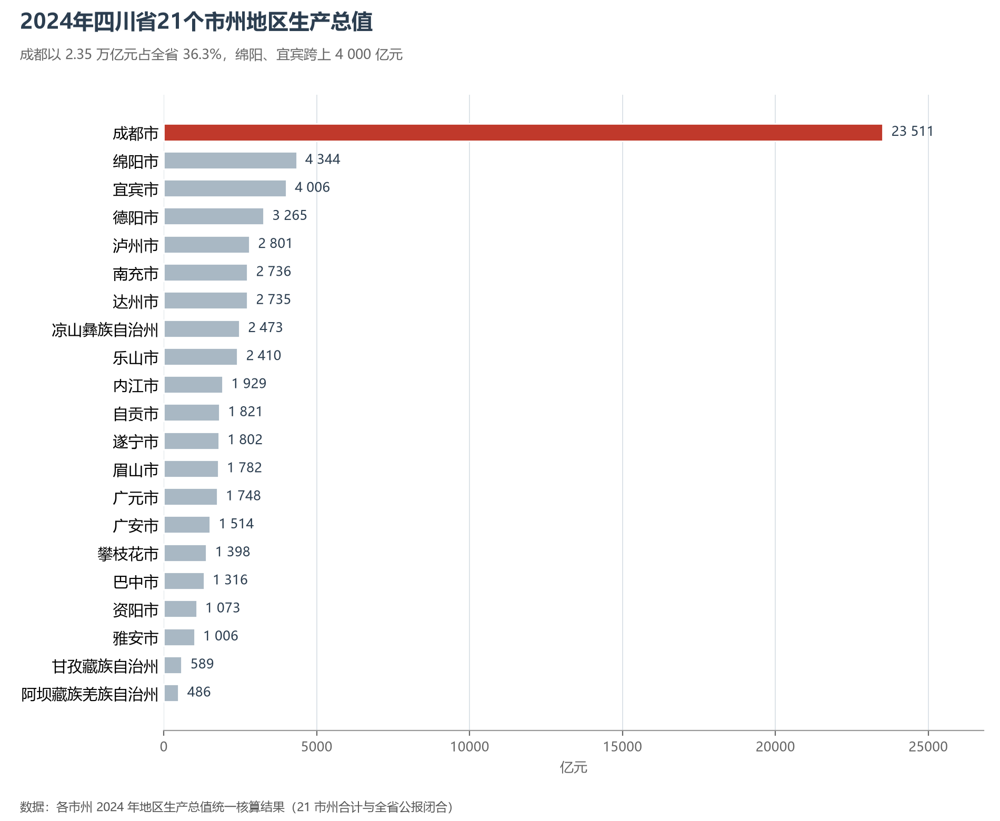

# 13.5.23 四川省

从贡嘎山巅到长江出川的江面，四川用 7 500 米的落差把中国西部的两种世界缝在同一张省图上：西边是青藏高原东缘的雪峰、冰川与高山草甸，东边是被紫色丘陵包起来的四川盆地。盆底一块 8 000 平方公里的冲积平原，靠两千二百多年前李冰父子修的一道堰，成了"水旱从人、不知饥馑"的天府之国。今天，8 364 万人在 48.6 万平方公里的土地上，把这里做成了全国第五经济大省、全国最大的水电基地与大熊猫的故乡。

## 一、省情速览

| 指标 | 数值 |
|------|------|
| 面积 | 48.6 万 km²（居全国第 5 位） |
| 常住人口 | 8 367.5 万（2020 年七普）；8 364 万（2024 年末） |
| 常住人口城镇化率 | 60.10%（2024 年末） |
| 地区生产总值 | 60 132.9 亿元（2023）；64 697.0 亿元（2024，增长 5.7%），居全国第 5 位 |
| 人均地区生产总值 | 77 333 元（2024） |
| 行政区划 | 18 个地级市、3 个自治州 |
| 简称 | 川/蜀 |

放在全国坐标里：四川 2024 年 GDP 64 697 亿元超过河南，成为全国第五、也是前五名中唯一的内陆省份；粮食产量 3 633.8 万吨、生猪出栏 6 149.6 万头，都居全国前列。放回世界视角：全省人口略多于德国，经济规模粗折约 9 100 亿美元，与土耳其、荷兰同处一个量级。21 个市州的体量差距极大——成都一市 23 511.3 亿元，占全省 36.3%，而甘孜、阿坝两州合计不足 1 100 亿元；但两州所辖的川西高原，恰恰是长江与黄河上游最重要的水源涵养地。

**图 13-136 四川省地势与 21 市州**：z9 级 DEM 晕渲（300 m 分辨率），21 个市州界线与编号说明见图下；成都平原在图上呈浅绿色低平的一块，向西迅速抬升为川西高原。

## 二、自然地理

四川的地势是"一省两级台阶"。**川西高原**属青藏高原东缘，平均海拔 3 500—4 500 米，贡嘎山（7 556 米）为全省最高峰，也是横断山脉的主峰，与成都平原的高差接近 7 000 米；沙鲁里山、大雪山、邛崃山自西向东排开，山原、丘状高原与深切的河谷交错。**四川盆地**是第二级台阶，盆周被龙门山、大巴山、巫山、大娄山、大小凉山围合，盆底海拔只有 250—750 米；西部是成都平原（川西平原），由岷江、沱江冲积而成，土层深厚、自流灌溉；中部与东部是紫红色的丘陵与方山，侏罗纪—白垩纪的红色砂泥岩风化后成为肥力较高的紫色土，四川因此也被称为"红色盆地"。

**水是四川的另一条主脉**。金沙江、雅砻江、大渡河、岷江、嘉陵江、乌江从高原奔下，在盆地边缘切出深谷，再汇入长江；长江干流横贯盆地南缘，宜宾以下始称长江。巨大的落差让四川成为全国最大的水电基地——白鹤滩（1 600 万千瓦，世界第二大水电站）、溪洛渡、向家坝、乌东德四座巨坝在金沙江下游梯级排列，"西电东送"的起点就在这里。

**气候**分属两域：盆地为亚热带湿润季风气候，冬暖春早、多云雾、少日照，成都年日照时数不足 1 300 小时；川西高原为高原季风气候，气温低、日照强、干湿季分明。盆地西缘的雅安—峨眉山一带是著名的"华西雨屏"，年降水量可达 1 800 毫米以上，雅安"雨城"之名由此而来。地质上，龙门山断裂带是 2008 年汶川 8.0 级地震、2013 年芦山 7.0 级地震的构造背景，川西的鲜水河、安宁河断裂同样是强震活跃区——"地震带上的天府"是四川地理无法回避的一体两面。

## 三、建置沿革与人文

四川的文明底稿比"省"要早得多：广汉三星堆的青铜神树与纵目面具（距今约 3 000—4 800 年）、成都金沙遗址的太阳神鸟金饰，显示出与中原并行而独特的古蜀文明。公元前 316 年秦并巴蜀，设蜀郡、巴郡；公元前 256 年前后，李冰主持修建都江堰，以鱼嘴、飞沙堰、宝瓶口三件套实现自动分水排沙，使成都平原"沃野千里，号为陆海"。此后两千余年，都江堰一直在灌溉，至今控灌面积超过 1 000 万亩，是全世界仍在运行的最古老大型无坝引水工程。

三国时期，蜀汉定都成都，"天府之国"的说法在《三国志》中定型。唐代设剑南道，成都与扬州并称"扬一益二"。北宋咸平四年（1001 年），朝廷将川峡地区分为益州、梓州、利州、夔州四路，合称"川峡四路"，"四川"之名即由此而来；元代设四川行省，省界大体奠定。明末清初的战乱使人口锐减，清代"湖广填四川"的移民潮重建了人口结构，也带来了方言、会馆与饮食的融合。1911 年四川保路运动成为辛亥革命的导火索；抗战时期重庆为陪都、四川为大后方，内迁的工厂与学校改变了这里的工业与教育格局；1960—70 年代的三线建设，把一大批国防与重型工业布局在川西山谷之间。

今天四川有 5 处世界遗产：九寨沟、黄龙（1992，世界自然遗产），峨眉山—乐山大佛（1996，世界文化与自然双遗产），青城山—都江堰（2000，世界文化遗产），四川大熊猫栖息地（2006，世界自然遗产）。川剧变脸、蜀锦蜀绣、自贡灯会与火锅、茶馆一起，构成长江上游最浓的市井烟火。

## 四、经济与区域战略

四川的经济结构是"一城独大、多点支撑"。**成都**以 23 511.3 亿元居首，电子信息、航空航天、生物医药与数字经济构成其支柱，全球约一半的笔记本电脑芯片在成都封装测试；**绵阳**（4 344 亿元）是中国唯一的科技城，中国工程物理研究院所在地；**宜宾**（4 005.8 亿元）靠白酒（五粮液）与动力电池"双轮"跨上 4 000 亿元台阶；**德阳**的重型装备（发电设备产量世界第一）、**泸州**的白酒与港口、**攀枝花**的钒钛磁铁矿、**乐山**的多晶硅，共同撑起"六大优势产业"的骨架。

战略上，四川同时握着三张牌：**成渝地区双城经济圈**（2020 年上升为国家战略），让成都与重庆共同承担西部高质量发展引擎；**天府新区**（2014 年获批国家级）与成都天府国际机场（2021 年投运）构成"一市两场"的开放门户；**西部陆海新通道**与中欧班列（成都 2013 年首发）让内陆盆地变成开放前沿——2024 年全省货物贸易进出口 10 457.2 亿元、增长 9.4%，在川落户的世界 500 强企业达 385 家。农业上，四川是全国 13 个粮食主产省之一，2024 年粮食产量 3 633.8 万吨、生猪出栏 6 149.6 万头均居全国前列，"川猪""川酒""川茶"是三个辨识度最高的农产品品牌。

**图 13-137 四川省分市州人口格局**：左为分市州常住人口（七普），右为分市州人口密度——成都市以约 1 460 人/km² 居首，甘孜州仅约 7 人/km²，两端相差 200 倍。

## 五、分区地理：五大经济区（编号见图 13-136）

**成都平原经济区（1、5、6、8、10、12、16、18）**——成都（1）2 093.8 万人（七普），是全省唯一常住人口超 2 000 万的城市，天府广场—春熙路—交子公园构成"一城双中心"；德阳（5）的重装基地、绵阳（6）的科技城、眉山（12）的锂电与泡菜、资阳（18）的医疗器械沿成德眉资同城化轴线铺开；乐山（10）以峨眉山—乐山大佛坐拥双遗产；遂宁（8）以锂电新材料承接成渝配套；雅安（16）是"华西雨屏"的中心，也是大熊猫栖息地的核心区之一。

**川南经济区（2、4、9、13）**——宜宾（13）与泸州（4）分列长江上下游，白酒、动力电池、港口物流三业并举；自贡（2）的井盐与恐龙、内江（9）的糖业与新材料，是这条"长江南岸产业带"的传统底色。

**川东北经济区（7、11、14、15、17）**——南充（11）、达州（15）人口均在 500 万以上（七普），达州是全国重要的天然气与锂钾资源基地；广安（14）是邓小平故里；广元（7）扼嘉陵江上游与川陕通道；巴中（17）以光雾山红叶与富硒农产品著称。

**攀西经济区（3、21）**——攀枝花（3）因三线建设而生，钒钛磁铁矿储量世界前列，也是四川唯一的"阳光康养"城市；凉山（21）的安宁河谷是四川第二大平原，西昌卫星发射中心与邛海泸山构成"航天+旅游"的双名片。

**川西北生态示范区（19、20）**——阿坝（19）与甘孜（20）合计 23.3 万平方公里、占全省面积近半，而两州人口合计不足 200 万（七普 193.0 万，占全省 2.3%），九寨沟、黄龙、稻城亚丁、贡嘎山都在这一片；这里是长江、黄河上游的水源涵养与生态屏障，也是全国最大的藏族聚居区之一。

**图 13-138 2024 年四川省 21 市州地区生产总值**：成都 23 511 亿元相当于其余 20 个市州合计的 57%，绵阳、宜宾是仅有的两个 4 000 亿元级城市；甘孜、阿坝两州合计不足 1 100 亿元。

## 六、省内之最

| 项 | 值 |
|----|----|
| 最高点 | 贡嘎山（甘孜州），7 556 m |
| 面积最大 / 最小的市州（量算） | 甘孜藏族自治州 149 783 km² / 自贡市 4 384 km² |
| 人口最多 / 最少的市州（七普） | 成都市 2 093.8 万 / 阿坝州 82.3 万 |
| 人口密度最高 / 最低（七普量算） | 成都市约 1 460 人/km² / 甘孜州约 7 人/km² |
| GDP 首位市 | 成都市 23 511.3 亿元（2024，占全省 36.3%） |
| 最大水电站 | 白鹤滩（装机 1 600 万千瓦，世界第二） |
| 最古老的水利工程 | 都江堰（公元前 256 年前后，仍在灌溉） |
| 世界遗产 | 5 处（九寨沟、黄龙、峨眉山—乐山大佛、青城山—都江堰、大熊猫栖息地） |

## 参考与数据来源

1. 面积、人口、GDP 总量：附录 A 口径（《中国统计年鉴 2024》）；2024 年 GDP、三次产业、人均 GDP、城镇化率、年末常住人口、粮食与生猪产量、进出口、世界 500 强企业数均取自《2024 年四川省国民经济和社会发展统计公报》（四川省统计局，2025 年 3 月）。
2. 分市州人口：四川省第七次全国人口普查公报（2021），21 市州数据精确到人并与全省合计核对。
3. 分市州 GDP：各市州 2024 年国民经济和社会发展统计公报与四川省统计局统一核算结果，21 市州合计与全省公报闭合。
4. 分市州面积：按 DataV.GeoAtlas 界线在 Albers 投影下量算，与各市州公布的辖区面积略有出入。
5. 地势图 DEM：AWS Terrain Tiles z9（300 m 分辨率量算）；界线：DataV.GeoAtlas areas_v3（2021.5，仅供学习交流）。
6. 世界遗产：联合国教科文组织《世界遗产名录》；白鹤滩装机容量：三峡集团公开资料。
