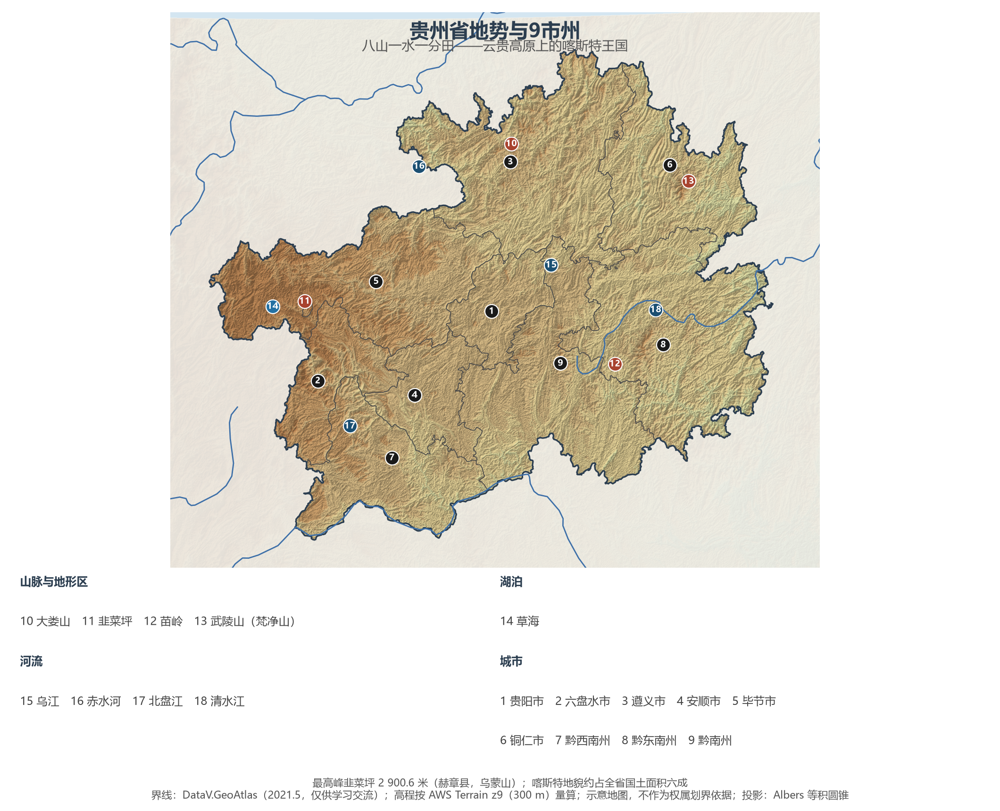
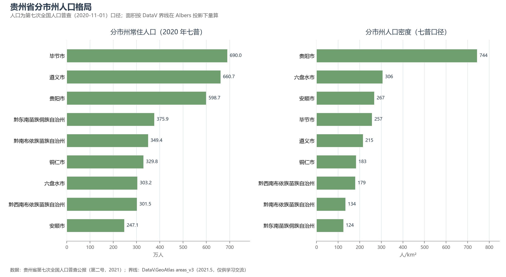
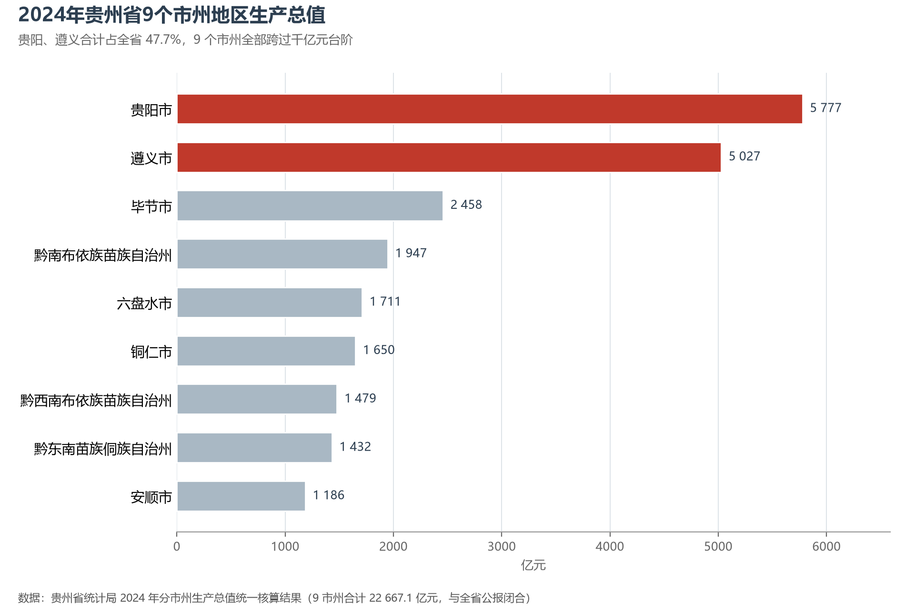

# 13.5.24 贵州省

贵州是中国唯一没有平原支撑的省份：92.5% 的国土是山地和丘陵，喀斯特出露面积占六成以上，峰丛、溶洞、天坑、地缝把大地切成了"八山一水一分田"。可就是在这片"地无三里平"的高原上，贵州架起了世界前 100 座高桥中的近一半，在平塘的喀斯特洼地里安放了直径 500 米的"中国天眼"，把茅台镇的一缕酒香做成了千亿级产业，也把凉爽的夏天变成了避暑经济。3 860 万人、17.6 万平方公里的山地省份，正在用桥、数与酒重写自己的地理。

## 一、省情速览

| 指标 | 数值 |
|------|------|
| 面积 | 176 200 km²（山地丘陵占 92.5%） |
| 常住人口 | 3 856.2 万（2020 年七普）；3 860 万（2024 年末） |
| 常住人口城镇化率 | 56.65%（2024 年末） |
| 地区生产总值 | 20 913.2 亿元（2023）；22 667.12 亿元（2024，增长 5.3%），居全国第 22 位 |
| 人均地区生产总值 | 约 5.87 万元（2024） |
| 行政区划 | 6 个地级市、3 个自治州 |
| 简称 | 黔/贵 |

放在全国坐标里：贵州经济体量居全国第 22 位、西南第 4 位，但人均 GDP 只有全国的约六成，仍是最需要追赶的省份之一；它的白酒产量、煤炭与水电装机、"东数西算"枢纽节点地位，却都是全国性的。放回世界视角：全省人口与波兰相当，经济规模粗折约 3 200 亿美元，与葡萄牙接近。9 个市州的落差同样鲜明——贵阳、遵义两市合计占全省 GDP 的 47.7%，而黔东南、黔南两个自治州的面积加起来超过 5.6 万平方公里，GDP 却只有 3 380 亿元。

**图 13-139 贵州省地势与 9 市州**：z9 级 DEM 晕渲（300 m 分辨率），9 个市州界线与编号说明见图下；西部乌蒙山一带色阶最高，东部与南部为低缓的喀斯特丘陵。

## 二、自然地理

贵州位于云贵高原东段，地势西高东低：西部威宁、赫章一带海拔 2 000 米以上，中部贵阳—安顺降到 1 100 米左右，东部铜仁、黔东南的河谷只有 300—500 米。全省最高点韭菜坪（2 900.6 米，赫章县）与最低点黎平县水口河出省处（147.8 米）相差 2 750 米，平均海拔约 1 100 米。**喀斯特**是理解贵州的钥匙：碳酸盐岩广布，地表水沿裂隙下渗，形成峰丛、峰林、溶洼、溶洞与地下河，土层薄、保水差，"一场大雨土跑光"曾是石漠化的写照；今天贵州的石漠化治理与退耕还林，正是与这种地质底子长期拉锯。

**山脉与河流**构成骨架：北部大娄山、西部乌蒙山、中部苗岭、东北武陵山（主峰梵净山 2 572 米）四面围合，苗岭是长江与珠江两大流域的分水岭。乌江是贵州第一大河，全长约 1 037 公里，横贯全省北部注入长江；北盘江、南盘江属珠江流域，清水江、都柳江流向东南；赤水河沿川黔边界北上，因茅台、习酒而被称为"美酒河"。河流深切形成峡谷，也造就了瀑布群——黄果树瀑布宽 101 米、高 77.8 米，是亚洲最大的瀑布之一；威宁草海是贵州最大的天然淡水湖，也是黑颈鹤最重要的越冬地之一。

**气候**属亚热带湿润季风气候，冬无严寒、夏无酷暑，年均气温 15 ℃ 左右，年降水量 1 100—1 300 毫米，"天无三日晴"说的正是这里多云多雨、日照偏少的特点。夏季凉爽使贵阳赢得"中国避暑之都"的名号，也让贵州的旅游旺季从夏季延伸到整个夏半年。

## 三、建置沿革与人文

贵州的历史是一部"山地与中央"的互动史。战国至西汉，夜郎国在此立国，"夜郎自大"的典故流传至今；汉武帝设牂牁郡，把贵州纳入郡县体系。此后千余年，中央王朝在这里实行**土司制度**，以当地首领世袭治理——遵义海龙屯就是播州杨氏土司的城堡，1600 年"平播之役"后废弃，2015 年作为"土司遗址"列入世界文化遗产。明永乐十一年（1413 年），朝廷设贵州布政使司，贵州正式建省；清雍正年间"改土归流"，中央权力才真正深入苗疆。

近代贵州的三次转折都写进了中国史：1508 年王阳明贬居龙场（今修文），在石洞中悟出"心即理"，阳明心学由此发端；1935 年 1 月遵义会议在长征途中召开，成为党和红军历史上的伟大转折；1960—70 年代的三线建设在安顺、遵义的山谷里布下航空、航天与电子工业，今天贵州的装备制造与军工底子多源于此。

贵州是多民族共居的山地：苗族、布依族、侗族、土家族、彝族、水族等 18 个世居民族，苗族银饰与刺绣、侗族大歌（人类非物质文化遗产）、水族水书、屯堡地戏各成体系。明代"调北征南"的屯堡人至今保留着江淮遗风，安顺一带的石板房与地戏是六百年前的活化石。

## 四、经济与区域战略

贵州的经济由"一瓶酒、一块煤、一张网、一个洞"四根柱子撑着。**白酒**是第一支柱：茅台镇所在的仁怀市，以峡谷里的一条赤水河酿出全国最贵的酒，贵州茅台长期是 A 股市值最高的公司之一；**能源**上，贵州是"西电东送"的主战场，煤炭与水电装机均居全国前列；**大数据**是后起之秀——贵安新区凉爽的气候与稳定的地质条件，吸引了三大运营商与苹果、华为、腾讯的数据中心，"中国天眼"（FAST，2016 年在平塘落成启用）则让贵州成为世界天文地图上的一个点；**旅游**上，"村超"（榕江）、"村 BA"（台江）在 2023 年成为现象级 IP，荔波、梵净山、黄果树构成三条黄金线路。

基础设施的跨越是贵州最近二十年的最大变量：2015 年贵州在西部率先实现县县通高速，2014 年贵广高铁通车，此后沪昆、成贵、渝贵、贵南高铁相继开通，贵阳成为西南高铁枢纽；世界前 100 座高桥中近半数在贵州，北盘江大桥桥面距江面 565 米，曾是世界第一高桥。2020 年，贵州 66 个贫困县全部摘帽、923 万贫困人口全部脱贫，是中国减贫史上规模最大的一役之一。

**图 13-140 贵州省分市州人口格局**：左为分市州常住人口（七普），右为分市州人口密度——贵阳市以约 744 人/km² 居首，黔东南州仅约 124 人/km²。

## 五、分区地理：四个板块（编号见图 13-139）

**黔中板块（1、4、9）**——贵阳（1）598.7 万人，全省唯一的特大城市，2024 年 GDP 5 777.41 亿元、增长 6.0%，大数据与电子信息制造是新的增长极；安顺（4）247.1 万人，黄果树瀑布与龙宫所在，也是三线航空工业（011 基地）的老家；黔南州（9）349.4 万人，FAST 与荔波喀斯特都在其境内，州府都匀是"毛尖茶之乡"。

**黔北板块（3）**——遵义（3）660.7 万人，全省人口第二大市，2024 年 GDP 5 027.2 亿元、首次跨过 5 000 亿元；茅台、习酒、董酒扎堆的赤水河谷是"世界酱香型白酒产业基地核心区"，遵义会议会址与娄山关则让它同时是红色圣地。

**黔西北板块（2、5）**——毕节（5）690.0 万人，全省人口第一大市，乌蒙山腹地的喀斯特山区，也是当年"开发扶贫、生态建设"试验区的起点；六盘水（2）303.2 万人，因煤而兴的"江南煤都"，夏季平均气温 19 ℃，"中国凉都"的品牌让它从资源型城市转向避暑康养。

**黔东南—黔西南板块（6、7、8）**——黔东南州（8）375.9 万人，苗侗村寨最密集的地方，西江千户苗寨、肇兴侗寨与侗族大歌构成"原生态民族文化"的核心区；铜仁（6）329.8 万人，梵净山（2018 年世界自然遗产）与汞矿历史并存；黔西南州（7）301.5 万人，万峰林、马岭河峡谷与兴义"山地旅游"是它的名片。

**图 13-141 2024 年贵州省 9 市州地区生产总值**：贵阳、遵义双双突破 5 000 亿元，合计占全省 47.7%；其余 7 个市州全部跨过千亿元，最低的安顺为 1 186 亿元。

## 六、省内之最

| 项 | 值 |
|----|----|
| 最高点 | 韭菜坪（赫章县，乌蒙山），2 900.6 m |
| 最低点 | 黎平县水口河出省处，147.8 m |
| 面积最大 / 最小的市州（量算） | 遵义市 30 778 km² / 贵阳市 8 050 km² |
| 人口最多 / 最少的市州（七普） | 毕节市 690.0 万 / 安顺市 247.1 万 |
| 人口密度最高 / 最低（七普量算） | 贵阳市约 744 人/km² / 黔东南州约 124 人/km² |
| GDP 首位市 | 贵阳市 5 777.41 亿元（2024） |
| 世界遗产 | 5 处（荔波、赤水、施秉喀斯特，梵净山，海龙屯土司遗址） |
| 桥梁之最 | 世界前 100 座高桥近半数在贵州；北盘江大桥桥面高 565 m |

## 参考与数据来源

1. 面积、人口、GDP 总量：附录 A 口径（《中国统计年鉴 2024》）；2024 年 GDP、增速、人均 GDP、城镇化率与年末常住人口取自《贵州省 2024 年国民经济和社会发展统计公报》（贵州省统计局，2025 年 3 月）。
2. 分市州人口：贵州省第七次全国人口普查公报（第二号，2021），9 市州数据精确到人并与全省合计（38 562 148 人）核对。
3. 分市州 GDP：贵州省统计局 2024 年分市州生产总值统一核算结果，9 市州合计 22 667.1 亿元，与全省公报闭合。
4. 喀斯特面积占比、山地丘陵占比：贵州省自然资源厅与《贵州省国土空间规划（2021—2035 年）》公开口径；海拔极值取自贵州省地理国情普查与地方志公开资料。
5. 世界遗产与非遗：联合国教科文组织《世界遗产名录》《人类非物质文化遗产代表作名录》；FAST 落成时间：中国科学院国家天文台公开资料。
6. 地势图 DEM：AWS Terrain Tiles z9（300 m 分辨率量算）；界线：DataV.GeoAtlas areas_v3（2021.5，仅供学习交流）。
