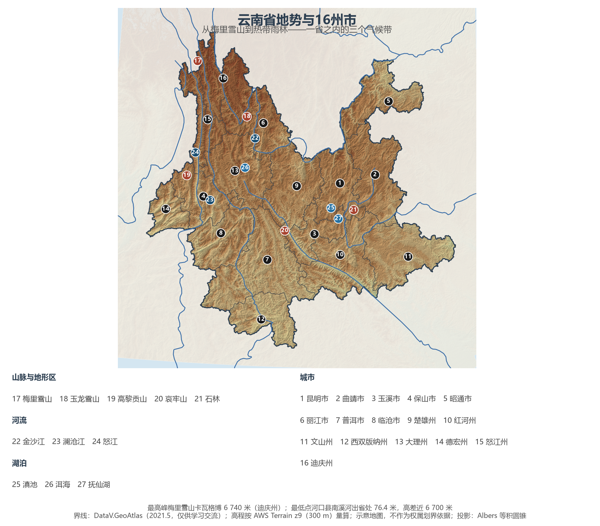
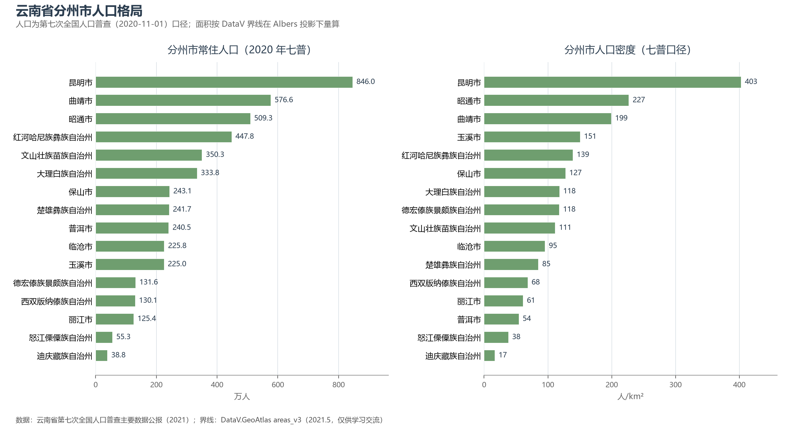
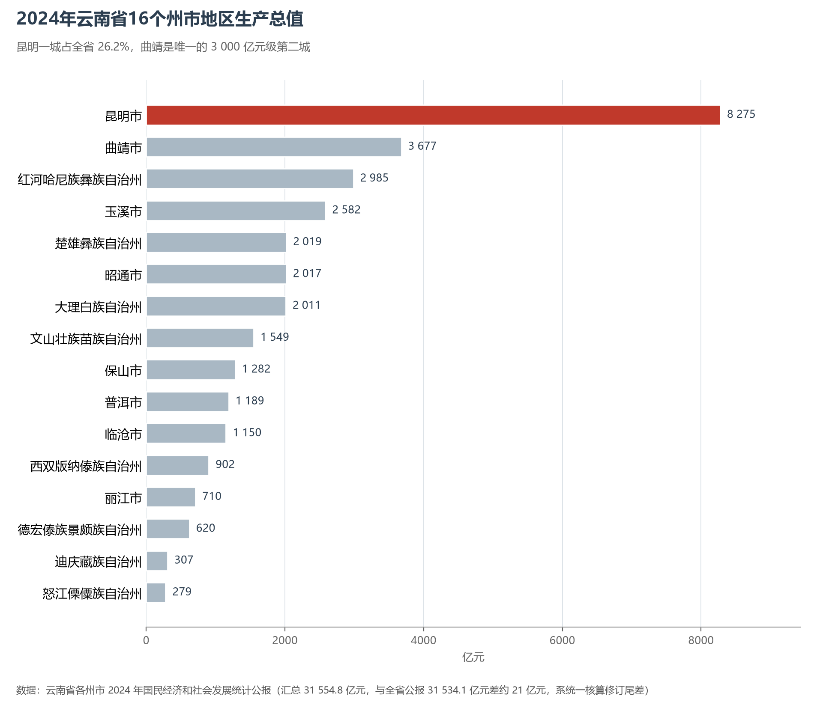

# 13.5.25 云南省

云南是中国地理的"压缩包"：南北跨越 8 个纬度、海拔从 76 米升到 6 740 米，热带雨林、亚热带常绿阔叶林、温带针叶林、高山草甸与冰川在同一个省里依次出现。怒江、澜沧江、金沙江在横断山的褶皱里并肩南流 170 多公里而不交汇，"三江并流"因此成为世界自然遗产；再往南，西双版纳的雨林里走着亚洲象，普洱的景迈山上留着千年古茶林。4 655 万人、39.4 万平方公里的土地上，25 个世居民族各守一片山谷，把云南写成了中国生物多样性与民族文化最密集的一页。

## 一、省情速览

| 指标 | 数值 |
|------|------|
| 面积 | 39.4 万 km²（居全国第 8 位） |
| 常住人口 | 4 720.9 万（2020 年七普）；4 655 万（2024 年末） |
| 常住人口城镇化率 | 54.11%（2024 年末） |
| 地区生产总值 | 30 021 亿元（2023）；31 534.10 亿元（2024，增长 3.3%），居全国第 18 位 |
| 人均地区生产总值 | 67 612 元（2024） |
| 行政区划 | 8 个地级市、8 个自治州 |
| 简称 | 云/滇 |

放在全国坐标里：云南 GDP 居全国第 18 位、西南第 2 位，但 2024 年 3.3% 的增速明显低于全国，曲靖等工业大市甚至出现负增长，能源与投资周期对它的影响比多数省份更直接。放回世界视角：全省人口与西班牙相当，经济规模粗折约 4 400 亿美元，接近比利时。16 个州市的分布极不均衡——昆明一城 8 275 亿元占全省 26.2%，而怒江、迪庆两州合计不足 600 亿元；但正是这两州所在的高山峡谷，撑起了云南"亚洲水塔"与生物多样性宝库的名声。

**图 13-142 云南省地势与 16 州市**：z9 级 DEM 晕渲（300 m 分辨率），16 个州市界线与编号说明见图下；西北角深褐色为梅里雪山—怒江峡谷一带，南部浅色为热带河谷与低山。

## 二、自然地理

云南的地势由三块拼成。**滇西北高山峡谷区**是横断山脉的南延，梅里雪山卡瓦格博峰 6 740 米为全省最高点，玉龙雪山（5 596 米）是中国最南的现代海洋性冰川分布区；金沙江、澜沧江、怒江自北向南深切，形成"三江并流"的世界级峡谷群。**滇中与滇东高原**是云贵高原的主体，海拔 1 500—2 000 米，起伏和缓的红色高原上散布着断陷盆地（当地称"坝子"），昆明、曲靖、玉溪都坐落在坝子里。**滇南低山宽谷**海拔降到 500—1 000 米，河谷打开，西双版纳与红河州南部进入热带。全省最低点在河口县南溪河出省处，仅 76.4 米，与最高点的高差接近 6 700 米。

**水与湖**是云南的另一半。金沙江、澜沧江、怒江、南盘江、元江（红河）五大水系分属长江、澜沧江—湄公河、怒江—萨尔温江、珠江与红河水系；滇池（约 330 km²）是云南最大的湖泊，洱海是苍山脚下的断陷湖，抚仙湖最大水深 158.9 米、是中国第二深的湖泊。高原湖泊普遍面临水体富营养化与水位下降的压力，滇池、洱海的治理是云南最持久的环境议题。

**气候**属低纬高原季风气候，干湿季分明：11 月至次年 4 月为干季，晴暖少雨；5—10 月为雨季，降水占全年八成以上。由于海拔落差巨大，"一山分四季，十里不同天"不是修辞——从河口的热带雨林到梅里雪山的冰川，垂直带上依次出现热带、亚热带、温带、寒温带与高山寒漠。昆明年均气温 15 ℃ 左右，"四季如春"的名声正来自低纬度高海拔的组合。

## 三、建置沿革与人文

云南的文明线索极早：元谋人牙齿化石距今约 170 万年，是中国境内最早的人类化石之一；战国至西汉，滇国在滇池周围立国，晋宁石寨山出土的"滇王之印"印证了汉武帝赐印的史实。南诏（738—902）与大理国（937—1253）先后以洱海地区为中心，留下了崇圣寺三塔与大理古城；元灭大理后设云南行省，"云南"作为省级政区沿用至今。明代沐英镇滇、大规模军屯与移民，把中原的耕作、语言与建筑带进坝子；清代改土归流后，中央权力深入边疆。

云南的文化地理由三条线交织：**民族**——25 个世居少数民族中，白族、哈尼族、傣族、傈僳族、拉祜族、佤族、纳西族、景颇族、布朗族、普米族、怒族、德昂族、独龙族、基诺族、阿昌族 15 个为云南特有；**通道**——南方丝绸之路（蜀身毒道）、茶马古道与滇越铁路把云南连向东南亚与南亚；**生态**——哈尼梯田是"森林—村寨—梯田—水系"四素同构的活态遗产，2021 年亚洲象北移南归的旅程则让世界看见了云南的生物多样性。

云南现有 6 处世界遗产：丽江古城（1997）、三江并流（2003）、石林（2007，中国南方喀斯特）、澄江化石地（2012）、红河哈尼梯田（2013）、普洱景迈山古茶林文化景观（2023）。2021 年，《生物多样性公约》缔约方大会第十五次会议（COP15）在昆明举行，"昆明宣言"与"昆明—蒙特利尔全球生物多样性框架"从这里出发。

## 四、经济与区域战略

云南的经济有三张老牌与三张新牌。老牌是**烟草、有色冶金、旅游**：云南中烟长期贡献全省财政的四成左右，"云烟""玉溪""红塔山"曾是中国烟草的代名词；锡（个旧）、铜（东川）、铅锌（兰坪）构成有色金属的骨架；丽江、大理、西双版纳、香格里拉把"诗与远方"做成了支柱产业。新牌是**绿色能源、高原特色农业、生物医药与大健康**：全省清洁能源发电量占规上工业发电量的 86.3%（2024），金沙江与澜沧江的水电通过"西电东送"送往东部；鲜切花产量 208.5 亿枝居全国第一，斗南是亚洲最大的鲜切花交易市场；咖啡、茶叶（58.62 万吨）、中药材（三七、天麻）与"云菌"共同撑起"绿色食品牌"。

战略上，云南的定位是"**面向南亚东南亚辐射中心**"：2021 年 12 月 3 日中老铁路通车，昆明到万象实现朝发夕至，云南从"边陲"变成"前沿"；中缅油气管道、昆曼公路、澜沧江—湄公河国际航运与昆明长水国际机场一起，构成中国通往印度洋方向的综合通道。2021 年云南与全国同步全面建成小康社会，88 个贫困县、933 万农村贫困人口全部脱贫，是中国减贫任务最重的省份之一。

**图 13-143 云南省分州市人口格局**：左为分州市常住人口（七普），右为分州市人口密度——昆明市以约 403 人/km² 居首，迪庆州仅约 17 人/km²。

## 五、分区地理：五大板块（编号见图 13-142）

**滇中板块（1、2、3、9）**——昆明（1）846.0 万人，全省唯一的特大城市，2024 年 GDP 8 275.22 亿元、首次突破 8 000 亿元，电子信息与生物医药是新的增长点；曲靖（2）576.6 万人，云南第二大经济体（3 677.22 亿元），绿色硅光伏与铝产业让它在 2024 年经历了 -0.9% 的阵痛；玉溪（3）225.0 万人，烟草与矿冶并重；楚雄（9）241.7 万人，彝族自治州，绿色能源与"彝绣"产业各成一路。

**滇东北板块（5）**——昭通（5）509.3 万人，乌蒙山腹地的"咽喉西蜀、锁钥南滇"，2024 年 GDP 2 016.91 亿元、增速 4.6% 居全省前列；向家坝、溪洛渡两座巨型水电站就在其境内的金沙江上。

**滇西北板块（6、13、15、16）**——大理（13）333.8 万人，苍山洱海与白族文化；丽江（6）125.4 万人，古城与玉龙雪山；迪庆（16）38.8 万人，香格里拉与梅里雪山，海拔 3 300 米的州府是全省最高；怒江（15）55.3 万人，独龙江峡谷是全国最深的峡谷之一，"直过民族"整族脱贫的样本。

**滇西板块（4、14）**——保山（4）243.1 万人，腾冲火山热海与滇西抗战的记忆；德宏（14）131.6 万人，瑞丽口岸是对缅贸易的最大陆路口岸之一，"有一个美丽的地方"唱的就是这里。

**滇南与滇西南板块（7、8、10、11、12）**——红河（10）447.8 万人，个旧锡矿、蒙自过桥米线与元阳哈尼梯田；文山（11）350.3 万人，三七之乡，2024 年 GDP 1 549.11 亿元、增速 6.0% 全省领先；普洱（7）240.5 万人，茶与咖啡的双重原产地；临沧（8）225.8 万人，滇红茶乡；西双版纳（12）130.1 万人，热带雨林、亚洲象与傣族泼水节。

**图 13-144 2024 年云南省 16 州市地区生产总值**：昆明一城占全省 26.2%，曲靖是唯一的 3 000 亿元级第二城；红河、玉溪紧随其后，怒江、迪庆仍在 300 亿元量级。

## 六、省内之最

| 项 | 值 |
|----|----|
| 最高点 | 梅里雪山卡瓦格博峰（迪庆州），6 740 m |
| 最低点 | 河口县南溪河出省处，76.4 m |
| 面积最大 / 最小的州市（量算） | 普洱市 44 253 km² / 德宏州 11 174 km² |
| 人口最多 / 最少的州市（七普） | 昆明市 846.0 万 / 迪庆州 38.8 万 |
| 人口密度最高 / 最低（七普量算） | 昆明市约 403 人/km² / 迪庆州约 17 人/km² |
| GDP 首位市 | 昆明市 8 275.22 亿元（2024） |
| 湖泊之最 | 滇池约 330 km² 为最大湖泊；抚仙湖最大水深 158.9 m，为中国第二深湖 |
| 边境线 | 约 4 060 km，与缅甸、老挝、越南三国接壤 |
| 世界遗产 | 6 处（丽江古城、三江并流、石林、澄江化石地、红河哈尼梯田、景迈山古茶林） |

## 参考与数据来源

1. 面积、人口、GDP 总量：附录 A 口径（《中国统计年鉴 2024》）；2024 年 GDP、三次产业、人均 GDP、城镇化率与年末常住人口取自《云南省 2024 年国民经济和社会发展统计公报》（云南省统计局，2025 年 4 月）。
2. 分州市人口：云南省第七次全国人口普查主要数据公报（2021），16 州市数据精确到人并与全省合计（47 209 277 人）核对。
3. 分州市 GDP：云南省各州市 2024 年国民经济和社会发展统计公报（汇总 31 554.8 亿元，与全省公报 31 534.1 亿元相差约 21 亿元，系统一核算修订尾差）。
4. 海拔极值、湖泊深度：云南省地理国情普查与水利部门公开资料；清洁能源发电占比 86.3% 取自 2024 年云南统计公报。
5. 世界遗产：联合国教科文组织《世界遗产名录》；中老铁路通车时间：中国国家铁路集团公开资料。
6. 地势图 DEM：AWS Terrain Tiles z9（300 m 分辨率量算）；界线：DataV.GeoAtlas areas_v3（2021.5，仅供学习交流）。
