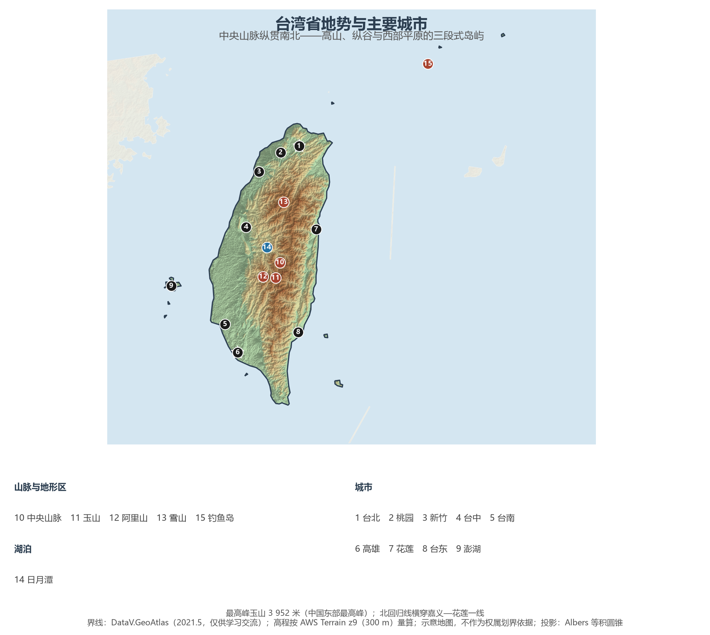
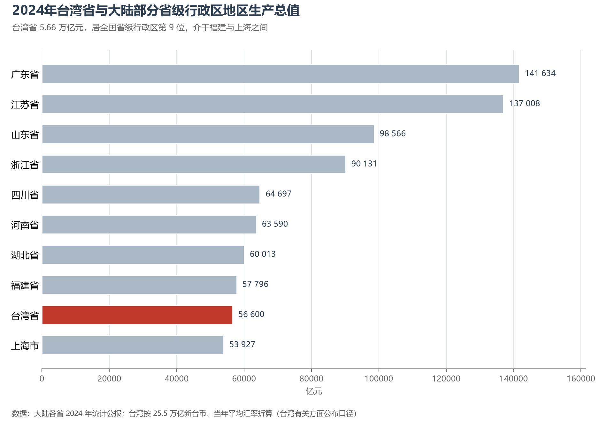

# 13.5.26 台湾省

台湾岛是中国第一大岛，也是世界上最年轻、最活跃的岛弧之一：菲律宾海板块向西北俯冲，把海底的沉积物挤成一座南北长 394 公里、东西最宽 144 公里的高山岛。中央山脉纵贯全岛，玉山（3 952 米）是中国东部最高峰；山脉以西是嘉南平原与屏东平原，以东是陡峭的海岸与花东纵谷。高山、纵谷与平原的三段式结构，加上北回归线穿岛而过，让这座 3.6 万平方公里的岛屿同时拥有热带雨林、亚热带季风与高山寒带三种气候。

## 一、省情速览

| 指标 | 数值 |
|------|------|
| 面积 | 约 3.6 万 km²（台湾岛 3.58 万 km²，中国第一大岛） |
| 人口 | 2 342 万（2023 年末）；2 340 万（2024 年末） |
| 地区生产总值 | 25.5 万亿新台币（2024，约合 5.66 万亿元人民币） |
| 人均地区生产总值 | 33 983 美元（2024） |
| 经济增长率 | 4.59%（2024） |
| 行政区划 | 6 个市、3 个市、13 个县（合计 22 个县市，台湾地区现行区划） |
| 简称 | 台 |

放在全国坐标里：按当年平均汇率折算，台湾 2024 年经济总量约 5.66 万亿元，居全国省级行政区第 9 位，介于福建（5.78 万亿元）与上海（5.39 万亿元）之间；人均 GDP 约 3.4 万美元，高于大陆任何一个省级行政区。放回世界视角：全岛人口与澳大利亚全国相当，经济规模接近瑞典。台湾的经济密度极高——2 340 万人生活在 3.6 万平方公里的土地上，人口密度约 650 人/km²，是大陆平均水平的四倍多；西部走廊从台北到高雄，集中了全岛约七成的人口与绝大部分制造业。

**图 13-145 台湾省地势与主要城市**：z9 级 DEM 晕渲（300 m 分辨率），中央山脉纵贯南北，玉山、雪山、阿里山与西部城市群的位置如图；澎湖列岛与钓鱼岛及其附属岛屿在岛的西、东北方向。

## 二、自然地理

台湾的地貌是"一山二平原三面海"。**中央山脉**自北而南绵延 340 公里，主脊海拔多在 3 000 米以上，玉山（3 952 米）、雪山（3 886 米）、秀姑峦山、南湖大山依次排列，构成东亚最高的岛上山系；**雪山山脉**与**玉山山脉**分列其西，**阿里山山脉**最靠西，山间盆地与丘陵过渡到西部平原。**嘉南平原**是岛上最大的平原，由浊水溪、曾文溪等河流冲积而成，是稻米、甘蔗与水果的主产区；**屏东平原**在西南端，**花东纵谷**夹在中央山脉与海岸山脉之间，是东部唯一的大块平地。

**气候**以北回归线为界：以南属热带季风气候，以北属亚热带季风气候，但真正决定差异的是海拔——从海平面到玉山山顶，年均气温从 22 ℃ 降到 4 ℃。年降水量平均 2 500 毫米，基隆附近的火烧寮多年平均逾 6 000 毫米，是中国降水最多的地方之一；降水集中在 5—9 月的梅雨与台风季，夏秋之际平均每年有 3—4 个台风登陆或影响全岛。地震与台风是这座岛屿的两大宿命：1999 年"9·21"集集地震（里氏 7.3 级）造成 2 400 余人死亡，2024 年 4 月花莲地震（7.3 级）再次提醒人们，台湾正处在环太平洋地震带最活跃的一段。

**河流与湖泊**短促而湍急：浊水溪（186.6 公里）是全岛最长河流，高屏溪流域面积最大；日月潭是最大的天然湖泊（约 7.9 km²），曾文水库是库容最大的水库。由于山高谷深、河短流急，台湾的水资源"留不住"，水库淤积与南部枯水期缺水是长期难题。

## 三、建置沿革与人文

台湾与大陆的联系可以上溯到史前：长滨文化、大坌坑文化都与东南沿海的史前文化一脉相承。中国历代政府对台湾的经略不断加深：三国吴国卫温、诸葛直率军到达"夷洲"，隋代多次遣人前往"流求"，宋元时期澎湖已设巡检司；1624 年荷兰殖民者侵占台南，1662 年郑成功收复台湾；1684 年清政府设台湾府，隶福建省；1885 年台湾建省，刘铭传为首任巡抚，修铁路、办电报、开煤矿，台湾成为当时中国最现代化的省份之一。1895 年甲午战败后台湾被割让给日本，1945 年抗战胜利后光复，重归中国版图。

台湾的人文底色是**移民与海洋**：闽南、客家移民渡海而来，带来方言、宗族与庙宇；原住民 16 族（阿美、泰雅、排湾、布农、卑南、鲁凯、邹、赛夏、达悟、邵、噶玛兰、太鲁阁、撒奇莱雅、赛德克、拉阿鲁哇、卡那卡那富）约 58 万人，是全岛最早的居民。台北故宫博物院收藏着近 70 万件中华文物，其中毛公鼎、翠玉白菜、《快雪时晴帖》最为人熟知；台南的赤崁楼、安平古堡记录着荷郑时期的痕迹；妈祖信仰、歌仔戏、布袋戏与夜市文化，则把闽南的生活样式保存在岛上。

## 四、经济与区域战略

台湾经济是典型的**岛屿外向型经济**：对外贸易依存度长期高于 100%，出口以电子零组件、集成电路、资通讯产品为主。**半导体**是它的全球坐标——台积电（TSMC）一家占全球晶圆代工市场约六成、先进制程占九成以上，2024 年全岛半导体产值继续位居全球前列；联发科、日月光、鸿海（富士康）分别在 IC 设计、封装测试与电子代工领域占据关键位置。除半导体外，石化（麦寮六轻）、钢铁（中钢）、机械与工具机、自行车与纺织构成传统产业的基本盘；农业则以稻米、凤梨、释迦、芒果与高山茶（冻顶乌龙、文山包种）见长。

空间上，台湾的经济重心是**西部走廊**：台北—新北—桃园构成北部都会区，是金融、总部与研发中心；台中—彰化是中部制造业重镇，精密机械与自行车产业集聚；台南—高雄是南部石化、钢铁与半导体新基地（台积电 3 纳米、2 纳米厂区南移）。交通骨架由 2007 年通车的台湾高铁（台北—高雄 345 公里，最快 1 小时 45 分）、环岛铁路与桃园、高雄两大机场、高雄港（曾长期居世界第三大集装箱港）组成。

**图 13-146 2024 年台湾省与大陆部分省级行政区地区生产总值**：台湾 5.66 万亿元居全国第 9 位，与福建相当、高于上海，但已明显落后于广东、江苏、山东、浙江四省。

## 五、分区地理：四大区域

**北部（台北、新北、基隆、桃园、新竹县市、宜兰）**——台北—新北都会区约 700 万人，是全岛的政治、经济与文化中枢：台北 101（508 米，2004—2010 年间曾为世界第一高楼）与信义计划区构成金融地标，内湖、南港是科技与媒体园区；新北是人口最多的市（约 404 万）；桃园是国际机场与物流枢纽；新竹科学园区是半导体产业的发源地，被称为"台湾的硅谷"；宜兰以兰阳平原与礁溪温泉著称。

**中部（苗栗、台中、彰化、南投）**——台中市约 286 万人，是中部核心，精密机械、自行车（捷安特、美利达）与手工具产业世界知名；彰化是农业与中小工厂大县；南投的日月潭、阿里山与玉山是观光与登山胜地。

**南部（云林、嘉义县市、台南、高雄、屏东）**——台南是台湾开发最早的城市，赤崁楼、安平古堡与孔庙记录着四百年的历史，如今又是台积电先进制程的重镇；高雄是南部最大城市与港口（2024 年集装箱吞吐量约 950 万标准箱），石化与钢铁工业集中；屏东是热带农业与垦丁海岸。

**东部（花莲、台东）**——花东纵谷夹在两列山脉之间，人口稀疏（两县合计约 54 万人），却是全岛风景最壮丽的地方：太鲁阁峡谷的大理岩峭壁、清水断崖的断崖海岸、台东的海岸山脉与绿岛、兰屿的火山岛，构成台湾的"后山"意象。东部也是原住民文化保存最完整的地方。

## 六、省内之最

| 项 | 值 |
|----|----|
| 最高点 | 玉山（3 952 m），中国东部最高峰 |
| 最长河流 | 浊水溪，约 186.6 km |
| 最大天然湖泊 | 日月潭，约 7.9 km² |
| 人口最多 / 最少的市（2023 年前后） | 新北市约 404 万 / 连江县（马祖）约 1.4 万 |
| 最高建筑 | 台北 101，508 m（2004—2010 年为世界第一高楼） |
| 最长公路隧道 | 雪山隧道，12.9 km |
| 降水之最 | 火烧寮，多年平均逾 6 000 mm，中国降水最多处之一 |
| 经济之最 | 台积电占全球晶圆代工约六成，先进制程占九成以上 |

## 参考与数据来源

1. 面积、人口：台湾有关方面公布之 2023 年年末户籍人口（约 2 342 万）与 2024 年年末人口（约 2 340 万）；台湾岛面积 3.58 万 km² 为通行的地理口径。
2. 经济数据：台湾有关方面公布之 2024 年地区生产总值 25.5 万亿新台币、经济增长率 4.59%、人均 GDP 33 983 美元；人民币折算按 2024 年人民币对新台币平均汇率，约为 5.66 万亿元，仅作量级比较。
3. 大陆各省 GDP：各省 2024 年国民经济和社会发展统计公报（广东 141 633.8 亿元、江苏 137 008.0 亿元、山东 98 566 亿元、浙江 90 131 亿元、四川 64 697.0 亿元、河南 63 590 亿元、湖北 60 013 亿元、福建 57 796 亿元、上海 53 926.7 亿元）。
4. 自然与灾害：台湾有关方面公布的地形、气象与地震观测资料；1999 年集集地震、2024 年花莲地震的震级与灾情为公开报道口径。
5. 区位与界线：地势图 DEM 取自 AWS Terrain Tiles z9（300 m 分辨率量算）；界线：DataV.GeoAtlas（2021.5，仅供学习交流）。
6. 说明：本节涉及台湾地区的统计数字均标注"台湾有关方面公布"口径，与大陆统计口径不完全可比；示意地图不作为权属划界依据。
