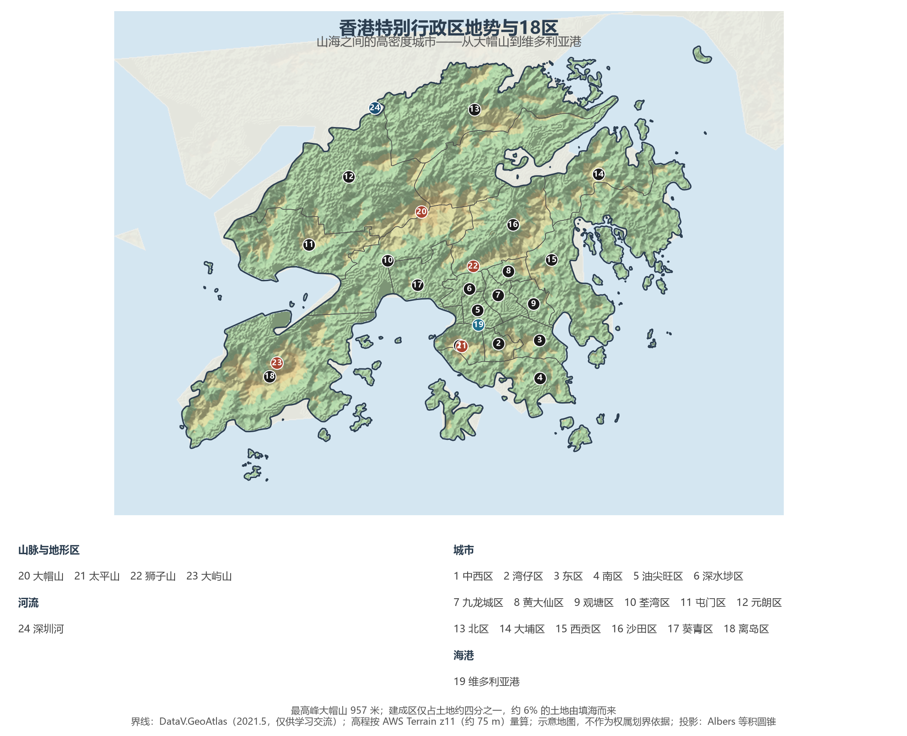
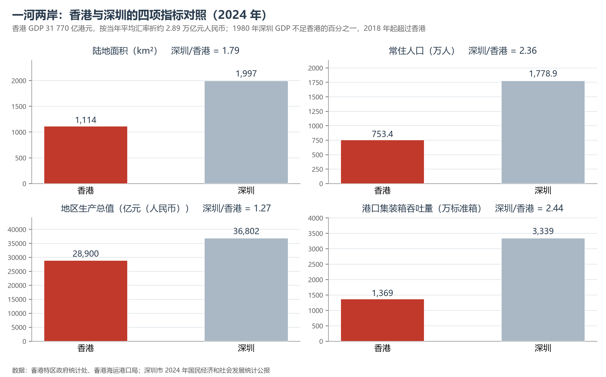

# 13.5.27 香港特别行政区

香港是一块被海水切割出来的山地：1 114 平方公里的陆地里有 262 座岛屿，山地与陡坡占去四分之三，能建城市的平地只有两成多。于是这座城市向上生长——全球最密集的高层住宅群挤在维多利亚港两岸的窄带上，约 6% 的土地由填海而来，却承载了全港近三成的人口。2024 年，750 余万人在此创造了 31 770 亿港元的本地生产总值，人均约 42 万港元；而它作为国际金融中心、离岸人民币枢纽与自由港的角色，远比这串数字更重。

## 一、省情速览

| 指标 | 数值 |
|------|------|
| 面积 | 1 114 km²（2023 年，含 262 座岛屿） |
| 人口 | 750.3 万（2023 年年中）；753.4 万（2024 年年中） |
| 本地生产总值 | 29 836 亿港元（2023）；31 770 亿港元（2024，实质增长 2.5%） |
| 人均本地生产总值 | 约 42 万港元（2024，约 5.41 万美元） |
| 行政区划 | 18 个区（区议会为区域咨询组织） |
| 最高点 | 大帽山 957 m |
| 简称 | 港 |

放在全国坐标里：香港 GDP 折约 2.89 万亿元人民币，与陕西、江西同处一个量级，但只有 1 114 平方公里的土地上产出这样的总量，经济密度居全国城市前列；人均 GDP 约 5.4 万美元，是内地最高的城市之一。放回世界视角：香港人口与新加坡相当（约为其 1.25 倍），陆地面积约为新加坡的 1.5 倍，两座城市型经济体长期被并置比较——一个背靠内地、以金融与转口起家，一个以制造与航运立身，构成了世界金融版图上最直接的一对镜像。

**图 13-147 香港特别行政区地势与 18 区**：z11 级 DEM 晕渲（约 75 m 分辨率），18 个区界线与编号说明见图下；南部港岛与九龙之间的蓝色水域即维多利亚港，西部大片山地为大屿山。

## 二、自然地理

香港的地貌是"山—海—填"三件事。**山地**构成骨架：大帽山（957 米）是全港最高点，凤凰山（934 米）、大东山、马鞍山、狮子山依次排列，山脊陡峭、河谷短促，山地与陡坡占陆地面积的四分之三，真正平坦的土地不足三成。**海岸**带来曲折：全港海岸线曲折绵长，维多利亚港港阔水深、潮差小，与旧金山、里约热内卢并称世界三大天然良港；西贡、清水湾、大屿山南岸散布着沙滩与海湾，200 多个离岛中最大的大屿山（约 147 km²）比香港岛还大一倍。**填海**是人与海的交易：自 19 世纪以来，全港约 6% 的土地（约 70 km²）由填海而得，中环、湾仔、九龙西、启德、将军澳新市镇都建在海上。

**气候**属亚热带季风气候，年均气温约 23 ℃，年降水量约 2 400 毫米，5—9 月湿热多雨，夏秋常受台风影响；冬季受大陆冷空气影响，1 月平均气温约 16 ℃，偶有寒潮。由于山多平地少，香港的城市形态被地形"挤压"成几条走廊：港岛北岸、九龙半岛、沙田—大埔的河谷、屯门—元朗的西北平原，中间由隧道与桥梁连接。

**生态**是被低估的一面：全港约四成土地划为 24 个郊野公园与海岸公园，米埔内后海湾湿地是国际重要湿地（拉姆萨尔湿地），每年冬天数万只候鸟在此停歇；香港联合国教科文组织世界地质公园（2011 年列入）以六角形岩柱与海蚀地貌著称。城市与荒野在半小时车程内切换，是香港地理最独特的体验。

## 三、建置沿革与人文

香港地名最早见于明代记载，清代属新安县（今深圳）。1842 年《南京条约》割让香港岛，1860 年《北京条约》割让九龙半岛南端，1898 年英国又强租新界 99 年——三块土地、三种租约，构成了今日香港的地理边界。此后一个半世纪，香港从转口港成长为自由港、制造业中心与国际金融中心：1950 年代大量内地资本与劳动力南下，纺织、塑胶、玩具业起飞；1970—80 年代金融、航运与专业服务崛起；1997 年 7 月 1 日，中国对香港恢复行使主权，香港特别行政区成立，"一国两制"、"港人治港"、高度自治由此开始。

香港的文化是"移民城市"的层叠：粤语流行曲、港产片、武侠小说与茶餐厅，把岭南市井与英美制度揉在一起；黄大仙祠、天后庙与基督教堂在同一条街上相邻；中环的摩天楼群之间保留着石板街、文武庙与都爹利街的石阶。香港故宫文化博物馆（2022 年开馆）与 M+ 视觉文化博物馆，让这座商业城市又多了两座世界级文化设施。

## 四、经济与区域战略

香港的经济由**四大支柱产业**撑起：**金融**——全球重要的国际金融中心，2024 年在全球金融中心指数中位居前三，港交所是内地企业最重要的境外上市地，香港也是全球最大的离岸人民币业务枢纽；**贸易与物流**——自由港政策、零关税与高效清关，让它长期是全球最繁忙的集装箱港之一，香港国际机场的货运量多年居全球第一；**专业服务**——法律、会计、咨询、保险，为跨境投资提供制度接口；**旅游**——2019 年入境旅客超过 5 500 万人次，2024 年恢复至约 4 500 万人次。

但香港正处在结构转型的关口。**港口**是最直观的指标：集装箱吞吐量从 2010 年前后的 2 370 万标准箱（当时全球第三）跌至 2024 年的 1 369 万标准箱，创 1996 年以来新低，被深圳、广州、青岛、天津等内地港口相继超越；**金融**则面临新加坡的强势竞争，港股 IPO 集资额近年一度跌出全球前列。应对之道写在两份文件里：2021 年《北部都会区发展策略》把新界北部 300 平方公里规划为科创与居住新城，2023 年以来"抢企业、抢人才"政策与粤港澳大湾区通关便利化，则试图把香港的国际化优势与深圳的产业能力重新焊接。

**图 13-148 香港与深圳的四项指标对照（2024 年）**：深圳的面积与人口分别是香港的 1.79 倍与 2.36 倍，GDP 为 1.27 倍，集装箱吞吐量为 2.44 倍——1980 年深圳 GDP 不足香港的百分之一，2018 年起超过香港。

## 五、分区地理：港岛、九龙、新界（编号见图 13-147）

**香港岛（1—4）**——中西区（1）是金融与行政核心，中环的摩天楼群与半山住宅构成"垂直城市"的标本；湾仔区（2）会展中心与旧街区并存，是人口最少的区（2021 年 166 695 人）；东区（3）的鲗鱼涌、太古坊是新兴商业区；南区（4）背山面海，浅水湾、赤柱是传统的高尚住宅与海滨休闲区。

**九龙（5—9）**——油尖旺区（5）的尖沙咀—旺角是零售与旅游的心脏，弥敦道两侧的旧楼与商场层层叠叠；深水埗区（6）是草根市井与电子零件市场的代名词；九龙城区（7）的启德机场旧址已变身住宅与体育园；黄大仙区（8）以黄大仙祠闻名，是全港人口密度最高的区之一；观塘区（9）由工业区转型为商贸与住宅混合的新核心。

**新界（10—18）**——荃湾区（10）、屯门区（11）、元朗区（12）构成西北走廊，屯门—元朗平原是香港重要的农业与湿地分布区；北区（13）与深圳一河之隔，罗湖、落马洲、文锦渡口岸在此，北部都会区规划的核心也在这里；大埔区（14）、沙田区（16）、西贡区（15）是沙田海与吐露港沿岸的新市镇带，沙田区以 692 806 人（2021 年）居全港之首；葵青区（17）的葵青货柜码头曾是全球最繁忙的集装箱码头；离岛区（18）包括大屿山、长洲、南丫岛、坪洲等 200 多个岛屿，面积最大而人口最少。

## 六、区内之最

| 项 | 值 |
|----|----|
| 最高点 | 大帽山 957 m |
| 面积最大 / 最小的区（量算） | 离岛区 218 km² / 黄大仙区 10 km² |
| 人口最多 / 最少的区（2021 年人口普查） | 沙田区 692 806 人 / 湾仔区 166 695 人 |
| 人口密度最高的区 | 观塘区，约 5.9 万人/km² |
| 最大岛屿 | 大屿山，约 147 km² |
| 港口之最 | 葵青货柜码头曾多年居全球第一；2024 年全港吞吐量 1 369 万标准箱，创 1996 年以来新低 |
| 生态之最 | 郊野公园约占土地四成；米埔湿地为国际重要湿地 |
| 制度之最 | 全球最大的离岸人民币业务枢纽；普通法适用地区 |

## 参考与数据来源

1. 面积、人口：香港特区政府统计处（2023 年年中人口 750.3 万、2024 年年中 753.4 万；陆地面积 1 114 km²）。
2. 经济数据：香港特区政府统计处《本地生产总值》2024 年全年数字（当年价格 31 770 亿港元，实质增长 2.5%）；人均 GDP 按 2024 年人口与汇率折算。
3. 港口与机场：香港海运港口局（2024 年集装箱吞吐量 1 369 万标准箱，同比下跌 4.9%，为 1996 年以来新低）、香港机场管理局公开数据。
4. 深港对比：深圳市 2024 年国民经济和社会发展统计公报（GDP 36 801.57 亿元、常住人口 1 778.9 万、集装箱吞吐量 3 339 万标准箱、陆地面积 1 997 km²）。
5. 制度与规划：《中华人民共和国香港特别行政区基本法》《北部都会区发展策略》（2021）；世界地质公园与米埔湿地：联合国教科文组织、拉姆萨尔湿地名录。
6. 地势图 DEM：AWS Terrain Tiles z11（约 75 m 分辨率量算）；界线：DataV.GeoAtlas（2021.5，仅供学习交流）。

