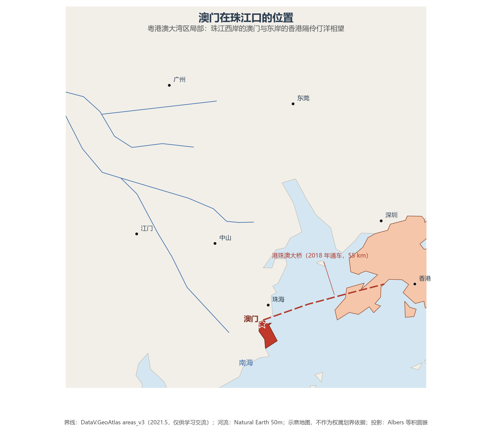
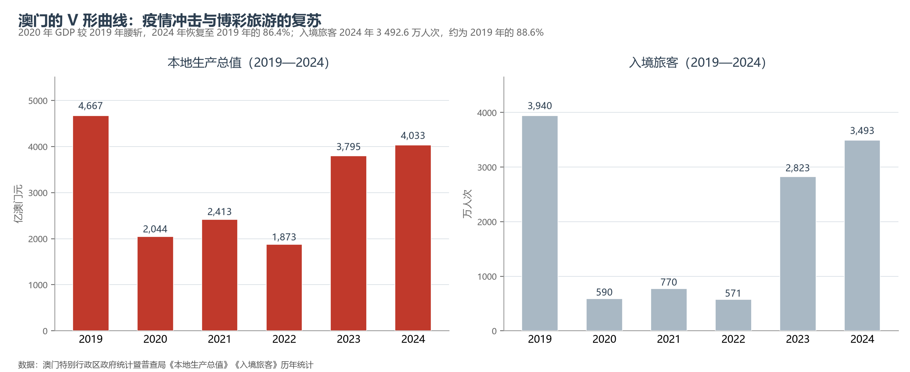

# 13.5.28 澳门特别行政区

澳门是一块被海水与填海不断改写形状的微型城市：33.3 平方公里的陆地由澳门半岛、氹仔、路环三块拼成，其中约六成是近百年填海造出来的。它坐落在珠江口西岸，与香港隔伶仃洋相望，与珠海一桥相连；68 万余人在此生活，人口密度超过每平方公里 2 万人，是世界上人口最稠密的地方之一。2024 年，澳门以 4 033 亿澳门元（约合 7.3 万美元人均）的本地生产总值，把"世界旅游休闲中心"与"中葡商贸合作服务平台"两个身份叠在同一块弹丸之地上。

## 一、省情速览

| 指标 | 数值 |
|------|------|
| 面积 | 33.3 km²（2023 年） |
| 人口 | 68.3 万（2023 年年末）；约 68.8 万（2024 年年末） |
| 本地生产总值 | 3 795 亿澳门元（2023）；4 033 亿澳门元（2024，实质增长 8.8%） |
| 人均本地生产总值 | 约 58.6 万澳门元（2024，约 7.3 万美元） |
| 入境旅客 | 3 492.6 万人次（2024，同比增长 23.8%） |
| 行政区划 | 8 个堂区（统计分区，非政权机构） |
| 简称 | 澳 |

放在全国坐标里：澳门是全国面积最小的省级行政区（不到北京市的 1/500），却是人均 GDP 最高的省级行政区，约为全国平均的 5 倍；人口密度约 2.07 万人/km²，约为深圳的 2.3 倍、香港的 3 倍。放回世界视角：澳门人口与卢森堡相当，人均 GDP 与瑞士、挪威同处世界前列，博彩旅游业的规模则自 2006 年起超过拉斯维加斯，居全球第一。

**图 13-149 澳门在珠江口的位置**：澳门位于珠江口西岸，北接珠海，东与香港隔伶仃洋相望；2018 年通车的港珠澳大桥（55 公里）把三地连成 1 小时生活圈。

## 二、自然地理

澳门的地貌可以一句话概括：**丘陵与填海**。澳门半岛原是海中孤岛，后来因西江泥沙淤积形成沙堤与珠海相连，成为半岛；半岛上有东望洋山（90 米）、西望洋山、望厦山、青洲山等一串低丘，平地极少。**氹仔**与**路环**原是两座离岛，19 世纪末以来不断填海，两岛之间的大片浅滩被填成**路氹填海区**（今路氹城），两岛在 1990 年代连成一体。全澳最高点路环塔石塘山只有 172 米，是名副其实的"丘陵城市"。

**填海**是澳门地理的主线：1912 年有记录的面积只有 11.6 平方公里，2023 年已达 33.3 平方公里，百余年扩大了近两倍——澳门半岛的北岸、筷子基、黑沙环、氹仔的机场与路氹城，都是填海的产物。2015 年中央划定澳门管理海域 85 平方公里，为填海与海洋管理提供了法律依据；正在推进的新城填海 A、B、C、D、E 区，又将为这座城市增加约 3.5 平方公里的土地。

**气候**属亚热带季风气候，年均气温约 22.5 ℃，年降水量约 2 200 毫米，4—9 月为雨季，夏秋常受台风影响；冬季短暂而温和。由于陆地狭小、海域包围，澳门的气候带有明显的海洋性调节，湿热与多雨是它的常态。**生态**资源有限：路环岛的黑沙海滩与龙爪角是仅存的海岸自然岸段，路氹城湿地与莲花大桥附近的红树林则是候鸟停歇地。

## 三、建置沿革与人文

澳门的历史是中国与欧洲相遇的第一个现场。1553 年前后，葡萄牙人以"晾晒货物"为名获准在澳门半岛暂居，1557 年起逐步形成居留区；明清两代在此设官府、收地租、驻军队，澳门始终在中国主权之下。1840 年代以后，葡萄牙借不平等条约逐步扩大占领，1887 年《中葡和好通商条约》取得"永居管理"地位。1987 年 4 月 13 日，中葡两国签署联合声明，确认中国于 1999 年 12 月 20 日对澳门恢复行使主权；1999 年 12 月 20 日零时，澳门特别行政区成立，"一国两制"、"澳人治澳"、高度自治由此开始。

澳门的人文是中西合璧的活标本：**妈阁庙**（1488 年前后）是澳门地名的由来（"Macau"即妈阁的音译），**大三巴牌坊**是 1835 年大火后仅存的圣保禄教堂前壁，**议事亭前地**的葡式碎石路与中式骑楼比邻而居，**东望洋炮台**与灯塔是中国沿海最早的现代灯塔之一。2005 年，"澳门历史城区"作为中国第 31 处世界遗产列入名录，22 处历史建筑与 8 个广场由街巷串联，是四百余年中西文化层叠的完整现场。澳门的土生葡人、葡式蛋挞、猪扒包与杏仁饼，则把这种混血文化写进了日常。

## 四、经济与区域战略

澳门的经济高度集中于**博彩旅游业**：2002 年赌权开放，2006 年博彩收入超过拉斯维加斯，2013 年达到 3 607 亿澳门元的峰值；2024 年博彩毛收入约 2 268 亿澳门元，恢复到 2019 年的七成半。博彩及相关产业贡献了政府财政收入的七成以上、GDP 的四成左右，"一业独大"的结构性风险始终存在。为此，澳门提出"**1+4**"适度多元发展策略：以旅游休闲为"1"，重点发展中医药大健康、现代金融、高新技术、会展商贸及文化体育四大产业。

**区域合作**是澳门破解空间约束的唯一路径。2003 年，中国—葡语国家经贸合作论坛在澳门设立，澳门成为连接内地与葡语国家（人口约 2.6 亿）的商贸平台；2013 年澳门大学横琴校区建成，1.09 平方公里的校园由澳门管辖；2019 年《粤港澳大湾区发展规划纲要》把澳门定位为"世界旅游休闲中心、中国与葡语国家商贸合作服务平台"；2021 年横琴粤澳深度合作区挂牌，把澳门的产业空间从 33 平方公里拓展到 106 平方公里。港珠澳大桥（2018 年通车）与澳门轻轨（2019 年氹仔线开通）则把这个微型城市接入了大湾区的轨道网。

**图 13-150 澳门本地生产总值与入境旅客（2019—2024）**：2020 年 GDP 较 2019 年腰斩，2022 年触底；2024 年 GDP 恢复至 2019 年的 86.4%，入境旅客 3 492.6 万人次、约为 2019 年的 88.6%。

## 五、分区地理：半岛、氹仔、路环、路氹城

**澳门半岛（花地玛堂区、花王堂区、望德堂区、大堂区、风顺堂区）**——这里是澳门的行政、商业与人口核心：大堂区的中区（新马路、议事亭前地）是世界遗产的核心区，银行、酒店与政府机构密集；花地玛堂区的黑沙环、筷子基是人口最稠密的居住区；花王堂区的沙梨头、三巴门一带保留着最完整的旧城肌理；望德堂区是面积最小的堂区（约 0.6 km²），塔石广场与望德堂坊是文创聚落；风顺堂区的西湾、南湾是传统高尚住宅区。

**氹仔（嘉模堂区）**——氹仔旧城区（官也街、龙环葡韵）保留着葡式住宅与市集，北部与东部则是大型酒店、会展与住宅新区；澳门国际机场、氹仔客运码头与轻轨氹仔线都在这里。

**路环（圣方济各堂区）**——澳门最南端，路环市区、黑沙海滩、龙爪角与荔枝碗船厂遗址保留着渔村与自然海岸的记忆，是澳门唯一还有"乡野感"的地方。

**路氹城（路凼填海区）**——1990 年代填海而成的新城，如今是全球博彩酒店最密集的地方：威尼斯人、巴黎人、伦敦人、新濠天地、银河等大型综合度假村沿路氹连贯公路排开，澳门蛋（东亚运动会体育馆）与路氹生态保护区也在其中。这一块填海地，集中了澳门博彩业的大部分产能。

## 六、区内之最

| 项 | 值 |
|----|----|
| 最高点 | 路环塔石塘山，172 m |
| 面积 | 33.3 km²，全国面积最小的省级行政区（约为北京市的 1/490） |
| 人口密度 | 约 2.07 万人/km²，全国最高、世界前列 |
| 人均 GDP | 约 7.3 万美元（2024），全国省级行政区最高 |
| 填海比例 | 约六成土地由填海而来（1912 年 11.6 km² → 2023 年 33.3 km²） |
| 世界遗产 | 1 处：澳门历史城区（2005 年，22 处建筑与 8 个广场） |
| 桥梁之最 | 港珠澳大桥全长 55 km，是世界最长的跨海大桥（与粤港共建） |
| 产业之最 | 博彩旅游业规模自 2006 年起居全球第一 |

## 参考与数据来源

1. 面积、人口：澳门特别行政区政府地图绘制暨地籍局（2023 年陆地面积 33.3 km²）、统计暨普查局（2023 年年末人口 68.3 万、2024 年年末约 68.8 万）。
2. 经济与旅客：澳门统计暨普查局《2024 年全年及第 4 季本地生产总值》（GDP 4 033 亿澳门元、实质增长 8.8%、恢复至 2019 年的 86.4%）、《入境旅客》2024 年全年统计（3 492.6 万人次，增长 23.8%）。
3. 填海与海域：澳门地图绘制暨地籍局历年土地面积资料；2015 年中央划定澳门管理海域 85 km²；新城填海区规划见《澳门特别行政区城市总体规划（2020—2040）》。
4. 制度与规划：《中华人民共和国澳门特别行政区基本法》；《粤港澳大湾区发展规划纲要》（2019）；《横琴粤澳深度合作区建设总体方案》（2021）。
5. 世界遗产与平台：联合国教科文组织《世界遗产名录》（澳门历史城区，2005）；中国—葡语国家经贸合作论坛（澳门，2003）。
6. 区位图界线：DataV.GeoAtlas areas_v3（2021.5，仅供学习交流）；河流：Natural Earth 50m；示意地图，不作为权属划界依据。

