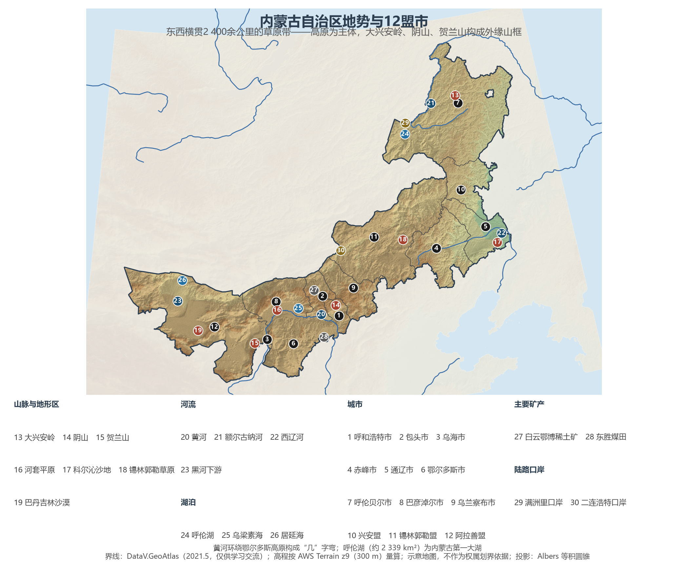
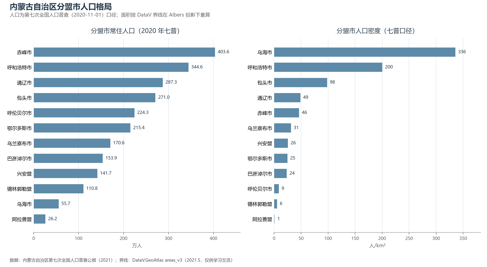
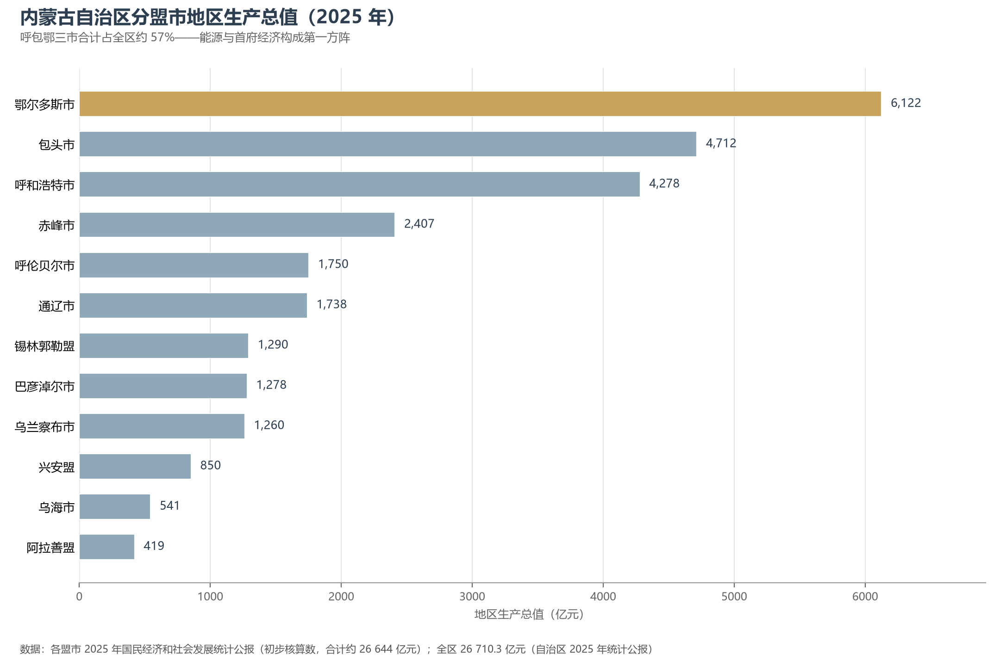

# 13.5.29 内蒙古自治区

从大兴安岭北段的黑龙江畔，到居延海畔的胡杨林，内蒙古以一道 2 400 余公里的长弧斜挂在祖国北疆——这是中国东西跨度最长的省级行政区，也是唯一同时毗邻东北、华北、西北三大区域的自治区。"东林西铁、南粮北牧"，一句老话道出了它横跨 2 400 多公里后的地貌与物产秩序：东部大兴安岭的林海，西部白云鄂博的铁矿与稀土，南部河套平原的粮仓，北部呼伦贝尔与锡林郭勒的牧草。它的另一个身份写在国境线上——与蒙古国、俄罗斯接壤，满洲里与二连浩特两座口岸城市，是中欧班列进出国门最繁忙的两处通道。

## 一、区情速览

| 指标 | 数值 |
|------|------|
| 面积 | 118.3 万 km²（全国第三，仅次于新疆、西藏） |
| 常住人口 | 2 404.9 万（2020 年七普）；2 374 万（2025 年末） |
| 常住人口城镇化率 | 71.48%（2025 年末，高于全国平均） |
| 地区生产总值 | 26 314.6 亿元（2024，增长 5.8%）；26 710.3 亿元（2025，增长 4.7%） |
| 人均地区生产总值 | 112 181 元（2025，高出全国平均约 15%） |
| 行政区划 | 9 个地级市、3 个盟，共 12 个地级单位 |
| 简称 | 蒙 |

放在全国坐标里：内蒙古 GDP 总量居省级行政区第 20 位上下，但三项指标把它从"中游"的标签里拉出来——原煤产量约 12.9 亿吨、约占全国四分之一；牛奶产量 776.7 万吨、约占全国五分之一；发电量长期居全国首位。放在世界坐标里更有意思：一墙之隔的蒙古国面积 156.65 万 km²，比内蒙古还大出三成多，但其人口（约 354.5 万，2024 年末）只有内蒙古的六分之一，2024 年 GDP 约 236 亿美元——按 2025 年口径折算，内蒙古的经济体量约相当于蒙古国的 16 倍。同一条草原带上的两侧，是两种截然不同的现代化路径。

**图 13-201 内蒙古自治区地势与 12 盟市**：z9 级 DEM 晕渲（300 m 分辨率），编号说明见图下。

## 二、自然地理

**地形**是一句话可以说清的：一个高原，三道山框。内蒙古高原是中国的第二大高原，平均海拔 1 000 米上下，从呼伦贝尔一直铺到阿拉善，地表坦荡、切割微弱，是中国最完整的天然草原载体。高原的外缘由三列山脉围合：东北的大兴安岭呈东北—西南走向纵贯约 1 400 公里，它既是内蒙古高原与东北平原的分界，也是季风区与非季风区、外流区与内流区的重要分界线；中部的阴山（大青山）横亘于黄河"几"字弯顶部，山北是牧区，山南是自战国以来未曾中断的农耕地带；西南角的贺兰山如一堵石墙，挡住腾格里沙漠的东侵与西伯利亚寒流——2024 年官方确认其主峰敖包圪垯海拔 3 556.1 米，是内蒙古最高点（全区最低点则在通辽市科尔沁左翼后旗境内，海拔仅 88.5 米，两者相差 3 400 余米）。高原的南缘另有一番天地：黄河环绕鄂尔多斯高原画出"几"字弯，弯内是毛乌素沙地与库布其沙漠，弯外则镶嵌着河套平原与土默川平原两块绿洲。也正因为这份"干旱高原+边缘绿洲"的组合，内蒙古成为中国荒漠化防治的主战场——境内分布巴丹吉林、腾格里、乌兰布和、库布其四大沙漠与毛乌素、浑善达克、科尔沁、呼伦贝尔四大沙地，"三北"防护林工程的主战场正在这里。

**气候**属温带大陆性气候，本质上是一条从半湿润到极端干旱的连续谱：年降水量从东北部大兴安岭的 500 毫米上下，一路递减到额济纳的不足 50 毫米；1 月均温自 −10 ℃ 到呼伦贝尔的 −30 ℃ 以下，7 月则普遍升至 16—30 ℃；冬春大风、日照充足是全区的共同禀赋。这条降水梯度决定了地表的一切——草原自东向西依次为草甸草原、典型草原、荒漠草原，农业只在"有水"的地方立足。

**水**的格局同样极端。外流区与内流区在大兴安岭—阴山一线分野：东侧的额尔古纳河沿中俄边界北流，是黑龙江的正源；西辽河由西拉木伦河与老哈河汇成，滋养了科尔沁；黄河从宁夏石嘴山入境，绕"几"字弯 800 余公里后于托克托县河口镇折而南下，河套灌区因此成为亚洲最大的一首制自流引水灌区。内流区里，黑河穿越河西走廊后以弱水之名流入额济纳，尾闾居延海的复活是近二十年流域治理的标志性成果；呼伦湖（约 2 339 km²）是内蒙古第一大湖、中国第四大淡水湖，与贝尔湖共系"草原双璧"；河套灌区的退水则汇入乌梁素海——黄河流域最大的功能湿地。

## 三、建置沿革与人文

内蒙古的农耕史与游牧史一样古老。战国时赵国在此设云中、九原郡，秦直道纵贯鄂尔多斯；汉代呼韩邪单于归汉、昭君出塞，遗下呼和浩特南郊的青冢。辽代在这里建起上京临潢府与中京大定府，金界壕横穿草原；元上都（今锡林郭勒盟正蓝旗）曾是横跨欧亚的帝国夏都，2012 年列入《世界遗产名录》，是内蒙古迄今唯一的世界遗产。明清两代推行盟旗制度——今天"盟""旗"的行政名称正是这段历史的活化石。1947 年 5 月 1 日，内蒙古自治区在乌兰浩特宣告成立，比共和国诞生还早两年有余，是中国第一个省级少数民族自治区，被誉为"模范自治区"。

人文景观的层次同样分明：历代长城遗迹长度居全国各省区之首；"走西口"把晋陕移民与草原城市缝合在一起，归化城（呼和浩特旧城）的召庙与商铺记录着旅蒙商的时代；蒙古族长调与呼麦列入人类非物质文化遗产代表作名录，那达慕与马头琴是草原的节律。全国仅有的三个民族自治旗——鄂伦春、鄂温克、莫力达瓦达斡尔——全部聚在大兴安岭两侧，守护着狩猎与农耕文明的最后样本。

## 四、经济与区域战略

2024 年三次产业结构为 10.9∶44.1∶45.0，"家底"几乎全部压在地下与草场上：煤炭（2025 年原煤产量 12.87 亿吨，仅次于山西）、稀土（白云鄂博是全球最大的稀土矿床，储量占全国八成以上，包头因此得名"稀土之都"）、天然气（鄂尔多斯的苏里格气田是国内最大整装气田）、风电与光伏（发电量 8 757 亿千瓦时居全国首位）。农牧业同样举足轻重：粮食产量 4 100.5 万吨（2024），是全国五个粮食净调出省区之一；牛奶、羊肉、羊绒产量居全国第一，呼和浩特集聚伊利、蒙牛两大龙头，号称"中国乳都"。

空间战略可以概括为"三向分流"：西部的呼和浩特、包头、鄂尔多斯三市构成呼包鄂榆城市群的内蒙古部分，是全区经济的心脏——三市 2025 年 GDP 合计约 15 100 亿元，占全区近六成；东部五盟市融入东北全面振兴，靠大铁路网与东北平原连成一体；北部则以满洲里（中国最大陆路口岸）与二连浩特两个口岸为支点，建设中欧班列中通道与东通道，担当我国向北开放的桥头堡。生态维度上，"两个屏障"——祖国北疆安全稳定屏障与我国北方重要生态安全屏障——是中央对内蒙古的根本定位；库布其沙漠治理作为全球荒漠化防治的样本写入了联合国决议。交通骨架沿"几"字弯与草原带展开：京包—包兰、集二、滨洲线构成"日"字形骨架，呼和浩特经张家口的进京高铁通道打通后，集大原高铁又于 2024 年底开通，自治区首府由此接入全国高铁网的东南大动脉。

**图 13-202 内蒙古自治区分盟市人口格局**：左为分盟市常住人口（七普），右为分盟市人口密度——乌海市以约 336 人/km² 居首，阿拉善盟仅约 1 人/km²。

## 五、分区地理：12 盟市与三大板块

**蒙西板块（黄河"几"字弯经济区）**——呼和浩特市 344.6 万人，首府：政治文化中心与"中国乳都"，2025 年 GDP 4 278.3 亿元。包头市 271.0 万人，"草原钢城"与稀土之都，2025 年 GDP 4 711.9 亿元居第二，白云鄂博的矿车昼夜不息。鄂尔多斯市 215.4 万人，全区经济第一市（2025 年 GDP 6 122.2 亿元）：煤炭、天然气、羊绒、稀土——"羊煤土气"四大件撑起全国地级市前列的人均 GDP，库布其与毛乌素的绿进沙退在这里同步上演。乌海市 55.7 万人，全区最小的盟市，焦煤与化工重镇。巴彦淖尔市 153.9 万人，坐拥后套平原，"塞外粮仓"——河套小麦、向日葵与番茄远销全国。

**蒙中板块（草原带）**——乌兰察布市 170.6 万人，"马铃薯之都"与京津冀的风电后院，集宁是草原茶道与今日高铁的枢纽。锡林郭勒盟 110.8 万人，锡林郭勒草原是中国最大的草原牧区之一，元上都遗址在正蓝旗，褐煤与煤电基地在草原地下延伸。

**蒙东板块（东北经济区）**——赤峰市 403.6 万人，全区人口第一大市：红山文化在这里出土了"中华第一龙"玉龙，乌兰布统草原与贡格尔河是其旅游名片。通辽市 287.3 万人，科尔沁草原腹地，玉米与肉牛产量均居全国地级市前列。呼伦贝尔市 224.3 万人，辖区约 25.3 万 km²，是全国面积最大的地级市之一：大兴安岭林海、呼伦贝尔草原与满洲里口岸三位一体。兴安盟 141.7 万人，1947 年自治区诞生地乌兰浩特所在，阿尔山的火山温泉林海是新兴旅游极。阿拉善盟 26.2 万人，辖区约 27 万 km²：巴丹吉林沙漠的必鲁图峰是世界最高固定沙山，额济纳胡杨林每秋必"刷屏"，东风航天城（酒泉卫星发射中心）实际就坐落在这片戈壁上。

**图 13-203 内蒙古自治区分盟市地区生产总值（2025 年）**：鄂尔多斯一市约占全区 23%。

## 六、区内之最

| 项 | 值 |
|----|----|
| 最高点 | 贺兰山主峰敖包圪垯（阿拉善盟），3 556.1 m（2024 年官方确认） |
| 最低点 | 通辽市科尔沁左翼后旗，88.5 m（西辽河平原） |
| 面积最大 / 最小的盟市 | 阿拉善盟约 27 万 km² / 乌海市约 1 754 km² |
| 人口最多 / 最少的盟市（七普） | 赤峰市 403.6 万 / 阿拉善盟 26.2 万 |
| 人口密度最高 / 最低（七普） | 乌海市约 336 人/km² / 阿拉善盟约 1 人/km² |
| GDP 首位盟市 | 鄂尔多斯市 6 122.2 亿元（2025，占全区约 23%） |
| 最大湖泊 | 呼伦湖，约 2 339 km²（中国第四大淡水湖） |
| 基本草原 | 7.3 亿亩（全国率先划定，面积居各省区前列） |
| 世界遗产 | 元上都遗址（2012，文化遗产） |

## 参考与数据来源

1. 面积、人口、GDP 总量：附录 A 口径（《中国统计年鉴 2024》）；2024 年数据为《内蒙古自治区 2024 年国民经济和社会发展统计公报》（2025 年 4 月），2025 年数据为《内蒙古自治区 2025 年国民经济和社会发展统计公报》（2026 年 4 月）。
2. 分盟市人口：内蒙古自治区第七次全国人口普查公报（2021）；分盟市面积按 DataV 界线在 Albers 投影下量算。
3. 分盟市 GDP：各盟市 2025 年国民经济和社会发展统计公报（初步核算数）。
4. 基本草原 7.3 亿亩：内蒙古自治区林业和草原局（新华社 2024-01-17）；呼伦湖面积：水利部门与呼伦湖国家级自然保护区管理局公开口径。
5. 最高峰敖包圪垯 3 556.1 m：阿拉善盟行政公署（2024-11 官方确认）；最低点 88.5 m：通辽市人民政府《通辽市情概况》。
6. 蒙古国面积、人口、GDP：中国外交部国家概况、中国驻蒙古国使馆与商务部口径（2024）；美元折算按 1 美元≈7.1 元。
7. 地势图 DEM：AWS Terrain Tiles z9（300 m 分辨率量算）；界线：DataV.GeoAtlas areas_v3（2021.5，仅供学习交流）。
