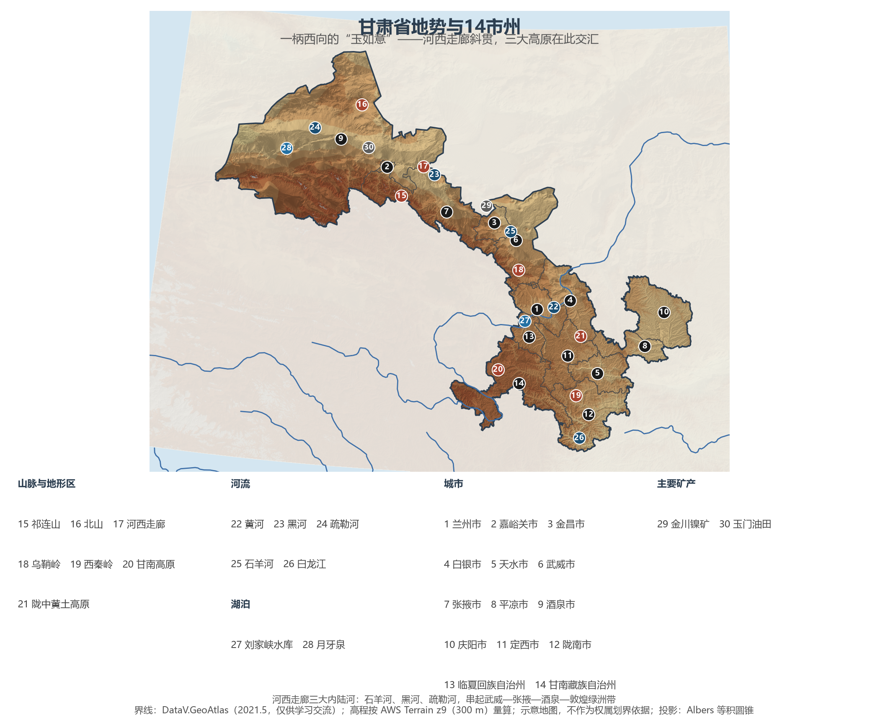
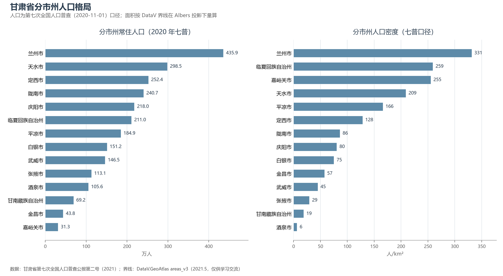
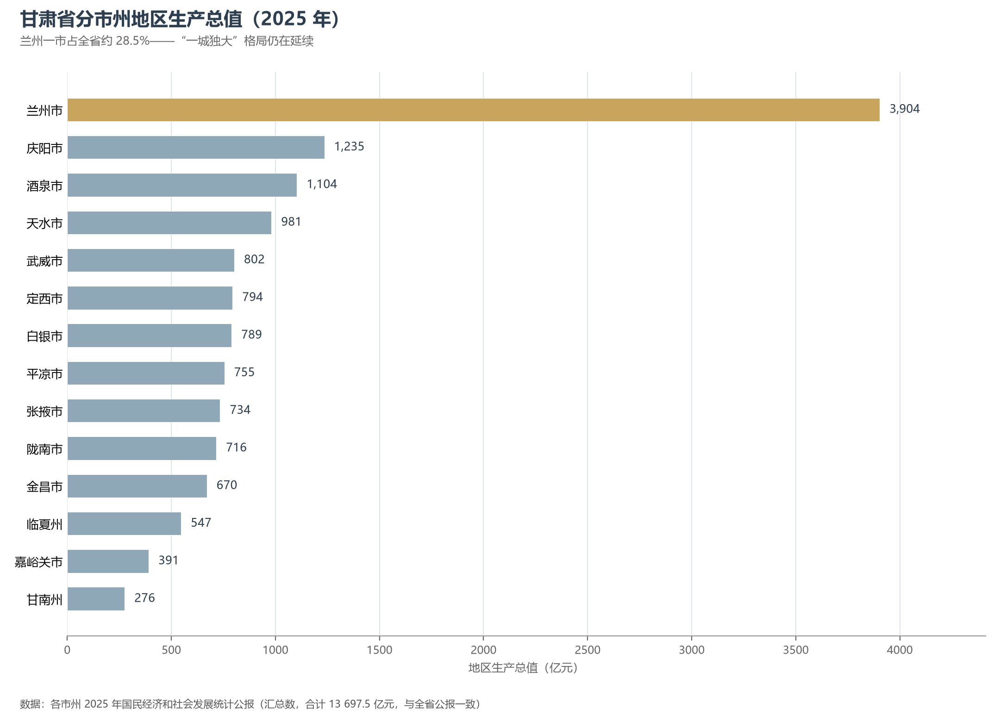

# 13.5.30 甘肃省

在中国版图上，甘肃像一柄斜向西北的"玉如意"——如意头枕在陇东黄土塬上，如意柄沿着河西走廊一路伸到敦煌以西，东西绵延 1 600 余公里。它是中国的地理枢纽：黄土高原、青藏高原、内蒙古高原与河西走廊在此交汇，古丝绸之路的咽喉、今日中欧班列的通道都从这柄"如意"上通过。若按自然区划而非行政归组，甘肃还是全国唯一地跨北方、南方、西北、青藏四大地理区域的省份——陇南白龙江谷地的亚热带常绿阔叶林与敦煌戈壁的极端干旱景观，同处一省。

## 一、省情速览

| 指标 | 数值 |
|------|------|
| 面积 | 42.58 万 km²（全国第七） |
| 常住人口 | 2 502.0 万（2020 年七普）；2 443 万（2025 年末） |
| 常住人口城镇化率 | 58.08%（2025 年末） |
| 地区生产总值 | 13 002.9 亿元（2024，增长 5.8%，增速居全国第 3）；13 697.5 亿元（2025，增长 5.8%） |
| 人均地区生产总值 | 55 897 元（2025，约为全国平均的六成弱） |
| 行政区划 | 12 个地级市、2 个自治州，共 14 个地级单位 |
| 简称 | 甘、陇 |

放在全国坐标里：甘肃的经济总量居省级行政区后段，人口也在持续外流——七普较六普减少 55.5 万人，仅兰州、临夏、嘉峪关、甘南四个市州实现人口增长。但两个指标让甘肃无法被低估：2024 年 GDP 增速居全国第 3 位；2025 年发电装机中风电与光伏合计 8 008.8 万千瓦、占比约 64%，是全国能源结构最"绿"的省份之一。放在世界坐标里：甘肃面积比日本大出 4.8 万 km²，人口却只有日本的约五分之一；其 2025 年 GDP 折美元约 1 929 亿——约为中亚第一大国哈萨克斯坦（2024 年约 2 880 亿美元）的三分之二。

**图 13-204 甘肃省地势与 14 市州**：z9 级 DEM 晕渲（300 m 分辨率），编号说明见图下。

## 二、自然地理

**地形**可以概括为"走廊+高原"四个字。河西走廊长约 1 000 公里、宽数十至百余公里，夹在祁连山与北山之间，自古是中原通往西域的必经之路；南侧的祁连山是走廊的"固体水库"，其最高峰团结峰（5 808 m，位于甘青交界的疏勒南山）也是甘肃最高点——全省最低点则在陇南文县的白龙江河谷，海拔约 550 米，顶底相差逾 5 200 米。走廊之外，东南部是黄土高原的西缘（陇中高原），沟壑纵横、水土流失深刻；西南部甘南高原属青藏高原东缘，玛曲县的"黄河首曲"在草原上画出发育早期的第一道大弯；南端西秦岭山地把白龙江峡谷切开，成了甘肃的"亚热带窗口"。

**气候**是浓缩的中国西北：从陇南的湿润区（年降水 700 毫米以上）到敦煌的极端干旱区（不足 50 毫米），四类干湿地区在一省内依次排开；温度带上，亚热带、暖温带、中温带与青藏高寒区同样齐备。冬季风与夏季风在乌鞘岭一线拉锯——山的西侧，季风已是强弩之末。

**水**是文明的钥匙。黄河干流在省内蜿蜒 900 余公里，兰州是全国唯一黄河穿城的省会；河西走廊则完全依靠祁连山冰雪融水补给——石羊河、黑河、疏勒河三大内陆河自东向西对应武威—民勤、张掖—酒泉、玉门—敦煌绿洲带，"有水是绿洲、无水是戈壁"在这里是最直白的地理规律。黄河上游的刘家峡水库是新中国第一座百万千瓦级水电站。

## 三、建置沿革与人文

甘肃之名取自甘州（张掖）与肃州（酒泉），建省始于元代。汉武帝设河西四郡（武威、张掖、酒泉、敦煌），把中原政权的力量第一次推到西域门口；此后两千年，这片走廊见证了大月氏与匈奴的进退、盛唐的驼队与吐蕃的铁骑、左宗棠抬棺西征与嘉峪关闭关。武威雷台汉墓出土的铜奔马"马踏飞燕"，如今是中国旅游的标志。

敦煌是这条走廊的明珠：公元 366 年乐僔和尚在鸣沙山开凿第一个石窟，此后千年营造不辍，留下 735 个洞窟、4.5 万平方米壁画——1987 年莫高窟入选中国首批世界遗产；明长城西端的嘉峪关号称"天下第一雄关"，与山海关东西遥望；天水麦积山石窟则以"东方雕塑馆"著称，随 2014 年丝绸之路廊道一起列入世界遗产。人文传统上，天水是伏羲故里，甘南夏河的拉卜楞寺是藏传佛教格鲁派六大寺院之一，临夏的"花儿"与砖雕、庆阳的香包与陇东皮影各成体系。1936 年 10 月红军三大主力在会宁会师；1909 年建成的兰州黄河铁桥是"天下黄河第一桥"。

## 四、经济与区域战略

2025 年三次产业结构为 12.9∶33.3∶53.8。工业家底是"一五"时期打下的：玉门油田是中国第一个天然石油基地、"铁人"王进喜的故乡，兰州石化长期是西北最大的炼化基地，嘉峪关的酒钢与金昌的金川集团支撑起有色冶金——金昌因此得名"镍都"，是国内最大的镍钴生产基地。新能源是当下最大的增量：酒泉是全国首个千万千瓦级风电基地，河西走廊正在变成"清洁能源走廊"，特高压通道把戈壁的风与光送往华中。农业以高原特色见长：定西的"中国薯都"与"千年药乡"、陇南的油橄榄、兰州的百合、静宁的苹果各霸一方。粮食产量 1 309.3 万吨（2025），在缺水省份里殊为不易。

空间战略上，兰州的枢纽地位独一无二：陇海、兰新、包兰、兰渝诸干线在此交汇，宝兰与兰新高铁把甘肃接入全国高铁网；2012 年获批的兰州新区是全国第五个国家级新区。甘肃的当代叙事有三条主线：**开放**——中欧班列与敦煌文博会把古丝路接进"一带一路"；**生态**——祁连山国家公园体制试点守护河西水源，黄河流域生态保护和高质量发展覆盖陇中陇东；**省域重整**——人口与要素持续向兰州集聚，"强省会"与河西"风光"双轮驱动。

**图 13-205 甘肃省分市州人口格局**：左为分市州常住人口（七普），右为分市州人口密度——兰州市约 331 人/km² 居首，酒泉市仅约 6 人/km²。

## 五、分区地理：14 市州与四大板块

**河西板块**——酒泉市 105.6 万人，辖区约 19.2 万 km²、约占全省近半：敦煌莫高窟、酒泉卫星发射中心的后勤基地与千万千瓦风电场同在一片戈壁，2025 年 GDP 1 103.6 亿元居全省第三。嘉峪关市 31.3 万人，是全国五个"不设市辖区"的地级市之一，因矿建市、因关成名。张掖市 113.1 万人，"金张掖"坐拥黑河绿洲与七彩丹霞。金昌市 43.8 万人，镍都，人均 GDP 常年居全省第一，2025 年增速（9.3%）同为全省最高。武威市 146.5 万人，古凉州，铜奔马的出土地，石羊河流域重点治理的主战场。

**陇中—陇东板块**——兰州市 435.9 万人，省会与全省唯一大城市，2025 年 GDP 3 903.6 亿元、占全省约 28.5%："一城独大"的格局仍在延续。白银市 151.2 万人，"铜城"转型的老工业城市。定西市 252.4 万人，马铃薯与中药材之乡。庆阳市 218.0 万人，陇东能源基地（石油、煤炭）让它的 GDP（1 235.3 亿元）稳居全省第二。平凉市 184.9 万人，崆峒山所在。

**陇东南板块**——天水市 298.5 万人，全省人口第二大市：麦积山石窟与老工业基地（装备制造）并存，是甘肃对接关中平原城市群的门户。陇南市 240.7 万人，白龙江峡谷里的"陇上江南"：油橄榄、茶叶与大熊猫（白水江自然保护区）颠覆外界对甘肃的想象。

**民族两州**——临夏回族自治州 211.0 万人，人口密度居全省第二（约 259 人/km²）：刘家峡水库、炳灵寺石窟与河州砖雕。甘南藏族自治州 69.2 万人，拉卜楞寺与扎尕那石城所在，黄河首曲湿地是黄河上游最重要的水源涵养区之一。

**图 13-206 甘肃省分市州地区生产总值（2025 年）**：兰州、庆阳、酒泉居前三。

## 六、省内之最

| 项 | 值 |
|----|----|
| 最高点 | 疏勒南山团结峰（甘青界），5 808 m |
| 最低点 | 文县白龙江河谷，约 550 m |
| 面积最大 / 最小的市州 | 酒泉市约 19.2 万 km² / 嘉峪关市 1 224 km² |
| 人口最多 / 最少的市州（七普） | 兰州市 435.9 万 / 嘉峪关市 31.3 万 |
| 人口密度最高 / 最低（七普） | 兰州市约 331 人/km² / 酒泉市约 6 人/km² |
| GDP 首位市州 | 兰州市 3 903.6 亿元（2025，占全省约 28.5%） |
| 世界遗产 | 敦煌莫高窟（1987）、长城·嘉峪关（1987）、丝绸之路廊道·麦积山石窟等（2014） |
| 全国之最 | 首个千万千瓦级风电基地（酒泉）；首座百万千瓦级水电站（刘家峡） |

## 参考与数据来源

1. 面积、人口、GDP 总量：附录 A 口径（《中国统计年鉴 2024》）；2024 年数据为《2024 年甘肃省国民经济和社会发展统计公报》（甘肃省政府网，2025-03-13），2025 年数据为《2025 年甘肃省国民经济和社会发展统计公报》。
2. 分市州人口：甘肃省第七次全国人口普查公报（第二号）——地区人口情况；分市州面积按 DataV 界线在 Albers 投影下量算，嘉峪关市（1 224 km²）、酒泉市（约 19.2 万 km²）另据省政府官网口径。
3. 分市州 GDP：各市州 2025 年国民经济和社会发展统计公报（汇总数，与全省公报一致）。
4. 最高峰团结峰 5 808 m：《中华文化符号解读·甘肃卷》等甘肃官方口径；莫高窟洞窟与壁画面积：敦煌研究院公开数据。
5. 哈萨克斯坦 GDP：哈萨克斯坦官方通讯社（哈通社，2024 年约 2 881 亿美元）；日本面积与人口为公认统计口径；美元折算按 1 美元≈7.1 元。
6. 地势图 DEM：AWS Terrain Tiles z9（300 m 分辨率量算）；界线：DataV.GeoAtlas areas_v3（2021.5，仅供学习交流）。
