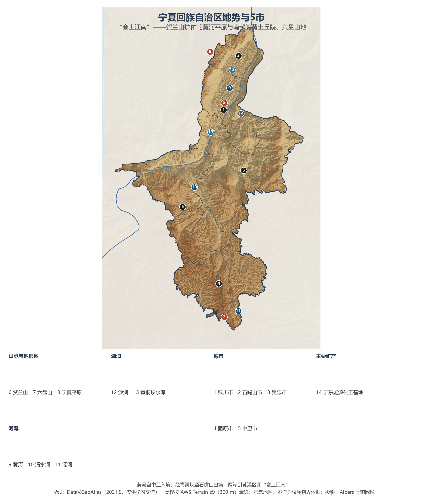
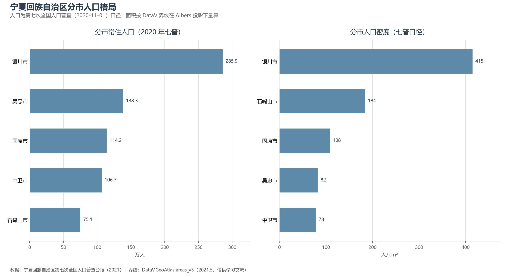
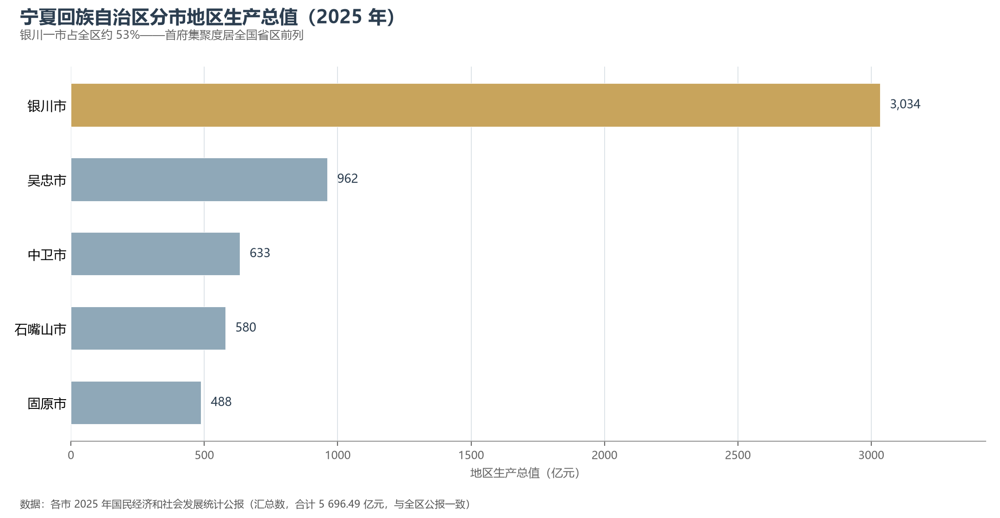

# 13.5.31 宁夏回族自治区

"天下黄河富宁夏"——黄河自中卫入境，斜贯北部平原 397 公里后从石嘴山出境，把中国最干旱的土地之一滋养成了渠道纵横的"塞上江南"。宁夏是全国唯一全境属于黄河流域的省级行政区，也是面积最小的自治区：6.64 万 km² 的土地浓缩了沙漠、平原、黄土丘陵与高山，浓缩了两千年的引黄灌溉史，也浓缩了从"苦瘠甲天下"的西海固到葡萄酒"当惊世界殊"的贺兰山东麓这一场跨越千年的命运反转。

## 一、区情速览

| 指标 | 数值 |
|------|------|
| 面积 | 6.64 万 km²（居省级行政区第 27 位，比重庆市还小） |
| 常住人口 | 720.3 万（2020 年七普）；732 万（2025 年末，仍在增长） |
| 常住人口城镇化率 | 69.13%（2025 年末） |
| 地区生产总值 | 5 502.7 亿元（2024）；5 696.49 亿元（2025，增长 5.3%） |
| 人均地区生产总值 | 77 981 元（2025，约为全国平均的四分之三） |
| 行政区划 | 5 个地级市 |
| 简称 | 宁 |

放在全国坐标里：宁夏 GDP 总量仅高于青海与西藏，但两项指标让它与众不同——人口仍在净增（七普较六普增长 14.3%，为西部少数人口正增长的省区），人均 GDP 约为全国平均的四分之三、居西部省区中游。放在世界坐标里最有意思：波罗的海东岸的立陶宛面积 6.53 万 km²，与宁夏几乎相等；立陶宛 2024 年 GDP 约 855 亿美元，宁夏 2025 年 GDP 折美元约 802 亿——总量已相当于这个欧盟国家的 94%；而宁夏 732 万人口约为立陶宛的 2.6 倍。

**图 13-207 宁夏回族自治区地势与 5 市**：z9 级 DEM 晕渲（300 m 分辨率），编号说明见图下。

## 二、自然地理

**地形**自北向南呈三级阶梯：北部的贺兰山与鄂尔多斯高原之间，黄河冲积出海拔 1 100—1 200 米的**宁夏平原**——宁夏的财富与人口都堆积在这条南北长约 320 公里的绿洲带上；中部是灵盐台地与毛乌素沙地边缘的风沙区；南部的黄土丘陵抬升为**六盘山地**，主峰米缸山海拔近 3 000 米。全区最高点是北缘的**贺兰山**主峰敖包疙瘩（3 556 m，位于宁蒙界山），最低点则是黄河出境处（约 1 090 m）——最高最低之间近 2 500 米的落差，装着宁夏的全部地理故事。自治区以"一河三山"（黄河与贺兰山、六盘山、罗山）勾画生态安全格局，贺兰山挡住腾格里沙漠与西伯利亚寒流，六盘山涵养泾河、清水河与葫芦河三源，罗山则孤独地守着中部旱塬的水源。

**气候**属温带大陆性气候：年降水自南部的 600 毫米递减至北部的 200 毫米以下，蒸发量却高达降水的十倍；日照 3 000 小时上下、昼夜温差常在 12 ℃ 以上——这正是枸杞、葡萄、硒砂瓜"甜"的化学来源。

**水**是宁夏的命脉与荣耀。秦渠、汉渠、唐徕渠……两千年不断的引黄灌溉让宁夏平原成为人类改造干旱区的经典样本，2017 年"宁夏引黄古灌区"入选世界灌溉工程遗产。黄河之外，南部山区的清水河是宁夏境内最大的黄河支流；北部的沙湖、星海湖与银川平原的"七十二连湖"湿地，则让首府赢得"塞上湖城"之名。

## 三、建置沿革与人文

宁夏的人类史相当古老：4 万年前的水洞沟遗址是中国最早系统发掘的旧石器时代遗址之一。战国秦在此设北地郡，汉代开始引黄屯垦；1038 年党项首领李元昊在此建立西夏，与两宋、辽金鼎峙近两百年，留下贺兰山东麓的西夏陵——2025 年 7 月，西夏陵列入《世界遗产名录》，成为中国第 60 项世界遗产，宁夏由此结束了没有世界遗产的历史。"宁夏"之名取"夏地安宁"之意，始于元代；明代宁夏镇为九边重镇之一。1958 年 10 月宁夏回族自治区成立。1997 年启动的闽宁协作把福建的资金与产业引来吊庄移民区，闽宁镇从干沙滩变成金沙滩——电视剧《山海情》正是这段当代史的注脚。

## 四、经济与区域战略

2025 年三次产业结构为 8.3∶41.4∶50.3，工业的底色是**能源**：宁东能源化工基地（位于银川市灵武境内）的 400 万吨级煤炭间接液化项目是全球单体规模最大的煤制油工程之一，"宁电入湘"特高压把宁东的火电与新能源一起送往湖南。新能源同样是主角：2025 年末发电装机 9 120 万千瓦（+21.4%），可再生能源发电量占比达 30.8%，腾格里沙漠边缘的"沙戈荒"新能源大基地正在铺开。农业的招牌则挂在气候上：中宁枸杞、盐池滩羊、中卫硒砂瓜、固原冷凉蔬菜各霸一方；**贺兰山东麓**是中国最大的酿酒葡萄集中连片产区（约 60.2 万亩），261 家酒企、年灌装 1.4 亿瓶，产量约占国产酒庄酒的一半，综合产值超 400 亿元——国际大赛上的持续获奖让它被媒体称作葡萄酒界的"当惊世界殊"。

空间战略上是"两大叙事"：其一，**黄河流域生态保护和高质量发展先行区**——全国唯一全境黄河流域的省区承担着先行探路的角色；其二，**开放**——2012 年获批的全国首个内陆开放型经济试验区、中阿博览会永久举办地银川，加上银西高铁（2020 年通车）与包兰铁路的百年走廊，让这片内陆腹地持续寻找出海口。交通细节里藏着一个地理学的经典：1958 年通车的包兰铁路在沙坡头穿越流动沙丘，半个多世纪的麦草方格固沙法从这里走向了世界。

**图 13-208 宁夏回族自治区分市人口格局**：左为分市常住人口（七普），右为分市人口密度——银川市约 415 人/km² 居首。

## 五、分区地理：5 市与两大板块

**沿黄城市群（北部）**——银川市 285.9 万人（七普），首府与全区的绝对核心：西夏陵、贺兰山岩画、镇北堡影视城与宁东基地同在一市，2025 年 GDP 3 033.53 亿元、占全区 53.25%——首府集聚度在全国省区中名列前茅。石嘴山市 75.1 万人，"塞上煤城"：太西煤、三线时代的钢铁水泥与正在转型的星海湖湿地，沙湖景区就在其平罗县。吴忠市 138.3 万人，辖区面积约 1.7 万 km² 为全区最大：青铜峡的黄河大峡谷、贺兰山东麓葡萄酒核心产区与盐池滩羊，是它的三张名片。中卫市 106.7 万人，黄河首入宁夏之地：沙坡头治沙、硒砂瓜与近年崛起的"西部云基地"（云计算产业）让这座小城同时踩着治沙史与数字时代的节拍。

**南部山区（固原市）**——固原市 114.2 万人，就是昔日"苦瘠甲天下"的西海固：海拔高、降水少、曾经不宜人居；今天的固原靠生态移民、冷凉蔬菜与肉牛养殖完成翻身，六盘山红军长征纪念馆与须弥山石窟并列山间——这里既是长征翻越的最后一座大山，也是宁夏森林覆盖率最高的区域之一。

**图 13-209 宁夏回族自治区分市地区生产总值（2025 年）**：银川一市独大，其余四市均不足千亿。

## 六、区内之最

| 项 | 值 |
|----|----|
| 最高点 | 贺兰山主峰敖包疙瘩（宁蒙界），3 556 m |
| 最低点 | 黄河出境处（石嘴山市境内），约 1 090 m |
| 面积最大 / 最小的市 | 吴忠市约 1.7 万 km² / 石嘴山市约 4 084 km²（DataV 界线量算） |
| 人口最多 / 最少的市（七普） | 银川市 285.9 万 / 石嘴山市 75.1 万 |
| 人口密度最高 / 最低（七普） | 银川市约 415 人/km² / 中卫市约 78 人/km² |
| GDP 首位市 | 银川市 3 033.53 亿元（2025，占全区 53.25%） |
| 世界遗产 | 西夏陵（2025 年列入，中国第 60 项） |
| 世界灌溉工程遗产 | 宁夏引黄古灌区（2017） |
| 全国之最 | 中国最大酿酒葡萄集中连片产区（贺兰山东麓约 60.2 万亩） |

## 参考与数据来源

1. 面积、人口、GDP 总量：附录 A 口径（《中国统计年鉴 2024》）；2024 年数据为《宁夏回族自治区 2024 年国民经济和社会发展统计公报》，2025 年数据为《宁夏回族自治区 2025 年国民经济和社会发展统计公报》。
2. 分市人口：宁夏回族自治区第七次全国人口普查公报（2021）；分市面积按 DataV 界线在 Albers 投影下量算。
3. 分市 GDP：各市 2025 年国民经济和社会发展统计公报（汇总数，与全区公报一致）。
4. 西夏陵列入世界遗产（2025-07-11，中国第 60 项）：国家文物局与联合国教科文组织第 47 届世界遗产大会公开信息；引黄古灌区世界灌溉工程遗产（2017）：国际灌排委员会。
5. 贺兰山东麓葡萄酒产业数据：新华社《北纬 38 度的浪漫》（2024-03）等公开报道；最高峰 3 556 m：文化和旅游部《宁夏二十一景》等官方口径。
6. 立陶宛面积、人口、GDP：中国外交部国家概况、世界银行（2024 年约 854.8 亿美元）；美元折算按 1 美元≈7.1 元。
7. 地势图 DEM：AWS Terrain Tiles z9（300 m 分辨率量算）；界线：DataV.GeoAtlas areas_v3（2021.5，仅供学习交流）。
