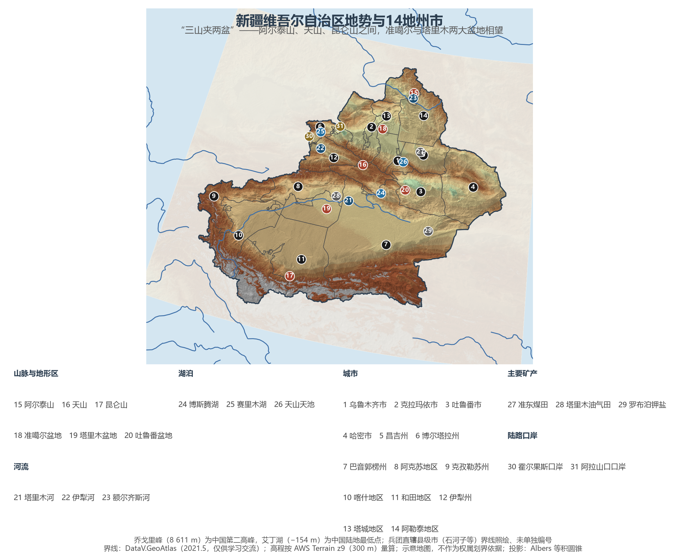
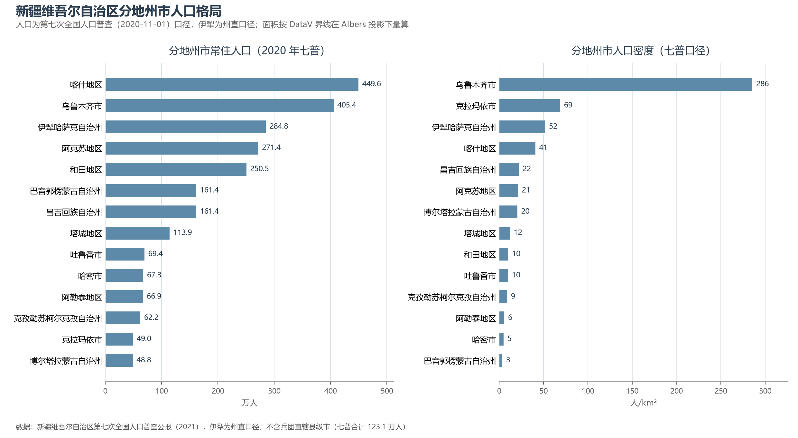
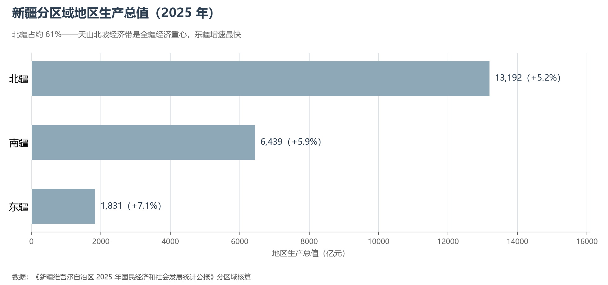

# 13.5.32 新疆维吾尔自治区

阿尔泰山、天山、昆仑山三大山系把新疆夹成两个巨大盆地——"三山夹两盆"四个字，是 166 万平方公里土地的全部骨架。这是中国面积最大的省级行政区，约占全国陆地面积的六分之一；古代丝绸之路在这里翻越山口、穿越绿洲，今天的第二座"亚欧大陆桥"仍沿着同样的走廊穿行。从一个更宏大的尺度看，新疆的面积与伊朗相当、比法国加西班牙加德国的总和还大——而它 2025 年的经济总量折美元约 3 023 亿，已经追平中亚第一大国哈萨克斯坦。

## 一、区情速览

| 指标 | 数值 |
|------|------|
| 面积 | 166.49 万 km²（全国第一，约占全国陆地面积 1/6） |
| 常住人口 | 2 585.2 万（2020 年七普）；2 639.0 万（2025 年末，仍在增长） |
| 常住人口城镇化率 | 61.61%（2025 年末） |
| 地区生产总值 | 20 534.2 亿元（2024，首破 2 万亿）；21 462.14 亿元（2025，增长 5.5%） |
| 人均地区生产总值 | 81 574 元（2025） |
| 行政区划 | 14 个地州市（4 市、5 州、5 地区）+ 新疆生产建设兵团 |
| 简称 | 新 |

放在全国坐标里：新疆 GDP 总量居省级行政区中下游，增速却连续多年位居全国第一方阵，人口也持续净增（七普较六普增长 18.5%）。三项"全国之最"界定了它的分量：棉花产量 616.5 万吨、约占全国九成；油气产量当量居全国第一；民用运输机场 28 个、数量居全国第一。放在世界坐标里：2025 年新疆 GDP 折美元约 3 023 亿，已与哈萨克斯坦（2024 年约 2 881 亿美元）并驾齐驱，人口（2 639 万）约为其后者的 1.3 倍——同一个天山的两侧，是两个量级相当的现代经济体。

**图 13-210 新疆维吾尔自治区地势与 14 地州市**：z9 级 DEM 晕渲（300 m 分辨率），编号说明见图下；兵团直辖县级市界线照绘、未单独编号。

## 二、自然地理

**地形**的秩序极其清晰：北为阿尔泰山（中俄蒙哈界山），南为昆仑山与喀喇昆仑山——中国第二高峰乔戈里峰（8 611 m）就耸立在新疆最西南的边界上；天山横贯中部约 1 700 公里，把全疆分为北疆与南疆。天山以北的准噶尔盆地是中国第二大内陆盆地，古尔班通古特沙漠居于其中；天山以南的塔里木盆地是中国最大的内陆盆地，腹地的塔克拉玛干沙漠面积约 33.76 万 km²，是我国最大、世界第二大流动沙漠——2024 年 11 月 28 日，环绕它 3 046 公里的绿色阻沙防护带全面"锁边合龙"，这项历时 46 年的工程建成了世界最长的环沙漠生态屏障。吐鲁番盆地则是另一重极端：盆地中的艾丁湖湖面低于海平面 154.31 米，为中国陆地最低点，夏季极端气温逼近 50 ℃，"火洲"由此得名。此外，向西张开的伊犁河谷承接大西洋来的水汽，是干旱区里罕见的"塞外江南"。

**气候**是极端大陆性的标本：全疆降水自西北的 400 毫米上下向东南递减至塔里木腹地的不足 25 毫米；日照强、温差大、风多风急——达坂城与阿拉山口的风区如今成了风电场的所在地。

**水**的格局是"以内流为纲"：塔里木河（约 2 179 km）是中国最长的内流河，沿塔里木盆地北缘串起一片片绿洲；伊犁河流出国境注入巴尔喀什湖；额尔齐斯河是中国唯一属于北冰洋水系的河流。天山雪山是全疆的"固体水塔"，博斯腾湖是中国最大的内陆淡水湖；而把雪山渗水引入绿洲的古老**坎儿井**地下渠系，是吐鲁番绿洲两千年的生存智慧。

## 三、建置沿革与人文

新疆古称西域。公元前 60 年，西汉设西域都护府，这片土地自此正式纳入中国版图；唐代安西、北庭两大都护府分治天山南北；元代以后历经察合台汗国与准噶尔部，1759 年清朝统一天山南北，1884 年正式建省，取"故土新归"之意名之曰**新疆**。1955 年 10 月 1 日新疆维吾尔自治区成立；1954 年组建的新疆生产建设兵团则以"师市合一"的独特体制屯垦戍边至今，石河子就是从戈壁上建起来的"军垦名城"。

丝路遗产遍布全境：交河故城与高昌故城的车辙、克孜尔千佛洞的壁画、楼兰的传说，连同 2013 年列入世界自然遗产的"新疆天山"与 2014 年"丝绸之路：长安—天山廊道路网"中的 6 处新疆遗产点，构成中国西部最密集的遗产群之一。维吾尔木卡姆艺术与柯尔克孜史诗《玛纳斯》列入人类非物质文化遗产代表作名录；大巴扎的喧闹、馕坑的麦香与冬不拉的琴声，是绿洲文明的日常。

## 四、经济与区域战略

2025 年三次产业结构为 13.1∶38.2∶48.7。**能源**是最大的一张牌：塔里木、准噶尔、吐哈三大盆地的油气产量当量居全国第一，"西气东输"一线自塔里木轮南起步，二线自霍尔果斯入境中亚气源；原煤产量 5.53 亿吨（2025），准东煤田是国家规划的大型煤炭基地；风与光正在接力——哈密、准东与环塔里木的"沙戈荒"新能源大基地使发电量达 5 714 亿千瓦时。**农业**早已超出绿洲自给的尺度：棉花占全国约九成，粮食产量 2 432.3 万吨（2025，+4.4%）自 2024 年起跃居全国第二，葡萄、哈密瓜、香梨与番茄制品行销世界。

空间战略一言以蔽之：**核心区**。作为"一带一路"核心区，新疆拥有霍尔果斯、阿拉山口等公路铁路口岸，全国中欧班列的主要出境通道由此穿过，喀什与霍尔果斯两个经济开发区分居南、西两端；28 个民用机场织成全国最密的省域航空网，兰新高铁（2014）把乌鲁木齐接入全国高铁网，2022 年和若铁路通车后，环塔里木盆地铁路环线成为世界首个沙漠铁路环线。分区域看，北疆以 13 192 亿元占全疆约 61%，天山北坡经济带（乌鲁木齐—昌吉—石河子—克拉玛依）是重心；南疆增速（5.9%）快于北疆（5.2%），东疆（+7.1%）最快——发展梯度正在收窄。19 个省市的对口援疆与兵团的屯垦戍边，构成这项区域叙事的另一半。

**图 13-211 新疆维吾尔自治区分地州市人口格局**：左为分地州市常住人口（七普，伊犁为州直口径），右为人口密度——乌鲁木齐市约 286 人/km² 居首，巴音郭楞州仅约 3 人/km²。

## 五、分区地理：14 地州市与三大板块

**北疆板块（天山北坡与伊犁河谷）**——乌鲁木齐市 405.4 万人，亚洲内陆的枢纽都会：2025 年 GDP 约 4 658 亿元、占全疆 22%，天山国际机场旅客吞吐量近 3 000 万人次。克拉玛依市 49.0 万人，因油而生的"石油城"，人均 GDP 超 26 万元、居全国地级市前列。昌吉州 161.4 万人，准东煤田与天山天池同在一州。伊犁州直 284.8 万人（州直口径），伊犁河谷的草原与杏花沟、霍尔果斯口岸与喀拉峻草原——它既是"塞外江南"，也是向西开放的大门。博尔塔拉州 48.8 万人，赛里木湖与阿拉山口口岸共生一州。塔城、阿勒泰两地区守着国境线：阿勒泰的喀纳斯湖与冰雪旅游近年声名鹊起，额尔齐斯河从这里流向北冰洋。

**东疆板块**——吐鲁番市 69.4 万人，火洲、葡萄沟、交河故城与坎儿井的同名地；哈密市 67.3 万人，哈密瓜的故乡，如今更是"疆电外送"与风电的重镇——东疆增速（7.1%）为全疆最快。

**南疆板块（环塔里木）**——巴音郭楞州 161.4 万人，辖区约 47.1 万 km²，是中国面积最大的地级行政区：库尔勒香梨、博斯腾湖、罗布泊钾盐与楼兰故地同在一州。阿克苏地区 271.4 万人，2025 年 GDP 首破 2 000 亿元，冰糖心苹果名满全国。喀什地区 449.6 万人，全疆人口最多的地州：喀什古城是活着的丝路标本，"五口通八国"的区位让它成为中巴经济走廊的起点。克孜勒苏州 62.2 万人，慕士塔格峰"冰川之父"守望高原。和田地区 250.5 万人，玉出昆冈的和田玉与沙漠尽头的绿洲农业，让它在人均 GDP 仅为克拉玛依约十分之一的落差中奋起直追。

**图 13-212 新疆分区域地区生产总值（2025 年）**：北疆、南疆、东疆三分格局——北疆约 61%，东疆增速最快。

## 六、区内之最

| 项 | 值 |
|----|----|
| 最高点 | 乔戈里峰（喀喇昆仑山），8 611 m（中国第二高峰） |
| 最低点 | 艾丁湖（吐鲁番盆地），−154.31 m（中国陆地最低点） |
| 面积最大 / 最小的地州 | 巴音郭楞州约 47.1 万 km²（中国最大地级行政区）/ 克拉玛依市约 7 127 km²（DataV 量算） |
| 人口最多 / 最少的地州（七普） | 喀什地区 449.6 万 / 博尔塔拉州 48.8 万 |
| 人口密度最高 / 最低（七普） | 乌鲁木齐市约 286 人/km² / 巴音郭楞州约 3 人/km² |
| GDP 首位地州 | 乌鲁木齐市约 4 658 亿元（2025，占全疆约 22%） |
| 世界遗产 | 新疆天山（2013，自然遗产）；丝绸之路廊道新疆段 6 处遗产点（2014） |
| 全国之最 | 棉花产量约占全国九成；油气产量当量第一；民用机场 28 个居全国首位；塔克拉玛干 3 046 km 锁边防护带为世界最长环沙漠屏障 |

## 参考与数据来源

1. 面积、人口、GDP 总量：附录 A 口径（《中国统计年鉴 2024》）；2024 年数据为《新疆维吾尔自治区 2024 年国民经济和社会发展统计公报》，2025 年数据为《新疆维吾尔自治区 2025 年国民经济和社会发展统计公报》（新疆政府官网，分区域 GDP 为公报口径）。
2. 分地州市人口：新疆维吾尔自治区第七次全国人口普查公报（伊犁为州直口径）；自治区直辖县级行政区划（兵团县级市）七普人口 123.1 万单独计列；分地州面积按 DataV 界线在 Albers 投影下量算。
3. 乌鲁木齐市 GDP：乌鲁木齐市 2025 年国民经济和社会发展统计公报（媒体汇总口径）；其余地州 GDP 区间据各地州公报汇总报道。
4. 塔克拉玛干锁边合龙（2024-11-28，3 046 km）：国家林业和草原局、央视新闻；机场 28 个：中国民航局及中国日报（2025-07）。
5. 哈萨克斯坦 GDP：哈萨克斯坦官方通讯社（2024 年约 2 881 亿美元）；伊朗面积约 164.8 万 km² 为公认口径；美元折算按 1 美元≈7.1 元。
6. 地势图 DEM：AWS Terrain Tiles z9（300 m 分辨率量算）；界线：DataV.GeoAtlas areas_v3（2021.5，仅供学习交流）。
