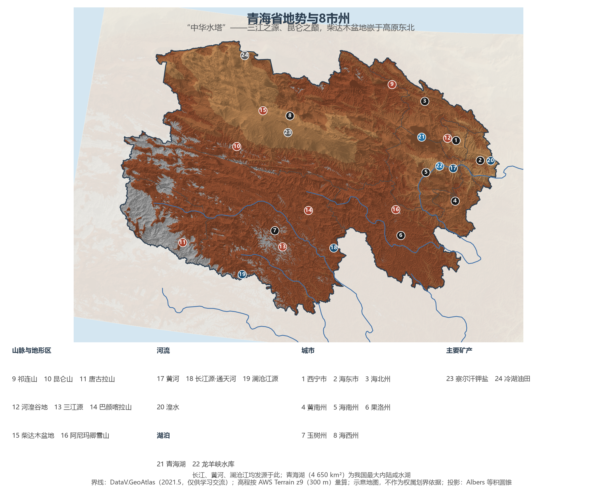
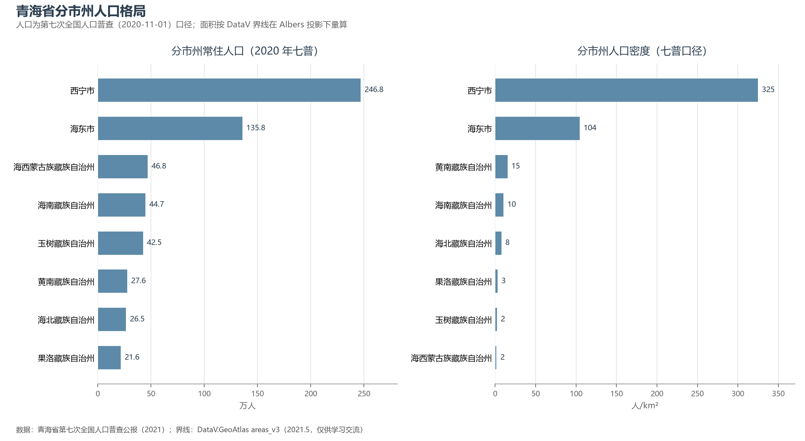
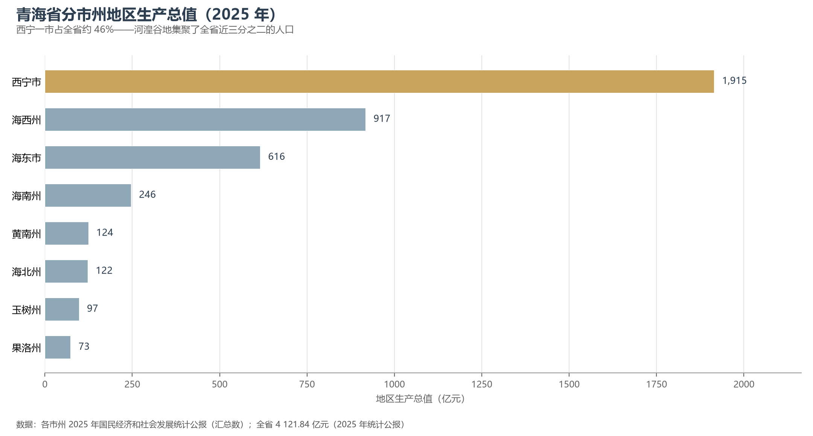

# 13.5.33 青海省

长江、黄河、澜沧江——中国三条大河的正源都在青海，"中华水塔"三个字是这个省最重的名片。72.23 万 km² 的土地上，祁连山、昆仑山、唐古拉山三大山系托举起青南高原与柴达木盆地，全省绝大部分国土海拔在 3 000 米以上；而 592 万人口中的近三分之二，都挤在东北角一块被称为"河湟谷地"的走廊里——高原的辽阔与河谷的拥挤，构成青海最基本的地理反差。

## 一、省情速览

| 指标 | 数值 |
|------|------|
| 面积 | 72.23 万 km²（全国第四，仅次于新疆、西藏、内蒙古） |
| 常住人口 | 592.4 万（2020 年七普，居省级行政区倒数第二）；592 万（2025 年末） |
| 常住人口城镇化率 | 64.7%（2025 年末） |
| 地区生产总值 | 3 950.8 亿元（2024，增长 2.7%）；4 121.84 亿元（2025，增长 4.1%） |
| 人均地区生产总值 | 69 567 元（2025） |
| 行政区划 | 2 个地级市、6 个自治州，共 8 个地级单位 |
| 简称 | 青 |

放在全国坐标里：青海 GDP 总量居省级行政区倒数第二（仅高于西藏），但三个指标决定了它的独特地位——规模以上工业清洁能源发电量占比达 86.6%，居全国之首；三江源国家公园面积 19.07 万 km²，是中国面积最大的国家公园；青海湖是我国最大的内陆咸水湖。放在世界坐标里：青海的面积比缅甸（67.7 万 km²）还大；与北部邻区蒙古国（156.65 万 km²、354.5 万人、2024 年 GDP 约 236 亿美元）相比，青海以它不到一半的土地，承载了其 1.7 倍的人口、创造了约 2.5 倍的经济总量（2025 年青海 GDP 折美元约 580 亿）。

**图 13-213 青海省地势与 8 市州**：z9 级 DEM 晕渲（300 m 分辨率），编号说明见图下。

## 二、自然地理

**地貌**自北向南分三大块：祁连山地介于甘肃与柴达木之间，雪山与河谷相间；柴达木盆地是中国海拔最高的大盆地（2 600—3 000 米），"聚宝盆"的盐湖、油气与光伏电场铺陈其上；青南高原是青藏高原的腹心，长江、黄河、澜沧江三大水系从巴颜喀拉山、唐古拉山两侧发源——昆仑山主脉横贯全境，其最高峰布喀达坂峰（6 860 m）也是青海最高点，全省最低点则在民和县马场垣乡的黄河出境处（1 644 m），两者相差 5 200 余米。

**水**是青海的另一半身份。三江源每年向下游输送约 600 亿立方米清洁水源，惠及全国一半以上的人口；黄河干流在省内蜿蜒近 1 700 公里，从卡日曲的涓流到龙羊峡的高峡平湖，再到民和出境时已是滚滚大河。湖泊是高原的眼睛：青海湖水体面积 4 650.08 km²（2024 年卫星监测，已连续 20 年扩大），是我国最大的内陆咸水湖，湖中裸鲤资源量恢复至 12 万余吨；察尔汗盐湖是中国最大的盐湖，氯化钾储量与产能支撑起全国化肥工业的大半边天。

**气候**是高寒与光照的合奏：年均温多在 0 ℃ 以下，高原腹地长冬无夏；降水自东南的 700 毫米递减至柴达木腹地的不足 50 毫米；而太阳辐射量为全国最高值区之一——这也是塔拉滩光伏园区选址的逻辑。可可西里（2017 年列入世界自然遗产）是这片荒原野生动物的最后庇护所之一，藏羚羊的迁徙每年夏天如约而至。

## 三、建置沿革与人文

青海古为羌人故地，汉置西海郡，南北朝时鲜卑慕容部建立的吐谷浑在此立国三百余年；唐蕃古道翻越日月山，文成公主的传说至今留在藏族的歌谣里。1928 年青海正式建省，因青海湖而得名；1950 年代以后，随着青藏公路与青藏铁路的修筑，这片高原深度融入国家体系。海北州海晏县的"原子城"是中国第一个核武器研制基地——我国第一颗原子弹、氢弹在此研制成功。多民族聚居是青海的人文底色：藏族、回族、土族、撒拉族、蒙古族与汉族共处，全国唯一的撒拉族自治县（循化）与土族聚居区（互助）都在河湟谷地；湟中塔尔寺是藏传佛教格鲁派创始人宗喀巴的诞生地，黄南同仁的热贡艺术与各民族传唱的"花儿"均列入人类非物质文化遗产代表作名录。

## 四、经济与区域战略

2025 年三次产业结构为 9.7∶41.7∶48.6。**盐湖化工与清洁能源**是两大支柱：察尔汗的钾肥、盐湖提锂的快速崛起让"世界级盐湖产业基地"成为国家定位；塔拉滩光伏园区与龙羊峡水电站构成全球规模领先的水光互补系统，"青豫直流"是世界首条主要输送清洁能源的特高压通道，青海还多次刷新全清洁能源供电的持续时间纪录。农牧业走高原特色路线：牦牛、藏羊、青稞与龙羊峡的冷水鱼养殖各具一格。生态是青海的根本定位——三江源国家公园（2021 年首批正式设立）与祁连山国家公园共同支撑起"国家公园示范省"的建设，"中华水塔"的保护被写入国家战略。

空间格局高度集聚：西宁—海东的河湟谷地承载全省 64.6% 的人口（七普），兰西城市群把西宁与兰州联成西北第四大城市群组团；青藏铁路（2006 年全线通车）与格库铁路（2020）让格尔木成为进藏、进疆的枢纽，西宁—成都铁路正在施工。6 个省市对口援青，与西部大开发、国家公园体制共同构成青海的当代叙事。

**图 13-214 青海省分市州人口格局**：左为分市州常住人口（七普），右为分市州人口密度——西宁市约 325 人/km² 居首，海西州仅约 2 人/km²。

## 五、分区地理：8 市州与四大板块

**东部河湟板块**——西宁市 246.8 万人，省会与青藏高原上最大的城市：海拔 2 275 米的"夏都"，塔尔寺在湟中，2025 年 GDP 1 914.77 亿元、占全省 46.5%。海东市 135.8 万人，河湟谷地的农业走廊与"拉面经济"之乡——化隆牛肉面馆开遍全国，循化撒拉族、互助土族的家园亦在此。

**环青海湖板块**——海北州 26.5 万人，原子城（221 基地）与青海湖北岸金银滩草原同在；海南州 44.7 万人，塔拉滩光伏与龙羊峡水光互补的所在地，"天下黄河贵德清"的贵德在其境内。

**青南高原板块**——黄南州 27.6 万人，热贡唐卡艺术之乡；果洛州 21.6 万人，阿尼玛卿雪山与格萨尔史诗的发祥地之一；玉树州 42.5 万人，三江源国家公园的核心区、可可西里南缘，2010 年地震后重建的结古以崭新的康巴新城矗立在通天河畔。

**柴达木板块（海西州）**——46.8 万人，辖区约 30 万 km² 为全省最大：格尔木是进藏门户与察尔汗盐湖所在，德令哈因诗人海子的名句"姐姐，今夜我在德令哈"而成为文艺地标，冷湖则以世界级的天文观测基地在戈壁上"仰望星空"。2008 年北京奥运会"金镶玉"奖牌用的昆仑玉，也产自这里。

**图 13-215 青海省分市州地区生产总值（2025 年）**：西宁、海西、海东居前三。

## 六、省内之最

| 项 | 值 |
|----|----|
| 最高点 | 布喀达坂峰（昆仑山，海西州），6 860 m |
| 最低点 | 民和县马场垣乡黄河出境处，1 644 m |
| 面积最大 / 最小的市州 | 海西州约 30.1 万 km² / 西宁市约 7 597 km²（DataV 量算） |
| 人口最多 / 最少的市州（七普） | 西宁市 246.8 万 / 果洛州 21.6 万 |
| 人口密度最高 / 最低（七普） | 西宁市约 325 人/km² / 海西州约 2 人/km² |
| GDP 首位市州 | 西宁市 1 914.77 亿元（2025，占全省约 46.5%） |
| 世界遗产 | 可可西里（2017，自然遗产） |
| 全国之最 | 青海湖 4 650 km²（最大内陆咸水湖）；三江源国家公园 19.07 万 km²（最大国家公园）；规上清洁能源发电占比 86.6%（全国领先） |

## 参考与数据来源

1. 面积、人口、GDP 总量：附录 A 口径（《中国统计年鉴 2024》）；2024 年数据为青海省 2024 年国民经济运行情况（青海省政府网，2025-01-26），2025 年数据为《青海省 2025 年国民经济和社会发展统计公报》。
2. 分市州人口：青海省第七次全国人口普查公报（第二号）；分市州面积按 DataV 界线在 Albers 投影下量算。
3. 分市州 GDP：各市州 2025 年国民经济和社会发展统计公报（汇总数）。
4. 青海湖面积与水位（2024-09 监测）：新华社（2024-12-20）；三江源国家公园：国家公园管理局（2021-10 首批设立）；最低点 1 644 m：青海省政府官网"大美青海"口径；黄河青海段长度约 1 693 km 为省级公开口径。
5. 蒙古国、缅甸数据：中国外交部国家概况、商务部口径；美元折算按 1 美元≈7.1 元。
6. 地势图 DEM：AWS Terrain Tiles z9（300 m 分辨率量算）；界线：DataV.GeoAtlas areas_v3（2021.5，仅供学习交流；原始文件无效几何已按 make_valid 修复）。
