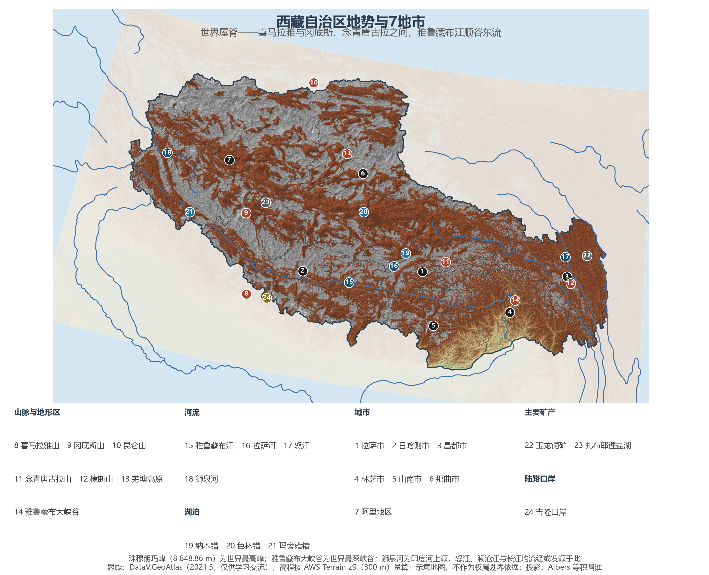
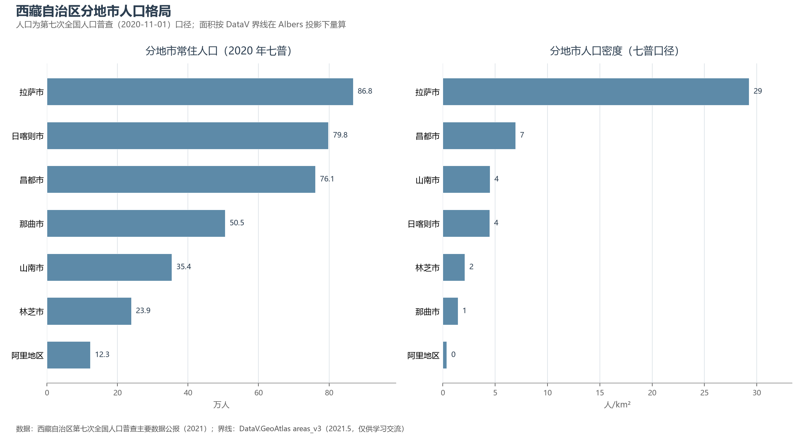
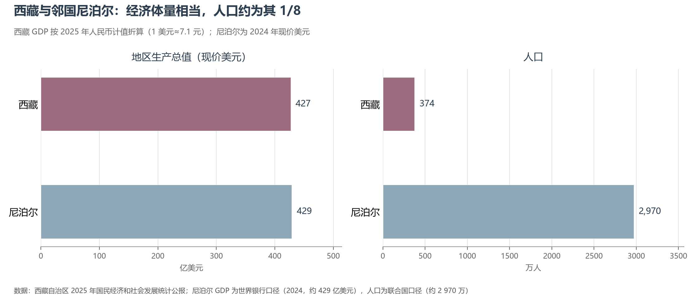

# 13.5.34 西藏自治区

喜马拉雅山脉与冈底斯山、念青唐古拉山之间，雅鲁藏布江顺着一条东西向的大谷奔腾 2 000 余公里——这就是平均海拔 4 000 米以上的"世界屋脊"，地球的"第三极"。122.84 万 km² 的土地与南非相当，却只住着 374 万人——全国人口最少的省级行政区，也是人口密度最低（约 3 人/km²）的省级行政区。然而最近十年的西藏给出了另一组令人意外的数字：GDP 增速连续多年位居全国前列，2025 年人均 GDP 达 81 502 元、高于甘肃与青海；与喜马拉雅山南麓的邻国尼泊尔相比，西藏的经济总量已经与其相当（427 亿美元对 429 亿美元），人口却只有其八分之一。

## 一、区情速览

| 指标 | 数值 |
|------|------|
| 面积 | 122.84 万 km²（全国第二，与南非相当） |
| 常住人口 | 364.8 万（2020 年七普，全国最少）；374 万（2025 年末，仍在增长） |
| 常住人口城镇化率 | 40.11%（2025 年末） |
| 地区生产总值 | 2 764.9 亿元（2024）；3 031.89 亿元（2025，增长 7.0%，增速居全国前列） |
| 人均地区生产总值 | 81 502 元（2025，高于甘肃、青海、宁夏等省区） |
| 行政区划 | 6 个地级市、1 个地区，共 7 个地级单位 |
| 简称 | 藏 |

放在全国坐标里：西藏经济总量居省级行政区末位，但增速（2025 年 +7.0%）常年领跑全国，人口保持正增长，人均 GDP 与自身总量的排位形成了"倒挂"——这背后是大规模基础设施投资、对口援藏与文旅产业的叠加。放在世界坐标里：与同一条喜马拉雅山南麓的尼泊尔相比，西藏以约八分之一的人口创造了相当的经济总量；而 2025 年 7 月开工的雅鲁藏布江下游水电工程（总投资约 1.2 万亿元）一项的投资额，就相当于尼泊尔全国 GDP 的三倍左右。

**图 13-216 西藏自治区地势与 7 地市**：z9 级 DEM 晕渲（300 m 分辨率），编号说明见图下。

## 二、自然地理

**山**是西藏的骨架：南缘的喜马拉雅山脉绵延 2 400 余公里，坐拥世界全部 14 座 8 000 米级高峰中的 10 座，主峰珠穆朗玛峰（8 848.86 m，2020 年中尼联合公布）是世界之巅；冈底斯山—念青唐古拉山纵贯中部，主峰冈仁波齐被多种宗教视为"神山"；北缘昆仑山与唐古拉山分列羌塘草原的西北与东北，东缘横断山的"三江并流"区把怒江、澜沧江、金沙江挤压成三条平行的大峡谷。山脉之间是海拔 4 500 米上下的羌塘高原湖盆区——西藏的"北方"，星罗棋布的高原湖泊 中国最密集的湖泊群在这里铺开：色林错已超越纳木错成为西藏第一大湖且仍在扩大，纳木错与玛旁雍错则是闻名遐迩的"圣湖"。

**雅鲁藏布江**是西藏的灵魂：它沿冈底斯山南麓东流，在藏东南来了个 90 度的大拐弯，切开喜马拉雅山东端形成雅鲁藏布大峡谷——全长 504.6 km、最深 6 009 m，是世界最深峡谷。2025 年 7 月 19 日，雅鲁藏布江下游水电工程在林芝开工：5 座梯级电站、总投资约 1.2 万亿元、规划装机相当于 3 座三峡，建成后将是世界最大的水电站。全区最低点就在大峡谷出口的墨脱县巴昔卡附近（约 115 m），与珠峰之间 8 700 余米的高差浓缩在一个自治区内，垂直自然带之完整世界罕见。

**气候**的主旋律是高寒与光照：高原腹地长冬无夏，降水自藏东南的数千毫米递减至羌塘腹地的不足 100 毫米；拉萨年日照 3 000 小时上下，"日光城"名副其实。藏东南谷地受印度洋水汽眷顾，森林茂密、物产丰饶，与藏北荒原判若两界——林芝"西藏江南"的桃花与那曲的雪山同框，正是这一巨大反差的写照。

## 三、建置沿革与人文

公元 7 世纪，松赞干布统一吐蕃，与唐联姻开启了汉藏交往的千年史；元代设宣政院，西藏正式纳入中央政权的行政管辖；清代康熙年间始称"西藏"。1951 年西藏和平解放，1965 年 9 月西藏自治区成立。今天挂在山巅的世界遗产是**布达拉宫历史建筑群**——布达拉宫（1994 年列入）与大昭寺（2000 年扩展）、罗布林卡（2001 年扩展）共同构成拉萨河谷的文化轴线；藏戏与格萨尔史诗列入人类非物质文化遗产代表作名录，唐卡、藏医药天文历算传承至今。

当代西藏的标志性叙事写在工程与生态里：青藏铁路 2006 年全线通车终结了没有铁路的历史，2021 年拉林铁路把复兴号开上高原，川藏铁路正在施工；"两江四河"流域造林让雅鲁藏布江中游河谷绿带逐年延伸，那曲通过科技攻关实现了极高海拔城镇植树零的突破。17 个省市对口援藏的机制与全国游客的脚步（2025 年接待游客 7 073.37 万人次）一起，把这个昔日"高原孤岛"接入了现代中国。

## 四、经济与区域战略

2025 年三次产业结构为 9.4∶38.1∶52.5。**旅游业**是第一张名片：全年接待国内外游客 7 073.37 万人次（+10.71%），旅游总花费 816.81 亿元——相当于全区 GDP 的四分之一以上。**清洁能源**是正在展开的第二张牌：雅下水电之外，藏东南与羌塘的水光资源使西藏成为国家清洁能源接续基地的候选地。**高原特色农牧业**自成一格：青稞产量 90.5 万吨（2025）稳定增收，牦牛、藏系绵羊与藏药材走出高原。**优势矿产**开始发力：昌都的玉龙铜矿、仲巴的扎布耶锂盐湖，是"高原聚宝盆"的新注脚。

空间战略可以用"边缘—轴线"概括：人口与经济沿雅鲁藏布江中游谷地（"一江两河"）集聚，拉萨—山南—日喀则构成核心轴线；边境地带则以吉隆、樟木、普兰等口岸和边境村镇建设支撑"强边"叙事。治理框架概括为"稳定、发展、生态、强边"四件大事：羌塘、珠峰等国家级自然保护区与生态补偿机制守护"世界屋脊"的原真性，川藏铁路与高原电网则把这片国土更深地织进国家网络。

**图 13-217 西藏自治区分地市人口格局**：左为分地市常住人口（七普），右为分地市人口密度——拉萨市约 29 人/km² 居首，阿里地区仅约 0.4 人/km²。

## 五、分区地理：7 地市与四大板块

**藏中谷地（"一江两河"）**——拉萨市 86.8 万人（七普，较六普增长 55.1%），首府与全区绝对核心：布达拉宫、大昭寺与八廓街所在的圣地河谷，2025 年 GDP 1 090.99 亿元、占全区约 36%。山南市 35.4 万人，藏文化发祥地——西藏第一座宫殿雍布拉康与第一块农田都在雅砻河谷。日喀则市 79.8 万人，后藏中心与"青稞之乡"：扎什伦布寺、珠峰大本营与吉隆口岸同在其境。

**藏东板块**——昌都市 76.1 万人，川藏、滇藏公路的咽喉与茶马古道重镇，澜沧江、怒江、金沙江"三江并流"穿境，玉龙铜矿是高原新兴的工业支点。

**藏东南板块**——林芝市 23.9 万人，"西藏江南"：雅鲁藏布大峡谷、南迦巴瓦峰与波密桃花的所在地，雅鲁藏布江下游水电工程正落笔于此——未来世界最大的水电站将让这片绿色峡谷成为中国的能源高地。

**藏北板块（羌塘）**——那曲市 50.5 万人，辖区约 35.3 万 km²、是中国面积最大的城市：羌塘草原上的牧民与藏羚羊、野牦牛共享世界级的高原荒野，冬虫夏草是草原的"软黄金"。

**藏西板块**——阿里地区 12.3 万人，"千山之宗、万水之源"：冈仁波齐与玛旁雍错的神山圣湖、古格王朝的遗址、班公错的碧水，还有印度河上源狮泉河——"天上阿里"是离天空最近的行政单元。

**图 13-218 西藏与尼泊尔对比**：经济体量相当（427 亿美元对 429 亿美元），人口约为其 1/8。

## 六、区内之最

| 项 | 值 |
|----|----|
| 最高点 | 珠穆朗玛峰，8 848.86 m（世界最高峰） |
| 最低点 | 雅鲁藏布江出境处（墨脱县巴昔卡附近），约 115 m |
| 面积最大 / 最小的地市 | 那曲市约 35.3 万 km²（中国面积最大的城市）/ 拉萨市约 2.97 万 km² |
| 人口最多 / 最少的地市（七普） | 拉萨市 86.8 万 / 阿里地区 12.3 万 |
| 人口密度最高 / 最低（七普） | 拉萨市约 29 人/km² / 阿里地区约 0.4 人/km² |
| GDP 首位地市 | 拉萨市 1 090.99 亿元（2025，占全区约 36%） |
| 世界遗产 | 布达拉宫历史建筑群（1994—2001） |
| 全国之最 | 人口密度最低的省级行政区（约 3 人/km²）；雅鲁藏布大峡谷为世界最深峡谷；在建雅下水电将成为世界最大水电工程 |

## 参考与数据来源

1. 面积、人口、GDP 总量：附录 A 口径（《中国统计年鉴 2024》）；2024 年数据为西藏自治区 2024 年国民经济和社会发展统计公报口径，2025 年数据为《2025 年西藏自治区国民经济和社会发展统计公报》。
2. 分地市人口：西藏自治区第七次全国人口普查主要数据公报（2021）；分地市面积按 DataV 界线在 Albers 投影下量算。
3. 拉萨、日喀则 GDP：两市 2025 年国民经济和社会发展统计公报（媒体汇总口径）；其余地市为梯队区间报道口径。
4. 雅鲁藏布江下游水电工程（2025-07-19 开工，总投资约 1.2 万亿元）：新华社及开工仪式公开报道；珠峰 8 848.86 m：2020 年中尼联合公布。
5. 尼泊尔 GDP 与人口：世界银行（2024 年约 429 亿美元）与联合国口径（约 2 970 万）；南非面积为公认口径；美元折算按 1 美元≈7.1 元。
6. 地势图 DEM：AWS Terrain Tiles z9（300 m 分辨率量算）；界线：DataV.GeoAtlas areas_v3（2021.5，仅供学习交流）。
