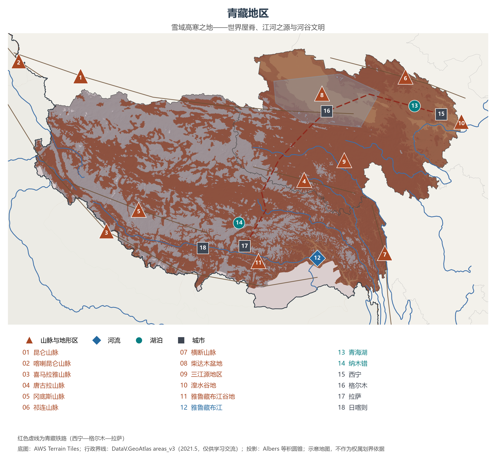
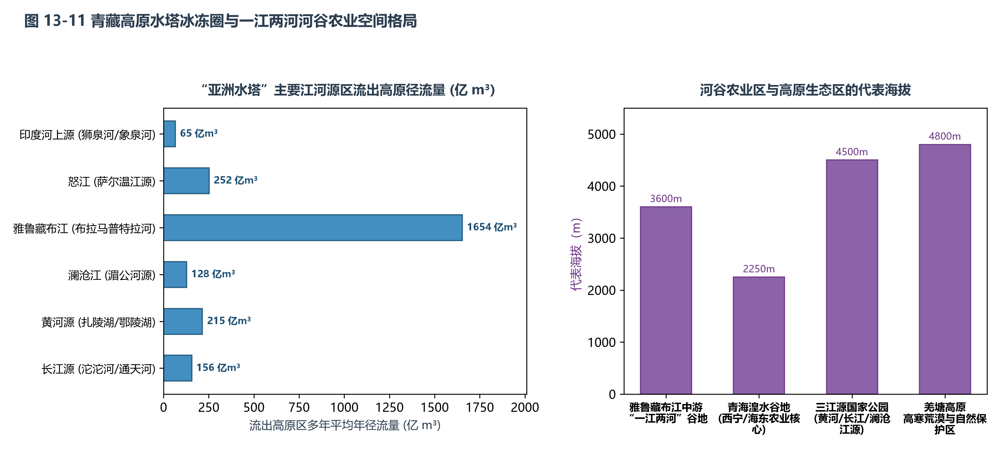

# 13.5 青藏地区

青藏地区涵盖青海省与西藏自治区全境（以及四川西部、滇西北、甘南等高原边缘地带），平均海拔在 4000 米以上，雄踞世界屋脊，是地球上平均高度最高、新生代构造隆升最剧烈的巨型地理单元。这里被国际科学界公认为“地球第三极”与“亚洲水塔”，陆地总面积达 195.1 万 km²（约占全国总面积的 20.2%），常住人口约 959 万（仅占全国 0.7%），2023 年全区地区生产总值约 6186 亿元。在这片离太阳最近的高洁雪域，壮丽的极高山冰川、幽蓝的高原咸淡水湖群、广袤的高寒草甸与坚韧的藏族游牧农耕人地智慧融为一体，构成了中华民族乃至全球最关键的生态安全屏障与水资源战略要冲。

## 一、区域范围与行政单元概况

青藏地区省域辽阔、地广人稀，生态地位极其特殊：

| 省级行政区 | 陆地面积（km²） | 常住人口（万，2023） | GDP（亿元，2023） | 行政中心 | 核心地理与战略定位 |
|:---|:---:|:---:|:---:|:---|:---|
| **青海省** | 722,300 | 594 | 3,793 | 西宁 | “三江之源、中华水塔”，全国最大的内陆咸水湖（青海湖），柴达木盆地“聚宝盆”（钾盐、锂矿），国家清洁能源产业高地 |
| **西藏自治区** | 1,228,400 | 365 | 2,393 | 拉萨 | “世界屋脊”，平均海拔超 4000 米，国家重要生态安全屏障与战略资源储备基地，面向南亚开放重要通道，西藏文化中心 |

**图 13-6 青藏地区专题图**：山脉、河流、湖泊与青藏铁路（编号说明见图下）。

## 二、“地球第三极”的构造奇迹与地貌骨架

青藏高原的诞生是距今约 5000 万年以来新生代地球演化史上最惊心动魄的篇章——印度板块向北漂移与欧亚大陆发生剧烈碰撞俯冲，地壳强烈缩短增厚，引发了全球规模最大、速度最快的板块造山运动，至今高原仍以每年数毫米的速度持续抬升与向东蠕变。

高原宏观地貌呈现由**雄浑褶皱山系、宽阔波状高原面与构造断陷盆地**组成的巨型骨架：
1. **环高原与内部巍峨山系**：
   - **南缘界山——喜马拉雅山脉**：全长约 2400 km，由数十座海拔 7000 米以上的极高山组成，主峰**珠穆朗玛峰**（海拔 8848.86 m）为世界第一高峰，山顶终年积雪、角峰刃脊林立；
   - **北缘界山——昆仑山脉与阿尔金山脉、祁连山脉**：横亘于青藏高原与塔里木盆地、柴达木盆地、河西走廊之间，雪山连绵，昆仑山主峰公格尔峰与慕士塔格峰傲立西端；
   - **西缘界山——喀喇昆仑山脉**：拥有世界第二高峰乔戈里峰（K2，海拔 8611 m），是全球中低纬度现代冰川发育最密集的山脉；
   - **东缘界山——横断山脉**：贡嘎山（7556 m）、四姑娘山等南北向岭谷纵列，江河深切，高差达数千米；
   - **高原腹地山系**：冈底斯山脉、念青唐古拉山脉与唐古拉山脉横卧腹地，构成藏北内流水系与外流水系的主要分水岭。
2. **广袤的藏北高平原（羌塘高原）**：位于冈底斯山与昆仑山之间，平均海拔 4500—5000 m，地表起伏平缓、视野辽阔，保存了古夷平面风貌，是中国最大的高寒草原与高寒荒漠区；
3. **“聚宝盆”柴达木盆地**：位于青海西北部，四周被阿尔金山、祁连山与昆仑山环抱，海拔 2600—3000 m，是中国地势最高的大型构造内陆封闭盆地。内部干旱少雨，发育了察尔汗盐湖、大柴旦盐湖等数十个盐湖，蕴藏着全国最大的可溶性钾盐、锂矿、硼矿与原盐资源；
4. **中国最密集的高原湖泊集群**：高原现有湖泊总面积超过 4.5 万 km²，占全国湖泊总面积的一半以上。**青海湖**（面积约 4500 km²）是中国最大的湖泊与咸水湖；**色林错**（面积超 2400 km²，已超过纳木错成为西藏第一大湖）、**纳木错**（海拔 4718 m）、玛旁雍错、羊卓雍错等如同一串蓝宝石镶嵌在雪山之间。

**图 13-11 青藏高原水塔冰冻圈与一江两河河谷农业空间格局**：左图对比“亚洲水塔”流出高原主要国际与国内大河的年径流体量；右图呈现青藏地区低海拔河谷农业区与高海拔生态红线保护区的海拔与功能特征。

## 三、“亚洲水塔”冰冻圈效应与全球气候调节

青藏高原拥有除南北极以外全球规模最大的现代冰川与多年冻土，被科学家称为地球的“天然冷源”与“亚洲水塔”：
- **现代冰川与固态水库**：高原地区发育了 4.8 万余条现代冰川，面积约 4.98 万 km²，冰川冰储量达数万亿立方米。冰川融水是维持干旱季节下游河湖生命径流的关键补给；
- **群江之源与生命之水**：青藏高原是多条亚洲骨干大江大河的共同孕育地：
  - **长江**发源于唐古拉山主峰各拉丹冬雪山西南侧的沱沱河；
  - **黄河**发源于巴颜喀拉山北麓的约古宗列曲，流经扎陵湖与鄂陵湖；
  - **澜沧江**（下游为湄公河，东南亚“母亲河”）发源于青海玉树杂多县吉富山；
  - **雅鲁藏布江**（下游为布拉马普特拉河）发源于喜马拉雅山北麓杰马央宗冰川，绕南迦巴瓦峰形成世界第一大峡谷（雅鲁藏布大峡谷）；
  - **怒江**（下游为萨尔温江）发源于唐古拉山南麓；
  - **印度河上源**（狮泉河、象泉河）发源于阿里高原冈底斯山脉与喜马拉雅山脉冰川。
  “亚洲水塔”流出高原的水资源总量常年超过 3000 亿立方米，直接滋润着下游中国、印度、孟加拉国、巴基斯坦、缅甸、泰国、老挝、柬埔寨、越南等国近 20 亿人口。
- **高原热力与动力作用对季风的驱动**：夏季，广袤的高原下垫面强烈吸收太阳辐射，成为悬浮在对流层中部的“巨大热源”与“热烟囱”，强烈的热低压抽吸来自印度洋与南海的暖湿西南季风，强有力地强化了东亚与南亚季风环流；若无青藏高原的隆升，中国长江流域同纬度地区将与北非撒哈拉、阿拉伯半岛一样沦为干旱荒漠。
- **气候变暖与水塔失衡响应**：中国科学院“第二次青藏科考”科学证实，青藏高原升温速率是全球同期平均水平的两倍以上。冰川快速退缩、多年冻土退化融化、色林错等封闭湖泊水位剧烈上升并急剧扩张，冰湖溃决（GLOF）与冻胀融沉灾害风险加大，“亚洲水塔”正面临固态水加速液态化、水储量空间失衡的严峻挑战。

## 四、极端生境下的人地适应：河谷农业与高寒畜牧业

在空气稀薄、气压低（约为平原 50%—60%）、强紫外线辐射与漫长严寒的高原环境下，人地系统演化出了极富生存智慧的适应模式：
1. **低海拔河谷农业的极致单产**：
   - **空间严格受限**：种植业无法在高海拔高原面上生存，严格分布在海拔相对较低（2000—3800 m）、热量较充足、水源充沛的河谷盆地；
   - **“一江两河”谷地**：西藏中南部雅鲁藏布江中游及其支流拉萨河、年楚河宽谷平原，是西藏农耕最集中、人口最密集的“粮仓”，集中了西藏 60% 以上的耕地；
   - **湟水谷地与黄河谷地**：青海东部湟水河流域（西宁、海东）是青海省的农业核心区与人口经济重心；
   - **耐寒高产作物品种**：主要作物为**青稞**（大麦的裸粒变种，耐严寒、早熟）、春小麦、豌豆与马铃薯。高原日照时间长（年日照 3000 小时以上）、太阳辐射强、光合作用极其旺盛，昼夜温差大（夜间呼吸消耗极低），使得青稞与小麦籽粒饱满、千粒重极高，单位面积单产常创全国高产纪录。
2. **高寒草甸与高原放牧体系**：在海拔 4000—4800 米的开阔高原草甸与草原上，世居藏族同胞依靠放牧**牦牛**（“高原之舟”，体表密生厚毛、心肺发达、红细胞含氧能力极强）、**藏羊**（藏系绵羊，耐寒抗粗饲）繁衍生息。牧民根据草场季节变化进行春冬草场与夏秋草场的定期转场，维护草畜平衡。
3. **传统物质文化与建筑力学**：藏式平顶碉房多采用石块或生土厚实夯筑，墙体厚达近米，具有极佳的御寒保温与抗震性能；风干牦牛肉、糌粑（青稞炒面）、酥油茶（抗寒补水与补充油脂）构成了适宜高寒生存的经典饮食谱系。

## 五、国家生态安全屏障与现代化天路走廊

青藏高原的生态环境极度脆弱，生态系统一旦破坏极难自我修复。维护青藏高原生态安全，是中国乃至全球可持续发展的重大战略：
- **国家公园建设先行先试**：2021 年正式设立的**三江源国家公园**（面积 19.07 万 km²，整合了长江源、黄河源、澜沧江源园区），成为中国首批设立的国家公园中面积最大的一座。通过全面推行生态管护员制度、实施黑土滩治理与退牧还草，藏羚羊种群数量从濒危时的不及 2 万只恢复至 7 万只以上，雪豹、野牦牛、藏野驴旗舰物种种群繁盛。西藏全区三分之一以上国土面积已划入生态保护红线。
- **世界工程极限——青藏铁路与川藏铁路**：
  - **青藏铁路**：全长 1956 km，其中格尔木至拉萨段（1142 km）穿越连续多年冻土地段达 550 km，最高点唐古拉山口海拔达 5072 m。中国工程建设团队自主创新研发了“主动降温”工程哲学，采用碎石路基、热棒通风、片石通风护坡与以桥代路技术，成功破解了“多年冻土、高寒缺氧、生态脆弱”三大世界性技术死结，被誉为“高原天路”；
  - **川藏铁路雅安至林芝段**：全长 1011 km，桥隧比高达 95% 以上，跨越横断山脉金沙江、澜沧江、怒江峡谷，“八起八落”累积爬升超 14000 米，攻克高地温、强岩爆、高烈度活动断裂带与高原深埋特长隧道世界级地质难题，正在书写人类轨道工程新传奇；
  - **高高原航空与光伏风电网络**：拉萨贡嘎、日喀则定日、阿里昆莎等高高原机场安全通航；青海省海南州与海西州建成全球最大规模的千万千瓦级水光互补与塔式光热基地，青海绿电跨省直供中原，西藏清洁能源外送电量突破百亿千瓦时。

## 参考与数据来源

1. 面积与人口：国家统计局《中国统计年鉴 2024》各省常住人口、陆地面积。
2. 科学考察研究成果：中国科学院“第二次青藏高原综合科学考察研究”系列公报（《青藏高原冰川冻土与湖泊变化评估》2023）。
3. 水文与水资源监测：水利部《中国水资源公报 2023》主要外流河发源地出境径流量统计；西藏自治区生态环境厅《2023 年西藏自治区生态环境状况公报》。
4. 国家公园与铁路工程：国家林草局三江源国家公园管理局官方监测数据；中国国家铁路集团青藏铁路与川藏铁路建设技术总结。
