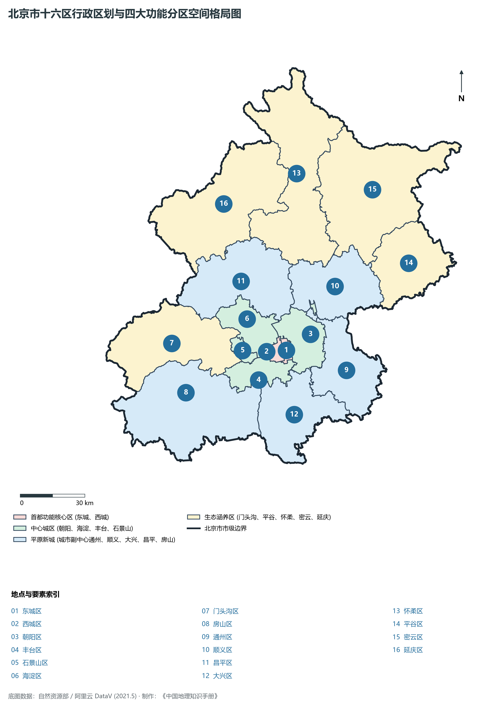
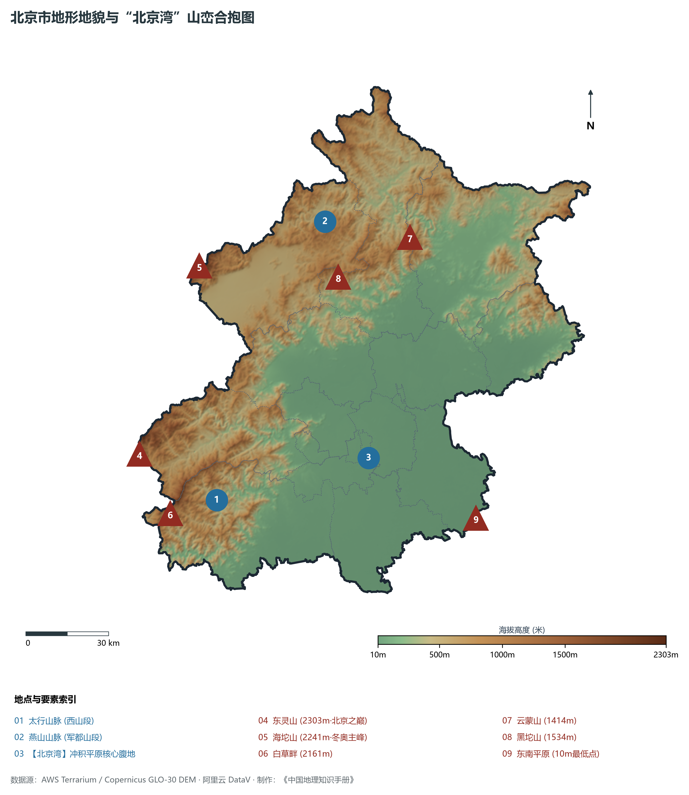
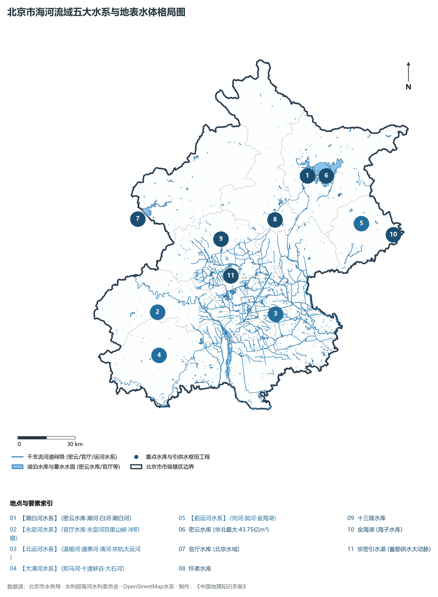
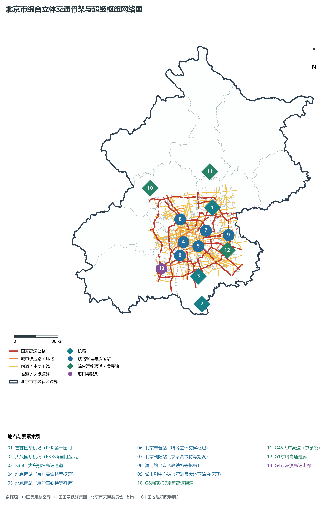
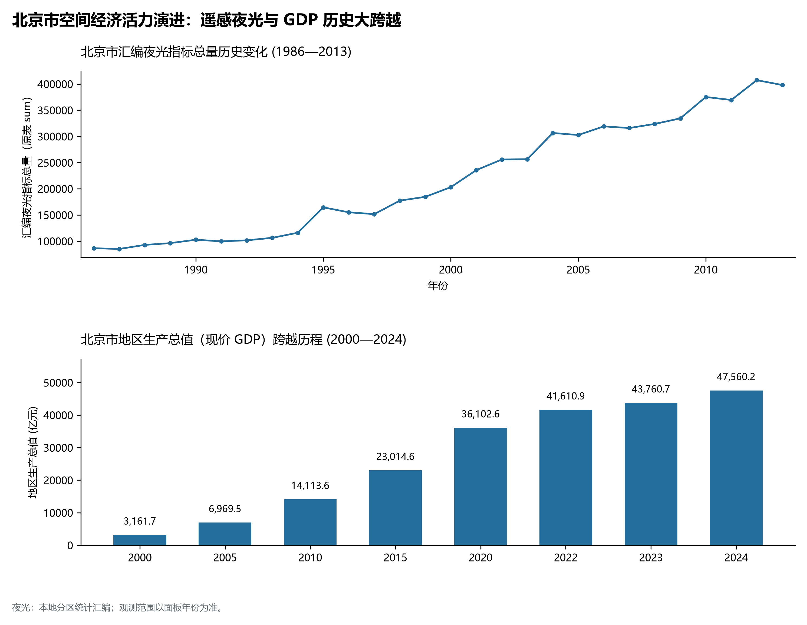

# 第一章 北京市地理统揽与市域空间格局

北京，中华人民共和国首都，全国政治中心、文化中心、国际交往中心、科技创新中心。地处华北大平原西北端，地理坐标介于东经 115°25′—117°30′、北纬 39°26′—41°03′ 之间。其雄踞燕山南麓、太行东侧，形成著名的“北京湾”地理大格局；自古北控大漠、南扼中原、东濒渤海、西倚高原，自古有“山川形胜、控扼北方”之叹。

从公元前 1045 年西周分封蓟国与燕国，到金中都、元大都、明清北京城，北京历经三千余年建城史、八百七十余年建都史，是中华文明多元一体、大一统政治地理中枢的最崇高典范。当代北京，全域土地面积 **16 410.54 km²**，下辖 16 个市辖区，常住人口超 **2 180 万人**，地区生产总值（GDP）跃上 **4.9 万亿元** 历史台阶。在新时代首都发展战略指引下，北京正坚定不移疏解非首都功能，以高水平建设北京城市副中心和支持雄安新区建设为“两翼”，探索出一条超大城市减量双控、创新驱动与生态文明协同跃升的高质量发展之路。

---

## 一、市情速览与全域基础指标

北京市兼具山地生态屏障与密集现代都市形态，地形格局呈西北高陡、东南倾缓的典型马蹄形半封闭盆地。

| 核心指标 | 全市数值与空间分布 | 全国/战略定位 |
|:---|:---|:---|
| **行政区划面积** | 16 410.54 km² | 山地面积 10 072 km² (占 61.4%)，平原面积 6 339 km² (占 38.6%) |
| **常住人口** | 2 183.6 万人 (2024 年末) | 核心区 181.5 万，城六区共 1 098.5 万，平原新城 716.2 万，生态涵养区 187.4 万 |
| **常住人口城镇化率** | 87.8% | 城六区达到 100%，居全国省级行政区最前列 |
| **人口密度** | 1 331 人/km² | 核心区超 2.1 万人/km²，门头沟、延庆等深山区低于 180 人/km² |
| **地区生产总值 (GDP)** | 49 270.8 亿元 (2024 年，现价) | 稳居全国城市第二位，占全国经济总量近 3.8% |
| **人均 GDP** | 约 22.56 万元人民币 (折合超 3.1 万美元) | 连续多年稳居全国 31 个省区市第一位，达发达经济体水准 |
| **产业三次结构** | 0.2 : 14.8 : 85.0 | 全国首个迈入服务经济主导超深水区的省级单元，数字经济增加值占比过半 |
| **行政架构** | 16 个市辖区，下辖 151 个街道、143 个建制镇、31 个乡 | 市委、市人大、市政府、市政协已整体迁驻北京城市副中心 (通州) |
| **战略发展总定位** | “四个中心” (政治、文化、国际交往、科技创新) | 打造国际一流的和谐宜居之都，构建京津冀世界级城市群核心核 |

**图 01-00-3 北京市十六区行政区划与四大功能分区空间格局图**：图上编号与地点、要素索引对应。

---

## 二、自然地理基底：燕山太行合抱与“北京湾”

北京的地质演化跨越了数十亿年沧桑历程，构筑了华北克拉通北缘极其丰富独特的断陷沉积盆地与隆起山地地貌。

### 1. “北京湾”形胜与三级地势台阶
北京市整体坐落于太行山余脉与燕山余脉环抱形成的山湾之中，地理学界通称为**“北京湾”**：

- **西倚太行山脉之北端（西山）**：包括妙峰山、百花山、东灵山等群峰，呈北东—南西走向，阻隔着蒙古高原与晋北高原干寒气流的南下；
- **北枕燕山山脉之主脉（军都山等）**：包括海坨山、雾灵山、云蒙山等群山，横亘于北京北部，是阻挡塞外严寒的又一道雄浑屏障；
- **东南面敞向华北平原与渤海之滨**：形成向东南倾斜展开的巨大冲积洪积平原扇裙，接纳来自太平洋的东南夏季季风与丰沛水汽。

全区地势自西北向东南倾斜下陷，高程落差极其悬殊：

- **第一阶梯（中山山地区）**：海拔 1 000 m 以上，主要分布于门头沟、延庆、房山与怀柔深山区。全区最高峰为门头沟与河北交界处的**东灵山**，海拔高达 **2 303 m**；小海坨山（2 241 m）、白草畔（2 161 m）、百花山（1 991 m）等群峰高耸入云，森林草甸苍翠；
- **第二阶梯（低山丘陵区）**：海拔 100—1 000 m，主要为西山山前丘陵与军都山山前断褶带，峡谷深邃、阶地发育，是著名的京西煤田、岩溶洞穴群与石灰岩景观区；
- **第三阶梯（平原沉积区）**：海拔 100 m 以下，东南边界最低处仅 **约 8—10 m**（通州与大兴东南平原）。永定河、潮白河、温榆河三大冲积洪积扇重叠发育，堆积了深厚的第四纪松散沉积物，地势广袤坦荡。

**图 01-00-1 北京市地形地貌与“北京湾”山峦合抱图**：图上编号与地点、要素索引对应。

### 2. 气候特征：典型暖温带半湿润大陆性季风气候
北京受欧亚大陆与太平洋环流系统交替控制，四季分明，光温水同步：

- **春季（3—5 月）**：气温回升迅猛，昼夜温差大，受蒙古气旋与冷空气影响，多大风少雨，空气干燥，蒸发旺盛；
- **夏季（6—8 月）**：炎热多雨，盛行东南与偏南暖湿气流。全区多年平均降水量约为 **580—650 mm**，但年际与时空变率极大。约 75%—80% 的降雨集中在“七下八上”（7月下旬至8月上旬）的防汛主汛期，燕山迎风坡（如密云水库东侧、怀柔南部山前）与西山迎风坡常因地形雨抬升效应形成全市暴雨中心；
- **秋季（9—10 月）**：冷高压控制，云淡风清，秋高气爽，是北京全年气候最宜人的黄金季节；
- **冬季（11—次年 2 月）**：西伯利亚寒潮与蒙古冷高压南侵，寒冷干燥，盛行西北偏北大风，冰冻期约 3—4 个月。

---

## 三、水文水系与“大运河北端”

北京地处海河流域北部的中下游扇缘区，自西向东横贯分布着**大清河（拒马河）、永定河、北运河、潮白河、蓟运河**五大水系。全市流域面积大于 10 km² 的河流达 425 条。

**图 01-00-2 北京市海河流域五大水系与地表水体格局图**：图上编号与地点、要素索引对应。

### 1. 五大水系特征与分流走向

1. **永定河水系（北京的“母亲河”）**：发源于山西桑干河与内蒙古洋河，两河汇入官厅水库后切穿西山百里峡谷，出三家店注入北京平原，经门头沟、石景山、丰台、房山、大兴流向天津入海。全长约 650 km（北京境内 170 km）。历史上永定河善淤、善决、善徙，曾称“浑河”、“无定河”，清康熙年间筑堤束水后赐名“永定河”。
2. **北运河水系（京城水脉与大运河终点）**：发源于昌平军都山麓，上游由温榆河汇集沙河、清河、坝河、通惠河、凉水河诸水，至通州北关闸始称北运河，东南流经香河、天津武清汇入海河。北运河是北京平原汇水与主要排洪水道，也是元明清三代京杭大运河漕运的北方总终点。
3. **潮白河水系（首都水源保障走廊）**：由潮河与白河在密云河槽村汇合而成。潮河出河北丰宁，白河出河北沽源，穿越燕山重叠深峡注入华北平原最大的人工水库——**密云水库**。出库后南穿顺义、通州，与北运河并行南下。水质优良，是北京平原东部极其关键的地下水涵养带。
4. **大清河（拒马河）水系**：发源于河北涞源，切穿太行山由十渡流入房山区，经张坊出山注入河北涿州平原。拒马河水流清澈奔腾，切出深邃雄奇的喀斯特峡谷地貌。
5. **蓟运河（泃河、错河）水系**：位于北京极东侧的平谷区境内，发源于燕山主峰雾灵山南麓，出金海湖汇入蓟运河，东南奔流注入渤海。

### 2. 水资源战略调配工程

- **密云水库**：坐落于燕山山前丘陵之间，总库容 **43.75 亿 m³**，最大水面面积达 188 km²，是首都最重要的饮用水源地与战略储备水库；
- **京密引水渠**：始建于 1960 年代，引密云水库之水经怀柔水库，绕军都山麓向西流经昌平、海淀，全长 110 km，被誉为首都中心城区的“水上生命线”；
- **南水北调中线工程进京**：长江水由丹江口水库历经千里北上，自房山穿永定河、经西四环团城湖、至密云水库调蓄工程入库反向补给，年均调水达 10 亿 m³ 以上，极大修复了北京地下水漏斗区与河湖生态。

---

## 四、建置沿革与古都营建史

北京是一座拥有独特地理枢纽优势的世界历史文化名城。在中国古代农牧交错带与南北大一统交通线上，北京扮演着承南启北、包容八方的核心枢纽角色。

### 1. 从“蓟燕分封”到“金元建都”

- **先秦周朝**：公元前 1045 年，周武王封黄帝之后于“蓟”，封召公奭于“燕”。蓟城建在永定河古冲积扇台地上（今西城区广安门至宣武门一带），地处北方太行山前大道、军都山居庸古道与山海关辽西走廊的交汇顶点；
- **秦汉隋唐**：秦置广阳郡，汉置幽州刺史部，隋设涿郡（大运河南起余杭、北达涿郡），唐设幽州节度使，历代皆为北方军政重镇；
- **辽金升格**：辽以幽州为南京幽都府（陪都）；公元 1153 年，金海陵王完颜亮迁都于此，营建**金中都**，北京正式开启作为中国北方乃至全国大一统王朝国都的历史序幕；
- **元代拓建**：忽必烈放弃金中都故城，以积水潭（今什刹海）水系为中心向东北扩展，营建规模宏大的**元大都**（Khanbaliq），确立了全城方正齐整、坐北朝南的街巷棋盘格局与大都中轴线。

### 2. 明清紫禁城与中轴线巅峰

- 明成祖朱棣于 1420 年建成北京宫殿，次年正式迁都北京。在元大都基础上向南拓展，修建了紫禁城、皇城、内城与外城，形成“凸”字形城廓；
- 历经明清两代营建，形成了南起永定门、北至钟鼓楼，全长 **7.8 km** 的**北京传统中轴线**。2024 年，“北京中轴线——中国理想都城秩序的杰作”成功列入《世界遗产名录》，向世界展现了东方对称礼乐、天地人和的最高营造范式；
- 加上周口店北京人遗址、故宫、天坛、颐和园、明十三陵、长城、大运河，北京市拥有 **8 处世界文化遗产**，是全球拥有世界文化遗产数量最多的城市。

---

## 五、现代城市空间结构与功能分区

《北京城市总体规划（2016年—2035年）》深刻改变了传统的“摊大饼”式同心圆扩张模式，明确确立了全域**“一核一主一副、两轴多点一区”**的城市空间结构：

1. **一核（首都功能核心区）**：包括**东城区、西城区**（共 92.54 km²）。坚持减量双控与功能疏解，全面服务保障中央政务功能，强化历史文化名城保护，营造政务、文化、人居高度协调的国都核心环境；
2. **一主（中心城区）**：包括**东城、西城、朝阳、海淀、丰台、石景山**（共 1 385 km²）。是政治中心、文化中心、国际交往中心、科技创新中心的核心承载区。推动功能重组与有机更新，建设国际一流的现代都市高能级服务网络；
3. **一副（北京城市副中心）**：以**通州区**全域（906 km²）为依托，规划 155 km² 核心区。作为承接中心城区非首都功能疏解的标志性示范工程，高标准集聚行政办公、商务服务、文化旅游、科技创新四大主导功能，打造高质量发展新高地；
4. **两轴（核心空间骨架）**：指**中轴线及其延长线**（南起大兴新机场、北至燕山山脉，承载国家文化与大国礼仪空间）和**长安街及其延长线**（东起副中心、西达石景山门头沟永定河畔，承载国家政务、金融决策与国际交往主轴）；
5. **多点（平原新城组团）**：包括**顺义、大兴、亦庄（经开区）、昌平、房山** 5 个平原新城。是承接中心城区适宜功能和人口疏解的重要阵地，培育壮大医药健康、新能源汽车、智能装备、航空航天等战略新兴先进制造产业集群；
6. **一区（生态涵养区）**：包括**门头沟、平谷、怀柔、密云、延庆** 5 个区，以及昌平区和房山区的山区部分（总面积超 1.1 万 km²）。严格实施生态红线保护，不考核 GDP 增速，专注守住绿水青山，打造国家综合性科学中心、国家级森林公园、国际交往与冰雪文旅胜地。

---

## 六、综合立体交通枢纽网络

北京是中国最大的铁路、航空综合综合性立体交通中枢，形成“双枢纽航空港、十大陆路高铁客站、放射状国家高速网、纵横交织轨道快网”的立体交通格局。

**图 01-00-4 北京市综合立体交通骨架与超级枢纽网络图**：图上编号与地点、要素索引对应。

### 1. “双枢纽”世界级国际机场群

- **北京首都国际机场（PEK）**：坐落于朝阳与顺义交界，拥有 3 座航站楼、3 条跑道，2019 年旅客吞吐量突破 1 亿人次，位居全球第二，是连接全球各主要国家的“中国第一国门”；
- **北京大兴国际机场（PKX）**：地处大兴区南部与河北廊坊交界，航站楼单体面积达 70 万 m²，规划远期旅客吞吐量超 1 亿人次。航站楼下方垂直集成京雄城际、城际铁路联络线、大兴机场快线，成为全球首座实现空铁零距离垂直换乘的巨型综合综合体。

### 2. 国家高速铁路超级客运中枢
北京是我国八纵八横高铁网最大的放射起点，拥有七大已运营大型国铁客运特等枢纽站：

- **北京南站**：京沪高铁、京津城际始发终到枢纽；
- **北京西站**：京广高铁、京九铁路始发主枢纽；
- **北京丰台站**：亚洲规模最大的铁路客运枢纽，国内首座双层车场重叠布置的现代化大型客站；
- **北京站**：历史悠久的老站，京哈铁路、京沪既有线骨干站；
- **北京朝阳站**：京哈高铁始发终到特等站；
- **清河站**：京张高铁出京第一特等站与张家口冬奥通道换乘枢纽；
- **北京城市副中心站（在建/投产）**：亚洲最大的地下综合交通枢纽，汇聚京唐城际、京滨城际、平谷线及多条轨道交通。

### 3. 超大规模城市轨道交通线网
截至 2024 年底，北京市城市轨道交通运营线路达 27 条，运营总里程超 **830 km**，车站总数超 490 座，日均客运量超 1 000 万人次，线网规模与客流强度常年位居全球超大城市最前列。

---

## 七、宏观经济地理演变与全域夜间灯光时空变化（1986—2013）

本节夜光图的观测年份为 1986—2013 年，指标为行政区汇总值（原表 sum）。

从建国初期的传统重工业与计划消费城市，到改革开放后的大型外资与民营高科技突破，再到当代迈向全国科技创新中心与全球数字经济标杆城市，北京实现了深刻的经济空间重构与能级跃迁。

**图 01-00-5 北京市空间经济活力演进：遥感夜光与 GDP 历史大跨越**：各面板按标注的观测年份、指标和单位列示。

### 1. 产业结构的划时代蝶变

- **“减量双控”与非首都功能疏解**：2014 年以来，北京坚决打响“疏解整治促提升”攻坚战，累计不予办理新设立或变更登记业务数万件，疏解一般制造业企业数千家，疏解提升区域性专业市场与物流中心数百个；
- **高精尖现代产业集群崛起**：形成以**新一代信息技术**与**医药健康**为“双发动机”，人工智能、集成电路、航空航天、新能源汽车、金融科技协同发力的新质生产力梯队。海淀区以超 1.29 万亿元 GDP 蝉联全国第一区核，朝阳区、西城区分别超 8 700 亿元与 6 200 亿元，金融街与中关村遥相呼应。

---

## 参考文献与权威数据来源

1. 中华人民共和国自然资源部：《第三次全国国土调查主要数据公报（北京市）》
2. 中华人民共和国国家统计局：《中国城市统计年鉴（1987—2025年）》、《第七次全国人口普查公报》
3. 北京市统计局、国家统计局北京调查总队：《2024年北京市国民经济和社会发展统计公报》
4. 北京市人民政府：《北京城市总体规划（2016年—2035年）》
5. 阿里云 DataV.GeoAtlas 2021.5 行政区划基础空间数据（审图号：GS(2021)6038号）
6. OpenStreetMap (OSM) 2026 年最新全要素道路与综合交通线网开源数据集
7. AWS Terrain Tiles / Copernicus GLO-30 全球数字高程模型（30米分辨率 DEM）
