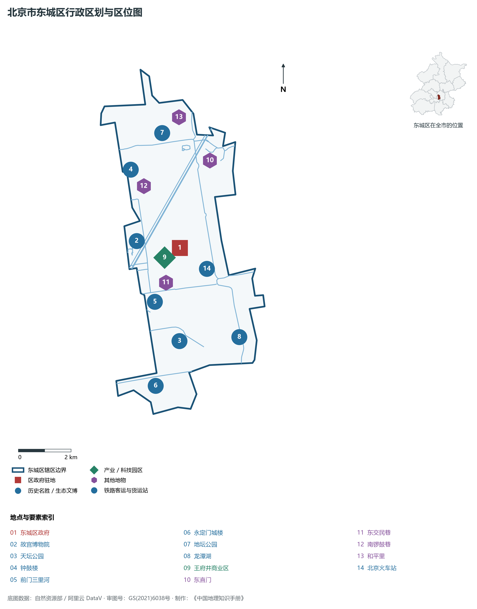
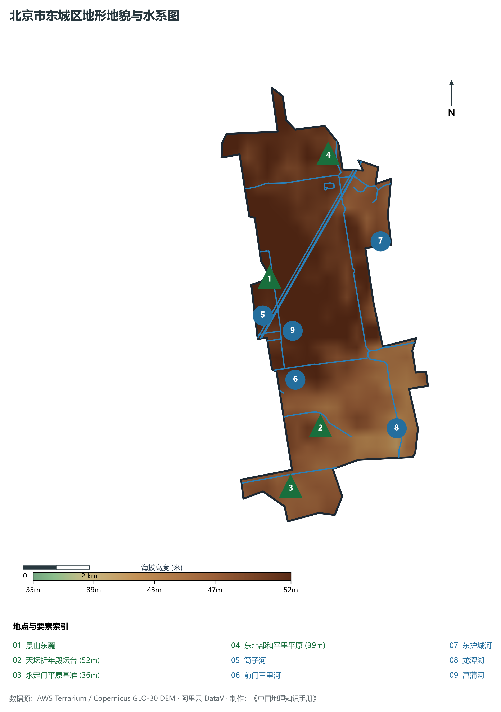
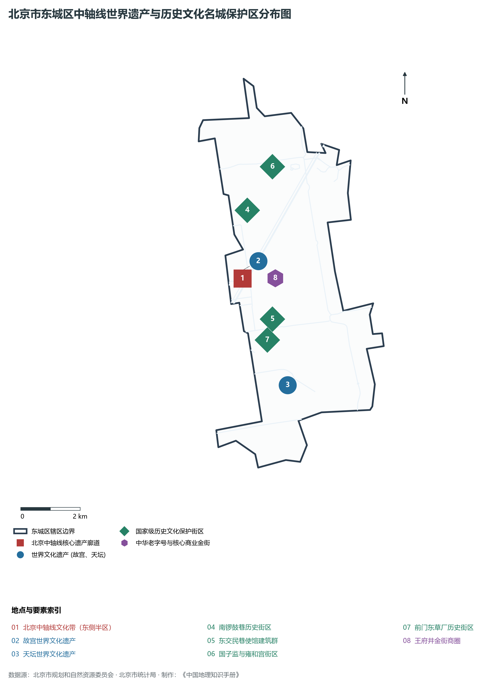
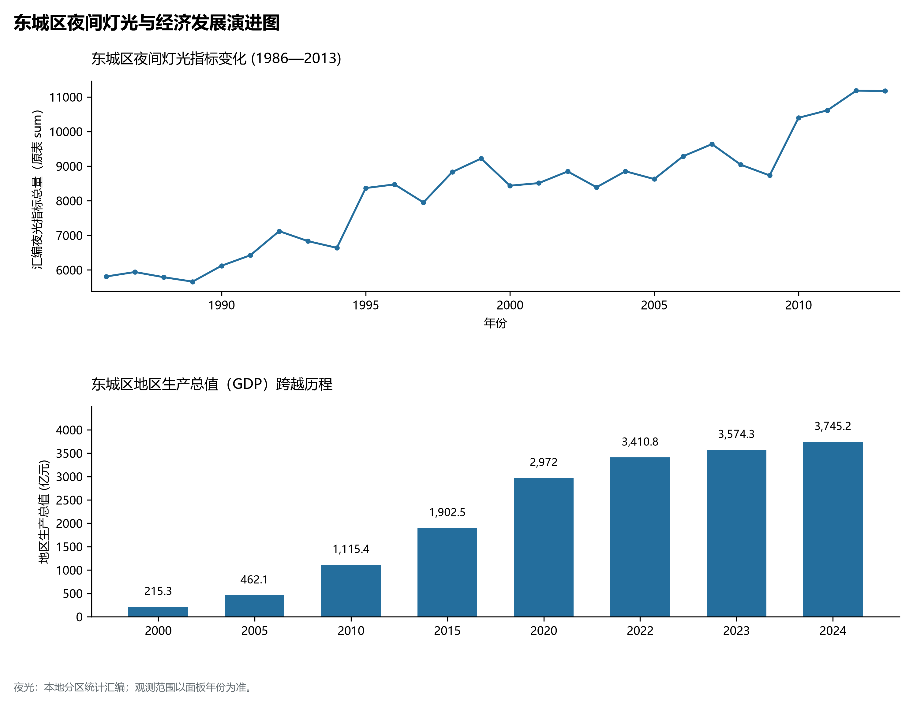
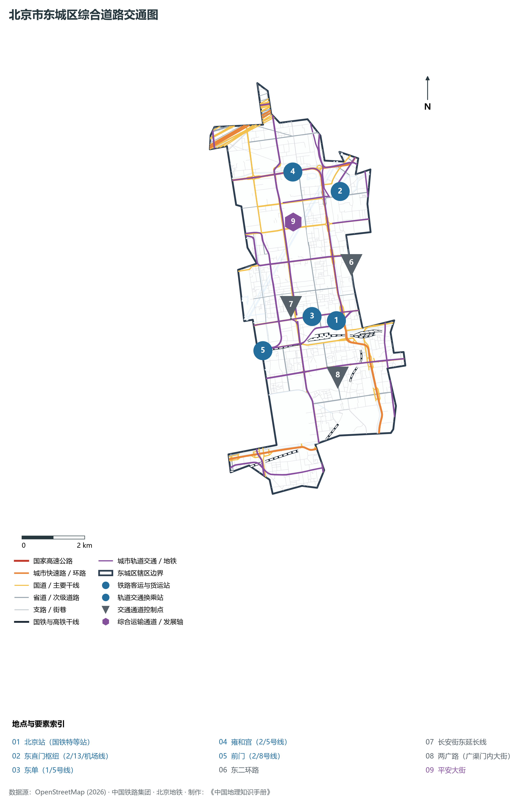

# 1.1 东城区

东城区位于北京市中心城区东北部，北、东与朝阳区相邻，南与丰台区相连，西与西城区以中轴线及前门大街诸段为界。其地理轮廓南北狭长、东西齐整，恰如一柄方正的玉璧镶嵌于首都核心区东翼——北接安定门外护城河平原，南抵永定门外古蓟运走廊，西纳紫禁城太和金殿之朝晖，东揽二环总部动脉之通衢。

历史上，东城区是元明清三代帝王营建国都的礼乐重地与百官府邸汇聚之所，以“紫禁皇城东半阙、天坛祈谷太庙祭”构建起东方传统古都秩序的至尊殿堂；近代更是新文化运动与觉醒年代红色火种的初燃圣地。当代，东城区作为全国政治中心、文化中心和国际交往中心的核心承载区，坚决落实首都功能核心区控规与“减量双控”，以北京中轴线成功申遗为契机推动老城整体保护与复兴，打造出政务环境清朗、文脉底蕴醇厚、现代商务高端的“首善之区”。

---

## 一、区情速览

东城区是北京市两个“首都功能核心区”之一，也是全中国政治活动与国家外交礼仪最高等级的服务保障重地。

| 指标 | 数值与特征 | 全国/全市坐标 |
|:---|:---|:---|
| **面积** | 41.84 km² | 占北京市总面积约 0.25%；全域为冲积平原微地貌 |
| **常住人口** | 70.88 万人（2020 年七普）；70.1 万人（2023 年末） | 持续推进核心区非首都功能疏解与人口密度合理调控 |
| **常住人口城镇化率** | 100%（全域高度城市化） | 全国最高水平 |
| **人口密度** | 16 941 人/km² | 全市第二（仅次于西城），前门、崇文门等街道人口极为稠密 |
| **地区生产总值 (GDP)** | 3 745.2 亿元（2024 年，现价） | 占北京市经济总量约 7.6%，地均产出高达 89.5 亿元/km² |
| **人均 GDP** | 约 52.8 万元人民币（折合超 7.3 万美元） | 稳居全国市辖区第一阵营，达全球极发达城市水准 |
| **主导产业结构** | 第三产业占比达 98.4% | 金融业、现代商贸、信息服务、文化创意四大支柱 |
| **行政区划** | 17 个街道，区政府驻景山街道金宝街 | 包含东华门、景山、安定门、交道口、北新桥等著名历史街区 |
| **战略功能定位** | 首都功能核心区、全国政治中心与文化中心核心承载区、历史文化名城保护关键区 | 贯彻减量发展、崇文争先，打造和谐宜居首善之区 |

**图 01-01-1 北京市东城区行政区划与区位图**：图上编号与地点、要素索引对应。

---

## 二、自然地理：平原台地与古城水脉

东城区位于永定河洪积冲积扇东北边缘的古台地平原之上，微地貌起伏平缓，地势由西北向东南微倾。

### 1. 地形地貌：古冲积台地与人工堆叠制高点
全区地势坦荡，地面绝对高程在 **35—52 m** 之间，全境无天然山峰丘陵，但微地形起伏与人工台地构成了极其深厚的地理地貌层次：

- **全区天然地势高位**：位于西北部和平里、安定门一带，海拔约 **39—41 m**，是古永定河向东北溢流冲刷形成的缓斜台地；
- **全区绝对工程制高点**：天坛祈年殿台基顶面，海拔 **52 m**（基底地面标高 44 m，汉白玉三重圆坛拔地而起 8 m），体现古代“祭天于圆丘、登坛接高天”的地理风水选址哲学；
- **景山东麓缓坡**：景山作为人工堆筑的山体（高 45.7 m），东侧半区山脚延入东城区境，海拔约 46 m；
- **全区地势最低处**：南部永定门以东、南护城河出境处，海拔约 **35—36 m**，水流顺势向东南平缓排出。

### 2. 气候特征：温带季风与城市热岛效应
东城区属于典型的暖温带半湿润大陆性季风气候。全区年平均气温在 **13.0—13.5 ℃** 之间，年平均降水量约 **585 mm**。

- **城市强热岛核心**：由于下垫面为极高密度的沥青、砖石古建与密闭建筑群，植被透水下垫面较少，东城区中心气温常年较北部郊区高 2—3.5 ℃，冬季夜间热岛效应尤为明显；
- **季节分明与暴雨滞纳**：降水高度集中于 7、8 月，短时强降雨往往对老旧四合院街区低洼院落构成排涝压力，近年来通过南锣鼓巷、东四老城地下海绵化雨洪改造，极大缓解了地表积水风险。

### 3. 河流水系：御河护城与引水名湖
东城区水系属于海河流域北运河水系（通惠河分支）：

- **东护城河与南护城河**：明清北京城外防洪排涝与漕运外壕，全长十余公里，由安定门流经东直门、朝阳门、广渠门至永定门，经现代综合生态整治后，已建成水清岸绿的环城绿色生态水岸；
- **筒子河与菖蒲河**：筒子河即故宫御河紫禁城护城河，宽 52 m，碧波倒映角楼金瓦；菖蒲河源自天安门城楼前金水河，东流汇入南护城河，两岸垂柳依依；
- **前门三里河**：起源于明代正统年间的前门草厂三里河，曾是古运河旧道，经“重塑三里河绿道水系”生态复原工程，恢复了“水穿街巷、绿道绕郭、白鹅戏水”的明清江南水乡风貌；
- **龙潭湖与青年湖**：龙潭湖水面面积达 40 余万 m²，分为东湖、中湖、西湖，原为明末外城取土烧砖形成的低洼窑坑，新中国成立后开凿筑湖，成为城南规模最大的城市水景观与蓄洪滞沥调蓄湖。

**图 01-01-2 北京市东城区地形地貌与水系图**：图上编号与地点、要素索引对应。

---

## 三、建置沿革与文化根脉

东城是北京城建史和中华礼乐文明的“集大成者”，蕴含着从紫禁皇家、明清府第、文人墨客到红色革命的极深文化厚度。

### 1. 地名考略与行政演进
东城区因地处北京老城东部而得名。

- 明清时期，北京内城划分为东四坊、西四坊等，东城属大兴县管辖；
- 1910 年宣统二年，清廷改设巡警内外城分区；
- 1952 年，北京市调整行政区划，设立东单区、东四区；1958 年两区合并成立**东城区**；
- 2010 年 7 月，国务院正式批复撤销原东城区与崇文区，设立新的**东城区**，原崇文区的天坛、前门、龙潭等板块整体并入，东城区版图扩展至 41.84 km²，完整拥有了传统外城东部的广阔文脉。

### 2. 世界文化遗产与中轴线精髓
东城区是全球世界文化遗产密度最高的城市区域之一：

- **故宫博物院（明清故宫，世界文化遗产）**：东半区（文华殿、太和殿东翼、东六宫、宁寿宫皇极殿等）坐落于东城区，是世界上现存规模最大、保存最完整的木结构古代宫殿建筑群；
- **天坛（世界文化遗产）**：明清两代帝王祭天、祈谷的圣地，祈年殿、皇穹宇、圜丘构筑了中国传统“天圆地方”哲学思想与声学建筑技艺的巅峰；
- **北京中轴线（世界文化遗产）**：永定门城楼、先农坛东侧、天坛、正阳门城楼及箭楼、故宫、景山、万宁桥、钟鼓楼，东城管辖了中轴线东半侧所有宏大建筑遗产要素与历史风貌管控带。

### 3. 历史文化街区与胡同肌理
东城区拥有 18.5 片历史文化保护区，占老城历史文化街区总数过半：

- **国子监与雍和宫街区**：汇集元代国子监、孔庙（大成殿、十三经刻石）与北京现存规模最大的藏传佛教寺院雍和宫，展现尊孔崇儒与民族融合的至高礼仪；
- **南锣鼓巷与东四三至八条**：保留了元大都最典型的“鱼骨状”里坊式胡同格局，是保存最为完好的传统四合院建筑标本；
- **东交民巷使馆建筑群**：近代中国风云激荡的活化石，汇聚哥特式、巴洛克式等近代多国使馆建筑与近代金融洋行旧址；
- **前门三里河与草厂三条至九条**：独具老北京南城草根烟火与会馆商帮文化特色的斜街织理。

**图 01-01-4 北京市东城区中轴线世界遗产与历史文化名城保护区分布图**：图上编号与地点、要素索引对应。

---

## 四、经济地理：首善之区与总部金融跃迁

东城区摆脱了传统依赖工业与增量土地扩张的发展模式，率先进入“以存量换增量、以减量促提质”的高端精致服务经济时代。

### 1. 产业腾笼换鸟与“减量双控”
新世纪以来，东城区全面关停清退老旧工矿与低端小商品批发市场：

- **红桥市场转型**：由传统的农贸水产市场蝶变为全国知名的国际珍珠交易中心与非遗文创殿堂；
- **“崇文争先”战略**：推动文化赋能经济，实施城市更新行动，打造隆福寺传统文化与现代潮流交织的城市文化新地标，培育航星科技园、禄米仓新视听等百亿级特色文创园区。

### 2. 经济总量跨越与超高地均效益

- 2000 年，东城区 GDP 仅为 **215.3 亿元**；
- 2010 年突破 **1 100 亿元**；
- 2024 年全区 GDP 攀升至 **3 745.2 亿元**。以仅占全市 0.25% 的土地面积，贡献了全市 7.6% 的 GDP，每平方公里土地产出近 90 亿元，经济密度位居全国超大城市区县最前列。

### 3. 支柱产业格局与黄金走廊

- **东二环高端总部经济带**：汇聚中石油、中石化、中国电信、保利集团、中粮集团等数十家大型央企与跨国公司亚太总部，成为与西二环金融街、东三环CBD鼎足而立的“总部商务走廊”；
- **现代金融与绿色金融**：以农业银行国际业务、交通银行北京分行、北京银行等为代表，资产规模庞大；
- **王府井“金街”国际商圈**：拥有东方广场、王府井百货大楼、王府中环等顶级商业集群，百年老字号与全球首店、旗舰店深度融合，年均吸引游客与消费者超亿人次。

### 4. 空间夜间灯光演化（1986—2013）

本节夜光图的观测年份为 1986—2013 年，指标为行政区汇总值（原表 sum）。

**图 01-01-5 东城区夜间灯光与经济发展演进图**：各面板按标注的观测年份、指标和单位列示。

---

## 五、交通网络与现代枢纽

东城区处于北京古城核心交通路网的原点，兼具百年国铁老站、高密度立体地铁网络与棋盘式林荫干道。

**图 01-01-3 北京市东城区综合道路交通图**：图上编号与地点、要素索引对应。

### 1. 百年国铁特等客运站：北京火车站

- **北京火车站**：坐落于崇文门与东便门之间，始建于清光绪二十七年（1901年），1959 年作为国庆十周年“十大建筑”迁建新站。总建筑面积达 8 万余 m²，双塔钟楼高耸，毛泽东主席亲笔题写“北京站”。北京站曾是全国最大的客运铁路枢纽，长期担负京哈、京沪、京广各主要干线客运列车始发终到任务，至今仍是连接华北与东北方向的重要客运特等门户。

### 2. 棋盘骨架路网与林荫大道

- **东二环路**：北京城市核心快速环路，连接东直门、东便门、广渠门，串联总部商务带；
- **东西向三大贯通干线**：
  - **长安街东延长线（建国门内大街）**：国之正街，宽广雄浑，串联王府井、东单与建国门；
  - **平安大街（地安门东大街—东四十条）**：横贯老城北部的仿古建筑风貌林荫大街；
  - **两广路（广渠门内大街—珠市口东大街）**：老城南部东西向骨干快速干道；
- **南北向中轴与辅轴**：前门大街、王府井大街、东单北大街（雍和宫大街至崇文门外大街走廊），构筑了纵贯内外的林荫通衢。

### 3. 高密度地下轨道交通网
东城区轨道交通车站密度与线网密度高居全市首位：

- **地铁 2 号线（老城内环）**：沿原北京内城城墙走向环行，串联前门、崇文门、北京站、建国门、朝阳门、东直门、雍和宫、安定门诸站；
- **骨干纵向线**：**5 号线**（天通苑至宋家庄纵贯东城腹地）、**8 号线**（中轴线地下直通线，贯穿前门、金鱼胡同、中国美术馆、南锣鼓巷、鼓楼大街）；
- **骨干横向线**：**1 号线 / 八通线**（东西横贯长安街腹地）、**6 号线**（横穿南锣鼓巷、东四、朝阳门）、**7 号线**（横贯南部广渠门至珠市口）；
- **东直门综合交通枢纽**：集地铁 2 号线、13 号线、首都机场线（大树下地下一键值机）及多条郊区公交线路于一体的全市最大立体换乘枢纽之一。

---

## 六、东城区地理要素矩阵与区域之最

### 1. 核心地理与经济指标速查表

| 要素类别 | 指标名称 | 数值/名称 | 备注 |
|:---|:---|:---|:---|
| **地势极值** | 最高点海拔（台面） | **52.0 m** | 天坛祈年殿第三层汉白玉基台顶面 |
| | 最低点海拔（水面） | **35.0 m** | 南护城河东南角广渠门出境处 |
| **水文要素** | 最大湖泊水体 | **龙潭湖（东湖/中湖/西湖）** | 水面面积约 41 万 m² |
| | 最长人工运河水系 | **东护城河 + 南护城河** | 全区境内长约 12.8 km |
| | 最具特色历史街巷河渠 | **前门三里河** | 恢复明代“水穿街巷”约 900 m |
| **生态指标** | 公园绿地 500 米服务半径覆盖率 | **超 95%** | 居全市前列，“推窗见绿、出门进园” |
| | 绿化覆盖率 | **35.6%** | 天坛、地坛、龙潭等古树名木达万余株 |
| **经济指标** | 2024 年 GDP | **3 745.2 亿元** | 地均产出 89.5 亿元/km²，全市极高水平 |
| | 人均地区生产总值 | **52.8 万元人民币** | 约合 7.3 万美元，全国市辖区前茅 |
| **文化遗产** | 世界文化遗产数量 | **2 处**（故宫东半阙、天坛）+ **北京中轴线**（核心段） | 全球遗产密度最高的都市行政单元之一 |
| | 全国重点文物保护单位 | **37 处** | 占全北京市国保单位近三成 |

### 2. 东城区之最（Superlatives）

- **遗产之最**：拥有全世界现存规模最大的古代祭天建筑群——天坛，以及中国古代宫殿艺术的至高巅峰——故宫东半区；
- **效益之最**：北京市地均经济产出（GDP/km²）最高的市辖区之一（近 90 亿元/平方公里）；
- **人均之最**：人均 GDP 突破 52 万元人民币，位列全中国市辖区人均财富产出第一梯队；
- **红色之最**：中国近代革命与思想觉醒发源地，拥有北京大学红楼（新文化运动策源地、五四运动发祥地、早期马克思主义传播主阵地）。

---

## 参考与数据来源

1. 中华人民共和国自然资源部：《第三次全国国土调查主要数据公报（北京市东城区）》
2. 北京市统计局、东城区统计局：《北京市第七次全国人口普查公报》、《2024年东城区国民经济和社会发展统计公报》
3. 北京市规划和自然资源委员会：《首都功能核心区控制性详细规划（街区层面）（2018年—2035年）》
4. 国家统计局：《中国城市统计年鉴（2024—2025年）》
5. 阿里云 DataV.GeoAtlas 2021.5 行政区划边界矢量（审图号：GS(2021)6038号）
6. OpenStreetMap (OSM) 2026 年最新全要素道路与交通线网矢量
7. AWS Terrain Tiles / Copernicus GLO-30 数字高程模型（DEM）
