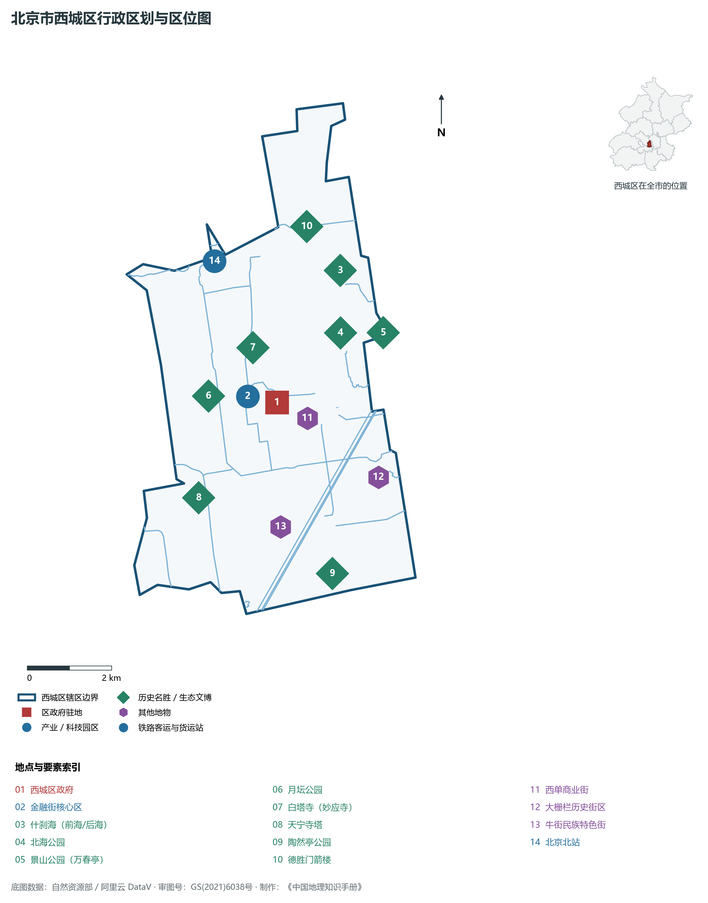
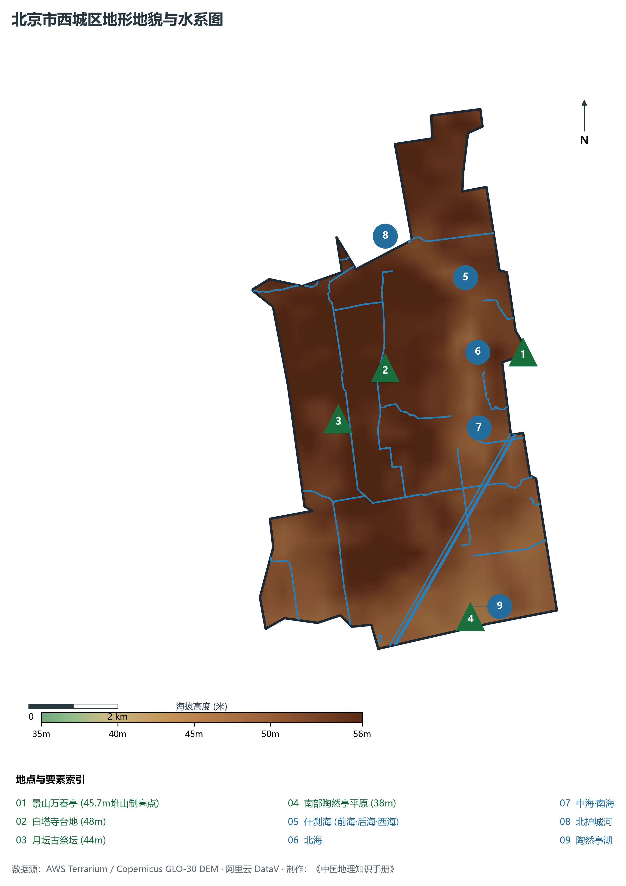
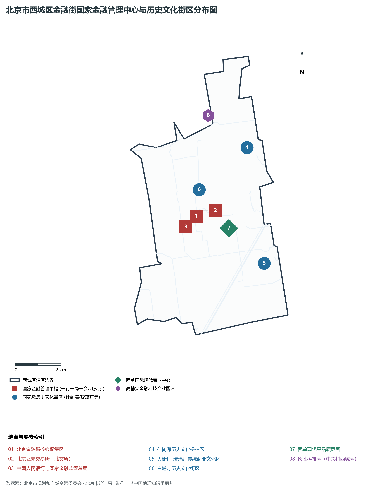
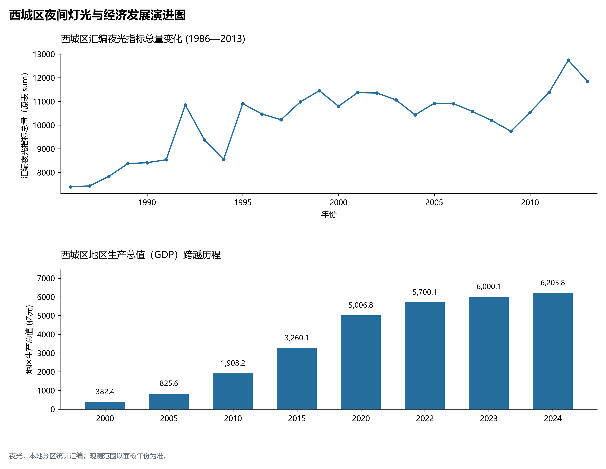
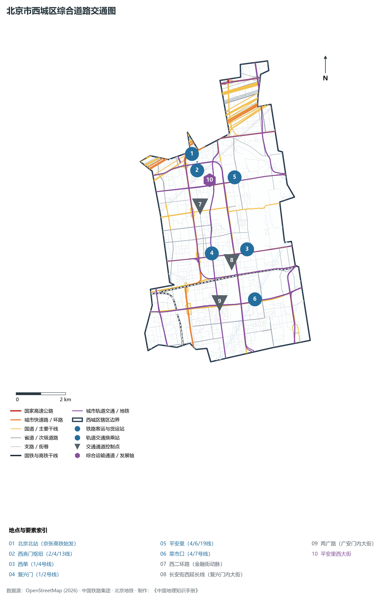

# 1.2 西城区

西城区位于北京市中心城区西部，东临东城区，南接丰台区，西与海淀区、石景山区相连，北与海淀区隔北护城河相望。其地理轮廓纵贯南北、横跨水陆，牢固坐落在永定河古冲积扇与金元大都水脉枢纽的核心台地之上——西倚白塔古刹与三里河林荫，东抱北海琼华与什刹三海碧波，南纳广安门金中都故址，北展德胜门通衢大道。

历史上，西城区是北京三千余年建城史与八百七十余年建都史的原点坐标：从西周蓟城“封召公于燕”，到金中都皇城建制，再到元大都积水潭“舳舻蔽水”的运河终点，西城始终是国都统治秩序的心脏。当代，西城区作为全国政治中心的核心空间载体与国家金融管理中心，坐拥党中央、国务院、全国人大等党政首脑机关驻地，金融街资产总规模超 140 万亿元，以极高的人口密度、极高的人均产出与极严的中央政务保障要求，成为名副其实的“大国中枢、首善之首”。

---

## 一、区情速览

西城区是北京市两个“首都功能核心区”之一，也是中央政务服务保障与国家金融调控中枢。

| 指标 | 数值与特征 | 全国/全市坐标 |
|:---|:---|:---|
| **面积** | 50.70 km² | 占北京市总面积约 0.31%；全域为第四纪冲积平原微丘 |
| **常住人口** | 110.62 万人（2020 年七普）；110.0 万人（2023 年末） | 持续推进核心区减量控容与精细化城市治理 |
| **常住人口城镇化率** | 100%（全域深度城市化） | 全国最高水平 |
| **人口密度** | 21 819 人/km² | 全市第一位，亦为中国人口密度最高的大都市核心区之一 |
| **地区生产总值 (GDP)** | 6 205.8 亿元（2024 年，现价） | 居北京市各区第二位，地均产出高达 122.4 亿元/km² |
| **人均 GDP** | 约 56.1 万元人民币（折合超 7.7 万美元） | 稳居全北京市第一位，媲美全球顶级离岸金融中心 |
| **主导产业结构** | 第三产业占比达 98.8% | 金融业占比超 54%，金融科技、高端智库、现代商贸协同 |
| **行政区划** | 15 个街道，区政府驻金融街街道二龙路 | 涵盖金融街、什刹海、新街口、展览路、大栅栏、牛街等 |
| **战略功能定位** | 首都功能核心区、国家政治中心核心承载区、国家金融管理中心、历史文化名城保护关键区 | 坚持平房保护、政务服务至上，建设高品质和谐宜居典范 |

**图 01-02-1 北京市西城区行政区划与区位图**：图上编号与地点、要素索引对应。

---

## 二、自然地理：湖池相生与古扇缘高台

西城区坐落于永定河古冲积扇东北侧的脊部与扇缘交汇带，地表平坦，地质结构坚实稳定。

### 1. 地形地貌：扇缘台地与人工胜景制高点
全区地势西高东低、西北向东南微斜，天然地面绝对高程在 **35—56 m** 之间：

- **全区天然地势高位**：位于西北部西直门外至百万庄台地，海拔约 **48—50 m**；白塔寺所处的古高台海拔约 48 m；
- **全区天然制高点与古堆山**：景山万春亭（45.7 m 堆山，绝对高程 89.2 m，山体西侧大部在西城）、月坛古坛台（44 m）；
- **全区地势低洼带**：南部陶然亭湖区及先农坛西侧，海拔降至 **35—38 m**，自古为城南洼聚芦塘与泄洪汇水之地。

### 2. 气候特征：温和季风与小气候水体调温
属于暖温带半湿润大陆性季风气候。全区年平均气温在 **13.2—13.6 ℃** 之间，年平均降水量约 **590 mm**。

- **“六海”调温绿肺**：西城区内拥有北海、中海、南海以及什刹海（前海、后海、西海），大面积水体水蒸发使周边什刹海、地安门、后海北沿形成显著的局部“冷岛效应”，夏季平均气温较周边干燥沥青街区低 1.5—2.0 ℃，空气湿度适宜，自古为燕京消夏泛舟胜境。

### 3. 河流水系：大都水胆与漕运命脉
西城区的水系在历史上扮演了决定北京建城与选址的“生死密码”：

- **什刹海（前海、后海、西海）**：元代称“积水潭”，水域辽阔。元代水利大家郭守敬引昌平白浮泉水入城，注于积水潭，“舳舻蔽水”的江南漕船在此停泊卸货，构成了大运河漕运北方终点码头与元大都的“水胆”；
- **三海（北海、中海、南海）**：金代称大宁宫琼华岛，元明清历代皇家太液池，是现存历史最悠久的皇家园林宫苑水系；
- **北护城河与转河**：西直门外引永定河引水渠之水经转河入北护城河，向东经德胜门流往东城，构筑了老城北部生态景观水环；
- **陶然亭湖**：水面面积约 16 万 m²，东、西两湖烟波荡漾，环湖亭榭错落，是清代士大夫与近现代革命先驱流连聚会的文化名湖。

**图 01-02-2 北京市西城区地形地貌与水系图**：图上编号与地点、要素索引对应。

---

## 三、建置沿革与文化根脉

西城是“北京城的肇始之壤”，汇聚了三千年建城史的始发印记与八百年建都史的皇家典范。

### 1. 地名考略与行政演进

- **蓟城发源**：公元前 1045 年，周武王封召公于燕，封地蓟城即建于西城区广安门至白纸坊一带的古永定河冲积台地上；
- **金中都皇城**：公元 1153 年金迁都燕京，皇城即设在今天宁寺、广安门外一带，天宁寺辽代密檐式砖塔至今巍然耸立，是北京城内现存最古老的地上高层建筑；
- **元大都与明清内城**：忽必烈放弃金中都废墟，依托积水潭营建元大都，西城确立了鼓楼西大街、阜成门内大街等骨干斜街街巷框架；
- **现代行政区划调整**：1958 年合并西单区、西四区为**西城区**；2010 年 7 月，国务院正式批复撤销西城区与宣武区，设立新的**西城区**，原宣武区所辖广安门、大栅栏、陶然亭、牛街等全域并入，面积扩充至 50.70 km²。

### 2. 世界遗产与国家级历史街区

- **北京中轴线（世界文化遗产）**：景山万春亭（全城制高点）、鼓楼、万宁桥（大运河与中轴线交汇第一古桥）均属于西城辖区范围；
- **什刹海历史文化保护区**：包含恭王府（国家5A级景区、现存最大清代王府）、宋庆龄故居、郭沫若纪念馆、银锭桥（“燕京八景”之一银锭观山），保存了完整的明清王府、寺庙、名人故居与四合院肌理；
- **大栅栏与琉璃厂古文化街**：大栅栏是明清以来北京最繁华的传统商业街区，汇集同仁堂、瑞蚨祥、张一元、六必居等中华百年老字号；琉璃厂则是清代文人墨客研磨金石、搜罗古籍书画的“中国第一文化街”；
- **白塔寺（妙应寺）与法源寺**：妙应寺白塔由尼泊尔工匠阿尼哥于元代主持修建，是北京最早也是最大的元代喇嘛塔；法源寺建于唐贞观十九年（悯忠寺），是北京内城最古老的名刹，也是中国佛学院所在地。

### 3. 近代觉醒与红色先驱殿堂
西城是近代中国先进思想知识分子探索救国真理的核心阵地：

- **陶然亭慈悲庵**：李大钊、毛泽东、周恩来曾在此秘密策划“驱张运动”与五四革命斗争，高君宇与石评梅长眠于湖畔松林之中；
- **李大钊故居（文华胡同）**：李大钊在此撰写了大量马克思主义光辉著作，是中国共产党早期创建的重要秘密据点。

**图 01-02-4 北京市西城区金融街国家金融管理中心与历史文化街区分布图**：图上编号与地点、要素索引对应。

---

## 四、经济地理：国家金融管理中心与超高地均产出

西城区是国家金融管理中枢所在地，拥有中国乃至全球最具决定性金融资源配置能力的“金融超级核心”。

### 1. 从“胡同街巷”到“国家金融中枢”

- **规划奠基（1993年）**：国务院批复《北京城市总体规划》，正式确立在西二环阜成门至复兴门沿线建设“北京金融街”；
- **国家战略跃升（2000年代至今）**：中国人民银行、国家金融监督管理总局、中国证监会（“一行一局一会”）以及国家开发银行、工商银行、建设银行、中国银行、农业银行等大型金融央企总部集中扎根于此；
- **北交所落地（2021年）**：经党中央、国务院批准，**北京证券交易所（北交所）**在金融街正式揭牌开市，构建起服务创新型中小企业主阵地，补齐了北京在多层次资本市场交易所层面的战略版图。

### 2. 经济总量跨越与“全市首善”

- 2000 年西城区 GDP 为 **382.4 亿元**；
- 2010 年增至 **1 908.2 亿元**；
- 2024 年全区 GDP 跃升至 **6 205.8 亿元**，稳居全市第二位；
- **人均 GDP 全市第一**：2024 年西城区人均 GDP 高达 **56.1 万元人民币**（约合 7.7 万美元），单位土地 GDP 产出高达 **122.4 亿元/km²**，金融资产总规模超 **140 万亿元**（占全国金融资产总量超三分之一），是名副其实控制全国金融血脉的“神经中枢”。

### 3. 产业格局：“一街一园”双轮驱动

- **北京金融街（2.59 km²）**：集聚金融机构超 1 900 家，资产规模超百万亿元，金融业增加值占全区 GDP 比重超 54%，成为中国金融业的“定海神针”；
- **中关村科技园区西城园（德胜科技园）**：以国家级“金科新区”（成方街—德胜门—动物园区域）为载体，大力发展金融科技、监管科技、金融大数据、人工智能风控等新兴高精尖业态，吸引奇安信、神州信息等龙头科技企业集聚；
- **西单现代高品质时尚商圈**：与王府井鼎足而立，拥有汉光百货、君太百货、大悦城、西单商场，年销售额数百亿元。

### 4. 空间夜间灯光演化（1986—2013）

本节夜光图的观测年份为 1986—2013 年，指标为行政区汇总值（原表 sum）。

**图 01-02-5 西城区夜间灯光与经济发展演进图**：各面板按标注的观测年份、指标和单位列示。

---

## 五、交通网络与现代枢纽

西城区是北京城区的枢纽型立体交通核心，集京张高铁始发站、多线地下轨道换乘枢纽与环线快速路于一体。

**图 01-02-3 北京市西城区综合道路交通图**：图上编号与地点、要素索引对应。

### 1. 国家铁路特等客运站：北京北站

- **北京北站**：坐落于西直门外，其前身为詹天佑主持修建的京张铁路西直门车站（始建于 1906 年），是百年京张铁路的历史起点。2019 年随京张高铁全线通车全面完成智能化升级改建，站房面积 2.1 万 m²，承担京张高铁、京呼高铁及北京市郊铁路怀密线的始发终到重任，是首都连接张家口、内蒙古及西北地区的百年现代化高铁名门。

### 2. 环路骨架与东西快速干道

- **西二环路**：贯通西直门、阜成门、复兴门、广安门，是金融街的地面交通主动脉；
- **长安街西延长线（复兴门内大街）**：连接天安门广场与西二环，国家金融决策机构与商业银行总部沿线分布；
- **平安大街西段与地安门西大街**：横贯什刹海南部与西四老城；
- **广安门内大街（两广路）**：贯穿原宣武老城，直通广安门外京港澳高速通道。

### 3. 高密度地下轨道交通线网
西城区轨道交通运营线路达 10 条，换乘站密集：

- **西直门综合枢纽**：汇聚 **2 号线、4 号线、13 号线** 及北京北站国铁，是全城客流吞吐量最大的地下超级枢纽之一；
- **平安里站**：汇聚 **4 号线、6 号线、19 号线** 三线大体量换乘，其中 19 号线作为贯穿南北的 120 km/h 轨道快线，快速直达大兴机场草桥站与金融街；
- **西单站（1/4号线）**、**复兴门站（1/2号线，中国最早的地铁换乘站）**、**菜市口站（4/7号线）**：构成全天候通达全城的无缝轨道出行网络。

---

## 六、西城区地理要素矩阵与区域之最

### 1. 核心地理与经济指标速查表

| 要素类别 | 指标名称 | 数值/名称 | 备注 |
|:---|:---|:---|:---|
| **地势极值** | 最高点海拔（堆山顶） | **45.7 m (绝对高程 89.2 m)** | 景山万春亭 |
| | 最低点海拔（湖池水面） | **35.0 m** | 南部陶然亭湖区东南泄水处 |
| **水文要素** | 最大天然/开凿水体 | **什刹海（前海/后海/西海）** | 水面面积约 34 万 m²，古运河终点码头 |
| | 皇家太液池水域 | **北海、中海、南海** | 水面达百余公顷，北京最古老皇家宫苑 |
| | 北部防洪排水运渠 | **北护城河与转河** | 连通长河与东护城河 |
| **生态指标** | 公园绿地 500 米服务半径覆盖率 | **超 96%** | 全区口袋公园、微绿地林立 |
| | 绿化覆盖率 | **33.2%** | 什刹海、北海绿树浓荫，古树名木万余株 |
| **经济指标** | 2024 年 GDP | **6 205.8 亿元** | 全市第二，单位面积产出 122.4 亿元/km²（全国第一） |
| | 人均地区生产总值 | **56.1 万元人民币** | 约合 7.7 万美元，居全北京市 16 区首位 |
| **金融实力** | 金融资产总规模 | **超 140 万亿元** | 占全国金融机构资产总额超三分之一 |
| | 北交所上市公司数量 | **超 260 家** | 打造服务创新型中小企业主阵地 |

### 2. 西城区之最（Superlatives）

- **金融之最**：全国金融决策与资产配置中枢，拥有国家金融管理中心（金融街），金融资产规模突破 140 万亿元；
- **产出之最**：全中国地均 GDP 产出最高的行政区（每平方公里贡献逾 122 亿元）；
- **人均之最**：人均地区生产总值高达 56.1 万元人民币，稳居全北京市第一位；
- **建城之最**：北京 3000 多年建城史的原点（西周燕都蓟城故址位于广安门一带）；
- **密度之最**：北京市人口密度最高的行政区（常住人口密度超 2.18 万人/km²）。

---

## 参考与数据来源

1. 中华人民共和国自然资源部：《第三次全国国土调查主要数据公报（北京市西城区）》
2. 北京市统计局、西城区统计局：《北京市第七次全国人口普查公报》、《2024年西城区国民经济和社会发展统计公报》
3. 北京市规划和自然资源委员会：《首都功能核心区控制性详细规划（街区层面）（2018年—2035年）》
4. 国家统计局：《中国城市统计年鉴（2024—2025年）》
5. 阿里云 DataV.GeoAtlas 2021.5 行政区划边界矢量（审图号：GS(2021)6038号）
6. OpenStreetMap (OSM) 2026 年最新全要素道路与交通线网矢量
7. AWS Terrain Tiles / Copernicus GLO-30 数字高程模型（DEM）
