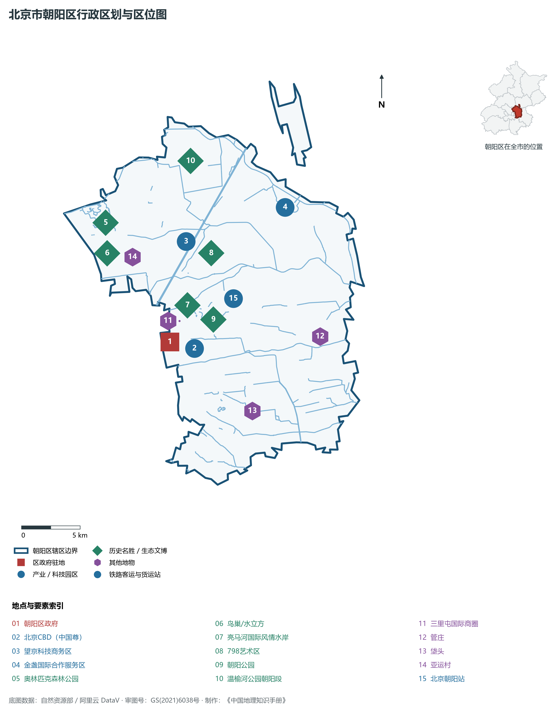
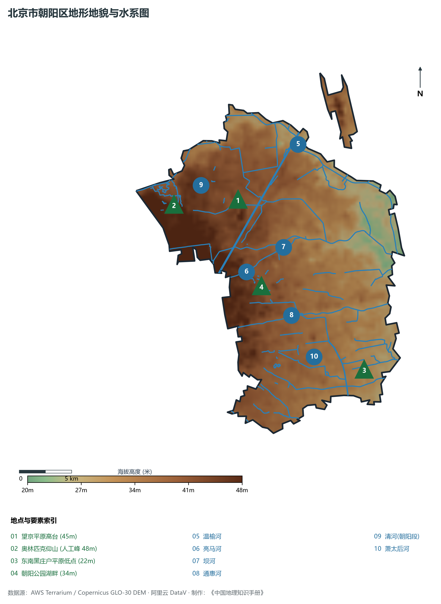
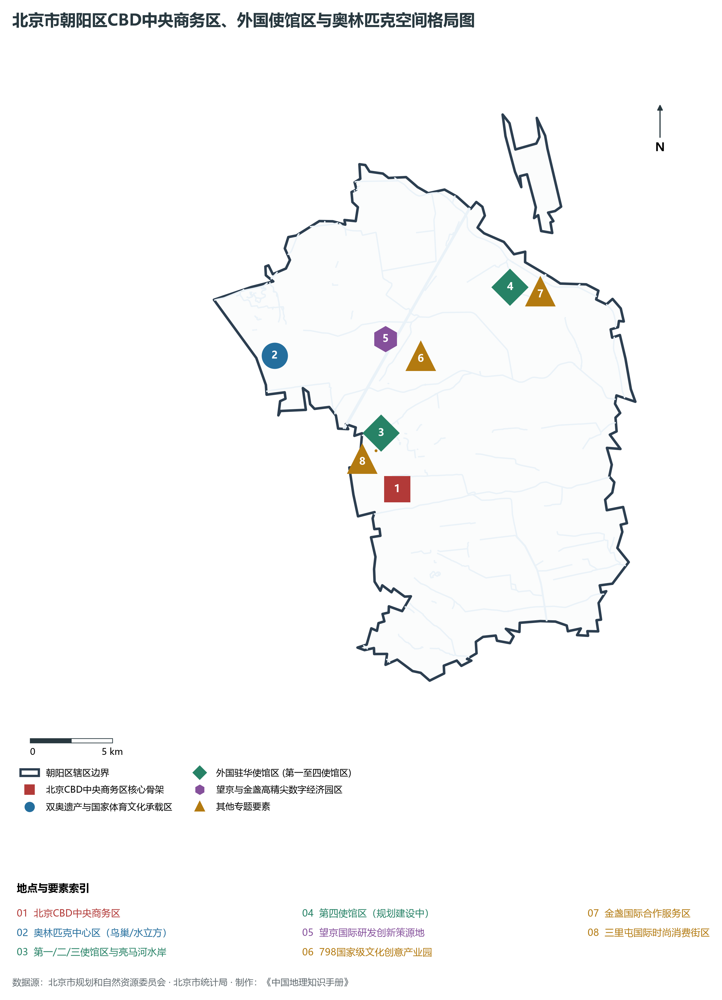
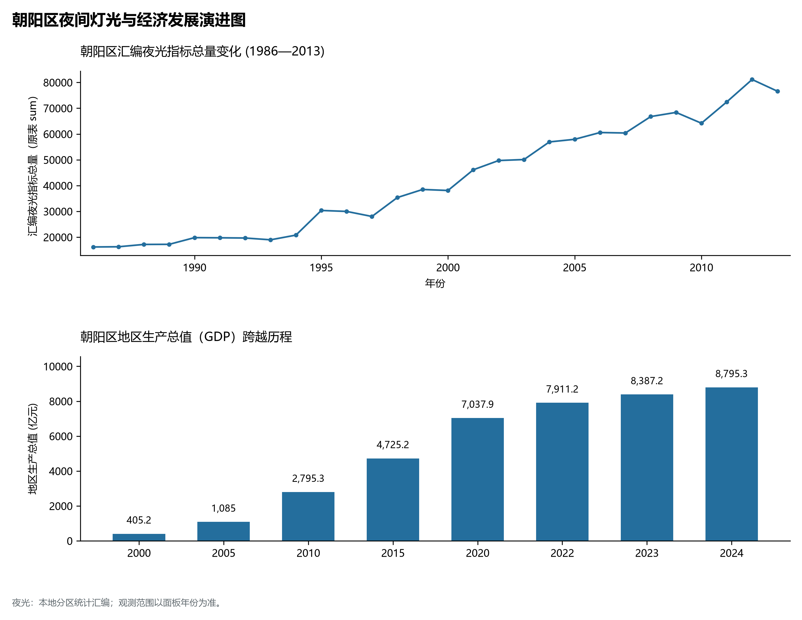
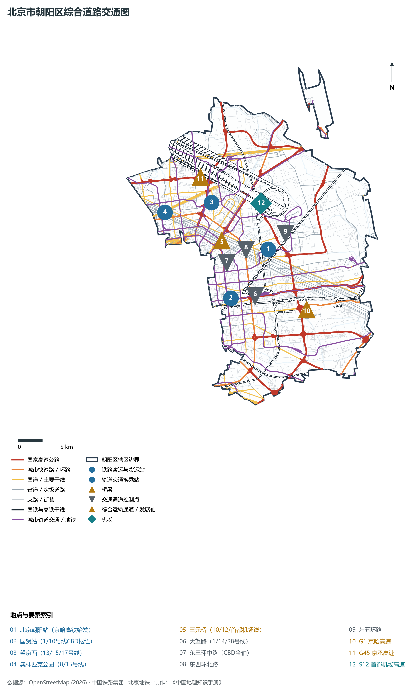

# 1.3 朝阳区

朝阳区位于北京市中心城区东部与东北部，西与东城区、西城区相依，西南与丰台区接壤，南接大兴区，东与通州区为邻，北与顺义区、昌平区界水相连。其辖域广袤、形态宛如展翅引颈的凤凰，自二环路东护城河一路向东、向北铺展至温榆河畔——西沐古都金轴之盛彩，东拓国贸CBD天际线之雄浑，北纳奥林匹克公园碧水连天之锦绣。

历史上，朝阳区曾是通惠河漕运进京的必经粮仓门户与近现代首都东郊工业基地。当代，朝阳区是首都对外交往的核心主阵地与国家经济增长的重要引擎：全区汇聚了北京市绝大多数驻华使馆、联合国机构、国际传媒、跨国公司地区总部以及国际金融机构；集聚“双奥之城”核心遗产、享誉全球的北京CBD、时尚地标三里屯与当代文化艺术圣地798。朝阳区以全市第一的常住人口、稳居全市第二的经济体量、全球瞩目的涉外服务网络，成为代表新时代中国首都国际化繁华盛景的“金名片”。

---

## 一、区情速览

朝阳区是北京市中心城区中面积最大、常住人口最多、外向型经济能级最高的经济与涉外大区。

| 指标 | 数值与特征 | 全国/全市坐标 |
|:---|:---|:---|
| **面积** | 455.08 km² | 占北京市总面积约 2.77%，占城六区总面积近三分之一 |
| **常住人口** | 345.25 万人（2020 年七普）；344.9 万人（2023 年末） | 全市 16 区中位居第一，占全市常住人口约 15.8% |
| **常住人口城镇化率** | 100%（全域城镇化统计口径） | 居全国区县级最高层级 |
| **人口密度** | 7 587 人/km² | 西部潘家园、呼家楼等街道超 2 万人/km²，东北近郊约 2 500 人/km² |
| **地区生产总值 (GDP)** | 8 795.3 亿元（2024 年，现价） | 占北京市总量约 17.8%，连续数十年稳居全省市第二 |
| **人均 GDP** | 约 25.5 万元人民币（折合超 3.5 万美元） | 高居全国人口超 300 万超大城区第一阵营 |
| **主导产业结构** | 第三产业占比达 93.5% | 商务服务、金融业、信息服务、文化体育娱乐业支柱集聚 |
| **行政区划** | 24 个街道、19 个地区（建制镇），区政府驻朝外街道日坛北街 | 辖区兼具密集超高层商务极核与广阔城乡融合绿色空间 |
| **战略功能定位** | 国际交往中心核心承载区、国际金融与商务中心区、文化创意产业引领区、科技创新重要节点 | 建设具有广泛国际影响力和竞争力的和谐宜居卓越城区 |

**图 01-03-1 北京市朝阳区行政区划与区位图**：图上编号与地点、要素索引对应。

---

## 二、自然地理：平原舒展与密织河网

朝阳区地处温榆河与潮白河古冲积平原西南缘，地势坦荡辽阔，无天然山体，微地貌自西北向东南缓缓倾斜。

### 1. 地形地貌：广阔平原与人工堆山台地
全区平均海拔在 **30—40 m** 之间，坡降极微，平原冲积层厚度达数百米：

- **全区天然地势高位**：位于西北部亚运村至望京平原台地，地面绝对标高约 **40—45 m**；
- **全区人工工程制高点**：奥林匹克森林公园**“仰山”**，利用奥林匹克公园地下工程开挖土方堆筑而成，主峰海拔 **48 m**（相对高度约 28 m），与奥海碧波形成“背山面水”的中轴线现代园林巅峰布局；
- **全区地势最低处**：东南端黑庄户出境交界处，地面标高仅 **20—22 m**，地表水系汇集排入通州平原。

### 2. 气候特征：温和湿润与平原风廊调节
朝阳区属于暖温带半湿润大陆性季风气候。全区年平均气温在 **13.0—13.4 ℃** 之间，年平均降水量约 **580—620 mm**。

- **城市通风廊道规划**：依托温榆河公园、奥林匹克森林公园、清河绿廊与朝阳公园等万亩大型生态绿地，朝阳区系统开辟了自北向南穿透城区的数条大型“城市冷风廊道”，极大削弱了高密度楼宇群形成的局部积热与空气静稳积聚。

### 3. 河流水系：通衢纵贯与国际风情水岸
朝阳区水资源极其丰富，分属海河流域北运河水系：

- **温榆河**：朝阳区东北部的母亲河与边界天然界河，全长十余公里，由沙河、清河汇聚而成，沿岸规划建设有北京平原最大的城市绿色生态绿肺——温榆河公园；
- **亮马河**：全长 9.3 km，西起东直门外护城河，穿过第一、二、三使馆区与朝阳公园，注入坝河。近年来实施亮马河国际风情水岸综合治理，打造出“乘船夜游两岸繁华、水岸咖啡与游艇辉映”的世界级滨水经济与文化走廊；
- **通惠河**：元代郭守敬主持开凿的著名漕运河道，横贯朝阳南部高碑店、管庄一带，历经千年沧桑，至今仍是朝阳连接城市副中心的重要排洪与历史文化通衢；
- **坝河与清河**：坝河横贯朝阳东北，承接北部山区来水；清河在朝阳西北奥森北侧汇入温榆河；
- **萧太后河**：辽代为运粮开凿的古河流，横卧朝阳区南部，是北京最早的人工运河之一。

**图 01-03-2 北京市朝阳区地形地貌与水系图**：图上编号与地点、要素索引对应。

---

## 三、建置沿革与文化根脉

朝阳大地历史悠久，既有千年古运河商帮粮仓印记，更有新中国工业开拓、双奥荣光与全球当代艺术交织的多元风采。

### 1. 地名考略与行政演进
朝阳区因其大部分辖区位于北京老城“朝阳门”之外而得名。

- 元明清时期，境域分属宛平县、大兴县，朝阳门外大道是通州漕粮运入京城内仓的“陆运皇道”；
- 1952 年设立北京市东郊区，因集聚棉纺、焦化、化工等国家“一五”重点工业而成为近现代工业基地；
- 1958 年 5 月正式定名为**朝阳区**；
- 伴随改革开放与 1990 年亚运会、2008 年奥运会、2022 年冬奥会的连续营建，朝阳区由传统城郊工业区蝶变跃升为现代国际化大都会核心功能区。

### 2. 双奥遗产与大国体育文化地标
朝阳是全球唯一的“双奥之城”核心承载区：

- **国家体育场（“鸟巢”）**：全球首个举办过夏奥会与冬奥会开闭幕式的超级体育场，独特的巨型网状钢结构编织出壮美的时代地标；
- **国家游泳中心（“水立方”/“冰立方”）**：ETFE膜结构膜结构与冰水自由转换的世界领先工程典范；
- **国家速滑馆（“冰丝带”）**：北京冬奥会唯一新建冰上竞赛场馆，22 条灵动飞舞的玻璃丝带展现出速度与科技的极致融合；
- **奥林匹克森林公园**：占地 680 公顷，横跨北五环，是首都中轴线上最大的人工城市自然生态森林。

### 3. 外交外事文脉与国际使馆区
新中国建立后，朝阳区成为国家外事主阵地：

- 辖区集中了全国约 99% 的外国驻华使馆，先后规划建设了**第一使馆区（建国门外）、第二使馆区（三里屯）、第三使馆区（燕莎亮马河）**；
- 目前正在高标准推进第四使馆区（金盏）规划建设，形成中外文明深度对话与大国外交的主场会客厅。

### 4. 当代文化艺术策源地：798 艺术区

- 原为新中国“一五”时期民主德国援建的华北无线电联合器材厂（718联合厂），拥有典型的包豪斯建筑风格锯齿形厂房；
- 2000 年代起，大批当代艺术家、画廊与文创机构进驻，将工业废墟转化为全球最具影响力的当代文化艺术园区，成为中国文化走向世界与对外展示文化自信的重要窗口。

**图 01-03-4 北京市朝阳区CBD中央商务区、外国使馆区与奥林匹克空间格局图**：图上编号与地点、要素索引对应。

---

## 四、经济地理：商务金轴与现代国际服务业极核

朝阳区是首都开放型经济的第一支撑，也是中国参与全球高端商务、现代金融与国际贸易博弈的旗舰核心。

### 1. 北京 CBD：东方曼哈顿的崛起

- 1993 年经国务院批复确立建设，规划范围 7.04 km²；
- 以东三环国贸桥为核心，集聚了中信大厦（中国尊，高 528 m，北京第一高楼）、中央电视台总部大楼、国贸三期、华贸中心等超级摩天楼宇群；
- 汇聚各类跨国公司地区总部达 110 余家，入驻世界 500 强企业数百家，外资金融机构占全北京市 70% 以上，年纳税超亿元的高能级商务楼宇达百余座，国际化程度稳居全国 CBD 首位。

### 2. 经济总量跨越与结构升级

- 2000 年朝阳区 GDP 仅为 **405.2 亿元**；
- 2010 年突破 **2 700 亿元**；
- 2024 年北京市全市地区生产总值为 49,843 亿元（当年价格）。

### 3. 多点支撑的高精尖产业集群

- **望京科技商务创新极**：集聚阿里巴巴北京总部大楼、美团、默沙东、西门子等全球高科技领军巨头，形成仅次于中关村的数字经济与互联网产业新高地；
- **金盏国际合作服务区**：依托第四使馆区，大力发展数字贸易、自由贸易港现代服务、国际免税消费，打造服务国家对外开放的战略新阵地；
- **三里屯与亮马河商圈**：首店经济与夜间经济全国领跑，成为全球顶尖奢侈品与国际流行时尚发布策源地。

### 4. 空间夜间灯光演化（1986—2013）

本节夜光图的观测年份为 1986—2013 年，指标为行政区汇总值（原表 sum）。

- 1993 年 CBD 启动与 2008 年奥运会期间分别跃升至 22 000 与 42 000；

**图 01-03-5 朝阳区夜间灯光与经济发展演进图**：各面板按标注的观测年份、指标和单位列示。

---

## 五、交通网络与现代枢纽

朝阳区拥有连接华北、东北、东南沿海各方向的国家级高铁枢纽，以及首都机场出入走廊和密集的环线放射网络。

**图 01-03-3 北京市朝阳区综合道路交通图**：图上编号与地点、要素索引对应。

### 1. 国家铁路特等客运站：北京朝阳站

- **北京朝阳站**：坐落于东四环外姚家园路与星火路交汇处，是京哈高速铁路的起点站与国家“八纵八横”京哈-京港澳通道的重要特等客运枢纽。站房总建筑面积达 18.26 万 m²，拥有 7 台 15 线，全面开通通往沈阳、长春、哈尔滨、大连等东北各核心城市的高速动车组，极大缩短了东北地区与首都中心城区的时空距离。

### 2. 放射状高速路网与多重环线

- **城市多重环线横贯**：东二环外侧、**东三环路（CBD商务金轴）**、**东四环路**、**东五环路**完整纵贯朝阳全境，构成了连接全城商务节点的快速集散环带；
- **进出京放射大动脉**：**G1 京哈高速**（通往东北三省及山海关）、**S12 首都机场高速**（国门迎宾大道）、**G45 京承高速**（通往怀柔、密云及河北承德）、**通燕高速**（直通城市副中心）。

### 3. 全市最密集之一的城市轨道交通网络
朝阳区通车地铁线路达十余条，站点覆盖率居全市前列：

- **纵向骨架干线**：**10 号线**（世界最长地铁环线之一，完整环绕朝阳西部与 CBD）、**14 号线**（串联北京南站、CBD与望京）、**17 号线**（南北大运量快线，贯穿未来科学城、望京与亦庄）；
- **横向骨干干线**：**1 号线 / 八通线**（贯穿长安街与建国路CBD核心）、**6 号线**（大运量横贯呼家楼、金台路直通副中心）、**7 号线**（贯通南部劲松、双井）、**15 号线**（串联奥林匹克公园、望京直通顺义）；
- **首都机场线**：三元桥站一键直达首都机场。

---

## 六、朝阳区地理要素矩阵与区域之最

### 1. 核心地理与经济指标速查表

| 要素类别 | 指标名称 | 数值/名称 | 备注 |
|:---|:---|:---|:---|
| **地势极值** | 最高点海拔（人工山体） | **48.0 m** | 奥林匹克森林公园仰山主峰 |
| | 天然平原最高点 | **约 45.0 m** | 望京西北平原台地 |
| | 最低点海拔 | **约 20.0 m** | 东南端黑庄户出境交界处 |
| **水文要素** | 母亲河/主干外排河流 | **温榆河（朝阳段）** | 全长约 14.5 km，为北运河源头水系 |
| | 最知名滨水文化水岸 | **亮马河** | 全长 9.3 km，打造 80 万 m² 国际风情水岸 |
| | 最大人工湖泊水景 | **朝阳公园湖群 / 奥森奥海** | 朝阳公园水面面积达 68 万 m² |
| **生态指标** | 森林覆盖率 | **23.8%** | 拥有温榆河公园、奥森公园两大超级绿心 |
| | 公园绿地总面积 | **超 10 000 公顷** | “公园里的城区”，绿化覆盖率达 48.5% |
| **经济指标** | 2024 年 GDP | **8 795.3 亿元** | 稳居全市各区第二，占全市 17.8% |
| | 跨国公司地区总部 | **110 余家** | 占全北京市跨国公司总部总量超 70% |
| **涉外指标** | 外国驻华使馆数量 | **近 170 所** | 占全国总数约 99% |
| | 国际组织与外资金融机构 | **占全市 70% 以上** | 国家对外交往与国际大都会展示首善窗口 |

### 2. 朝阳区之最（Superlatives）

- **涉外之最**：全国外国驻华使馆、国际传媒机构和国际组织最为密集的行政区域；
- **人口之最**：北京市常住人口规模最大的市辖区（常住人口超 345 万人）；
- **高度之最**：坐拥北京第一高楼中信大厦（中国尊，建筑总高 528 米）；
- **双奥之最**：拥有全球唯一“双奥之城”开闭幕式主场馆“鸟巢”及水立方、冰丝带超级场馆群；
- **夜光之最**：夜间卫星遥感灯光辐射总强度连续数十年蝉联全北京市 16 区第一。

---

## 参考与数据来源

1. 中华人民共和国自然资源部：《第三次全国国土调查主要数据公报（北京市朝阳区）》
2. 北京市统计局、朝阳区统计局：《北京市第七次全国人口普查公报》、《2024年朝阳区国民经济和社会发展统计公报》
3. 北京市规划和自然资源委员会：《朝阳分区规划（国土空间规划）（2017年—2035年）》
4. 国家统计局：《中国城市统计年鉴（2024—2025年）》
5. 阿里云 DataV.GeoAtlas 2021.5 行政区划边界矢量（审图号：GS(2021)6038号）
6. OpenStreetMap (OSM) 2026 年最新全要素道路与交通线网矢量
7. AWS Terrain Tiles / Copernicus GLO-30 数字高程模型（DEM）
