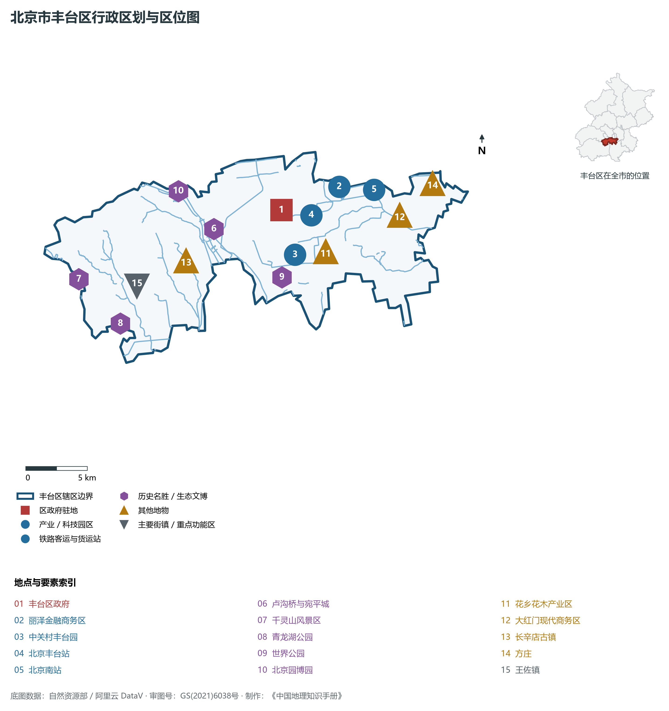
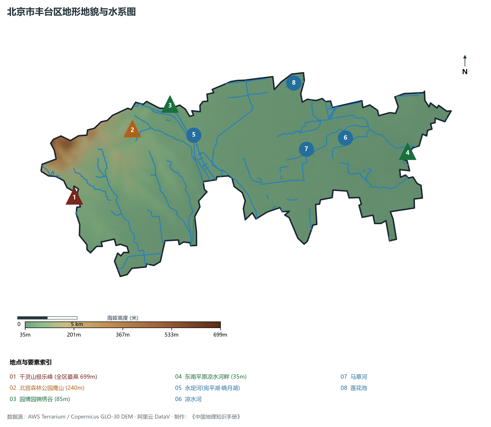
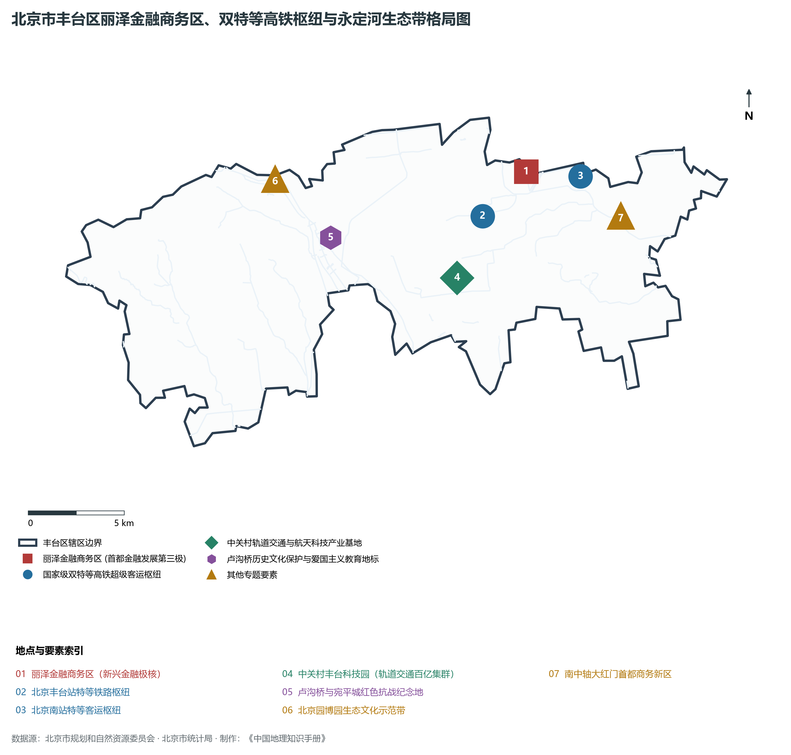
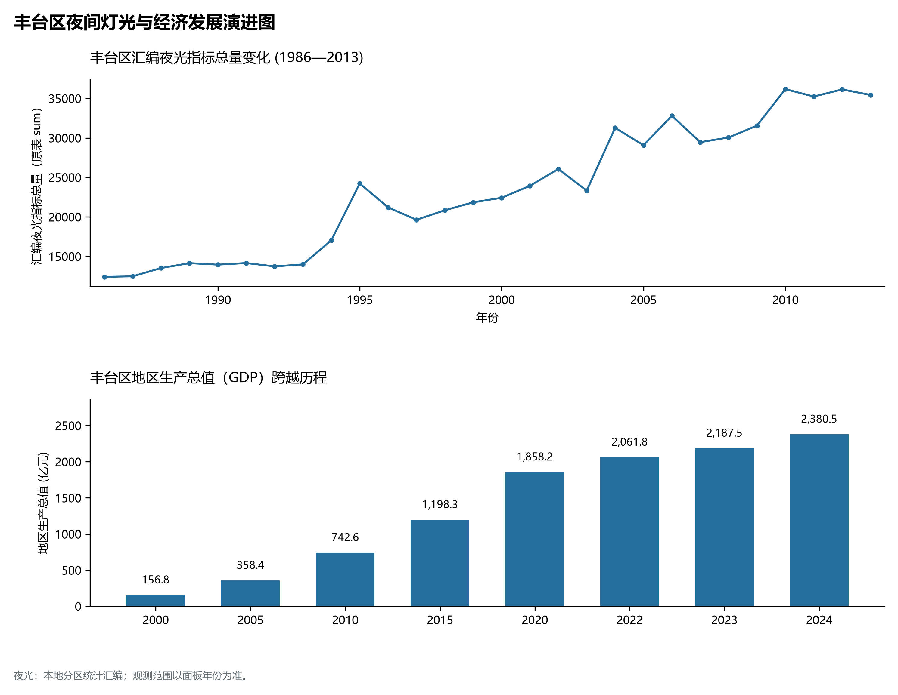
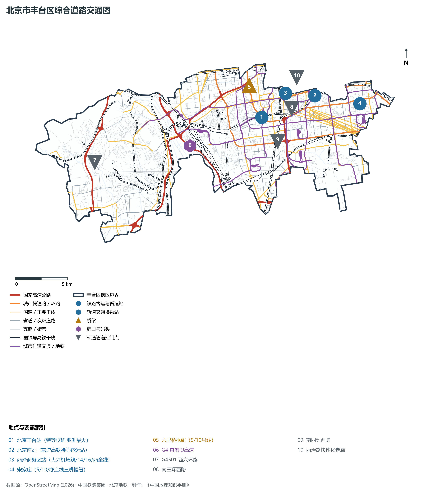

# 1.4 丰台区

丰台区位于北京市中心城区西南部，东临朝阳区、大兴区，北与东城区、西城区、海淀区、石景山区相接，西倚门头沟区，南与房山区隔永定河相望。其地势西北雄峙高山、东南坦展平川，宛如一把展开的巨扇横亘在京南咽喉要冲——西抱西山千灵之峻峰，东连南中轴大红门之繁盛，北托丽泽新兴金融之玉局，中汇双特等高铁超级客站之澎湃。

历史上，丰台是北京城市最早的发祥地之一，莲花池古水系曾是金中都建城的母亲泉源；卢沟桥石狮见证了“七七事变”全民族浴血抗战的壮烈开篇，长辛店二七风暴开创了中国近代工人运动的红色史诗。当代，丰台区迎来了跨越式大发展：亚洲最大铁路客运枢纽北京丰台站与北京南站交相辉映，丽泽金融商务区成为首都金融“第三极”，中关村丰台园构筑起国家级千亿级轨道交通与航天科技高地，实现了从“城南旧洼”到“首都高质量发展新门户”的华丽蝶变。

---

## 一、区情速览

丰台区是北京市中心城区六区中腹地纵深最大、拥有国家级高铁超级枢纽最密集的新兴经济活力大区。

| 指标 | 数值与特征 | 全国/全市坐标 |
|:---|:---|:---|
| **面积** | 305.80 km² | 占北京市总面积约 1.86%；山地占约 28%，平原占约 72% |
| **常住人口** | 201.98 万人（2020 年七普）；201.2 万人（2023 年末） | 全市 16 区中位居第四位，城南人口增长主要承载区 |
| **常住人口城镇化率** | 100%（全域城镇化统计口径） | 居全国区县级最高层级 |
| **人口密度** | 6 605 人/km² | 东部方庄、大红门达 1.5 万人/km²，西部浅山区低于 1 000 人/km² |
| **地区生产总值 (GDP)** | 2 380.5 亿元（2024 年，现价） | 占北京市经济总量约 4.8%，近年年均增速位列中心城区前茅 |
| **人均 GDP** | 约 11.8 万元人民币（折合超 1.6 万美元） | 伴随丽泽商务区与科技园投产进入快速上升通道 |
| **主导产业结构** | 第三产业占比达 86.4% | 金融业、现代科技服务、数字经济、高端轨道交通协同 |
| **行政区划** | 24 个街道、2 个建制镇（王佐镇、长辛店街道），区政府驻丰台街道文体路 | 辖区兼有中心城区极核与永定河两岸广袤生态新空间 |
| **战略功能定位** | 首都高品质生活服务供给的重要保障区、新兴金融与现代科技商务高地、南中轴首都商务新区 | 打造首都南部高质量发展核心引擎与枢纽门户 |

**图 01-04-1 北京市丰台区行政区划与区位图**：图上编号与地点、要素索引对应。

---

## 二、自然地理：西山障峙与永定奔流

丰台区的地形地貌呈现出鲜明的**“西北倚群峰、东南展平川、永定贯中央”**的空间二元特征。

### 1. 地形地貌：阶梯骤降与冲积平原
全区地势西北高、东南低，地表落差显著：

- **西北部深山区**：属于太行山余脉西山支脉，山势挺拔险峻。全区最高峰为位于王佐镇境内的**千灵山主峰（极乐峰）**，海拔达 **699 m**，不仅是丰台最高点，亦为北京近郊极具喀斯特溶洞地貌与道教佛教文化的奇峰名山；
- **浅山丘陵区**：北宫森林公园鹰山（海拔 240 m），山峦起伏，森林茂密；北京园博园锦绣谷（海拔 85 m），为原建筑垃圾填埋坑生态修复后建成的下沉式花园奇观；
- **中东部冲积平原**：永定河自西北出三家店冲刷形成的广袤古扇裙，海拔由出山口卢沟桥一带的 **60 m** 平缓降至东南端凉水河畔的 **35 m** 左右，土层深厚，自古为北方花木之乡（花乡）。

### 2. 气候特征：太行迎风坡与夏季温湿季风
属于暖温带半湿润大陆性季风气候。全区年平均气温在 **13.1—13.5 ℃** 之间，年平均降水量约 **590—630 mm**。

- **地形雨与排洪走廊**：西北山地对夏季暖湿气流具有抬升阻滞作用，汛期极易爆发局部强对流暴雨；而永定河与凉水河构成了丰台贯通南北的天然防洪与生态泄水通道。

### 3. 河流水系：母亲河干流与都城古水脉

- **永定河（贯通全境）**：北京的“母亲河”，自北向南横穿丰台区西部，将丰台划分为“河东”与“河西”两大片区。境内河段长达 16.5 km，沿岸分布有宛平湖、晓月湖、园博湖等大型水面生态工程，形成了水质清冽、百鸟翱翔的百里绿色滨水廊道；
- **莲花池**：位于丰台区西北角，湖面面积 15 万 m²。历史上曾是“蓟城”与“金中都”建城取水的最核心水源池（古称西湖），素有“先有莲花池，后有北京城”之赞誉；
- **凉水河与马草河**：凉水河发源于石景山，斜穿丰台城区东流出境，是城南重要的生态排水河道；马草河蜿蜒穿行于丰台科技园与南部城区，两岸建有带状亲水休闲公园。

**图 01-04-2 北京市丰台区地形地貌与水系图**：图上编号与地点、要素索引对应。

---

## 三、建置沿革与文化根脉

丰台大地汇聚了古都建城泉源、全民族抗战记忆、早期工人运动与皇家花卉园艺四大文化地层。

### 1. 地名考略与行政演进

- “丰台”之名见于金代《中都国子监题名记》，相传金代在此筑“拜郊台”，元明时期台旁渐聚村落，并以农耕花卉丰茂得名“丰台”；
- 辽金时期，丰台大部分为金中都郊畿重地；明代设花乡花局，专供宫廷用花；
- 1952 年设立北京市丰台区，辖区历经多次行政区划兼并与撤村建居，确立了今日 305.80 km² 的现代中心城区版图。

### 2. 卢沟桥与宛平城：民族精神丰碑

- **卢沟桥（全国首批重点文物保护单位）**：始建于金大定二十九年（1189年），为十一孔联拱石桥，全长 266.5 m，柱头雕刻着神态各异的精美石狮 501 尊，马可·波罗曾赞叹其为“世界上绝无仅有的美丽石桥”；
- **宛平城与全民族抗战策源地**：建于明崇祯年间，是明清拱卫京师的坚固军堡。1937 年 7 月 7 日，日军在卢沟桥制造“七七事变”，中国守军第29军在此打响了全民族抗战的第一枪。城内坐落着中国人民抗日战争纪念馆，是铭记历史、缅怀先烈的国家级爱国主义教育最高圣殿。

### 3. 长辛店百年古镇与早期红色工运

- 长辛店自古为九省御道咽喉驿站；清末设立卢保铁路机车修理厂；
- 1923 年爆发震撼中外的“京汉铁路二七大罢工”，长辛店成为中国工人运动的重要摇篮，留存有留法勤工俭学预备班旧址、二七惨案烈士墓等珍贵红色遗产。

**图 01-04-4 北京市丰台区丽泽金融商务区、双特等高铁枢纽与永定河生态带格局图**：图上编号与地点、要素索引对应。

---

## 四、经济地理：新兴金融高地与轨道航天产业集群

丰台区正以前所未有的速度跨越升级，从传统的物流商贸重镇蝶变为高精尖产业密集的新质生产力前沿阵地。

### 1. 丽泽金融商务区：首都金融“第三极”

- 规划面积 8.09 km²，定位为“紧凑型、活力型、生态型”现代金融商务区；
- 聚焦数字金融、绿色金融、专业服务与国际商务，已吸引国家数字货币研究所、银河证券、中国通用技术集团、华为中国总部等大型央企与金融机构入驻；
- 丽泽 SOHO 大厦拥有世界最高的中庭（194 m），与大兴国际机场丽泽城市航站楼（直通机场草桥线与多条轨道交通）构筑起国际化商务新地标。

### 2. 中关村丰台园：国家级轨道交通与航天基地

- **轨道交通千亿级集群**：中国通号、中国中铁、交控科技等骨干领军企业扎根于此，形成了全国最大的轨道交通控制系统与智能制造创新生态链；
- **航天科技摇篮**：毗邻中国运载火箭技术研究院（航天一院），汇聚大批航天航空、新材料、精密仪器高精尖企业，被誉为中国神舟飞船与长征火箭的“智力高地”。

### 3. 经济总量跨越与空间重塑

- 2000 年丰台区 GDP 仅为 **156.8 亿元**；
- 2010 年增至 **742.6 亿元**；
- 2024 年全区 GDP 跃升至 **2 380.5 亿元**。原大红门服装批发市场群全面疏解腾退，成功转型为南中轴国家级文化艺术与国际商务新区。

### 4. 空间夜间灯光演化（1986—2013）

本节夜光图的观测年份为 1986—2013 年，指标为行政区汇总值（原表 sum）。

- 2008 年北京南站启用与奥运举办跃升至 18 000；

**图 01-04-5 丰台区夜间灯光与经济发展演进图**：各面板按标注的观测年份、指标和单位列示。

---

## 五、交通网络与现代枢纽

丰台区拥有无与伦比的高铁枢纽资源，是全中国陆路铁路客运最强大的超级集散中枢之一。

**图 01-04-3 北京市丰台区综合道路交通图**：图上编号与地点、要素索引对应。

### 1. 国家铁路“双特等超级高铁枢纽”

- **北京丰台站（亚洲最大铁路客运枢纽）**：始建于 1895 年，曾是北京第一座火车站；2022 年 6 月改建投产，建筑总面积达 40 万 m²。首创了“顶层跑高铁、地面跑普速、地下换地铁”的双层重叠车场结构，拥有 17 台 32 线，担当京广高铁、京沪既有线、京九线等骨干列车始发终到，日吞吐能力达数十万人次；
- **北京南站（“京沪第一门”）**：坐落于丰台与西城交界处，中国首座高标准现代高铁特等客运站，担当京沪高铁与京津城际超级客运走廊的始发终到任务，年旅客发送量数千万人次。

### 2. 骨干快速路网与高速大通道

- **进出西南大动脉：G4 京港澳高速**：横贯丰台腹地，经宛平城直通河北、华中与华南；
- **城市多重快速环路**：南三环西路、南四环西路、南五环西路与西六环路横穿全境；
- **丽泽路快速化走廊**：直通金融街与二环，实现与大兴机场高速无缝接驳。

### 3. 高密度轨道交通线网

- **丽泽商务区站（五线交汇超级枢纽）**：规划接入 **14 号线、16 号线、大兴机场线、丽金线及 11 号线**，实现地下值机、20分钟直达大兴国际机场；
- **骨干地铁线路**：**10 号线**（串联宋家庄、六里桥）、**14 号线**（贯穿丽泽、大红门直通望京）、**9 号线**（直达北京西站与丰台科技园）、**19 号线**（直通新发地与草桥）。

---

## 六、丰台区地理要素矩阵与区域之最

### 1. 核心地理与经济指标速查表

| 要素类别 | 指标名称 | 数值/名称 | 备注 |
|:---|:---|:---|:---|
| **地势极值** | 最高点海拔 | **699.0 m** | 西部千灵山主峰（极乐峰） |
| | 最低点海拔 | **35.0 m** | 东南平原凉水河出境处 |
| **水文要素** | 母亲河水系 | **永定河（丰台段）** | 境内全长 16.5 km，纵贯南北 |
| | 最大历史生态名湖 | **莲花池** | 占地 44.6 万 m²，北京城建水资源源头 |
| | 大型平原生态水面 | **宛平湖与晓月湖** | 形成连绵数公里的永定河滨水景观 |
| **生态指标** | 森林覆盖率 | **28.7%** | 拥有北宫国家森林公园、千灵山景区 |
| | 绿化覆盖率 | **48.2%** | 北京园博园占地 267 公顷，为生态修复经典 |
| **经济指标** | 2024 年 GDP | **2 380.5 亿元** | 增速位列城六区前列，新兴金融与科技强劲 |
| | 轨道交通产业规模 | **超 2 000 亿元** | 占全国该领域科技研发与控制系统半壁江山 |
| **枢纽指标** | 高铁特等客运站 | **2 座**（北京丰台站、北京南站） | 拥有亚洲规模最大的铁路客运站 |

### 2. 丰台区之最（Superlatives）

- **枢纽之最**：全国唯一同时坐拥两座超大型国家高铁特等枢纽站的市辖区（亚洲最大北京丰台站与京沪第一门北京南站）；
- **历史之最**：全民族抗战爆发地标志——卢沟桥与宛平城；
- **水源之最**：北京城建三千年最早的地表水源摇篮——莲花池；
- **产业之最**：中国轨道交通控制系统与技术自主创新密度最高的基地（中关村丰台园）。

---

## 参考与数据来源

1. 中华人民共和国自然资源部：《第三次全国国土调查主要数据公报（北京市丰台区）》
2. 北京市统计局、丰台区统计局：《北京市第七次全国人口普查公报》、《2024年丰台区国民经济和社会发展统计公报》
3. 北京市规划和自然资源委员会：《丰台分区规划（国土空间规划）（2017年—2035年）》
4. 国家统计局：《中国城市统计年鉴（2024—2025年）》
5. 阿里云 DataV.GeoAtlas 2021.5 行政区划边界矢量（审图号：GS(2021)6038号）
6. OpenStreetMap (OSM) 2026 年最新全要素道路与交通线网矢量
7. AWS Terrain Tiles / Copernicus GLO-30 数字高程模型（DEM）
