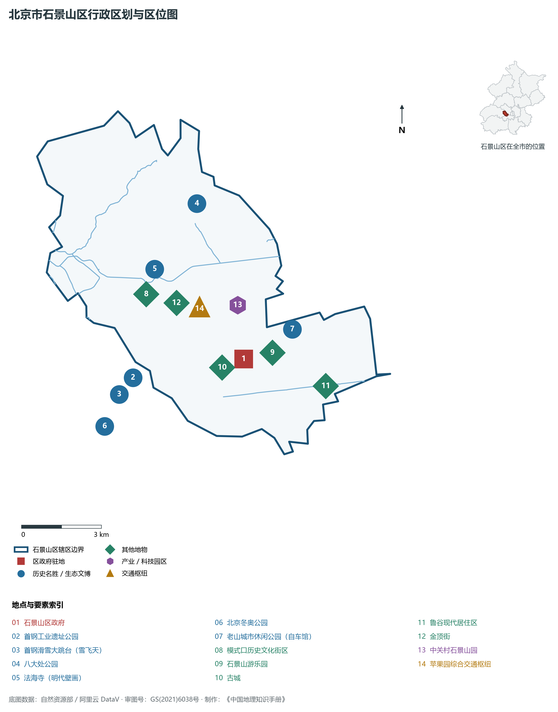
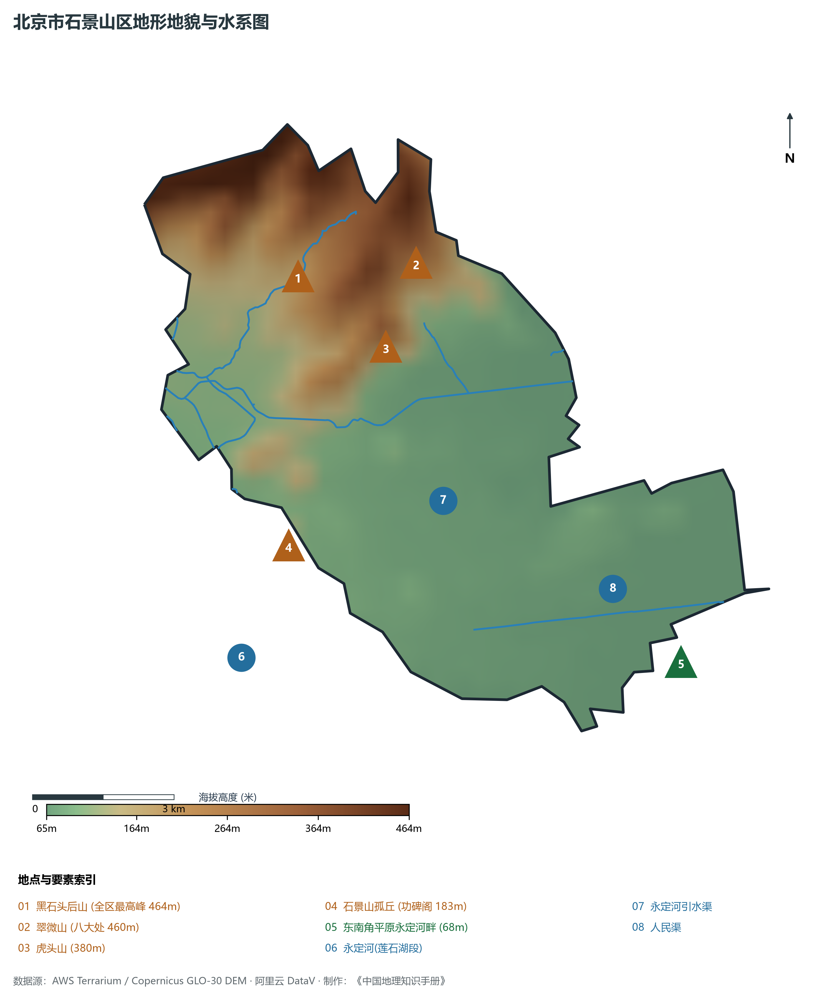
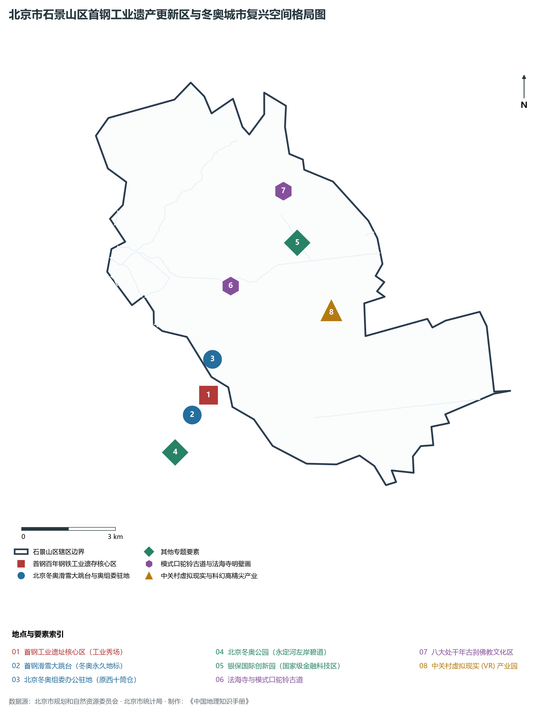
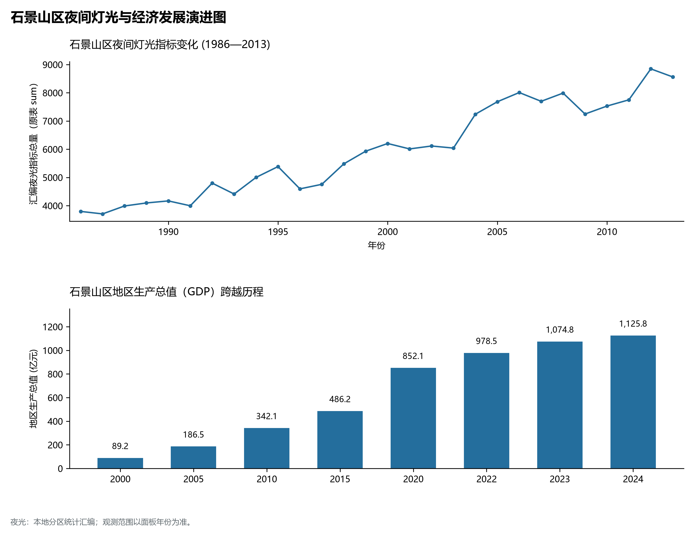
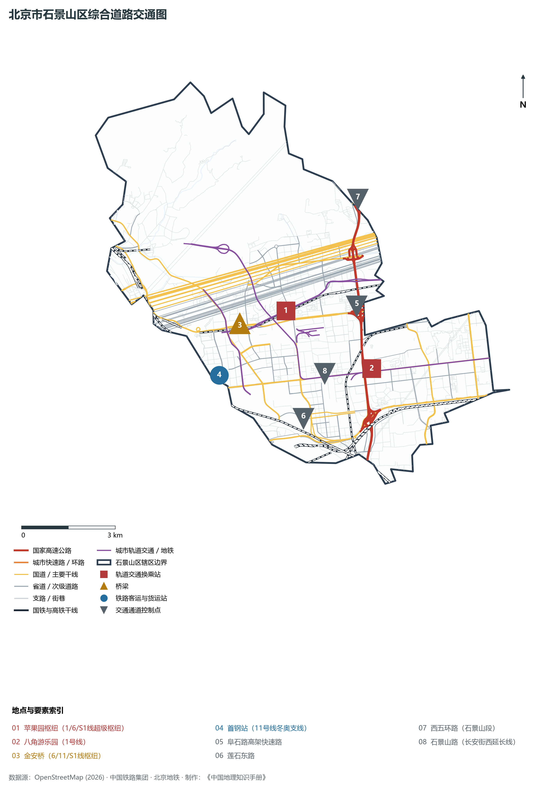

# 1.5 石景山区

石景山区位于北京市中心城区西部，东与海淀区、丰台区接壤，西隔永定河与门头沟区相望，北倚西山翠微山峰与海淀区连界。其行政区域东西窄、南北长，地理形态宛如一只蓄势待发的展翅雄鹰，依山抱水，枕于西山群峰向华北平原跌落的第一级斜坡之上——北靠翠微叠嶂之秀色，南临莲石湖畔之柔波，东接长安街西延线之通衢，西拥永定河百里山峡之出山口。

历史上，石景山因燕山余脉石景山孤丘而得名，模式口驼铃古道曾是京西煤炭与驼队往来中原的交通咽喉，法海寺明代宫廷壁画名冠华夏。近现代，这里孕育了中国近代钢铁工业的骄傲——百年首钢。当代，石景山区经历了一场波澜壮阔的“工业蝶变”：随着 2008 年奥运首钢全面压产搬迁与 2022 年北京冬奥会组委会入驻、首钢滑雪大跳台“雪飞天”横空出世，昔日的钢铁锈带完美蜕变为全球瞩目的城市复兴新地标与“冰雪+科幻”高精尖前沿阵地。石景山以“一半山水一半城”的绝美生态画卷，实现了由传统重工业重镇向新时代绿色创新之区的华丽转身。

---

## 一、区情速览

石景山区是北京市中心城区六区中陆域面积最小、山林水体比重最高、工业遗产绿色复兴最成功的现代化卓越城区。

| 指标 | 数值与特征 | 全国/全市坐标 |
|:---|:---|:---|
| **面积** | 84.38 km² | 占北京市总面积约 0.51%；山地占约 23%，平原占约 77% |
| **常住人口** | 56.78 万人（2020 年七普）；56.4 万人（2023 年末） | 人口总量适中，人居环境优雅宜人 |
| **常住人口城镇化率** | 100%（全域城镇化统计口径） | 居全国区县级最高层级 |
| **人口密度** | 6 729 人/km² | 东部鲁谷、古城街道人口密集，西北浅山区人口密度低 |
| **地区生产总值 (GDP)** | 1 125.8 亿元（2024 年，现价） | 历史性站稳千亿元新台阶，人均产出持续跃升 |
| **人均 GDP** | 约 19.8 万元人民币（折合近 2.8 万美元） | 达发达经济体中等偏上水准 |
| **主导产业结构** | 第三产业占比达 88.5% | 工业互联网、虚拟现实(VR)、数字科幻、现代金融协同 |
| **行政区划** | 9 个街道，区政府驻八角街道石景山路 | 包含金顶街、古城、苹果园、八角、鲁谷、五里坨等 |
| **战略功能定位** | 国家级产业转型升级示范区、绿色生态发展典范区、传统重工业区城市更新样板 | 全面打造新时代首都城市复兴新地标 |

**图 01-05-1 北京市石景山区行政区划与区位图**：图上编号与地点、要素索引对应。

---

## 二、自然地理：西山翠微与永定清流

石景山区地势西北高、东南低，地处西山山前断褶带向冲积平原过渡带，自然生态本底极其丰厚，素有“一半山水一半城”之美称。

### 1. 地形地貌：浅山秀峦与冲积平川
全区高程起伏明显，自海拔 464 m 的后山陡降至 65 m 的平原：

- **西北部低山丘陵**：属于西山余脉，山势青翠连绵：
  - **黑石头后山**：石景山区最高峰，海拔 **464 m**，林木茂密，是全区西北部的天然绿色屏障；
  - **翠微山与平坡山**：海拔约 **460 m**，为八大处千年名刹群的靠山；
  - **虎头山**：海拔 380 m，为西山著名登高瞰京胜地；
  - **石景山（孤丘）**：海拔 **183 m**，耸立于永定河东岸，山顶建有功碑阁与碧霞元君庙，是“石景山”得名源头与俯瞰首钢全景的制高绝壁；
- **东南部冲积平原**：地面标高约 **65—80 m**，为永定河泛滥冲积而成，地势平缓开阔，土层深厚，承载了古城、鲁谷、八角等现代密集城市聚落。

### 2. 气候特征：西山背风缓坡与季风温带气候
属于暖温带半湿润大陆性季风气候。全区年平均气温在 **12.8—13.2 ℃** 之间，年平均降水量约 **600 mm**。

- **背山面水微气候**：西北部西山群峰阻挡了冬季蒙古高原直袭的寒风，永定河谷水汽顺河槽涌入，使石景山山前台地夏季较干燥城区更为湿润凉爽，极利于植被生长。

### 3. 河流水系：母亲河畔与人工水渠

- **永定河（石景山段）**：流经石景山西界，全长约 13.8 km。经全流域生态综合治理与常态化补水，形成莲石湖、永定河休闲森林公园碧道等大面积生态水体，实现全线常年碧波荡漾；
- **永定河引水渠**：始建于 1950 年代，引永定河三家店之水，穿石景山向东流经模式口、苹果园，入海淀注入玉渊潭，是城市防汛供水的重要骨干人工河道；
- **人民渠**：横穿南部城区，承担排涝与生态补水功能。

**图 01-05-2 北京市石景山区地形地貌与水系图**：图上编号与地点、要素索引对应。

---

## 三、建置沿革与文化根脉

石景山区融汇了千年驼铃商道、明代壁画绝唱、北方古刹文化与百年工业现代文明。

### 1. 地名考略与行政演进

- “石景山”原指永定河畔的一座石质孤丘，古称“湿经山”（相传唐玄奘西天取经归来曾在此晾晒经书），后谐音转写为“石景山”；
- 辽金元明时期，境域多属宛平县管辖，模式口村是通往京西煤矿与口外的重要要道；
- 1952 年设立北京市石景山区；
- 伴随首钢建设，1967 年重设石景山区，形成了现代 84.38 km² 的辖区格局。

### 2. 模式口驼铃古道与法海寺明壁画

- **模式口历史文化街区**：古称“磨石口”，因盛产磨石得名。是京西古道出入京城的必经隘口，老舍名著《骆驼祥子》中祥子买骆驼走出之地，街区保留了完好的明清与民国商铺民宅建筑；
- **法海寺（全国重点文物保护单位）**：始建于明正统四年（1439年），大雄宝殿内完好保存着 10 幅由明代宫廷画士敬绘的珍贵壁画（达 236.7 m²）。其所绘“水月观音”轻纱透体、沥粉堆金，神态安详超逸，被艺术史界公认为中国古代壁画艺术的至高巅峰，与敦煌莫高窟、芮城永乐宫齐名；
- **八大处公园**：坐落于翠微山南麓，依山分布着长安寺、灵光寺、三山庵、大悲寺、龙泉庵、香界寺、宝珠洞、香佛寺八座千年古刹，其中灵光寺内供奉有珍贵的佛牙舍利。

### 3. 百年首钢与现代冬奥传奇

- 始建于 1919 年的龙烟铁矿股份公司，历经百年奋斗成为享誉世界的中国特大型钢铁联合企业“首钢”；
- 为保障 2008 年北京奥运会环境质量，首钢毅然实施史无前例的涉钢产业大搬迁；
- 2016 年北京冬奥组委入驻首钢西十筒仓；
- **首钢滑雪大跳台（“雪飞天”）**：依托首钢冷却塔与钢铁工业遗存建造，是全球首个永久保留的滑雪大跳台。中国运动员苏翊鸣、谷爱凌在此夺冠，让工业遗产与现代冰雪完美共生，国际奥委会主席巴赫由衷盛赞其为“城市更新与奥运遗产的奇迹”。

**图 01-05-4 北京市石景山区首钢工业遗产更新区与冬奥城市复兴空间格局图**：图上编号与地点、要素索引对应。

---

## 四、经济地理：工业锈带蝶变与科幻产业策源地

石景山区彻底摆脱了对重工业高耗能的路径依赖，成功走出了一条以数字科幻、现代金融、工业互联网为特色的高端产业跃升之路。

### 1. 首钢园城市更新与“工业秀场”

- 首钢园区占地 8.63 km²，是北京目前规模最大、风貌最独特的工业遗存活化片区；
- **三高炉秀场**：昔日吞吐铁水的巨大高炉，蜕变为举办中国国际服务贸易交易会（服贸会）、奔驰新品发布会等全球高端盛会的时尚殿堂；
- **中关村科幻产业创新中心**：集聚科幻影视、动作捕捉、XR虚拟制作、元宇宙等核心企业百余家，成为中国科幻产业大会的永久承办地与国家级科幻产业策源地。

### 2. 经济总量跨越与结构重构

- 2000 年石景山区 GDP 为 **89.2 亿元**；
- 2010 年增至 **342.1 亿元**；
- 2024 年全区 GDP 历史性跨过千亿门槛，达到 **1 125.8 亿元**。第三产业比重从搬迁前的不足 30% 逆势飙升至接近 90%，实现了经济动能的彻底换道超车。

### 3. 高精尖产业多点布局

- **银保国际创新园**：坐落于八大处山麓，聚焦国家级现代金融安全、银行保险科技与财富管理；
- **中关村石景山园**：以工业互联网、智慧城市、虚拟现实为核心，集聚了大批国家级专精特新“小巨人”企业；
- **首钢六工汇与金安科幻商圈**：成为京西最具活力的国际消费新潮流集聚地。

### 4. 空间夜间灯光演化（1986—2013）

本节夜光图的观测年份为 1986—2013 年，指标为行政区汇总值（原表 sum）。

**图 01-05-5 石景山区夜间灯光与经济发展演进图**：各面板按标注的观测年份、指标和单位列示。

---

## 五、交通网络与现代枢纽

石景山区处于长安街西轴线的西端终点，依托快速路高架、磁悬浮与多线轨道换乘，构建起通达全城的骨干路网。

**图 01-05-3 北京市石景山区综合道路交通图**：图上编号与地点、要素索引对应。

### 1. 骨干快速路与长安街西延长线

- **石景山路（长安街西延长线）**：自复兴门一路向西延伸，跨越**新首钢大桥**（全球首座双梯形斜拉索空间拱桥，全长 1 354 m），直达门头沟，构筑起贯穿京西的金色神州第一街轴线；
- **阜石路高架快速路**：全线无红绿灯高架桥，连接西四环定慧桥与门头沟，是冬奥会期间连接市区与首钢滑雪大跳台的快速直达专用道；
- **莲石东路快速路**：平行贯通南部，直连西二环天宁寺桥与莲花池西路；
- **西五环路（石景山段）**：纵贯全区南北，连接海淀与丰台。

### 2. 多线交汇的超级轨道交通枢纽

- **苹果园综合交通枢纽**：集 **地铁 1 号线、6 号线、S1 线**（中低速磁悬浮）与数十条常规公交、P+R停车场于一体，总建筑面积近 30 万 m²，是京西规模最大的地下立体客运中枢；
- **金安桥综合枢纽**：汇聚 **6 号线、11 号线（冬奥支线）、S1 线** 三线换乘，直接服务于首钢园北区与科幻产业聚集区；
- **地铁 11 号线（冬奥支线）**：全国首条智慧轨道交通示范线，直通首钢滑雪大跳台脚下；
- **地铁 1 号线（八角游乐园、古城）**：中国第一条地铁线，半个世纪以来持续服务京西居民与产业骨干通勤。

---

## 六、石景山区地理要素矩阵与区域之最

### 1. 核心地理与经济指标速查表

| 要素类别 | 指标名称 | 数值/名称 | 备注 |
|:---|:---|:---|:---|
| **地势极值** | 最高点海拔 | **464.0 m** | 西北部黑石头后山 |
| | 著名人文孤丘 | **183.0 m** | 石景山（山顶功碑阁） |
| | 最低点海拔 | **65.0 m** | 东南平原永定河畔出境处 |
| **水文要素** | 母亲河水系 | **永定河（石景山段）** | 境内全长 13.8 km，莲石湖形成万亩水面 |
| | 最重要供水运渠 | **永定河引水渠** | 连通三家店与玉渊潭 |
| **生态指标** | 森林覆盖率 | **31.4%** | 西部低山森林茂密，环境优美 |
| | 城市绿化覆盖率 | **53.8%** | 居中心城区前茅，人均公园绿地面积超 24 m² |
| **经济指标** | 2024 年 GDP | **1 125.8 亿元** | 突破千亿元，新一代信息与现代金融支柱稳固 |
| | 科幻与元宇宙产业集群 | **百亿元产值** | 国家级科幻产业创新高地 |
| **文化遗产** | 全国重点文物保护单位 | **法海寺、八大处灵光寺等** | 法海寺明代壁画被誉为中国壁画艺术巅峰 |
| | 冬奥地标 | **首钢滑雪大跳台** | 全球首个永久保留的滑雪大跳台场馆 |

### 2. 石景山区之最（Superlatives）

- **复兴之最**：全球工业遗产绿色更新与冬奥遗产活化再利用的最高标杆（首钢工业遗址公园）；
- **艺术之最**：拥有中国明代宫廷壁画保存最为完整、绘制水平最高的艺术孤品（法海寺壁画）；
- **地标之最**：建有全球首座双梯形斜拉桥新首钢大桥与首座永久性滑雪大跳台“雪飞天”；
- **生态之最**：中心城区中人均公共绿地面积最大、山林与水系空间最协调的宜居示范城区（“一半山水一半城”）。

---

## 参考与数据来源

1. 中华人民共和国自然资源部：《第三次全国国土调查主要数据公报（北京市石景山区）》
2. 北京市统计局、石景山区统计局：《北京市第七次全国人口普查公报》、《2024年石景山区国民经济和社会发展统计公报》
3. 北京市规划和自然资源委员会：《石景山分区规划（国土空间规划）（2017年—2035年）》
4. 国家统计局：《中国城市统计年鉴（2024—2025年）》
5. 阿里云 DataV.GeoAtlas 2021.5 行政区划边界矢量（审图号：GS(2021)6038号）
6. OpenStreetMap (OSM) 2026 年最新全要素道路与交通线网矢量
7. AWS Terrain Tiles / Copernicus GLO-30 数字高程模型（DEM）
