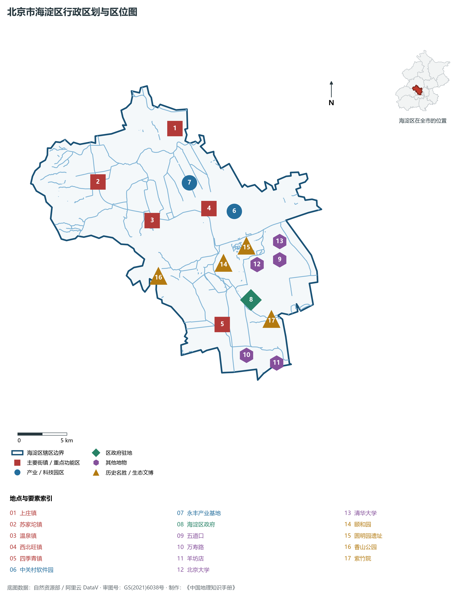
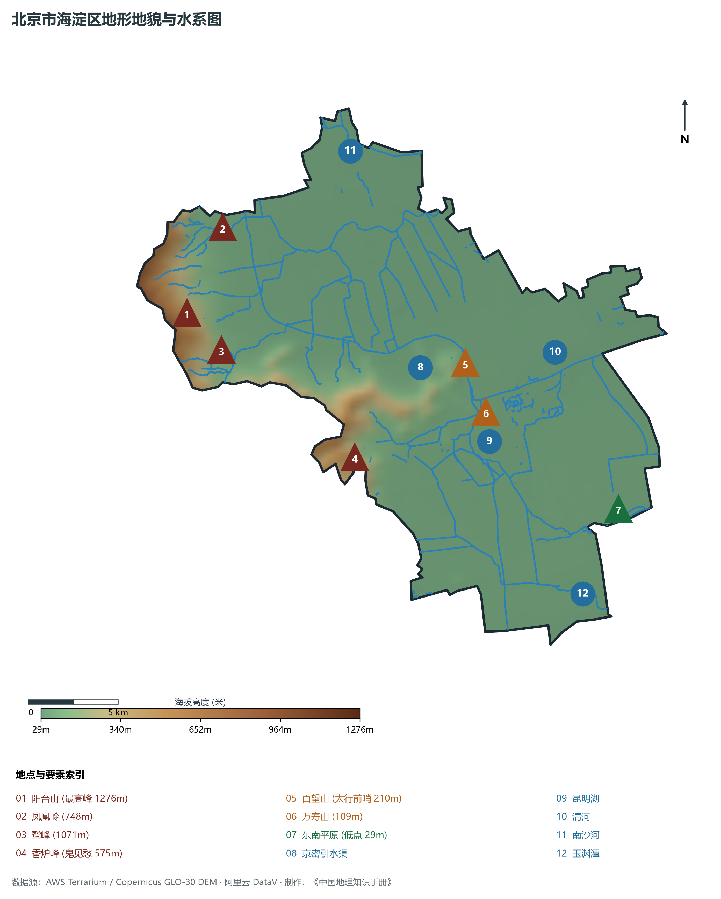
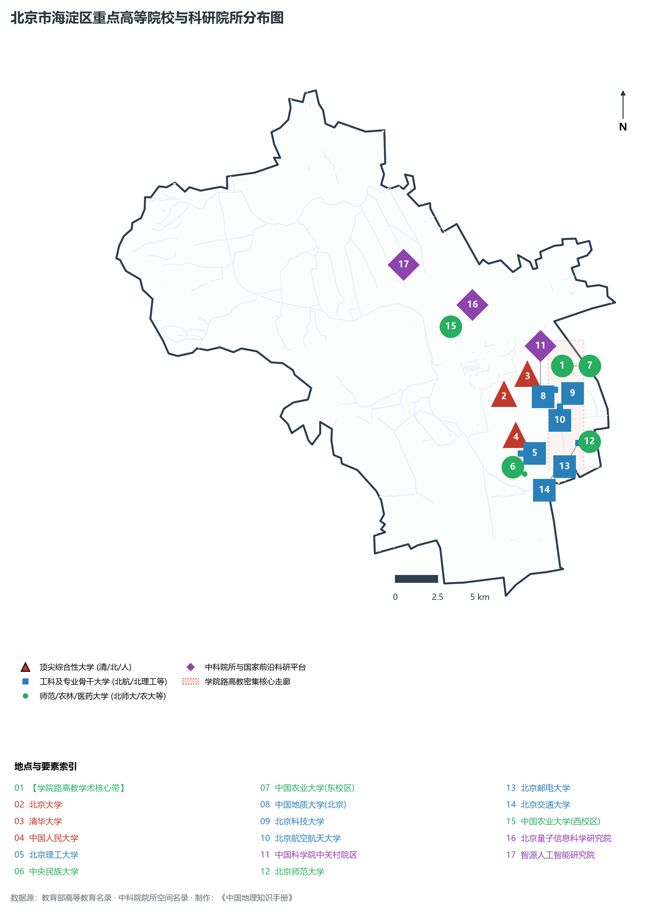
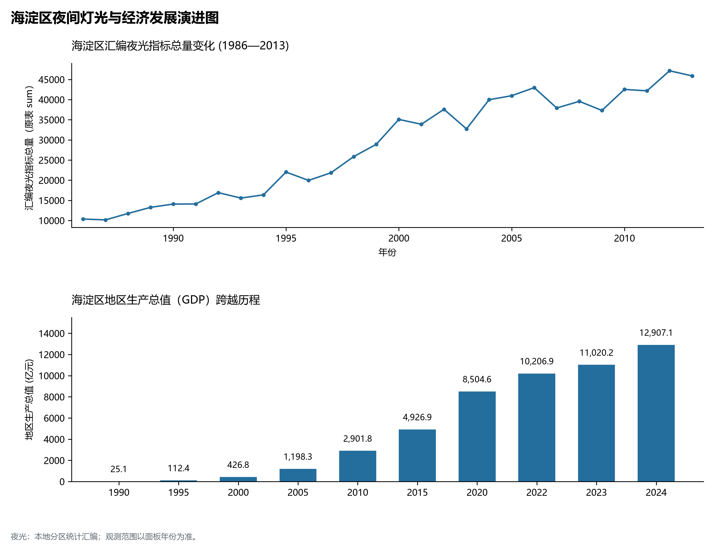
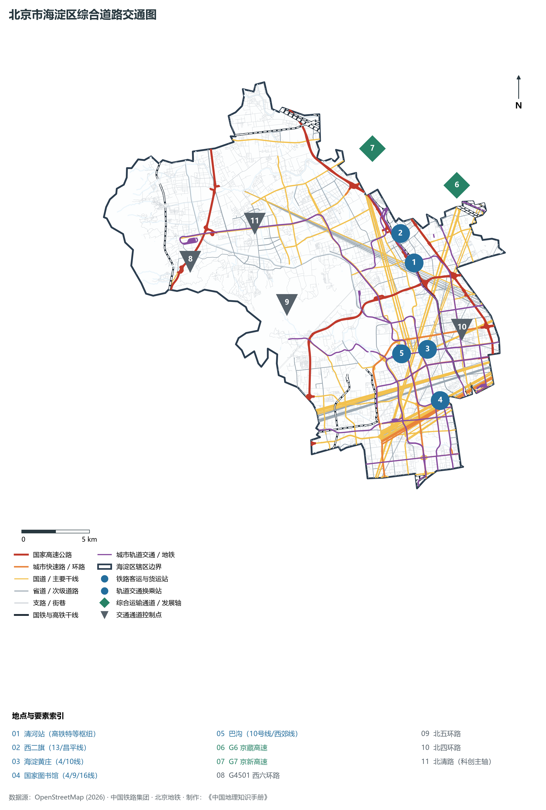

# 1.6 海淀区

海淀区位于北京市城区西北部，东与朝阳区相连，南与西城区、丰台区接壤，西与门头沟区、石景山区为邻，北与昌平区界水相分。其地理轮廓西北宽缓、东南延展，恰好坐在西山山麓向北京平原过渡的第一道倾斜缓坡上——西倚太行余脉之群峰，东汇华北平原之通衢。

历史上，海淀因“水淀平川、湖沼如海”而得名，曾是辽金元明清历代皇家离宫与园林行宫的核心承载地，以“三山五园”构筑起中国古典古典山水宫苑的至高巅峰。当代，海淀则是共和国科技自立自强的策源中枢：从 20 世纪 80 年代中关村“电子一条街”敢为人先的破冰突围，到今天集聚数十所顶尖高校、数百个国家级实验室、数万家科技创新企业的“万亿级科创第一区”，海淀将山水形胜、深厚学脉与数字智能紧密熔铸为一体，成为中国乃至全球城市科技创新网络中不可替代的战略支点。

## 一、区情速览

海淀区是北京市中心城区六区中面积第二大、人口第一大、经济体量长年高居榜首的经济与科创特大区。

| 指标 | 数值与特征 | 全国/全市坐标 |
|:---|:---|:---|
| **面积** | 430.77 km² | 占北京市总面积约 2.6%；平原占约 57%，山地丘陵占约 43% |
| **常住人口** | 313.34 万人（2020 年七普）；312.4 万人（2023 年末） | 全市 16 区中位居第一，人口总量约相当于蒙古国全国人口 |
| **常住人口城镇化率** | 100%（全域城镇化统计口径） | 居全国区县级最高层级 |
| **人口密度** | 7 274 人/km² | 南部中关村、北下关等街道超 2 万人/km²，西北山地低于 400 人/km² |
| **地区生产总值 (GDP)** | 12 907.1 亿元（2024 年，按现价计算） | 占北京市经济总量超 25.8%，连续数十年稳居全省市第一 |
| **人均 GDP** | 约 41.3 万元人民币（折合近 5.8 万美元） | 达全球高收入发达经济体前沿水准 |
| **主导产业结构** | 第三产业占比超 91.2% | 信息软件、研发服务业增加值占全区半壁江山 |
| **行政区划** | 22 个街道、7 个镇，区政府驻海淀街道长春桥路 | 辖区兼具超高密度都市中心与广袤山林田园 |
| **战略功能定位** | 国际科技创新中心核心区、国家战略科技力量重要承载地、历史文化名城保护关键区 | “一区两翼”北京中心城区核心发展引擎 |

**图 01-06-1 北京市海淀区行政区划与区位图**：图上编号与地点、要素索引对应。

---

## 二、自然地理：西山形胜与平原水网

海淀区的自然地理骨架呈现鲜明的**“西山、东原、北水、中渠”**的二元空间分异。山地向平原的跌落与交汇，塑造了其得天独厚的气候微环境与泉源胜景。

### 1. 地形地貌：阶梯过渡与山前断裂
全区地势自西北向东南倾斜下陷。西北部为太行山余脉西山段，山峰起伏险峻，基岩主要由古生界石灰岩、砂页岩及火山碎屑岩构成，受地质构造断裂切深，山峰陡立：

- **阳台山**：海淀区最高峰，主峰海拔 **1 276 m**，横跨海淀与门头沟区界，森林茂密，是海淀西北部的天然生态安全屏障。
- **凤凰岭与鹫峰**：凤凰岭以花岗岩峡谷断崖地貌著称，海拔 748 m；鹫峰（海拔 1 071 m）峰峦叠嶂，设有中国最早的地震台遗址。
- **香山与香炉峰**：主峰香炉峰（俗称“鬼见愁”），海拔 **575 m**，为西山东麓的著名陡峻峰岭，红叶林海名冠天下。
- **百望山**：海拔 **210 m**，位于颐和园北侧京密引水渠畔，地处西山延伸进入平原的最前沿断突，素有“太行前哨第一峰”之誉。

东部与东南部为永定河古冲积扇与清河冲积平原，地面标高仅 **35—60 m**，地势坦荡，坡降微缓，冲积层深厚肥沃，为自古以来的密集农耕与现代超大城市建成区提供了坚实的地基承载。

### 2. 气候特征：山地暖带与季风润泽
海淀属于暖温带半湿润大陆性季风气候。全区多年平均气温约 12.5 ℃，极端最高气温可达 41 ℃，极端最低气温约 -18 ℃。

- **降水时空分异**：年平均降水量约 **580—650 mm**，7、8 月暴雨集中期占全年降水量的 70% 以上。西北部山地迎风坡受暖湿气流抬升地形雨作用，降水量显著高于东部平原区约 50—80 mm。
- **背山阻寒效应**：巍峨西山群峰犹如一道天然屏障，削弱了冬季西伯利亚强冷空气的正面直袭；春季山风下沉产生微弱的焚风增温，使得海淀山前台地成为北京城郊著名的早春花木产区与宜人小气候区。

### 3. 河流水系：泉湖汇聚与大都水脉
海淀历来以水丰林茂闻名。区域分属海河流域北运河水系：

- **京密引水渠**：全区最重要的生态与供水生命动脉。自昌平流经海淀西北，顺山麓蜿蜒南下，过昆明湖东侧，入玉渊潭，是贯通密云水库至首都中心城区的核心人工开凿运渠，年引水量数亿立方米。
- **昆明湖与颐和园水系**：昆明湖水面达 2.2 km²，是北京西郊最大的天然蓄水洼聚与人工扩大湖泊。它承接玉泉山、万寿山泉流水系与京密引水渠来水，既是世界文化遗产皇家园林的山水母体，亦兼具排洪滞洪与城市生态调节功能。
- **清河与南沙河**：清河全长约 24 km，横贯海淀北部平原，由西向东经圆明园北侧、清河镇、注入温榆河，沿岸建有贯通百里的绿色滨水碧道；南沙河则横卧海淀北部上庄镇外缘，与昌平区形成自然水上界线。
- **万泉河与玉渊潭**：万泉河发源于海淀镇西侧万泉庄古泉群，向北经北大燕园入清河；南部玉渊潭湖面广阔，与中央电视塔、钓鱼台国宾馆水波交相辉映。

**图 01-06-2 北京市海淀区地形地貌与水系图**：图上编号与地点、要素索引对应。

---

## 三、建置沿革与文化根脉

海淀的文脉积淀深邃厚重，融汇了古代农耕庄园、皇家离宫御苑、近代觉醒革命与当代学术科技四大文化地层。

### 1. 地名考略与行政演进
“海淀”之名最早见于金代《元好问集》，因元明时期西山积水汇于平原洼地形成浅湖群落而得“海淀”（浅水淀泽）之称。

- 元代营建大都，郭守敬勘定玉泉山泉水引入积水潭，奠定海淀水系与国都漕运生命线的纽带关系；
- 清代于此广置八旗兵营与庄田，设“海淀镇”；
- 1949 年 10 月设北京市第十八区，1952 年 9 月正式命名为**海淀区**，辖区多次调整合并，确立了今日 430.77 km² 的行政版图。

### 2. “三山五园”皇家园林艺术巅峰
从康熙末年起，清代历代帝王在西山山麓集中营建了人类园林艺术史上的奇迹——“三山五园”：

- **三山**：万寿山、香山、玉泉山；
- **五园**：**颐和园**（清漪园，1998年列入世界文化遗产，保存最为完整的皇家行宫御苑）、**圆明园**（万园之园，兼纳中西建筑与四十景，1860年遭焚毁后成为民族记忆与爱国主义教育圣地）、**静宜园**（香山）、**静明园**（玉泉山）、**畅春园**。
- 这条数十平方公里的皇家园林带，利用天然西山泉流开凿湖泊、堆筑假山、引水成渠，形成借西山天然形胜、融江南水乡灵秀与北方皇家雄阔于一体的东方建筑杰作。

### 3. 红色初心与革命地标
1949 年 3 月 25 日，毛泽东率中共中央机关由西柏坡抵达北平，进驻香山双清别墅与来青轩。在这里，党中央指挥了渡江战役，起草了《论人民民主专政》，为建立新中国奠定了坚实基石，使香山成为中国革命历史“进京赶考”的第一座里程碑。

### 4. 学府圣地与中国智识母港
海淀是中国近现代高等教育与现代科学事业的发祥地：

- 拥有全中国最集中的顶尖高等学府群（37 所），包括**北京大学**（未名湖燕园）、**清华大学**（水木清华近春园）、中国人民大学、北京航空航天大学、北京理工大学、北京师范大学、中国农业大学等“双一流”名校；
- 集聚以中国科学院为骨干的科研机构近百所，拥有两院院士近千名（占全国总数约三分之一），国家级重点实验室与大科学装置密集度居全球城市最前列。

**图 01-06-4 北京市海淀区重点高等院校与科研院所分布图**：图上编号与地点、要素索引对应。

---

## 四、经济地理：中国“硅谷”与万亿科创极核

海淀区不仅是北京经济的“压舱石”，更是代表国家参与全球高科技竞争的战略核心。

### 1. 从“电子一条街”到全球自主创新策源地

- **创业拓荒（1980—1988）**：陈春先、倪光南等科技人员突破体制壁垒，在中关村大街两侧创办民营科技企业，形成风靡全国的“中关村电子一条街”；
- **园区升格（1988—2009）**：1988 年经国务院批复设立“北京市新技术产业开发试验区”；1999 年更名中关村科技园区；
- **国家战略示范（2009 至今）**：2009 年国务院批复建设全国首个国家自主创新示范区。海淀区成为新质生产力的孵化极核，培育出联想、百度、小米、美团、字节跳动、快手等众多世界级科技领军企业。

### 2. 经济总量跨越与“万亿强区”

- 2022 年，海淀区地区生产总值（GDP）首度突破 **10 000 亿元**（达到 10 206.9 亿元），成为中国北方乃至全国首个破万亿元的副省级以下市辖区；
- 2024 年北京市全市地区生产总值为 49,843 亿元（当年价格）。

### 3. 产业格局：“双轮驱动”与前沿赛道
海淀区第三产业占比高达 91.2%，呈现极其高端化、知识化、轻资产化的智力密集特征：

- **新一代信息技术与软件服务**：上地中关村软件园总产值突破数千亿元，地均产出高居全球前列；
- **人工智能核心策源地**：汇聚全国最具影响力的通用大模型团队（智源研究院、智谱AI、月之暗面等），人工智能学者、核心企业与算力基础设施占全国比重超过三成；
- **前沿新兴赛道**：量子信息（北京量子院）、空天信息与商业航天、集成电路EDA与先进芯片设计、合成生物制造等颠覆性前沿集群在永丰、翠湖等科学城北区规模崛起。

### 4. 空间夜间灯光演化（1986—2013）

本节夜光图的观测年份为 1986—2013 年，指标为行政区汇总值（原表 sum）。

- 2000 年中关村大规模开发后跃升至 35 000；

**图 01-06-5 海淀区夜间灯光与经济发展演进图**：各面板按标注的观测年份、指标和单位列示。

---

## 五、交通网络与现代枢纽

海淀依托高速铁路、多环路快速路网与极高密度的城市轨道交通，构筑起辐射京津冀、畅达全球的复合型立体交通体系。

**图 01-06-3 北京市海淀区综合道路交通图**：图上编号与地点、要素索引对应。

### 1. 国家铁路与高铁特等客运站：清河站

- **清河站**：京张高铁出京第一座特等枢纽站，也是连接北京市区与张家口冬奥赛区、内蒙古呼包鄂区域的关键节点。车站总建筑面积达 14.6 万 m²，集京张高铁、市郊铁路怀密线、地铁 13 号线、昌平线等多线于一体，实现了高铁与城市轨道的“零距离”无缝垂直换乘。

### 2. 高速公路与快速骨架路网

- **出京大动脉**：**京藏高速 (G6)**、**京新高速 (G7)** 自南向北并行纵贯海淀中东部平原，是通往塞北、内蒙古及西北陆路通道的战略咽喉。
- **城市环线**：西二环（邻近）、**北三环西路 / 西三环北路**、**北四环西路 / 西四环北路**、**北五环西路 / 西五环北路**横贯全境，构成了连接北京各大商圈的快速流通动脉。
- **横贯科创走廊：北清路**：全长近 30 km 的北清路横跨海淀北部与昌平，连接生命科学园、永丰产业基地、中关村环保科技园，正加快推进快速化高架改造，打造世界级高科技产业活力走廊。

### 3. 超高密度城市轨道交通体系
海淀区轨道交通通车运营里程超过 150 km，线网密度位居全市前三：

- **纵向主骨架**：**地铁 4 号线**（贯穿海淀黄庄、中关村、北大、清华、圆明园，直达北京南站）、**地铁 16 号线**（北起北安河，沿山前纵贯海淀南北，激活大北区通勤）、**昌平线南延**（直插学知园、学院桥、蓟门桥）；
- **横向与环状网络**：**地铁 10 号线**（城市第二大环线，串联巴沟、知春路、海淀黄庄）、**地铁 13 号线**（连接五道口、上地、西二旗）、**地铁 1 号线 / 八通线**与 **6 号线**（贯通南部城乡）；
- **西郊文旅观光线**：自 10 号线巴沟站始发，穿行三山五园绿色廊道直达香山，是极具诗意的现代化有轨电车观光专线。

---

## 六、海淀区地理要素矩阵与区域之最

### 1. 核心地理与经济指标速查表

| 要素类别 | 指标名称 | 数值/名称 | 备注 |
|:---|:---|:---|:---|
| **地势极值** | 最高点海拔 | **1 276 m** | 阳台山主峰（妙峰山群峰东麓） |
| | 最低点海拔 | **约 29 m** | 东南部清河出境交界处 |
| **水文要素** | 最大湖泊水体 | **昆明湖** | 水面面积约 2.2 km²（颐和园内） |
| | 最长引水渠 | **京密引水渠（海淀段）** | 全长约 30 km，横贯南北 |
| | 主干外排河流 | **清河** | 全长 23.8 km，横贯北部平原 |
| **生态指标** | 森林覆盖率 | **35.78%** | 居中心城区第一，拥有西山国家森林公园 |
| | 建成区绿化覆盖率 | **53.8%** | “半山半城、绿意葱茏” |
| **经济指标** | 2024 年 GDP | **12 907.1 亿元** | 全市第一，占全省市总值 25.8% |
| | 万元 GDP 能耗 | **约 0.12 吨标准煤** | 全国能耗强度最低的特大城市辖区之一 |
| **科技创新** | 国家高新技术企业 | **超 10 000 家** | 占北京市总数约 35% |
| | 独角兽企业数量 | **超 50 家** | 占全中国近两成，全球城市区级第一阵营 |
| **高等学府** | “双一流”建设高校 | **17 所** | 占全北京市“双一流”高校过半 |

### 2. 海淀区之最（Superlatives）

- **经济之最**：中国北方地区经济规模最大、也是全国首个突破万亿元大关的县级市/市辖区行政单元（2022 年突破万亿，2024 年达 1.29 万亿元）；
- **科技之最**：中国高等院校、两院院士、国家重点实验室和独角兽企业密度最高的行政区域；
- **文博之最**：中国古典皇家园林最为集中连片的区域，拥有清代“三山五园”完整核心区及世界文化遗产颐和园；
- **地形之最**：北京市中心城区六区中海拔落差最大的区（高差达 1 247 米，从千米高山阳台山直落至三十余米平原）。

---

## 参考与数据来源

1. 自然资源部：《全国第三次国土调查主要数据公报（北京市海淀区）》
2. 北京市统计局、海淀区统计局：《北京市第七次全国人口普查公报》、《2024年海淀区国民经济和社会发展统计公报》
3. 北京市规划和自然资源委员会：《海淀分区规划（国土空间规划）（2017年—2035年）》
4. 国家统计局：《中国城市统计年鉴（2024—2025年）》
5. 阿里云 DataV.GeoAtlas 2021.5 行政区划边界矢量（审图号：GS(2021)6038号）
6. OpenStreetMap (OSM) 2026 年最新全要素道路与交通线网矢量
7. AWS Terrain Tiles / Copernicus GLO-30 数字高程模型（DEM）
