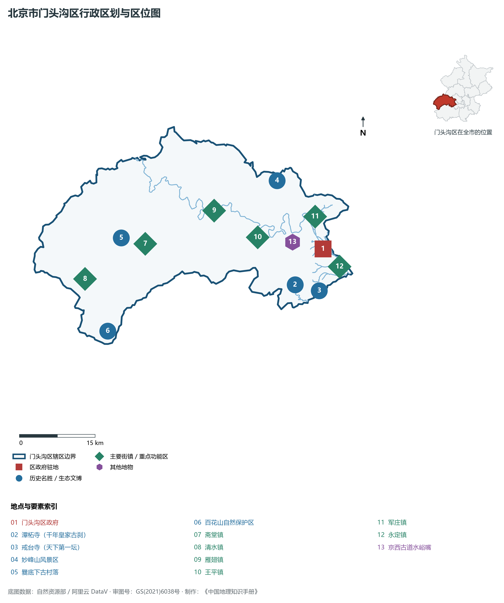
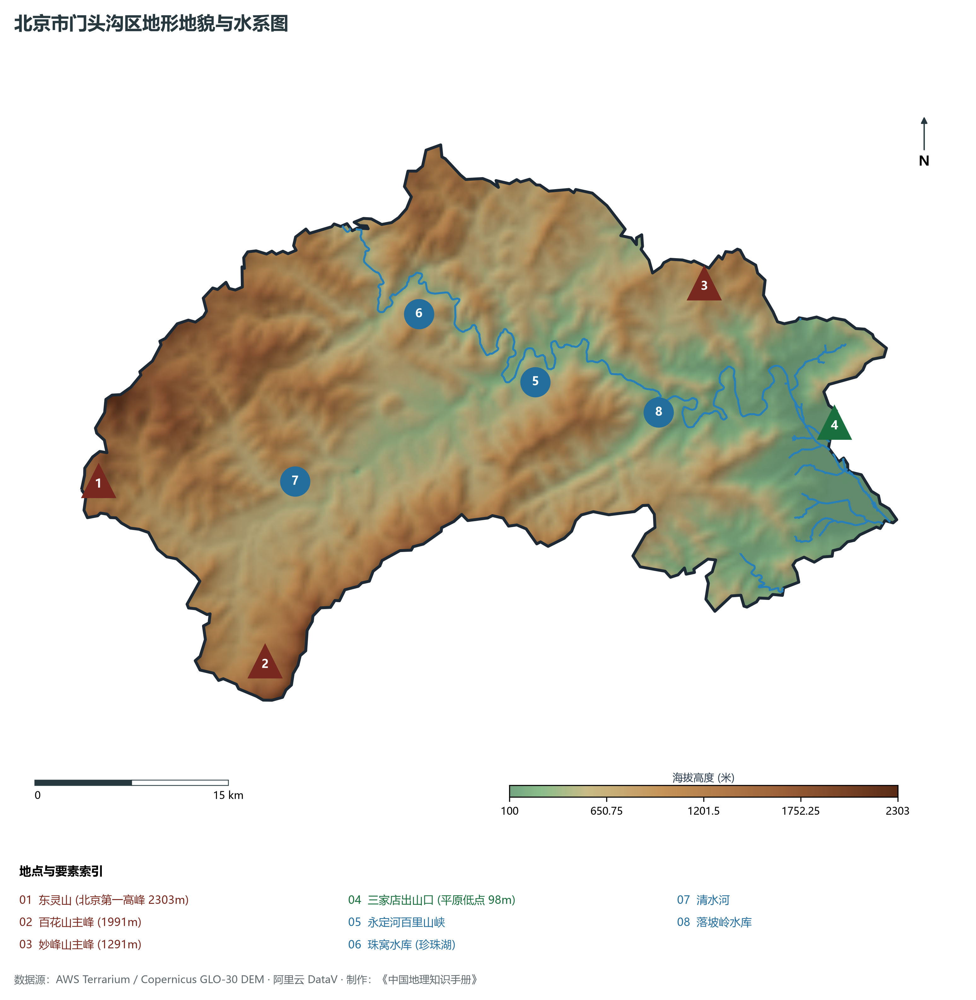
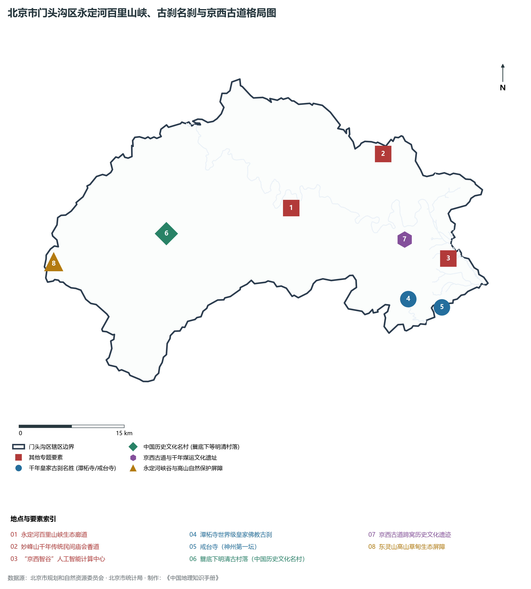
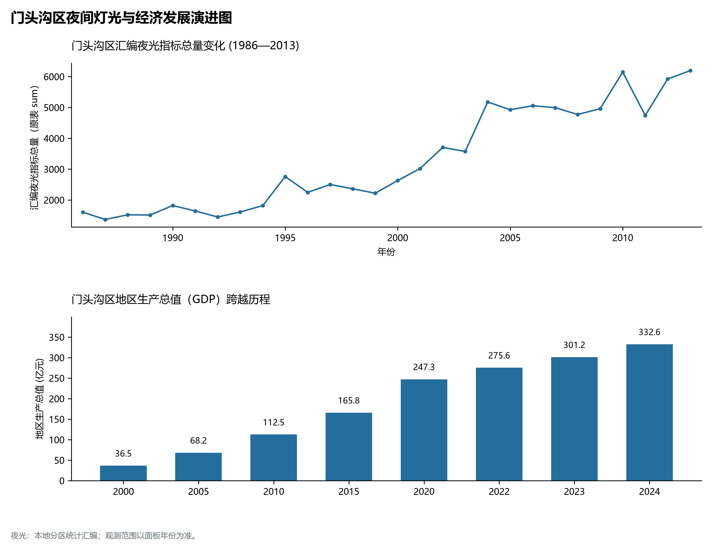
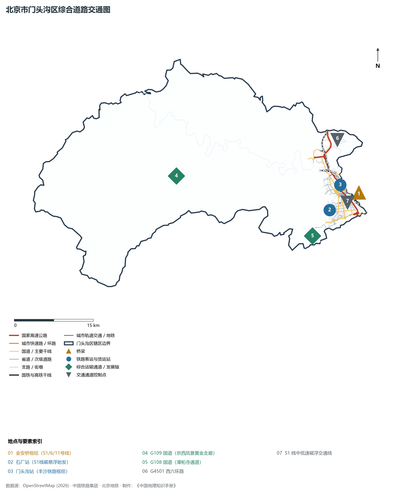

# 1.7 门头沟区

门头沟区位于北京市西部，地处太行山余脉与燕山交汇的深山地带，东与石景山区、海淀区接壤，南与房山区相连，西与河北省涿鹿县、涞水县界峰相望，北与昌平区、延庆区及河北省怀来县以分水岭相分。其地理轮廓东西宽广、南北起伏，山峦叠嶂，全境 98.5% 均为山地，是名副其实的“京西绿海”与首都生态安全第一道崇山屏障。

历史上，门头沟素有“东望神州第一都，西出险隘百里峡”之称。永定河百里山峡奔涌激荡，切开亿万年沧海桑田的地质奇观；千年古刹潭柘寺享有“先有潭柘寺，后有北京城”之至崇美誉；京西古道深陷的蹄窝见证了自元明清以来驼队输送石炭柴炭入京的千年沧桑。近代更是京西煤矿工人罢工与平西抗日游击战争的重要堡垒。当代，门头沟区完成了由“千年煤都”向“绿色生态涵养区”的历史性悲壮蜕变：全面关闭关停全域采煤矿坑，坚定走生态立区之路，更依托“京西智谷”前瞻布局人工智能公共算力中心，以生态文旅与数字算力“双轮驱动”，探索出绿水青山转化为金山银山的首都京西实践。

---

## 一、区情速览

门头沟区是北京市生态涵养区的重要组成部分，是全北京山地占比最高、海拔落差最大的生态安全与绿色创新极核。

| 指标 | 数值与特征 | 全国/全市坐标 |
|:---|:---|:---|
| **面积** | 1 450.70 km² | 占北京市总面积约 8.84%；山地面积占 98.5%，平原仅占 1.5% |
| **常住人口** | 39.26 万人（2020 年七普）；39.0 万人（2023 年末） | 人口高度集聚于东部龙泉、大峪、永定等山前出山口河谷组团 |
| **常住人口城镇化率** | 95.8% | 人口集约分布特征鲜明，深山区呈散点式传统古村聚落 |
| **人口密度** | 271 人/km² | 全市 16 区中位居倒数前列，深山区乡镇低于 40 人/km² |
| **地区生产总值 (GDP)** | 332.6 亿元（2024 年，现价） | 彻底摆脱煤炭依赖后，以人工智能、文化旅游和精品农业为核心稳步增长 |
| **人均 GDP** | 约 8.5 万元人民币（折合约 1.18 万美元） | 绿色生态效益与智算新质生产力加速转化 |
| **主导产业结构** | 产业全面绿色化 | 彻底退出煤炭采掘，高新数字技术与特色文旅成为主引擎 |
| **行政区划** | 4 个街道、9 个建制镇，区政府驻大峪街道新桥大街 | 辖有斋堂、清水、雁翅、王平、潭柘寺、军庄、永定等名镇 |
| **战略功能定位** | 首都西部重点生态涵养区、国家级森林公园与水源涵养带、京西人工智能算力中心 | 守护绿水青山，打造京西智谷与山水文旅圣地 |

**图 01-07-1 北京市门头沟区行政区划与区位图**：图上编号与地点、要素索引对应。

---

## 二、自然地理：太行深峡与神州第一峰

门头沟地处太行山余脉西山段的核心隆起带，山峦起伏剧烈，峡谷切割幽深，地质构造运动塑造了气势磅礴的高山峡谷大观。

### 1. 地形地貌：北京第一高峰与极差落差
全区地形自西向东呈阶梯状急剧跌落，绝对高程跨越 **100—2 303 m**，相对高差超过 **2 200 m**，居全北京市之冠：

- **东灵山（北京第一高峰）**：位于全区极西部与河北涿鹿交界处，主峰海拔 **2 303 m**，为北京市最高点。山顶常年气温偏低，发育有华北地区面积最大的典型高山草甸生态系统，云海苍茫，素有“北京屋脊”之称；
- **百花山主峰**：海拔 **1 991 m**，以高山草甸花海、温带针阔叶混交林和丰富的中草药生物多样性著称，建有国家级自然保护区；
- **妙峰山**：主峰海拔 **1 291 m**，为西山著名的险峻突峰，金顶娘娘庙庙会香火绵延千年；
- **三家店出山口平原低点**：永定河切穿山脉冲出山口的三家店一带，地面标高仅 **98—100 m**，为全区地势最低洼处。

### 2. 气候特征：山地立体气候与“小西藏”微环境
属于暖温带半湿润大陆性季风山地气候。受海拔垂直差异影响，立体气候特征极其显著：

- **气温垂直递减**：东灵山顶年平均气温仅约 **2—4 ℃**，比东部三家店平原低 8—10 ℃，每年 10 月至次年 5 月常有积雪覆盖，夏季清凉无暑；
- **降水地形雨效应**：全区年降水量在 **550—650 mm** 之间，迎风坡降水常达平原的 1.2 倍以上，局地突发短时暴雨易形成山洪地质灾害，近年来永定河百里山峡防洪治本工程体系持续健全。

### 3. 河流水系：永定河百里山峡
门头沟是永定河出山入原的决定性流域通道，分属海河流域永定河水系：

- **永定河百里山峡**：自官厅水库下泄，横切门头沟崇山峻岭百余公里，沿途切削出落坡岭、幽州等险峻深邃的峡谷奇观，两岸悬崖峭壁、绿树成荫，是北方极其罕见的大河穿山地貌；
- **珠窝水库（珍珠湖）**：库容数千万立方米，湖水碧绿如翡翠，素有“京西小三峡”美誉；
- **落坡岭水库**：位于王平镇境内，是百里峡谷重要的调蓄水利枢纽；
- **清水河**：永定河在门头沟境内的最大支流，发源于百花山与东灵山麓，东流注入永定河干流。

**图 01-07-2 北京市门头沟区地形地貌与水系图**：图上编号与地点、要素索引对应。

---

## 三、建置沿革与文化根脉

门头沟文化底蕴积淀万千，熔铸了皇家宗教名刹、明清古村落、京西商旅古道与红色抗日根据地文化。

### 1. 地名考略与行政演进

- “门头沟”因圈门一带有一条石炭外运的大沟，其沟口有古村名“门头村”，由沟口通往山内采煤，故称“门头沟”；
- 辽金元明清时期，境域分属宛平县、宛平县西乡；
- 1952 年设立北京市京西矿区，以采煤供暖保障首都能源为首要使命；
- 1958 年正式更名为**门头沟区**，辖区多次调整合并，确立了今日 1 450.70 km² 版图。

### 2. 千年皇家古刹：潭柘寺与戒台寺

- **潭柘寺（全国重点文物保护单位）**：始建于西晋永嘉元年（307年），距今已有 1 700 多年历史，是北京地区历史最悠久的佛教名刹。寺内古木参天，拥有唐代银杏“帝王树”，明清历代皇帝多次驾临拈香，留下了“先有潭柘寺，后有北京城”的古老民谚；
- **戒台寺（全国重点文物保护单位）**：始建于隋开皇年间，寺内拥有全国最大的辽代汉白玉戒坛，与泉州开元寺、杭州昭庆寺并称为中国“三大戒坛”，位居神州第一。

### 3. 古村古道：爨底下与京西古道

- **爨底下村（中国首批历史文化名村）**：位于斋堂镇深山峡谷中，始建于明正德年间，村落依山而建，错落有致，保存有 70 余套、500 余间明清四合院砖木石建筑，被建筑学者赞誉为“东方古建筑的明珠”；
- **京西古道与蹄窝奇观**：水峪嘴村牛角岭关城是京西古道的咽喉要隘，历经数百上千年数以百万计的骡马驼队重负踩踏，在坚硬的石灰岩古道地面上磨凿出深达十余厘米的密集“蹄窝”，成为记录古代京华能源运输史的实物活化石；元代大曲家马致远曾隐居于此，写下流传千古的《天净沙·秋思》。

**图 01-07-4 北京市门头沟区永定河百里山峡、古刹名刹与京西古道格局图**：图上编号与地点、要素索引对应。

---

## 四、经济地理：绿色转型蝶变与“京西智谷”算力高地

门头沟区彻底完成了由“一煤独大”的重化采掘经济向生态高新、数字智能新质生产力的世纪大跨越。

### 1. 彻底退出采煤矿业的历史决断
门头沟曾是保障北京城市供暖与工业运转的“煤炭摇篮”，采煤历史长达千年，曾拥有数十座大型国企统配煤矿与数百座地方矿。进入 21 世纪，门头沟坚决服从国家与首都生态红线大局：

- 2000 年代启动全面关停小煤窑；
- 2020 年，随着北京最后一座煤矿大安山煤矿正式关井闭坑，门头沟彻底告别采煤历史，实现了全域“无煤化”，由昔日黑灰烟尘重地跃升为首都生态涵养绿色屏障。

### 2. “京西智谷”算力中心与人工智能新极核

- 依托中关村门头沟园，门头沟全面拥抱数字经济时代，前瞻布局建设**“京西智谷”人工智能计算中心**；
- 智算规模已突破 500P，规划建设 1 000P 算力集群，打造自主可控的昇腾 AI 算力底座，已吸引大模型、算法框架、智能医疗、具身智能等前沿科技企业数百家入驻，成为北京市人工智能算力基础设施的核心节点。

### 3. 经济总量跨越与生态精品文旅

- 2000 年门头沟区 GDP 仅为 **36.5 亿元**；
- 2010 年为 **112.5 亿元**；
- 2024 年全区 GDP 稳步增长至 **332.6 亿元**。以潭柘寺精品民宿群、百花山生态科普、京西古道山地越野为代表的精品文旅品牌蓬勃兴起，“小院里的门头沟”成为市民微度假与高端会务的首选目的地。

### 4. 空间夜间灯光演化（1986—2013）

本节夜光图的观测年份为 1986—2013 年，指标为行政区汇总值（原表 sum）。

**图 01-07-5 门头沟区夜间灯光与经济发展演进图**：各面板按标注的观测年份、指标和单位列示。

---

## 五、交通网络与现代枢纽

门头沟依托磁悬浮交通、山区快速通道与放射状骨干公路，构筑起连接首都核心区与深山峡谷的快捷立体交通网。

**图 01-07-3 北京市门头沟区综合道路交通图**：图上编号与地点、要素索引对应。

### 1. 轨道交通示范：S1 线中低速磁悬浮

- **S1 线**：北京也是全国首条拥有自主知识产权的中低速磁浮交通商业运营示范线。自门头沟石厂站始发，穿行浅山隧道，跨越永定河，直达金安桥与苹果园综合枢纽，列车“贴地飞行”，具有转弯半径小、爬坡能力强、低噪声零排放等优异性能，极大缩短了门头沟新城与市区中心的时空距离。

### 2. 纵横崇山的骨干公路大动脉

- **G109 国道（京拉线走廊）**：贯通门头沟百里山峡的风景黄金大走廊，自三家店一路向西，过军庄、妙峰山、雁翅、斋堂直通河北张家口；新 109 国道高速公路工程实施后，全线桥隧比极高，实现深山区 1 小时直达中心城区；
- **G108 国道（潭柘寺快速通道）**：穿行南部潭柘寺镇，直通房山与中心城区莲石东路；
- **G4501 西六环路**：穿行门头沟东部浅山带，设有军庄、陇驾庄等多座出入口，成为全区南北对外辐射的快速集散干线。

### 3. 历史铁路动脉：丰沙铁路

- **丰沙铁路**：新中国成立后修建的第一条极其艰巨的山区铁路（1955年通车），沿永定河百里山峡穿凿数十座隧道开山而建，是晋煤外运与客运进京的功勋铁道，至今仍开行郊区市郊列车与长途客货列车。

---

## 六、门头沟区地理要素矩阵与区域之最

### 1. 核心地理与经济指标速查表

| 要素类别 | 指标名称 | 数值/名称 | 备注 |
|:---|:---|:---|:---|
| **地势极值** | 最高点海拔 | **2 303.0 m** | 西部东灵山主峰（全北京市第一高峰） |
| | 最低点海拔 | **98.0 m** | 东部三家店永定河出山口处 |
| | 全域相对高差 | **2 205.0 m** | 居北京市各区之冠，地形垂直分异极其强烈 |
| **水文要素** | 母亲河峡谷 | **永定河百里山峡** | 全长百余公里，华北著名深切大峡谷 |
| | 最大人工湖泊水库 | **珠窝水库（珍珠湖）** | 库容数千万立方米，京西小三峡 |
| **生态指标** | 森林覆盖率 | **48.5%** | 深山区植被郁闭度极高，拥有百花山国家级保护区 |
| | 山地面积占比 | **98.5%** | 全市山地占比最高的纯山区市辖区 |
| **经济指标** | 2024 年 GDP | **332.6 亿元** | 彻底摆脱煤炭采掘，绿色数字新经济主导 |
| | 智算算力规模 | **超 500P (规划 1000P)** | “京西智谷”国家级人工智能公共算力平台 |
| **文化遗产** | 全国重点文物保护单位 | **潭柘寺、戒台寺等** | 潭柘寺建于西晋，为北京现存历史最古名刹 |
| | 中国历史文化名村 | **爨底下村** | 明清深山古村落建筑群活化石 |

### 2. 门头沟区之最（Superlatives）

- **海拔之最**：拥有全北京市最高点——东灵山主峰（海拔 2 303 米）；
- **地势之最**：北京市地形相对高差最大、山地面积占比最高（98.5%）的区；
- **古刹之最**：拥有北京建寺历史最悠久的皇家古刹——潭柘寺（建于公元 307 年）；
- **转型之最**：彻底关停退出数百年煤炭采掘历史，成功转型为国家级绿色生态与人工智能算力策源地。

---

## 参考与数据来源

1. 中华人民共和国自然资源部：《第三次全国国土调查主要数据公报（北京市门头沟区）》
2. 北京市统计局、门头沟区统计局：《北京市第七次全国人口普查公报》、《2024年门头沟区国民经济和社会发展统计公报》
3. 北京市规划和自然资源委员会：《门头沟分区规划（国土空间规划）（2017年—2035年）》
4. 国家统计局：《中国城市统计年鉴（2024—2025年）》
5. 阿里云 DataV.GeoAtlas 2021.5 行政区划边界矢量（审图号：GS(2021)6038号）
6. OpenStreetMap (OSM) 2026 年最新全要素道路与交通线网矢量
7. AWS Terrain Tiles / Copernicus GLO-30 数字高程模型（DEM）
