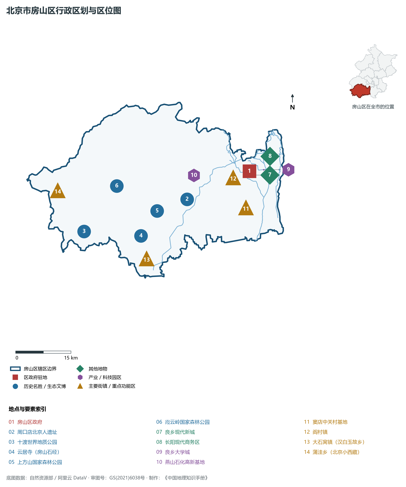
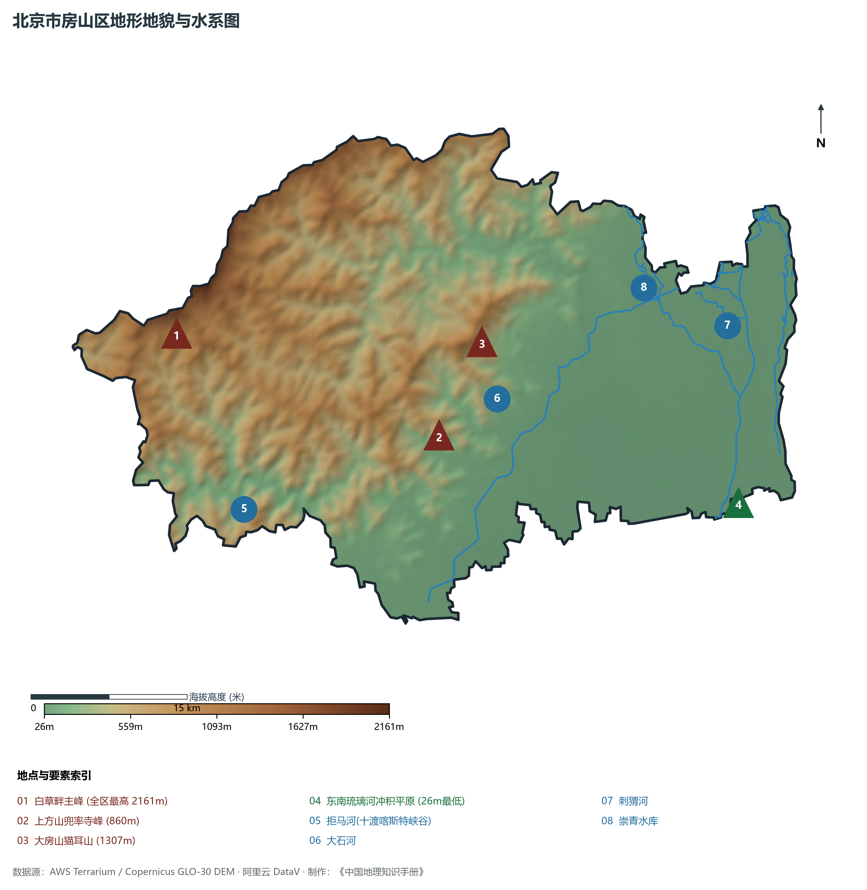
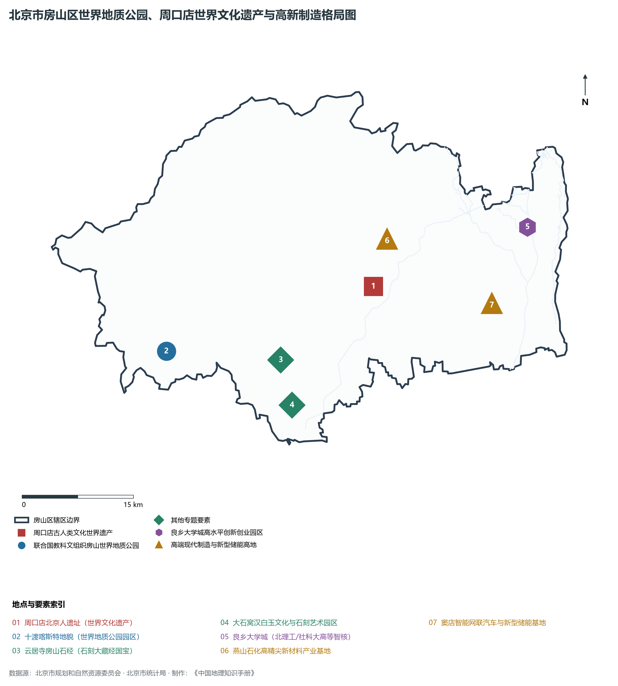
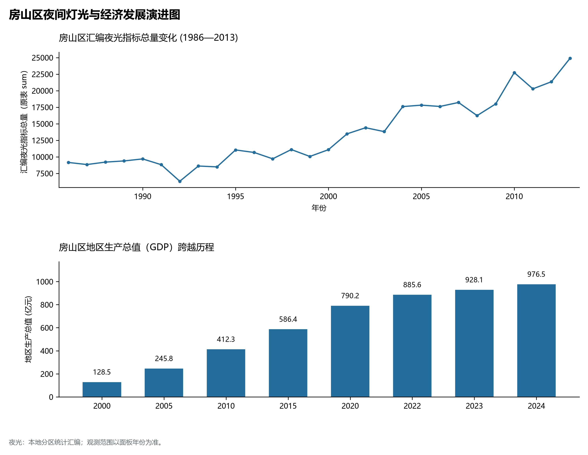
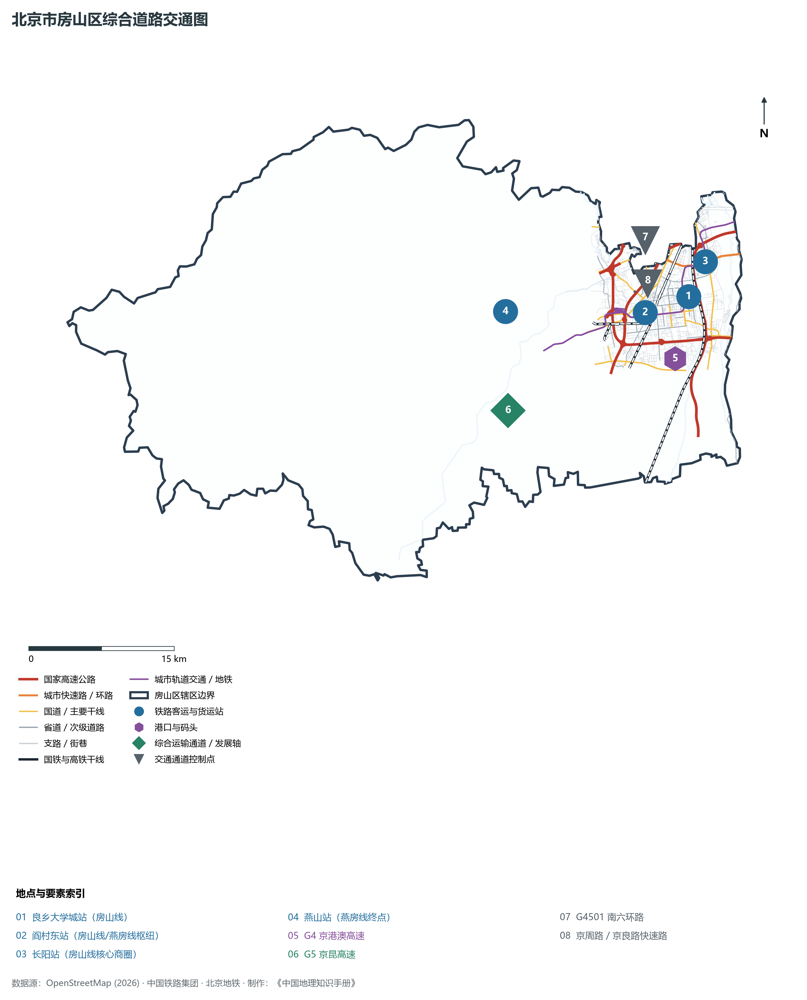

# 1.8 房山区

房山区位于北京市西南部，东北与丰台区紧密相连，东隔永定河与大兴区相望，南、西与河北省涿州市、涞水县接壤，北倚大房山诸峰与门头沟区以山脊为界。其辖域广袤雄阔，形态呈由西北向东南倾斜展开的巨幅屏障——西踞太行百草之雄峰，南饮拒马十渡之清波，东展良乡新城之锦绣，中筑现代高新制造业之基石。

历史上，房山是华夏古人类与古都建城的共同“摇篮”：70万年前的周口店北京人在此点燃了人类文明的第一簇圣火；3060年前西周燕国都城琉璃河遗址出土的青铜礼器，铭刻了北京建城最早的信史证据；云居寺万余块房山石经构筑起举世无双的石刻文化长城；大石窝汉白玉砌筑了故宫、天安门与人民英雄纪念碑的东方尊崇。当代，房山区统筹推进生态涵养与平原新城建设：依托中关村房山园培育千亿级新型储能与新能源智能网联汽车产业，高水平建设良乡大学城科教智核，推动燕山石化向氢能与高端新材料绿色转型，展现出厚重文脉与现代工业交融共进的蓬勃活力。

---

## 一、区情速览

房山区是北京市平原新城与生态涵养兼备的综合性大区，是京津冀协同发展西南方向的重要门户通道。

| 指标 | 数值与特征 | 全国/全市坐标 |
|:---|:---|:---|
| **面积** | 2 019.00 km² | 占北京市总面积约 12.3%；山区占约 67%，平原占约 33% |
| **常住人口** | 131.28 万人（2020 年七普）；131.0 万人（2023 年末） | 全市 16 区中位居第六位，南部平原新城集聚超 70% 人口 |
| **常住人口城镇化率** | 79.2% | 良乡、长阳城镇化率超 95%，西部深山保持田园生态聚落 |
| **人口密度** | 650 人/km² | 平原良乡、长阳组团超 3 500 人/km²，深山区低于 100 人/km² |
| **地区生产总值 (GDP)** | 976.5 亿元（2024 年，现价） | 即将跨越千亿元大关，先进制造与新能源储能势头强劲 |
| **人均 GDP** | 约 7.4 万元人民币（折合超 1.0 万美元） | 新旧动能平稳转换，工业经济效益加速释放 |
| **主导产业结构** | 现代先进制造与文旅生态并进 | 新型储能、智能网联汽车、医药健康、高端石化新材料 |
| **行政区划** | 8 个街道、14 个建制镇、6 个乡，区政府驻拱辰街道政通路 | 辖有良乡、长阳、周口店、窦店、十渡、大石窝等历史名镇 |
| **战略功能定位** | 三区一节点（生态涵养区、新型城镇化示范区、高端制造业基地、京津冀协同发展桥头堡） | 打造首都西南活力门户与生态科创重镇 |

**图 01-08-1 北京市房山区行政区划与区位图**：图上编号与地点、要素索引对应。

---

## 二、自然地理：太行奇嶂与清泉秀水

房山区处于华北大平原向太行山脉隆升过渡的剧烈构造褶皱带上，西山岩溶与断层地貌发育极其典型。

### 1. 地形地貌：喀斯特峡谷与华北沉积平原
全区地貌呈西北高、东南低的巨大倾斜阶梯，海拔跨度介于 **26—2 161 m**，高差超过 **2 100 m**：

- **白草畔主峰（全区最高峰）**：位于霞云岭乡西北与门头沟交界处，海拔高达 **2 161 m**，是京西南第一高峰。拥有大面积高山草甸、针叶落叶混交林，常年山风呼啸，气温比平原低 10 ℃ 以上；
- **猫耳山（大房山主峰）**：海拔 **1 307 m**，因双峰并峙如猫耳得名，是房山中部的标志性高山；
- **上方山与十渡喀斯特地貌**：上方山主峰海拔 860 m，拥有北方最集中的原始次生林与古喀斯特溶洞群（云水洞拥有高达 37 米的中国第一石笋）；十渡拒马河沿岸发育出规模宏大的北方喀斯特嶂谷与峰丛峰林地貌；
- **东南平原冲积扇裙**：永定河与大石河冲积形成的低平原，海拔由山口良乡一带的 **50 m** 降至琉璃河出境处的 **26 m**，水土丰美。

### 2. 气候特征：温带半湿润季风与深山阻隔
全区年平均气温在 **11.5—13.0 ℃** 之间，年平均降水量约 **600—680 mm**。

- **降水时空分异显著**：受太行山东麓迎风坡抬升作用，霞云岭、佛子庄一带是北京著名的暴雨多发区之一；春季干燥多风，秋季天高云淡。

### 3. 河流水系：拒马奔流与大石古水
全区水系分属海河流域大清河水系与永定河水系：

- **拒马河**：源自河北涞源，横穿房山西南部十渡景区长达 30 余公里，河水清澈碧绿，在张坊出山口流入河北平原。拒马河沿途切削出九曲回肠的十渡绝壁画卷，是北京西南著名的生态水岸；
- **大石河**：贯穿房山中部，发源于霞云岭，流经周口店、房山城关、燕山石化至琉璃河注入白沟河，全长 70 余公里，两岸坐落着古燕都文明发祥遗址；
- **刺猬河**：蜿蜒流经良乡大学城与长阳新城，水清岸绿，构筑了现代新城的生态滨水碧道；
- **崇青水库**：位于青龙湖镇境内，湖面开阔，是房山东北部重要的防洪蓄水与水上运动湖泊。

**图 01-08-2 北京市房山区地形地貌与水系图**：图上编号与地点、要素索引对应。

---

## 三、建置沿革与文化根脉

房山被誉为“北京的远古老家”，汇聚了人类演化、古都滥觞、宗教石经与皇家建材四大世界级文脉。

### 1. 地名考略与行政演进

- “房山”源自金代营建金陵（太祖完颜阿骨打等历代金帝王陵寝），因境内大房山“四面如壁，中平如房”而得名“房山”；
- 西周时期，召公长子克在此受封，建都琉璃河镇董家林村（燕都遗址）；
- 汉置良乡县，历经千百年沿革；
- 1986 年，撤销房山县与燕山区，正式设立北京市**房山区**，确立了今日 2 019 km² 的现代辖区格局。

### 2. “人之源”与“城之源”的双重圣地

- **周口店北京人遗址（世界文化遗产）**：1929 年裴文中在此发现第一颗完整的直立人（北京猿人）头盖骨化石，震惊世界，把人类用火历史提前至 50 万年前；1987 年列入首批世界文化遗产，是中国远古人类演化的里程碑圣殿；
- **琉璃河西周燕都遗址（全国重点文物保护单位）**：拥有城墙、城壕、宫殿区及大型贵族墓葬群，出土了“克盉”、“克罍”等刻有周王封燕铭文的青铜国宝，实证了北京作为北方历史名城可考的三千年建城史起源；
- **房山世界地质公园（联合国教科文组织）**：横跨房山与河北涞水，包括周口店园区、十渡园区、石花洞园区、上方山园区等八大园区，是全球首个位于首都大都市的世界地质公园。

### 3. 云居寺石经与大石窝汉白玉

- **云居寺房山石经（国宝珍存）**：始刻于隋大业年间，静琬法师为防佛法毁灭，发愿刻经于石板之上，历经六个朝代、一千余年连续镌刻，共刻佛经 1 122 部、14 278 块石板，被国际学术界盛赞为“北京的敦煌”；
- **大石窝汉白玉文化**：大石窝镇自汉代起开采汉白玉石材，石质细腻温润、洁白无瑕，明清紫禁城大石雕、天坛皇穹宇台基、天安门华表金水桥以及人民英雄纪念碑浮雕，皆采选于大石窝高庄汉白玉古矿坑。

**图 01-08-4 北京市房山区世界地质公园、周口店世界文化遗产与高新制造格局图**：图上编号与地点、要素索引对应。

---

## 四、经济地理：高端制造业腾飞与绿色能源基地

房山区紧紧抓住产业升级战略契机，大力推进结构优化，构筑起以新能源汽车、新型储能、医药健康与绿色石化为骨干的现代产业体系。

### 1. “中国新型储能第一区”与智能制造

- **新型储能与新能源高地**：以中关村房山园窦店基地为载体，汇聚海博思创（全球储能系统领军企业）、卫蓝新能源（固态电池龙头）等骨干企业，打造具有全球竞争力的千亿级新型储能产业集群；
- **智能网联新能源汽车走廊**：长安汽车北京基地、京西智行等重点项目扎根房山，形成集整车研发、核心底盘、自动驾驶系统为一体的汽车产业创新链。

### 2. 良乡大学城：科教智核与产教融合

- 规划面积 17.12 km²，已入驻**北京理工大学、中国社会科学院大学、北京工商大学、首都师范大学、北京中医药大学**等一流高校，师生规模超 5 万人；
- 建设高校创新转化中心与留学生创业园，打造首都西南地区最强劲的基础科学研究与科技成果转化策源地。

### 3. 经济总量跨越与传统产业脱胎换骨

- 2000 年房山区 GDP 仅为 **128.5 亿元**；
- 2010 年突破 **400 亿元**；
- 2024 年全区 GDP 攀升至 **976.5 亿元**，逼近千亿台阶。拥有半个多世纪历史的特大型骨干企业燕山石化，大力实施绿色低碳改造，布局京津冀氢能保供枢纽与医用聚烯烃新材料，实现传统石化向战略高精尖的蝶变。

### 4. 空间夜间灯光演化（1986—2013）

本节夜光图的观测年份为 1986—2013 年，指标为行政区汇总值（原表 sum）。

根据区县级卫星长时序遥感监测：

**图 01-08-5 房山区夜间灯光与经济发展演进图**：各面板按标注的观测年份、指标和单位列示。

---

## 五、交通网络与现代枢纽

房山区地处北京通往华中华南与大西南的陆路咽喉，依托高铁、高速公路与轨道快线，实现了与市区半小时通勤对接。

**图 01-08-3 北京市房山区综合道路交通图**：图上编号与地点、要素索引对应。

### 1. 高速公路国家骨干大动脉

- **G4 京港澳高速（京石段）**：新中国第一条通车的高速公路之一，纵贯房山东部良乡、阎村、窦店、琉璃河，是连接北京与石家庄、郑州、武汉、广州的南下国家级超级经济大走廊；
- **G5 京昆高速**：自丰台向西南穿过房山中部大石窝出京，开辟了通往太行西侧的快速货运大通道；
- **G4501 南六环路**：横穿北部良乡与长阳，无缝联通大兴国际机场与副中心；
- **京良路快速路**：高架直连西五环与长阳，打造京西南进出城无红绿灯通衢。

### 2. 现代轨道交通网络

- **地铁房山线**：自苏庄站始发，贯通良乡大学城、长阳镇，直插丰台郭公庄站与首经贸站，与地铁 9 号线、10 号线实现全互通；
- **地铁燕房线**：中国首条完全拥有自主知识产权的全自动无人驾驶轨道交通线，连接燕山石化高新基地与苏庄，打通了西南深山产业带与现代地铁网的神经末梢。

---

## 六、房山区地理要素矩阵与区域之最

### 1. 核心地理与经济指标速查表

| 要素类别 | 指标名称 | 数值/名称 | 备注 |
|:---|:---|:---|:---|
| **地势极值** | 最高点海拔 | **2 161.0 m** | 西北部白草畔主峰（京西南第一峰） |
| | 最低点海拔 | **26.0 m** | 东南平原琉璃河出境处 |
| | 全境地势高差 | **2 135.0 m** | 居全市前列，山水垂直梯度落差显著 |
| **水文要素** | 著名生态峡谷水系 | **拒马河（十渡段）** | 境内长 30 余公里，北方喀斯特峰丛绝景 |
| | 主干外排河流 | **大石河** | 境内长约 70 km，串联周口店与琉璃河 |
| **生态指标** | 森林覆盖率 | **36.9%** | 拥有上方山国家森林公园、石花洞地质公园 |
| | 建成区绿化覆盖率 | **46.8%** | 青龙湖、长阳公园水绿环绕 |
| **经济指标** | 2024 年 GDP | **976.5 亿元** | 工业总产值突破千亿，新型储能产业爆发 |
| | 高等学府数量 | **5 所重点大学** | 良乡大学城在校师生逾 5 万人 |
| **世界遗产** | 联合国教科文组织项目 | **周口店北京人遗址**（世界文化遗产）+ **房山世界地质公园** | 拥有人类演化与地质奇迹双重桂冠 |

### 2. 房山区之最（Superlatives）

- **人类之最**：拥有全世界古人类用火与古人类化石材料最丰富、最重要的遗址（周口店北京人遗址）；
- **建城之最**：拥有实证北京 3060 年建城信史的青铜重器出土地与最早都城废墟（琉璃河西周燕都遗址）；
- **地质之最**：全球首个位于首都大都市的世界地质公园（房山世界地质公园）；
- **石经之最**：保存有中国乃至世界规模最大、刻字数量最多的石刻大藏经宝库（云居寺房山石经）。

---

## 参考与数据来源

1. 中华人民共和国自然资源部：《第三次全国国土调查主要数据公报（北京市房山区）》
2. 北京市统计局、房山区统计局：《北京市第七次全国人口普查公报》、《2024年房山区国民经济和社会发展统计公报》
3. 北京市规划和自然资源委员会：《房山分区规划（国土空间规划）（2017年—2035年）》
4. 国家统计局：《中国城市统计年鉴（2024—2025年）》
5. 阿里云 DataV.GeoAtlas 2021.5 行政区划边界矢量（审图号：GS(2021)6038号）
6. OpenStreetMap (OSM) 2026 年最新全要素道路与交通线网矢量
7. AWS Terrain Tiles / Copernicus GLO-30 数字高程模型（DEM）
