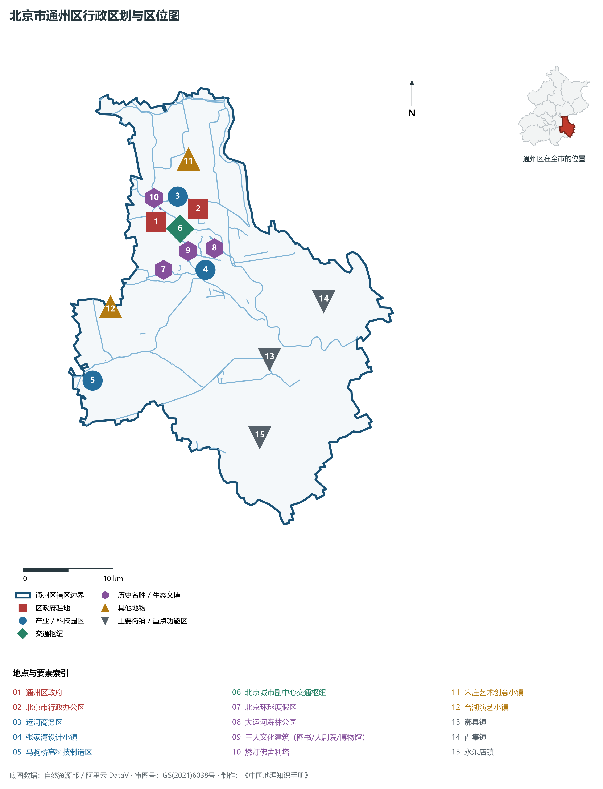
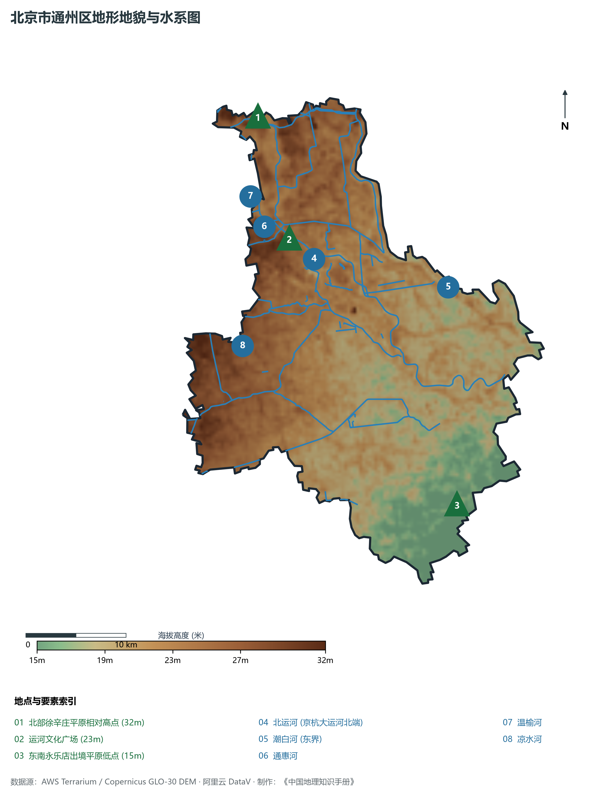
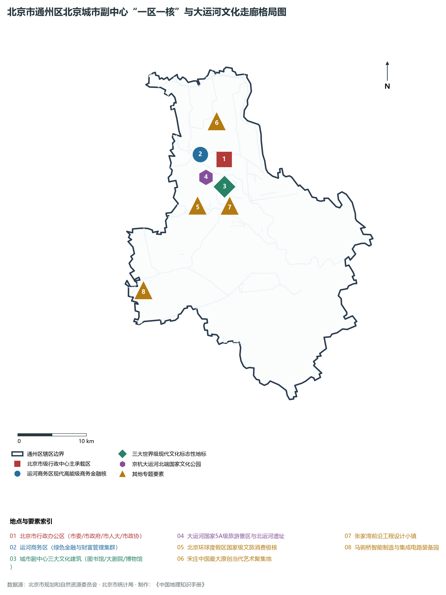
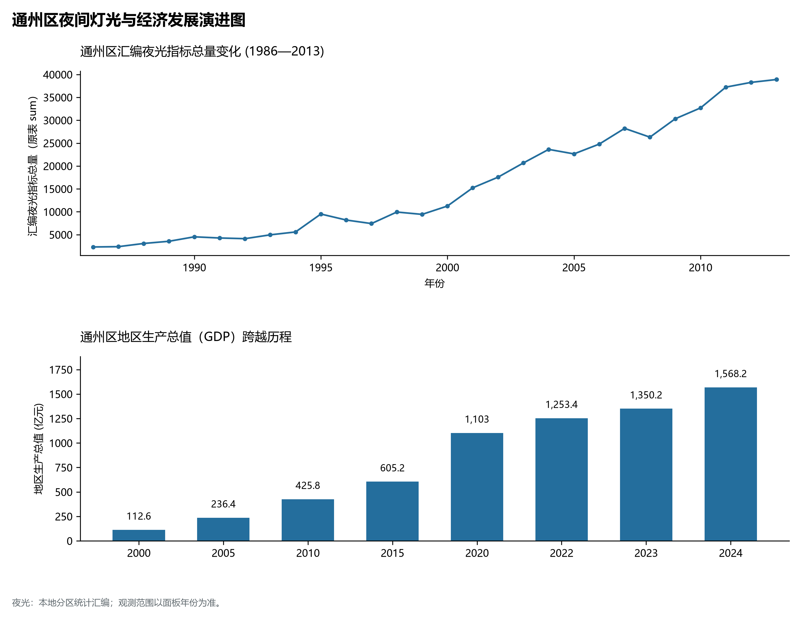
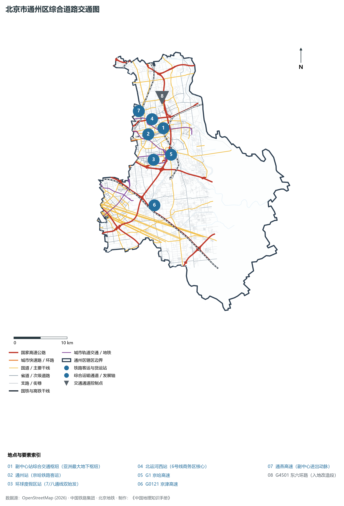

# 1.9 通州区

通州区位于北京市东南部，西临朝阳区、大兴区，北接顺义区，东北隔潮白河与河北省三河市、大厂回族自治县、香河县（北三县）接壤，东南与天津市武清区为邻。其地势自西北向东南平缓倾斜，地处温榆河、潮白河古冲积平原下游，全境 100% 均为广阔坦荡的平原微地貌——西承长安街东延长线之伟力，北纳京杭大运河五河汇流之浩荡，东跨潮白碧水协同北三县，南展国家级现代综合交通超级枢纽之宏图。

历史上，通州因北运河漕运繁华而获赐名“通州”，取“通达九州、漕运重地”之意；清代燃灯佛舍利塔耸立于大运河北端，享有“一支塔影认通州”的历史美谈。当代，通州区肩负着新时代党中央赋予的崇高历史使命：建设**北京城市副中心**，与雄安新区共同构筑起北京新的“两翼”。北京市委、市人大、市政府、市政协四大班子已整体迁入城市副中心行政办公区，运河商务区千亿级财富管理极核初具规模，北京艺术中心、北京城市图书馆、北京大运河博物馆三大文化地标惊艳亮相，北京环球度假区成为享誉全球的文旅新地标。通州正以非凡的气魄，打造出新时代高质量发展与千年大计的示范标杆。

---

## 一、区情速览

通州区是北京城市副中心所在地，是承接中心城区非首都功能疏解的重要承载区与京津冀协同发展桥头堡。

| 指标 | 数值与特征 | 全国/全市坐标 |
|:---|:---|:---|
| **面积** | 906.28 km² | 占北京市总面积约 5.52%；全域为冲积平原微地貌，无天然山体 |
| **常住人口** | 184.03 万人（2020 年七普）；184.5 万人（2023 年末） | 全市 16 区中位居第五位，过去十年常住人口增长最快城区之一 |
| **常住人口城镇化率** | 74.8% | 核心行政办公区与运河商务区城镇化率达 100% |
| **人口密度** | 2 031 人/km² | 梨园、北苑等老城区达 1.2 万人/km²，东南乡镇约 700 人/km² |
| **地区生产总值 (GDP)** | 1 568.2 亿元（2024 年，现价） | 占北京市经济总量约 3.2%，固定资产投资总量连续多年稳居全市各区前茅 |
| **人均 GDP** | 约 8.5 万元人民币（折合超 1.18 万美元） | 高端要素集聚推动人均产出快速攀升 |
| **主导产业结构** | 现代服务业与高精尖智造融合 | 行政办公、商务服务、文化旅游、科技创新四大主导产业 |
| **行政区划** | 11 个街道、10 个建制镇、1 个乡，区政府驻通运街道胡各庄大街 | 北京市级党政机关行政办公区坐落于潞城镇 |
| **战略功能定位** | 北京城市副中心、国际一流和谐宜居之都示范区、新型城镇化示范区、京津冀协同发展示范区 | 构建协同雄安新区比翼齐飞的新发展格局 |

**图 01-09-1 北京市通州区行政区划与区位图**：图上编号与地点、要素索引对应。

---

## 二、自然地理：广袤平原与五水汇运河

通州区坐落于海河流域下游冲积平原北部，全境无山，地表坦荡开阔，坡度极其微缓。

### 1. 地形地貌：平原微洼与微阶地
全区地面绝对高程在 **15—32 m** 之间，自然坡降仅为万分之二左右，水流流速平缓：

- **全区天然地势高位**：位于西北部徐辛庄至宋庄一带，海拔约 **30—32 m**；
- **运河核心区台地**：运河文化广场及行政办公区一带，海拔约 **22—24 m**；
- **全区地势最低处**：东南端永乐店、西集与河北、天津交界处的出境洼地，地面标高仅 **15—16 m**，是全北京市平原区海拔最低的区域之一。

### 2. 气候特征：暖温带季风与大运河水湿调节
属于暖温带半湿润大陆性季风气候。全区年平均气温在 **13.2—13.6 ℃** 之间，年平均降水量约 **570—610 mm**。

- **大运河森林水体微气候**：凭借北运河、潮白河宽阔水面与大运河森林公园超万亩滨水湿地，城市副中心核心区形成了天然的水气微循环带，夏季周边降温效果明显，空气湿润，被誉为北京平原东部的“水绿碧肺”。

### 3. 河流水系：五河汇通与京杭大运河北端
通州自古因水而兴，是海河流域北运河水系的枢纽地带：

- **北运河（京杭大运河北段）**：通州城内北关闸是历史著名的“五河交汇处”——**温榆河、通惠河、小中河、减河、运潮减河**五水在此交汇合流，出闸始称北运河，南流穿过通州全境，经香河注入海河；2022 年北运河京冀段全线 62 公里实现互联互通正式通航，沉寂百年的千年古运河重现千帆竞渡生机；
- **潮白河**：北京东部第一大河，自北向南纵贯通州东部，与河北省北三县构成宽阔的天然生态隔离带与协同水岸；
- **通惠河**：自北京市区西向东奔流，入通州注入北运河，历史上是连接紫禁城与通州码头的皇家漕运生命线；
- **凉水河**：横贯通州西南部，经亦庄流向通州漷县，是城南重要的排洪绿廊。

**图 01-09-2 北京市通州区地形地貌与水系图**：图上编号与地点、要素索引对应。

---

## 三、建置沿革与文化根脉

通州大运河文化源远流长，凝聚了千年漕运商贸史、古镇民俗、当代艺术与国家标志性现代文化建筑群。

### 1. 地名考略与行政演进

- 西汉高祖十二年（公元前195年）置路县（东汉改称潞县）；
- 金海陵王天德三年（公元1151年），升潞县为州，因“取通达九州之义”正式赐名**通州**；
- 明清时期通州为京畿重镇、漕运总汇；
- 1958 年由河北省划归北京市，设通州区；1960 年改称通县；
- 1997 年 4 月撤县设区，重定为北京市**通州区**；
- 2015 年 4 月，中共中央政治局审议通过《京津冀协同发展规划纲要》，明确通州为**北京城市副中心**，翻开了千年运河之城的崭新历史篇章。

### 2. 京杭大运河与古都文脉地标

- **大运河（世界文化遗产）**：中国古代劳动人民创造的伟大水利工程奇迹。通州是京杭大运河的最北端起点，大运河通州段被列入世界文化遗产名录；
- **燃灯佛舍利塔（全国重点文物保护单位）**：始建于北周，重修于辽代，高 56 m，砖木结构密檐式八角十三层塔，矗立于三教庙旁，与北运河碧波交相辉映；
- **张家湾古运河码头**：曹雪芹家族在张家湾开设有当铺并置办产业，红学界在此发现了著名的“曹雪芹墓石”，是红楼梦文脉的重要溯源地；
- **宋庄艺术创意小镇**：全球规模最大的原创艺术家聚集区，入驻海内外各类艺术家与艺术工作室达数千家。

### 3. 副中心三大文化建筑：时代文化新殿堂
坐落于城市绿心森林公园内，已全面建成对公众开放：

- **北京艺术中心（“文化粮仓”）**：外立面宛如古运河畔粮仓帆影，拥有世界顶尖声学设计的歌剧院与音乐厅；
- **北京城市图书馆（“森林书苑”）**：拥有全球最大单体图书馆阅览室，144 根树状钢柱拔地而起，银杏叶片交叠成巨大的“阅读森林”；
- **北京大运河博物馆（“运河之舟”）**：屋顶宛如巨帆扬起，全面展示大运河千年历史文脉与人水和谐共生图景。

**图 01-09-4 北京市通州区北京城市副中心“一区一核”与大运河文化走廊格局图**：图上编号与地点、要素索引对应。

---

## 四、经济地理：副中心产业崛起与现代商务极核

通州区全面退出一般制造业，坚决落实非首都功能疏解，围绕四大主导功能全力打造高质量发展战略高地。

### 1. 运河商务区：千亿级现代商务与绿色金融极核

- 规划面积 20.38 km²，以北运河两岸现代化天际线为骨架；
- 重点发展总部经济、财富管理、绿色金融、金融科技，吸引了三峡集团北京总部、华夏理财、北京绿色交易所（国家级绿色交易所）等重点机构集聚；
- 建设全球绿色金融和可持续金融中心，绿色金融资产与低碳基金规模快速跃升。

### 2. 北京环球度假区：世界级文旅消费旗舰

- 2021 年 9 月正式开园迎客，是全球第五座、亚洲第三座、也是目前占地规模最大（4 km²）的环球影城主题公园；
- 包括七大主题景区（功夫熊猫、变形金刚、哈利·波特等），单日客流屡创历史纪录，带动周边住宿、餐饮、免税、现代演艺消费百亿元，打造世界级旅游度假新极核。

### 3. 张家湾与马驹桥高新智造走廊

- **张家湾设计小镇**：以老旧工业厂房改造为特色，集聚建筑设计、工业设计、城市规划等国际前沿设计机构；
- **马驹桥智能制造基地**：与北京亦庄经济技术开发区紧密协同，布局集成电路核心装备、先进封装与新型显示高端产业。

### 4. 空间夜间灯光演化（1986—2013）

本节夜光图的观测年份为 1986—2013 年，指标为行政区汇总值（原表 sum）。

**图 01-09-5 通州区夜间灯光与经济发展演进图**：各面板按标注的观测年份、指标和单位列示。

---

## 五、交通网络与现代枢纽

通州区正全力打造“轨道上的副中心”，建设连接京津冀、畅达主城区的多层次立体交通体系。

**图 01-09-3 北京市通州区综合道路交通图**：图上编号与地点、要素索引对应。

### 1. 亚洲最大地下综合交通枢纽：城市副中心站

- **北京城市副中心站综合交通枢纽**：坐落于通州杨坨地区，总建筑面积约 128 万 m²，地下分为三层；
- 集成了**京唐城际铁路、京滨城际铁路、城际铁路联络线（连接首都机场与大兴机场）**，以及**地铁 6 号线、平谷线（22号线）、M101 线**等多条轨道快线；
- 实现 15 分钟直达北京首都国际机场、35 分钟直达大兴国际机场与唐山、1 小时直达雄安新区，是国内首个超大型“站城融合”TOD示范工程。

### 2. 骨干快速路网与高速大走廊

- **进出副中心快速通衢**：**广渠路东延高架快速路**（直连东四环双井与副中心行政办公区）、**通燕高速**（连接朝阳与通州老城）；
- **高速公路干线**：**G1 京哈高速**（通往秦皇岛、沈阳）、**G0121 京津高速**（通向天津与滨海新区）；
- **东六环入地改造工程**：全长 16 km 的东六环入地改造，采用国内最大直径盾构机开掘超深地下双向六车道隧道，原地面路段将改建为高品质空中高线公园，彻底消除城市副中心东西片区的空间阻隔。

### 3. 多线贯通的轨道交通体系

- **地铁 6 号线**：横穿老城直通副中心潞城东端，大运量快速保障行政办公通勤；
- **地铁 7 号线与八通线**：双线并行直通北京环球度假区站超级文旅终点；
- **地铁 22 号线（平谷线，在建）**：横穿通州副中心核心区，串联河北燕郊与平谷。

---

## 六、通州区地理要素矩阵与区域之最

### 1. 核心地理与经济指标速查表

| 要素类别 | 指标名称 | 数值/名称 | 备注 |
|:---|:---|:---|:---|
| **地势极值** | 最高点海拔 | **32.0 m** | 北部徐辛庄平原相对高点 |
| | 最低点海拔 | **15.0 m** | 东南平原永乐店出境处 |
| | 全境平原占比 | **100%** | 全市平原面积占比最高的市辖区 |
| **水文要素** | 母亲河水系 | **北运河（京杭大运河）** | 境内全长 40 km，古漕运终点与通航水带 |
| | 水网交汇工程 | **北关闸五河交汇处** | 温榆河、通惠河等五河在此汇通 |
| | 绿色生态绿肺 | **大运河森林公园与城市绿心** | 城市绿心森林公园占地达 11.2 km² |
| **生态指标** | 森林覆盖率 | **34.2%** | 平原地区造林绿化示范标杆，万亩绿心遍布 |
| | 水体优良比例 | **超 85%** | 运河水质实现历史性从劣V类跃升至IV类及以上 |
| **经济指标** | 2024 年 GDP | **1 568.2 亿元** | 增速平原新城领跑，现代金融与文旅繁荣 |
| | 重点投资规模 | **超千亿元/年** | 连续多年位居全市固定资产投资第一阵营 |
| **时代地标** | 城市副中心三大文化建筑 | **艺术中心/图书馆/博物馆** | 绿色三星级超级文化地标 |
| | 国家级综合枢纽 | **副中心站综合枢纽** | 亚洲规模最大的地下综合客运中枢 |

### 2. 通州区之最（Superlatives）

- **枢纽之最**：建有亚洲规模最大的地下综合综合交通枢纽——北京城市副中心站（128 万平方米）；
- **文旅之最**：拥有全球占地面积最大的环球影城主题公园——北京环球度假区；
- **运河之最**：京杭大运河的最北端终点（大运河世界文化遗产北端核心枢纽）；
- **生态之最**：全市平原地区人均公共绿地面积最大、千亩以上大型森林公园最密集的平原示范新城。

---

## 参考与数据来源

1. 中华人民共和国自然资源部：《第三次全国国土调查主要数据公报（北京市通州区）》
2. 北京市统计局、通州区统计局：《北京市第七次全国人口普查公报》、《2024年通州区国民经济和社会发展统计公报》
3. 北京市规划和自然资源委员会：《北京城市副中心控制性详细规划（街区层面）（2016年—2035年）》
4. 国家统计局：《中国城市统计年鉴（2024—2025年）》
5. 阿里云 DataV.GeoAtlas 2021.5 行政区划边界矢量（审图号：GS(2021)6038号）
6. OpenStreetMap (OSM) 2026 年最新全要素道路与交通线网矢量
7. AWS Terrain Tiles / Copernicus GLO-30 数字高程模型（DEM）
