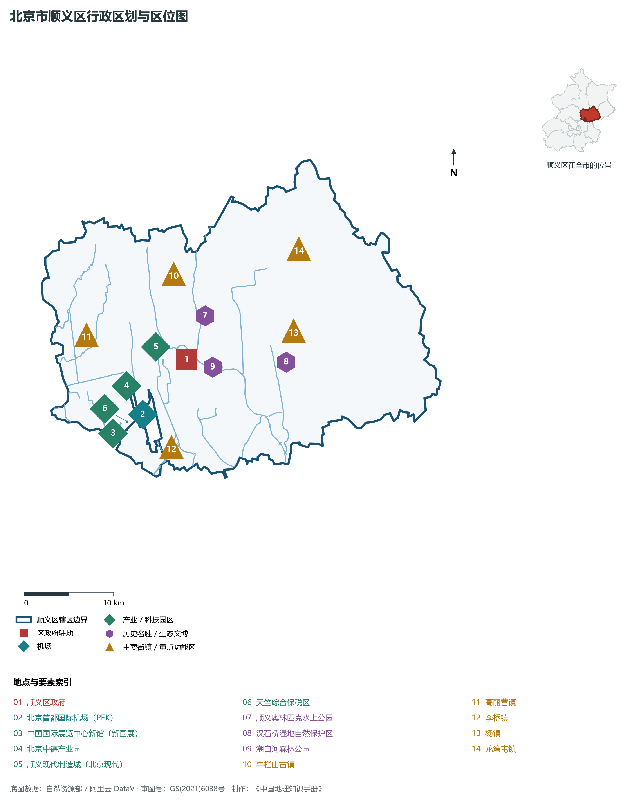
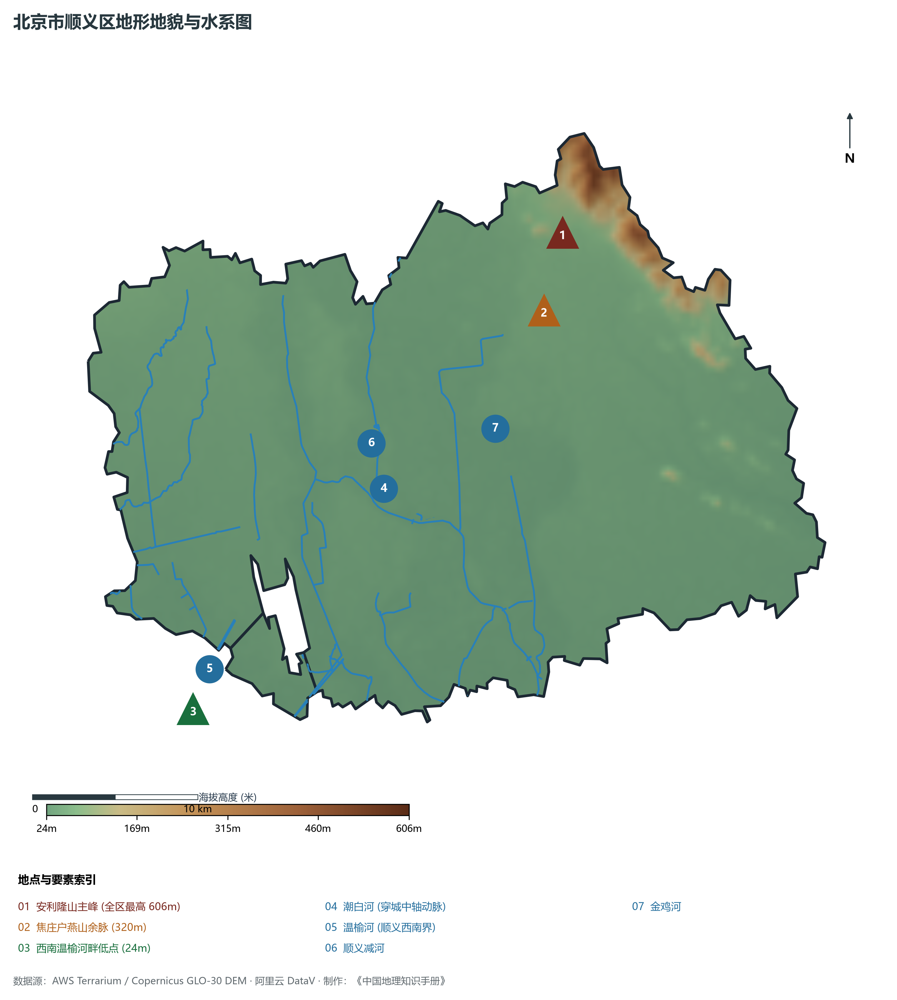
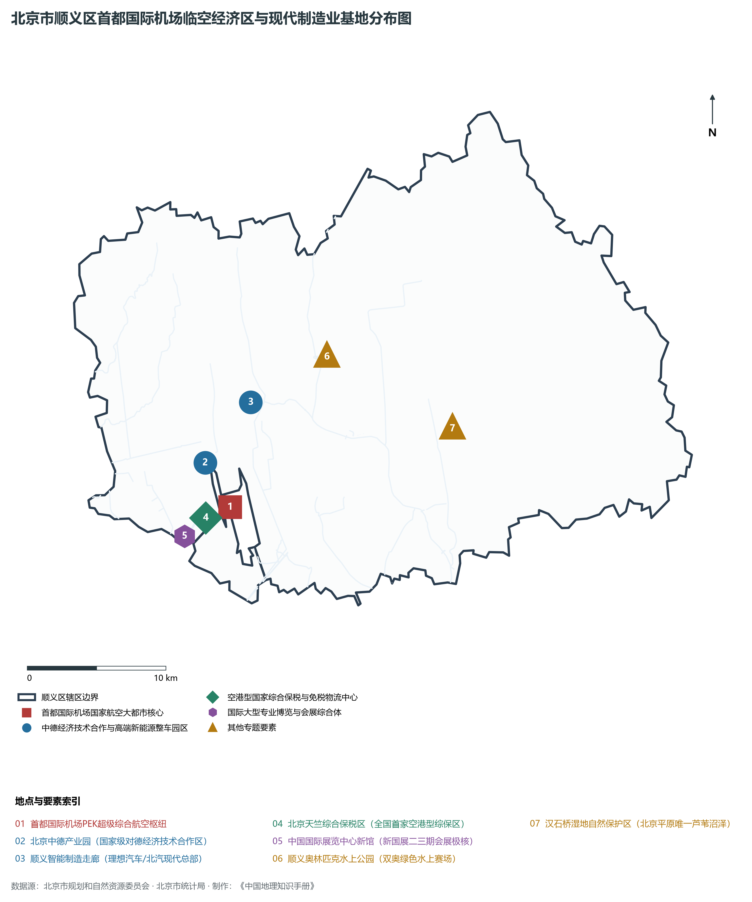
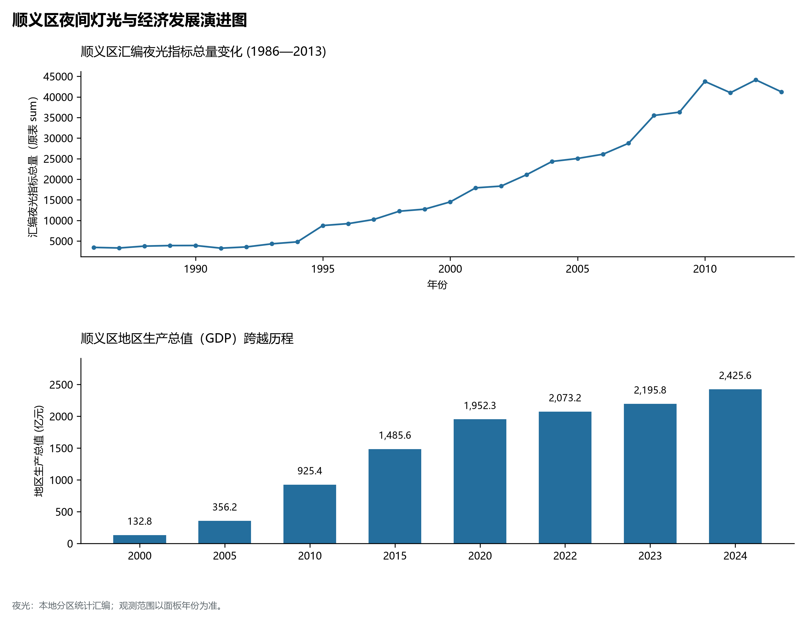
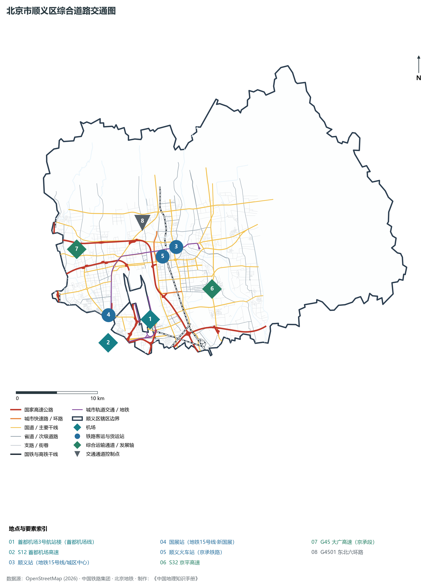

# 1.10 顺义区

顺义区位于北京市东北部，东邻平谷区，北接怀柔区、密云区，西与昌平区相依，西南隔温榆河与朝阳区相望，南连通州区。其地理轮廓横跨潮白两岸，形态如一柄伸向东北平原的玉如意，地处军都山山前洪积冲积平原腹地——西揽温榆清流之沃野，中拥潮白碧水之绿轴，北倚燕山余脉安利隆之浅峦，南托首都国际机场“第一国门”之宏图。

历史上，顺义古称“狐奴”，唐代设顺州，明洪武元年赐名“顺义县”，取“顺从朝廷忠义”之美意；焦庄户地道战曾创下以弱胜强、抗击日寇的地下奇迹；牛栏山二锅头传承数百年古法酿造芬芳。当代，顺义区是名副其实的“首都第一国门”：拥有年旅客吞吐量曾突破 1 亿人次的北京首都国际机场（PEK）；建有全国首个空港型国家综合保税区——北京天竺综合保税区；北京中德产业园集聚百余家德资隐形冠军；理想汽车全球旗舰制造工厂与北汽集团构筑起千亿级先进制造业走廊。顺义以雄踞平原新城之首的经济总量、优美清澈的潮白河生态绿带，成为首都高精尖先进制造、临空经济与国际展会的强劲增长极。

---

## 一、区情速览

顺义区是北京市平原新城中经济体量第一大区、临空经济与高端现代制造业中心。

| 指标 | 数值与特征 | 全国/全市坐标 |
|:---|:---|:---|
| **面积** | 1 021.00 km² | 占北京市总面积约 6.22%；平原占 95.7%，东北低山占 4.3% |
| **常住人口** | 132.40 万人（2020 年七普）；132.1 万人（2023 年末） | 平原新城人口规模前列，高端制造业从业者与外籍人士密集 |
| **常住人口城镇化率** | 73.1% | 仁和、旺泉、石园等核心街道及空港地区城镇化率超 95% |
| **人口密度** | 1 297 人/km² | 核心城区近 6 000 人/km²，东北浅山镇街约 400 人/km² |
| **地区生产总值 (GDP)** | 2 425.6 亿元（2024 年，现价） | 占北京市经济总量约 4.9%，连续多年稳居全市平原新城第一位 |
| **人均 GDP** | 约 18.3 万元人民币（折合超 2.5 万美元） | 平原新城人均 GDP 第一位，达中等发达经济体水准 |
| **主导产业结构** | 临空经济与高端制造双轮驱动 | 航空物流、新能源智能汽车、第三代半导体、航空金融 |
| **行政区划** | 6 个街道、19 个建制镇，区政府驻双丰街道仓上街 | 辖有天竺、后沙峪、高丽营、牛栏山、马坡、杨镇等经济强镇 |
| **战略功能定位** | 首都第一国门、国家级临空经济示范区、国际高端制造业基地、平原新城重要承载地 | 打造经济繁荣、环境优美、国际交往便捷的现代化宜居新城 |

**图 01-10-1 北京市顺义区行政区划与区位图**：图上编号与地点、要素索引对应。

---

## 二、自然地理：潮白穿城与平原沃土

顺义区地质构造稳定，坐落于潮白河古冲积洪积扇的扇中至扇缘开阔带，地表平坦肥沃。

### 1. 地形地貌：平坦冲积扇与东北浅山断突
全区地势由东北向西南微倾，绝大部分为开阔平原，海拔在 **24—606 m** 之间：

- **东北部低山丘陵**：属于燕山山脉余脉，山体低缓，林果飘香：
  - **安利隆山主峰**：顺义区最高峰，海拔 **606 m**，屹立于龙湾屯镇与平谷交界处，山势陡峻，森林茂盛；
  - **焦庄户龙湾屯浅山**：海拔约 200—320 m，为著名的生态休闲登山步道与红色景区；
- **广阔平原主域**：占全区总面积近 96%，地面绝对高程在 **25—45 m** 之间，地势开阔平缓，坡降在 1/1000 左右；
- **全区地势最低处**：西南端李桥镇与朝阳交界的温榆河河槽，海拔仅 **24 m**。

### 2. 气候特征：温和湿润与平原风光互补
属于暖温带半湿润大陆性季风气候。全区年平均气温在 **12.5—13.0 ℃** 之间，年平均降水量约 **600—640 mm**。

- **水库与大河调温**：流经全境的潮白河水面与北部密云水库出库冷水效应，使得顺义平原夏秋季夜间温润清新，少有市区强烈的静稳暴热，微环境极其优异。

### 3. 河流水系：潮白河绿轴与平原湿地奇观

- **潮白河（贯通全境中轴）**：顺义的“生命之河”与城市发展主轴。由潮河与白河汇合注入密云水库后下泄，自北向南纵贯顺义全境长达 32 km。沿岸建设了潮白河森林公园、奥林匹克水上公园、五彩浅山滨水碧道，形成了宽达数百米的城市中央绿色生态走廊；
- **温榆河**：流经顺义西南边界，与朝阳、昌平界水相分，沿线绿树成荫；
- **顺义减河**：人工开凿的分洪河道，连接潮白河与奥林匹克水上公园，水清草盛；
- **汉石桥湿地自然保护区**：位于杨镇境内，总面积 1 900 公顷，是北京市平原地区唯一现存的大型天然芦苇沼泽湿地，被誉为“京东大芦荡”，记录有珍稀候鸟百余种。

**图 01-10-2 北京市顺义区地形地貌与水系图**：图上编号与地点、要素索引对应。

---

## 三、建置沿革与文化根脉

顺义大地兼具汉唐边塞雄风、抗战地下长城、传统非遗佳酿与现代国际博览文明。

### 1. 地名考略与行政演进

- 汉高祖五年设狐奴县；唐天宝元年设顺州；
- 明洪武元年（1368年）因改州为县，正式命名为**顺义县**，隶属顺天府；
- 1958 年由河北省划入北京市；
- 1998 年 3 月，经国务院批复撤销顺义县，设立北京市**顺义区**，开启了大规模临空经济与现代工业化建设征程。

### 2. 人民战争奇迹：焦庄户地道战遗址

- **焦庄户地道战遗址（全国重点文物保护单位）**：坐落于龙湾屯镇，全长达 23 华里（11.5 km）。在抗日战争与解放战争时期，焦庄户人民依靠群众智慧，把单一地道改造成能打、能防、能走、能藏的“地下长城”，设有陷阱、单人翻板、双层水缸枪眼、防毒气门等完备防御设施，是享誉全国的爱国主义与革命传统教育基地。

### 3. 传统工匠酿造非遗：牛栏山二锅头

- 拥有 300 余年悠久酿造历史的牛栏山古镇，背靠潮白河甘甜地下水源，其二锅头传统酿造技艺列入国家级非物质文化遗产名录，畅销海内外。

### 4. 双奥水上地标与国家会展极核

- **顺义奥林匹克水上公园**：2008 年北京奥运会赛艇、皮划艇、激流回旋及残奥会赛艇竞赛场馆，绿水碧波，是全球首个集动水与静水项目于一体的顶级水上运动中心；
- **中国国际展览中心新馆（新国展）**：位于天竺空港地区，一期、二期室内展览面积超数十万平方米，是承接北京国际汽车展览会、国际机床展等全球超大型展会的国际博览核。

**图 01-10-4 北京市顺义区首都国际机场临空经济区与现代制造业基地分布图**：图上编号与地点、要素索引对应。

---

## 四、经济地理：首都第一国门与先进制造双引擎

顺义区紧密依托首都国际机场与现代制造业根基，构建起具有全球影响力的开放型临空产业创新生态。

### 1. 首都国际机场与“国家级临空经济区”

- **北京首都国际机场（PEK）**：坐拥 3 座航站楼、3 条跑道，2019 年旅客吞吐量突破 1 亿人次，货邮吞吐量超 200 万吨，是全球连接国际都市最为密集的空中交通中枢之一；
- **北京天竺综合保税区**：全国首家空港型综合保税区，口岸功能强大，形成罕见的医药冷链进口、艺术品保税展示交易、跨境电商与航空航材保税租赁高能级集群；
- **北京中德产业园**：国家级对德经济技术合作示范区，集聚宝马研发中心、奔驰、威乐水泵、博世等德资企业百余家，成为对德合作标杆。

### 2. 高端新能源汽车与智能制造集群

- **“理想汽车”全球研发制造总部**：理想汽车在顺义打造百万台级绿色智能数字化超级工厂，成为北京智能网联新能源汽车产业链的链主企业；
- **北京现代汽车与北汽集团产业基地**：形成了从发动机、变速箱、电池包到整车冲压焊装的千亿级汽车制造完整产业生态。

### 3. 经济总量跨越与平原新城“领头羊”

- 2000 年顺义区 GDP 为 **132.8 亿元**；
- 2010 年增至 **925.4 亿元**；
- 2024 年全区 GDP 攀升至 **2 425.6 亿元**，连续多年蝉联全市 10 个平原新城与生态涵养区第一位，工业总产值突破 1 800 亿元。

### 4. 空间夜间灯光演化（1986—2013）

本节夜光图的观测年份为 1986—2013 年，指标为行政区汇总值（原表 sum）。

**图 01-10-5 顺义区夜间灯光与经济发展演进图**：各面板按标注的观测年份、指标和单位列示。

---

## 五、交通网络与现代枢纽

顺义区依托世界级航空港、密集的放射状高速公路网与轨道交通，构建起全方位通达国内外的立体交通网络。

**图 01-0-3 顺义区综合道路交通图**：呈现首都国际机场航线通道、过境高速（首都机场高速、京承、京平、东北六环）、城市轨道交通（地铁15号线、首都机场线）及骨干公路网。

### 1. 全球超级空中门户：北京首都国际机场

- 坐落于顺义区与朝阳区交界，航站楼总面积超 140 万 m²（其中 T3 航站楼达 98.6 万 m²），具备三条跑道同时起降大型远程宽体客机的能力，是国家对外交往与全球商贸客货集散的战略超级枢纽。

### 2. 纵横交错的高速公路网

- **S12 首都机场高速与 S50 机场第二高速**：连接首都核心区与国门的世界级迎宾快速大道；
- **S32 京平高速**：横贯顺义南部，连接市区与平谷、天津蓟州，是重要的京津冀客货走廊；
- **G45 大广高速（京承段）**：穿过顺义西部后沙峪与高丽营，直通怀柔、密云与承德；
- **G4501 东北六环路**：横穿顺义腹地，串联顺义新城与全城外环。

### 3. 高效轨道交通服务

- **首都机场线**：连接北新桥、东直门、三元桥直达 T2、T3 航站楼，160 km/h 快速轨道专线；
- **地铁 15 号线**：横穿顺义东西全境，串联中国国际展览中心新馆（国展站）、后沙峪、顺义城区（顺义站、石门站），终至俸伯，实现了顺义新城与望京、中关村的无缝轨道直达。

---

## 六、顺义区地理要素矩阵与区域之最

### 1. 核心地理与经济指标速查表

| 要素类别 | 指标名称 | 数值/名称 | 备注 |
|:---|:---|:---|:---|
| **地势极值** | 最高点海拔 | **606.0 m** | 东北部安利隆山主峰 |
| | 最低点海拔 | **24.0 m** | 西南部李桥镇温榆河出境处 |
| **水文要素** | 母亲河水系 | **潮白河（顺义段）** | 境内长 32 km，穿城而过形成宏大生态水带 |
| | 最大天然平原湿地 | **汉石桥湿地自然保护区** | 面积 1 900 公顷，“京东大芦荡” |
| | 奥运水上场馆水系 | **顺义奥林匹克水上公园** | 水面面积约 63.5 万 m²，动水静水兼备 |
| **生态指标** | 森林覆盖率 | **28.8%** | 潮白河森林公园连绵万亩，绿化覆盖率超 55% |
| | 空气质量优良天数比例 | **超 80%** | 平原生态宜居样板 |
| **经济指标** | 2024 年 GDP | **2 425.6 亿元** | 连续多年位列平原新城各区第一位 |
| | 工业总产值 | **超 1 800 亿元** | 理想汽车、北汽整车智造核心基地 |
| **外向型指标** | 综合保税区进出口规模 | **数百亿美元/年** | 天竺综保区为全国首个空港型综保区 |
| | 国际会展规模 | **新国展一二期** | 首都室内展览面积最大的国际会展殿堂 |

### 2. 顺义区之最（Superlatives）

- **国门之最**：拥有年客运量超 1 亿人次的世界级超大型国际航空超级枢纽——北京首都国际机场；
- **经济之最**：北京市平原新城中地区生产总值（2 425 亿元）长年稳居第一位的领头羊；
- **保税之最**：全国首家空港型综合保税区——北京天竺综合保税区；
- **湿地之最**：拥有北京平原地区唯一现存的大型天然芦苇沼泽湿地——汉石桥湿地（1 900 公顷）。

---

## 参考与数据来源

1. 中华人民共和国自然资源部：《第三次全国国土调查主要数据公报（北京市顺义区）》
2. 北京市统计局、顺义区统计局：《北京市第七次全国人口普查公报》、《2024年顺义区国民经济和社会发展统计公报》
3. 北京市规划和自然资源委员会：《顺义分区规划（国土空间规划）（2017年—2035年）》
4. 国家统计局：《中国城市统计年鉴（2024—2025年）》
5. 阿里云 DataV.GeoAtlas 2021.5 行政区划边界矢量（审图号：GS(2021)6038号）
6. OpenStreetMap (OSM) 2026 年最新全要素道路与交通线网矢量
7. AWS Terrain Tiles / Copernicus GLO-30 数字高程模型（DEM）
