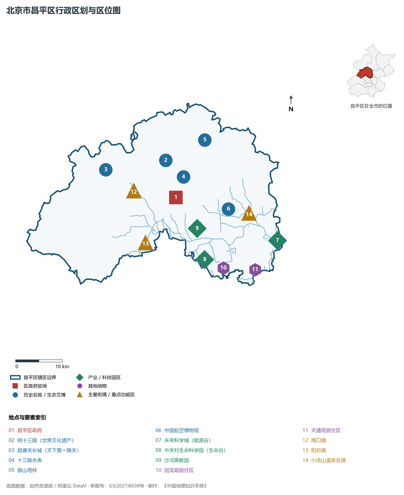
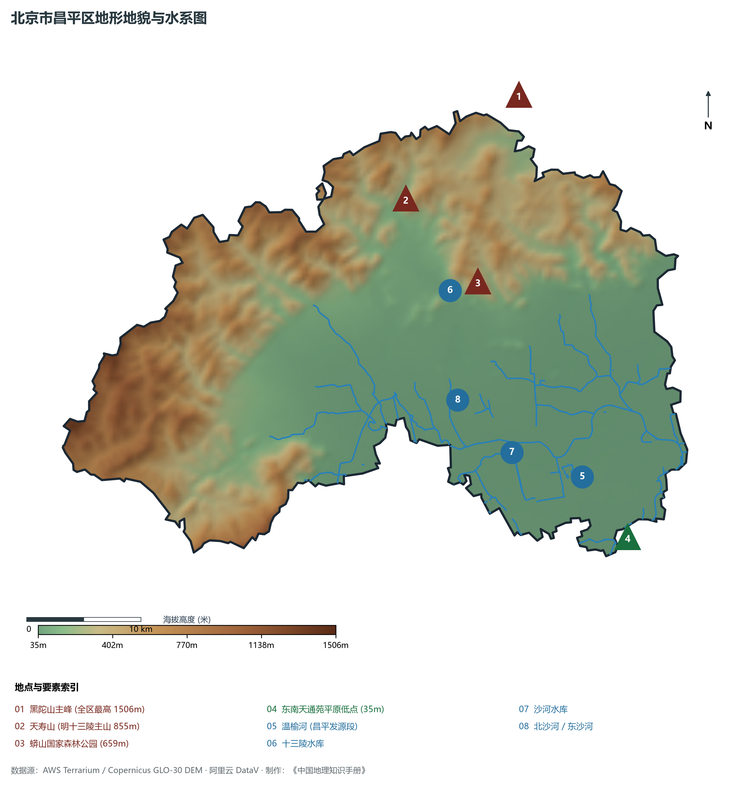
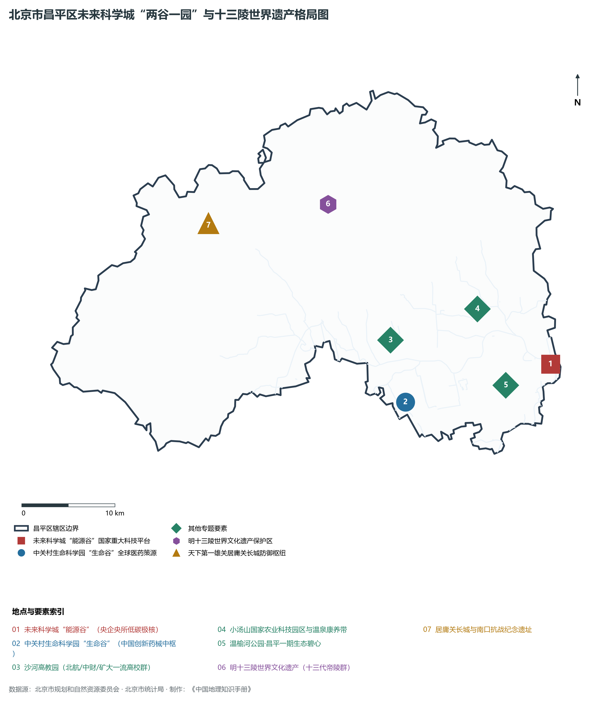
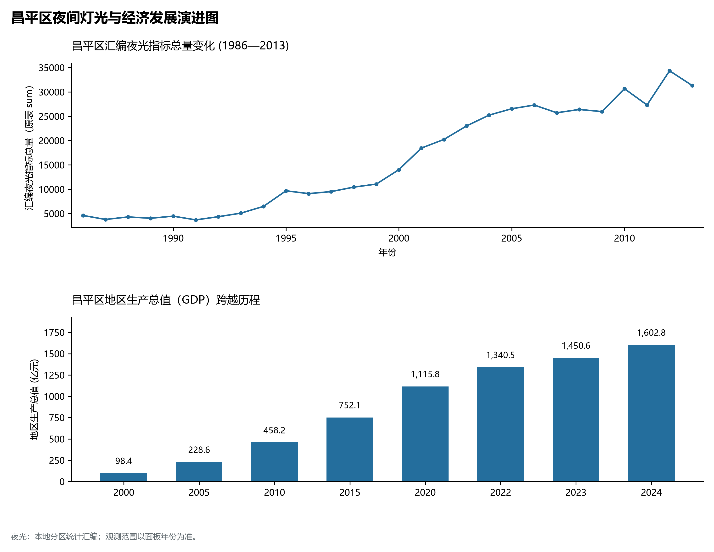
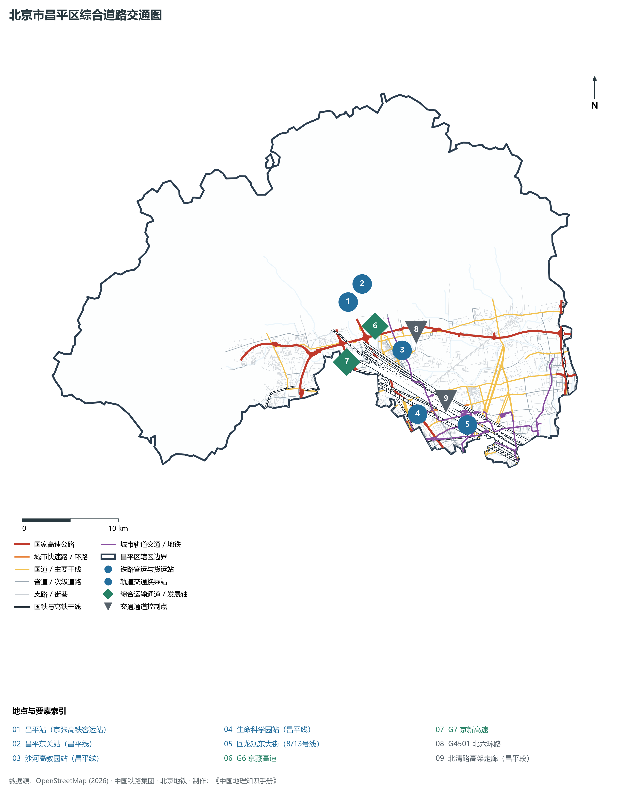

# 1.11 昌平区

昌平区位于北京市西北部，南连海淀区、朝阳区，东邻顺义区、怀柔区，西与门头沟区及河北省怀来县接壤，北与延庆区以军都山主脊相界。其地貌半山半原、形胜天成，恰好处在燕山与太行山脉交汇的居庸关断陷山口——西控八达岭居庸天险之锁钥，南引温榆沙河平原之通衢，北倚天寿苍莽群峰之龙脉，东汇未来科学城能源创新之智核。

历史上，昌平自汉代设县，取“昌盛平安”之吉祥寓意；明代历经两百余载于天寿山麓营建明十三陵，构筑起中国古代帝王陵寝风水营造的至高杰作；居庸关长城作为“天下第一雄关”，千百年扼守京师西北大门；白浮泉引水工程曾是元郭守敬引白浮泉注入积水潭的漕运水源滥觞。当代，昌平区作为北京平原新城与国际科创中心的重要承载地，全面构筑“两谷一园”（未来科学城能源谷、生命谷、沙河高教园）创新发展格局：生命科学园成为全球医药健康研发策源中心，未来科学城汇聚几十家央企研发中枢，沙河高教园汇聚一流大学群，配合“回天地区”超大型社区的现代化治理奇迹，成为首都融合深厚历史、优质生态与硬核新质生产力的卓越新城。

---

## 一、区情速览

昌平区是北京市平原新城中人口规模最大、创新要素极其密集的科教创新与生态文化大区。

| 指标 | 数值与特征 | 全国/全市坐标 |
|:---|:---|:---|
| **面积** | 1 344.00 km² | 占北京市总面积约 8.19%；山区占 52.8%，平原占 47.2% |
| **常住人口** | 226.95 万人（2020 年七普）；227.5 万人（2023 年末） | 全市 16 区中位居第三位（仅次于朝阳、海淀） |
| **常住人口城镇化率** | 83.2% | 回龙观、天通苑及主城区城镇化率超 98% |
| **人口密度** | 1 689 人/km² | 南部回天地区超 1.2 万人/km²，北部山区低于 150 人/km² |
| **地区生产总值 (GDP)** | 1 602.8 亿元（2024 年，现价） | 占北京市经济总量约 3.3%，先进能源与生命医药双发动机强劲 |
| **人均 GDP** | 约 7.1 万元人民币（折合约 0.98 万美元） | 高精尖创新成果转化加速释放高附加值产出 |
| **主导产业结构** | 医药健康、先进能源、智能制造与现代文旅 | 拥有“生命谷”与“能源谷”两大国家级硬核创新策源极 |
| **行政区划** | 8 个街道、14 个建制镇，区政府驻城北街道政府街 | 辖有城北、回龙观、天通苑、沙河、小汤山、南口等名镇 |
| **战略功能定位** | 国际科技创新中心前沿阵地、平原新城创新发展重要承载地、历史文化名城保护关键区 | 建设具有全球影响力的未来科学城与科教名城 |

**图 01-11-1 北京市昌平区行政区划与区位图**：图上编号与地点、要素索引对应。

---

## 二、自然地理：军都燕山与温榆平川

昌平区地处太行山脉与燕山山脉交接处，地貌呈现自西北深山向东南平原跌落的阶梯状构造。

### 1. 地形地貌：崇山要塞与冲积平原
全区地貌呈半环状盆地与平原相叠，海拔跨越 **35—1 506 m**：

- **北部军都山深山区**：属于燕山山脉支脉，山势险峻：
  - **黑坨山主峰（全区最高峰）**：海拔 **1 506 m**，屹立于昌平与延庆交界处，山峦层叠，古树茂密；
  - **天寿山**：海拔 **855 m**，为明十三陵的靠山玄武峰，林木幽深，气象万千；
  - **蟒山国家森林公园**：海拔 **659 m**，依傍十三陵水库，是北京面积最大的国家森林公园之一；
- **中部丘陵台地**：小汤山温泉台地与沙河阶地；
- **东南冲积平原**：温榆河冲积扇平原，地面标高由昌平城关的 **60 m** 降至东南天通苑的 **35 m** 左右，地势坦荡，为城市密集居住与先进制造业提供了坚实的承载基底。

### 2. 气候特征：温带大陆性季风与山前温泉小气候
全区年平均气温在 **11.8—12.5 ℃** 之间，年平均降水量约 **580—630 mm**。

- **北山屏障与小汤山地热**：军都山群峰削弱了冬季干冷北风的袭扰；而小汤山盆地地热资源储量丰富，拥有华北著名的地热温泉田，泉温高达 40—60 ℃，富含多种微量元素，自古为康养名胜。

### 3. 河流水系：温榆河源头与十三陵明珠
昌平是海河流域北运河水系的发源腹地：

- **温榆河（源头段）**：由发源于军都山山麓的**南沙河、北沙河、东沙河**三条支流汇聚而成，在沙河水库汇流后始称温榆河，东南流经昌平、朝阳、顺义至通州；
- **十三陵水库**：位于昌平城北天寿山麓，总库容 8 100 万 m²，大坝由毛泽东主席等中央领导人与广大群众于 1958 年义务劳动筑成，群山倒映，是防洪灌溉与水上休闲的著名水利名胜；
- **沙河水库**：又称醉湖，是温榆河干流源头的天然湿地蓄水池，每年春秋两季有天鹅、白鹭等珍稀水鸟在此栖息迁徙；
- **京密引水渠**：横贯昌平南部，自顺义由东向西穿过昌平注入海淀，构成平原绿色供水走廊。

**图 01-11-2 北京市昌平区地形地貌与水系图**：图上编号与地点、要素索引对应。

---

## 三、建置沿革与文化根脉

昌平文脉兼备帝王陵寝风水之雄浑、天下雄关防御之险峻与近代运河引水科技之源头。

### 1. 地名考略与行政演进

- 汉景帝元年（公元前156年）置昌平县，因居庸关南口之险，寄予“昌盛平安”之意；
- 明代景泰三年升为昌平州，筑昌平城（永安城）以护卫皇陵；
- 1956 年划归北京市管辖；
- 1999 年撤县设区，定名北京市**昌平区**。

### 2. 世界文化遗产：明十三陵

- **明十三陵（世界文化遗产）**：中国明朝十三位皇帝的陵墓群，坐落于天寿山群峰环抱的马蹄形盆地中，占地面积达 40 km²。从明成祖朱棣长陵开建，历经两百余载，依山就势修建了定陵（唯一发掘的地宫）、长陵（明代最大金丝楠木殿祾恩殿）、昭陵等十三座壮丽帝陵与神道石像生，代表了中国古代陵寝营造“天地合一、依山筑陵”的风水美学巅峰。

### 3. 天下第一雄关：居庸关长城

- **居庸关长城（全国重点文物保护单位）**：位于关沟峡谷险隘处，自古为燕京八景之“居庸叠翠”所在。关城两山夹峙，中有巨石砌筑的“云台”（元代藏传佛教石雕艺术杰作，刻有梵、藏、八思巴、西夏、回鹘、汉六种文字陀罗尼经），是长城防御体系中规模最宏大、关隘最坚实的国之要塞。

### 4. 大运河源头与白浮泉

- **白浮泉（大运河源头遗址公园）**：元至元二十九年（1292年），郭守敬主持寻得昌平白浮泉（龙山九龙池），开凿白浮堰，引泉水绕西山山麓注入积水潭，彻底解决了元大都城内漕运水源匮乏危机，成为京杭大运河引水工程不可替代的源头功勋地标。

**图 01-11-4 北京市昌平区未来科学城“两谷一园”与十三陵世界遗产格局图**：图上编号与地点、要素索引对应。

---

## 四、经济地理：未来科学城与生命能源双核

昌平区抢抓国家战略科技力量建设契机，全面激活“创新智核”，成长为全国领先的高精尖科技产业增长极。

### 1. 未来科学城“两谷一园”战略布局

- **“生命谷”（中关村生命科学园）**：集聚北京生命科学研究所（NIBS）、国家蛋白质科学中心、脑科学与类脑研究中心等全球一流科研机构，入驻百济神州、诺诚健华、万泰生物等高新创新药械企业数百家，成为代表中国参与全球生命科学前沿竞争的策源地；
- **“能源谷”（未来科学城东区）**：国家电网、国家能源集团、中海油、中国商飞等十余家大型央企研发机构扎根，专注先进储能、氢能利用、低碳清洁能源与新型电网，打造具有国际影响力的“能源创新策源地”；
- **沙河高教园**：汇聚**北京航空航天大学、中央财经大学、北京邮电大学、中国矿业大学（北京）、外交学院**等知名学府，校区深度融合、科教融汇，师生规模超 5 万人。

### 2. 经济总量跨越与先进制造支柱

- 2000 年昌平区 GDP 仅为 **98.4 亿元**；
- 2010 年增至 **458.2 亿元**；
- 2024 年全区 GDP 历史性跨过 **1 600 亿元**（达到 1 602.8 亿元），医药健康产业收入突破 1 000 亿元，先进能源产业收入超 2 500 亿元，构筑起双千亿级现代化高精尖产业大底盘。

### 3. “回天治理”大型社区城市更新典范
回龙观与天通苑两大超大型居住区总人口超 80 万人。昌平区深入推进“回天行动计划”，实施交通畅通、教育医疗补短板、双创空间扩容，打造出超大城市特大型居住区多跨协同、减负赋能的现代化治理全国样板。

### 4. 空间夜间灯光演化（1986—2013）

本节夜光图的观测年份为 1986—2013 年，指标为行政区汇总值（原表 sum）。

- 2000 年回天开发后跃升至 12 000；

**图 01-11-5 昌平区夜间灯光与经济发展演进图**：各面板按标注的观测年份、指标和单位列示。

---

## 五、交通网络与现代枢纽

昌平区是首都通向塞外内蒙古、西北各省的陆路咽喉，集高铁特等干线、多条地铁快线与国家放射高速于一体。

**图 01-11-3 北京市昌平区综合道路交通图**：图上编号与地点、要素索引对应。

### 1. 国家高铁动脉：京张高速铁路

- **昌平站**：始建于 1909 年詹天佑京张铁路老站；2019 年随京张高铁开通完成高标准改建，担当连接北京市区与延庆、张家口的高速动车组客运业务。

### 2. 放射状国家级高速走廊

- **G6 京藏高速（八达岭高速）**：自南向北贯穿昌平平原腹地，过居庸关通往延庆与西北高原；
- **G7 京新高速**：平行于京藏高速，是通往新疆乌鲁木齐的国家高速大通道；
- **G4501 北六环路**：横贯昌平中部，连接顺义与海淀；
- **北清路（快速化改造段）**：横跨海淀与昌平南部，连接生命科学园、永丰基地与未来科学城，构筑世界级科创高架走廊。

### 3. 纵横全域的城市轨道交通网络

- **地铁昌平线**：北起昌平西山口（直通十三陵），纵穿沙河高教园、生命科学园，向南直插入海淀学知园、蓟门桥，成为串联大学城与中关村科创走廊的黄金动脉；
- **骨干地铁接驳**：**8 号线**（回龙观东大街直穿南北中轴）、**13 号线**（回龙观站、龙泽站）、**17 号线北段**（未来科学城北至工人体育场的大运量快线）。

---

## 六、昌平区地理要素矩阵与区域之最

### 1. 核心地理与经济指标速查表

| 要素类别 | 指标名称 | 数值/名称 | 备注 |
|:---|:---|:---|:---|
| **地势极值** | 最高点海拔 | **1 506.0 m** | 北部军都山黑坨山主峰 |
| | 最低点海拔 | **35.0 m** | 东南平原天通苑东出境处 |
| **水文要素** | 母亲河源头 | **温榆河（昌平源头段）** | 南沙河、北沙河、东沙河汇流沙河水库 |
| | 著名防洪水库 | **十三陵水库** | 库容 8 100 万 m³，风光旖旎 |
| | 运河历史源泉 | **白浮泉（龙山九龙池）** | 元郭守敬引水大都源头 |
| **生态指标** | 森林覆盖率 | **48.7%** | 拥有蟒山国家森林公园、天寿山生态屏障 |
| | 林木绿化率 | **67.2%** | 全区生态涵养功能显著 |
| **经济指标** | 2024 年 GDP | **1 602.8 亿元** | 连续多年位列平原新城第二位 |
| | 研发投入强度 | **超 6.5%** | 高居全市平原新城各区前茅 |
| **文化遗产** | 世界文化遗产 | **明十三陵** | 中国保存最为完好的帝王陵寝群之一 |
| | 国家重点文物保护单位 | **居庸关长城及云台** | 天下第一雄关与元代六体石刻 |

### 2. 昌平区之最（Superlatives）

- **陵寝之最**：拥有全世界埋葬皇帝数量最多、保存最完整的明代皇家陵寝群——明十三陵；
- **要塞之最**：建有闻名遐迩的万里长城天下第一雄关——居庸关长城；
- **人口之最**：全北京市平原新城各区中常住人口最多、大学师生最为密集的科技大区；
- **生命医药之最**：拥有全中国生物医药领域国家级顶尖科研人员与源头研发管线密度最高的科技园区——中关村生命科学园。

---

## 参考与数据来源

1. 中华人民共和国自然资源部：《第三次全国国土调查主要数据公报（北京市昌平区）》
2. 北京市统计局、昌平区统计局：《北京市第七次全国人口普查公报》、《2024年昌平区国民经济和社会发展统计公报》
3. 北京市规划和自然资源委员会：《昌平分区规划（国土空间规划）（2017年—2035年）》
4. 国家统计局：《中国城市统计年鉴（2024—2025年）》
5. 阿里云 DataV.GeoAtlas 2021.5 行政区划边界矢量（审图号：GS(2021)6038号）
6. OpenStreetMap (OSM) 2026 年最新全要素道路与交通线网矢量
7. AWS Terrain Tiles / Copernicus GLO-30 数字高程模型（DEM）
