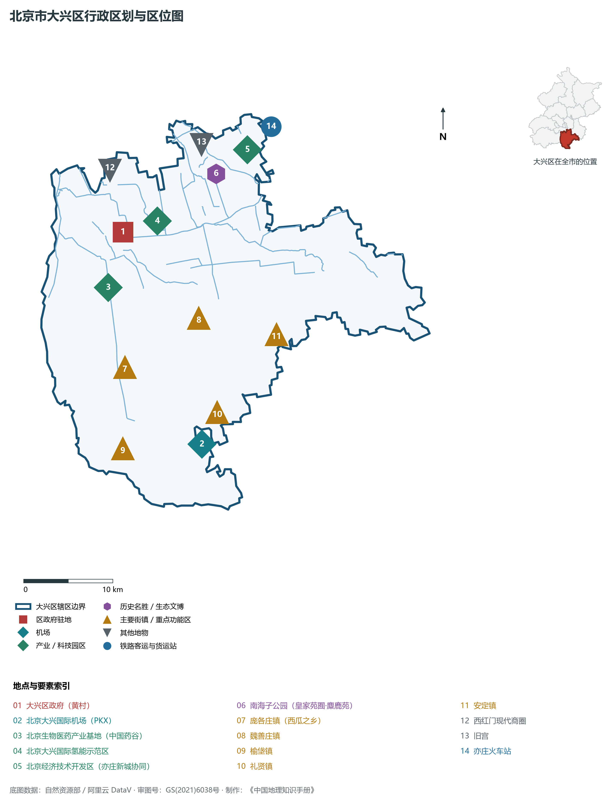
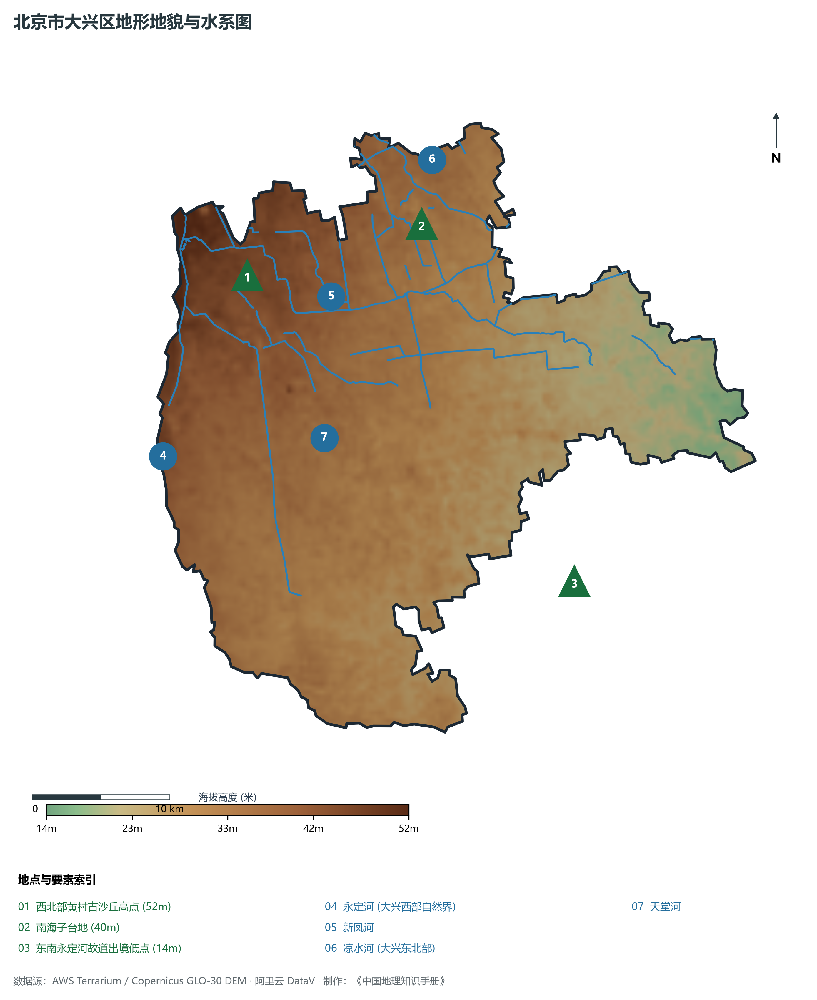
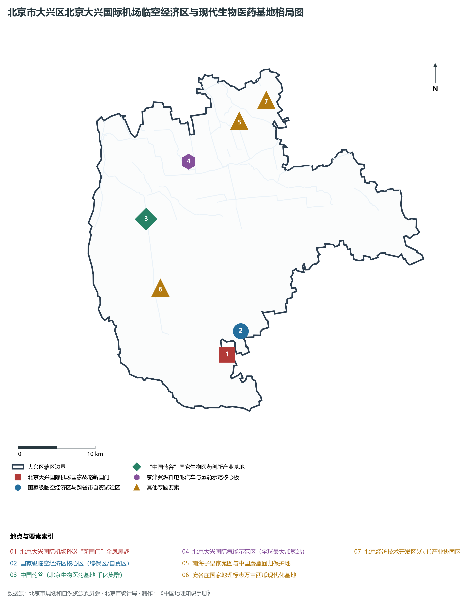
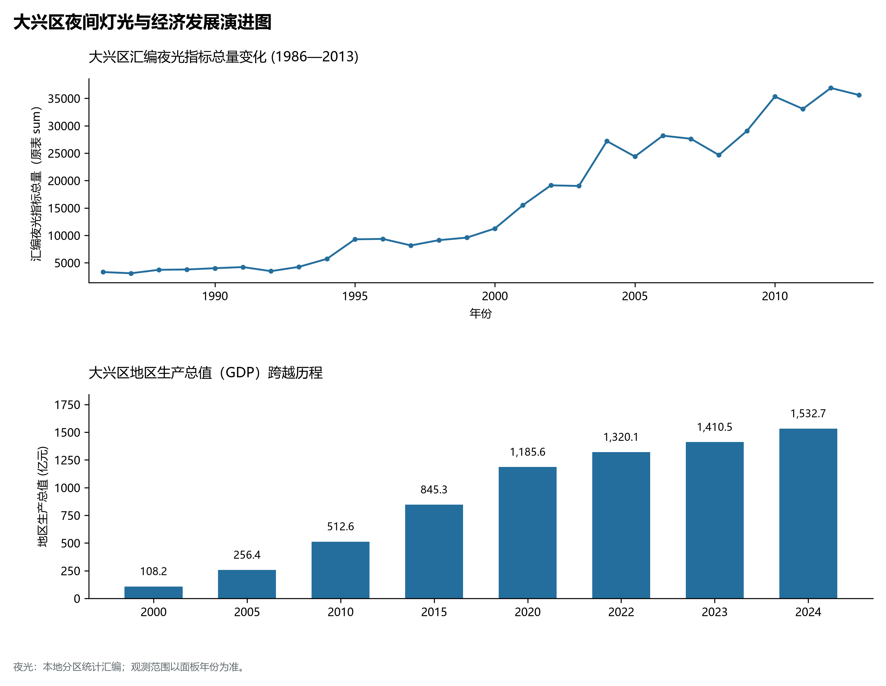
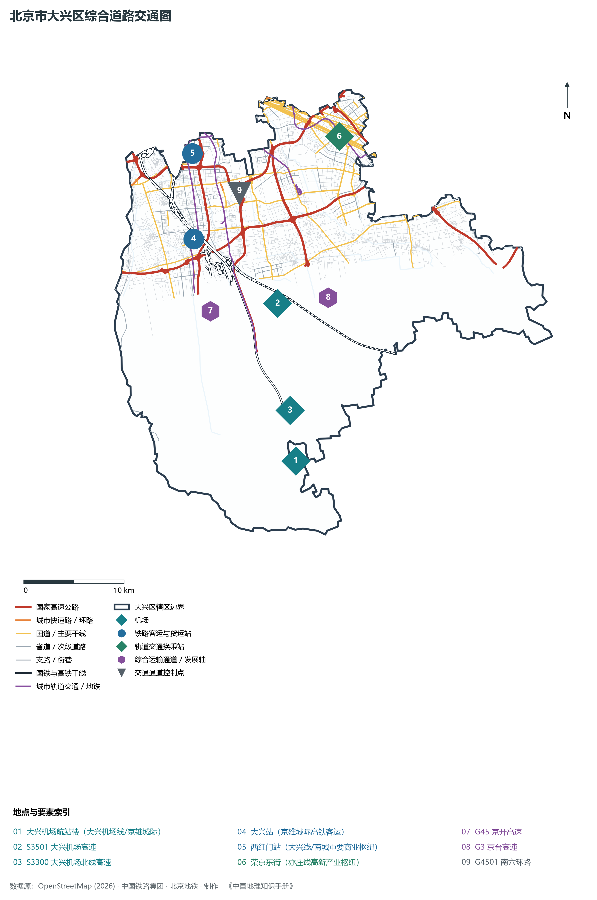

# 1.12 大兴区

大兴区位于北京市南部，北邻丰台区、朝阳区，东与通州区为邻，东北与北京经济技术开发区（亦庄新城）紧密相依，西隔永定河与房山区相望，南与河北省廊坊市广阳区、固安县交界。其地貌处于永定河冲积扇下游漫滩，全境 100% 均为广袤平原，地势自西北向东南倾伏——北承南中轴大红门之繁盛，西倚母亲河永定奔流之金沙，东拥亦庄高新技术之动能，南展“新国门”金凤展翅之伟力。

历史上，大兴是古都北京的“畿南首邑”，金代始设大兴县，寓意“天下大兴”；明清时期南海子曾是广袤百里的皇家苑囿，孕育了中国特有神兽麋鹿的重归繁衍奇迹；庞各庄万亩沙地瓜田名扬华夏。当代，大兴区经历了举世瞩目的划时代跨越：世界级超大型国际航空综合交通中枢——**北京大兴国际机场（PKX）**破土落成，打造出连接全球的“新国门”；国家级临空经济区与跨京冀自贸区应运而生；中关村大兴生物医药产业基地（“中国药谷”）崛起为千亿级产业航母；国际氢能示范区构筑起全球最大加氢走廊。大兴正以开放包容的大国风范，成为首都面向世界、链接未来的前沿主阵地。

---

## 一、区情速览

大兴区是北京市平原新城中面积开阔、坐拥国家超级国际航空港的“新国门”经济重区。

| 指标 | 数值与特征 | 全国/全市坐标 |
|:---|:---|:---|
| **面积** | 1 036.32 km² | 占北京市总面积约 6.31%；全域为第四纪冲积平原微地貌 |
| **常住人口** | 199.36 万人（2020 年七普）；200.1 万人（2023 年末） | 逼近 200 万大关，城南人口集聚效应突出 |
| **常住人口城镇化率** | 78.4% | 北部黄村、西红门、旧宫城镇化率超 95% |
| **人口密度** | 1 924 人/km² | 西北部与中心城区接壤地带超 5 500 人/km²，南部乡镇约 600 人/km² |
| **地区生产总值 (GDP)** | 1 532.7 亿元（2024 年，现价） | 占北京市经济总量约 3.1%，临空经济与生物医药强力支撑 |
| **人均 GDP** | 约 7.7 万元人民币（折合约 1.06 万美元） | 国际临空与现代制造带动人均财富稳步提高 |
| **主导产业结构** | 航空航天临空经济、医药健康、氢能与先进制造 | 拥有“中国药谷”与国家级临空经济区双支柱 |
| **行政区划** | 8 个街道、14 个建制镇，区政府驻兴丰街道兴政街 | 涵盖黄村、西红门、旧宫、庞各庄、榆垡、礼贤、魏善庄等名镇 |
| **战略功能定位** | 三区一门户（国家发展新动力源、国际交往新门户、科技创新成果转化承载区、生态宜居新航城） | 打造现代化国际一流“新国门”大航城 |

**图 01-12-1 北京市大兴区行政区划与区位图**：图上编号与地点、要素索引对应。

---

## 二、自然地理：平原舒阔与永定古道

大兴区地处永定河冲积扇的扇缘漫滩带，全境无山，地表平展如砥，土壤多为富含砂质的潮土与沙壤土。

### 1. 地形地貌：古沙丘高台与低湿古河道
全区地势西北微高、东南微倾，地面标高在 **14—52 m** 之间，天然坡降约 1/2000：

- **全区天然地势高位**：位于西北部黄村古沙丘高台一带，海拔约 **48—52 m**；
- **南海子古低丘台地**：东北部南海子公园一带，海拔约 **38—40 m**；
- **全区地势最低处**：东南端采育镇与安定镇交界处的永定河古河槽出境洼地，地面绝对标高仅 **14 m** 左右，是全北京市海拔最低的平原区域之一。

### 2. 气候特征：暖温带季风与沙土通透环境
属于暖温带半湿润大陆性季风气候。全区年平均气温在 **13.0—13.5 ℃** 之间，年平均降水量约 **560—600 mm**。

- **光照充足与微沙壤土**：大兴平原日照充足，昼夜温差适度，永定河历代泛滥沉淀的疏松砂质土壤排水通气性能极好，为庞各庄西瓜与梨树林果提供了绝佳的天然糖分累积生长环境。

### 3. 河流水系：母亲河为界与生态新凤河
大兴区分属海河流域永定河水系与北运河水系：

- **永定河（大兴西部界河）**：自北向南流贯大兴西部，全长约 55 km，与房山隔河相望。近年来实施全线通水与生态修复，形成了水清沙净、草长莺飞的百里生态湿地长廊；
- **新凤河**：横贯大兴中北部腹地，西起黄村，东穿亦庄入凉水河，全长 30 余公里，经“水环境全流域综合治理”后，昔日“龙须沟”蝶变为水清岸绿的“国家级水环境治理示范碧道”；
- **凉水河**：流经大兴区东北部旧宫一带，汇入通州；
- **天堂河**：大兴南部主要排沥水渠，自北向南经榆垡注入河北省境内。

**图 01-12-2 北京市大兴区地形地貌与水系图**：图上编号与地点、要素索引对应。

---

## 三、建置沿革与文化根脉

大兴文化源远流长，兼融金元古都畿辅、明清皇家苑囿、中国神兽重归与现代国际空港文明。

### 1. 地名考略与行政演进

- 金贞元二年（1154年），析蓟县东境置**大兴县**，寓意“疆土广阔、天下大兴”；
- 明清时期，大兴与宛平分治北京城内外，素有“大兴、宛平附郭”之称；
- 1958 年由河北省划入北京市，设立北京市大兴区；1960 年改称大兴县；
- 2001 年 1 月，经国务院批复撤县设区，重定为北京市**大兴区**。

### 2. 南海子皇家苑囿与中国麋鹿传奇

- **南海子（北京四大郊野公园之首）**：总面积达 11 km²。在元明清三代为皇家行宫御苑，建有团河行宫、新宫、旧宫等，也是北方最大的皇家天然湿地猎场；
- **北京麋鹿苑（中国麋鹿保护基地）**：麋鹿（俗称“四不像”）原产于中国长江、黄河流域湿地，八国联军侵华时在中国绝迹。1985 年，中英两国政府合作，20 头麋鹿自英国乌邦寺重返故土南海子。经过四十余年科学繁育，麋鹿种群在南海子突破数千头，并成功在全国多地野外放归，创造了世界物种重引进并成功复壮的自然传奇。

### 3. 庞各庄西瓜文化与沙地古树群

- 庞各庄种植西瓜历史达数百年，自明代万历年间即作为皇家贡品进贡朝廷。拥有“全国西瓜第一镇”称号，庞各庄西瓜被列为中国国家地理标志产品，留存有明代古桑林等珍贵古树群落。

**图 01-12-4 北京市大兴区北京大兴国际机场临空经济区与现代生物医药基地格局图**：图上编号与地点、要素索引对应。

---

## 四、经济地理：“新国门”临空经济与中国药谷千亿极核

大兴区坚持创新立区、产业强区，构筑起以生物医药、临空经济、氢能装备与商业航天为核心的新质生产力高地。

### 1. “中国药谷”：北京生物医药产业基地

- 规划面积 22.5 km²，是国家级生物医药产业基地的核心区；
- 汇聚中国食品药品检定研究院、中国医学科学院药物研究所等国家级“国字号”审评审批科研机构；
- 集聚中生科兴、以岭药业、民海生物、同仁堂、热景生物等生物医药领军企业超 600 家，涵盖疫苗抗体、现代中药、创新化药、高端医疗器械四大支柱，工业产值突破千亿元，成为国家战略生物医药创新与产业化主阵地。

### 2. 北京大兴国际机场临空经济区与自贸区

- 规划面积 150 km²（北京部分 50 km²），是全国唯一同时拥有**自贸试验区、国家综合保税区、临空经济区**三区政策叠加的开放高地；
- 重点布局航空物流、航空维修制造、国际生命健康、国际会展商贸，与顺义首都机场临空城遥相呼应，构筑起北京外向型经济新的“双子星座”。

### 3. 北京大兴国际氢能示范区

- 坐落于黄村镇，建有**全球最大加氢站**（日加氢能力达 4.8 吨，拥有 8 台 16 枪加氢机）；
- 汇聚国家电投氢能、海珀尔、亿华通等上下游领军企业，构建涵盖制氢、储氢、运氢、燃料电池发动机、整车示范运营的全国领先氢能全产业链生态。

### 4. 空间夜间灯光演化（1986—2013）

本节夜光图的观测年份为 1986—2013 年，指标为行政区汇总值（原表 sum）。

**图 01-12-5 大兴区夜间灯光与经济发展演进图**：各面板按标注的观测年份、指标和单位列示。

---

## 五、交通网络与现代枢纽

大兴区拥有世界级综合交通超级枢纽，形成直通雄安、畅达市区、飞跃全球的空铁地水立体化大交通格局。

**图 01-12-3 北京市大兴区综合道路交通图**：图上编号与地点、要素索引对应。

### 1. 国家超级空中门户：北京大兴国际机场

- 坐落于大兴区礼贤镇、榆垡镇与河北省廊坊市交界处；
- 航站楼面积达 70 万 m²，拥有“四纵两横”全向跑道构型；由扎哈·哈迪德团队设计，金色穹顶、八根 C 型柱宛如凤凰展翅；航站楼中心到最远登机口步行距离不超过 600 米（8分钟），是享誉全球的国家发展新动力源与“新国门”。

### 2. 空铁一体化超级客运中枢

- **京雄城际铁路**：自北京西站出发，设大兴站、大兴机场站，设计时速 350 km/h，实现 20 分钟直达北京西站、30 分钟通达雄安新区；
- **地铁大兴机场线**：采用 160 km/h 顶级地铁动车组，自丰台丽泽、草桥始发，19 分钟即可一键直达大兴机场航站楼地下一层，实现高铁、地铁与值机行李托运的无缝垂直接驳；
- **地铁 4 号线 / 大兴线**：横穿黄村新城，直通西单、中关村。

### 3. 纵横高速交通网

- **S3501 大兴机场高速与 S3300 机场北线高速**：双向八车道智慧高速公路；
- **国家级南北高速通道**：**G45 京开高速**（纵贯大兴西部）、**G3 京台高速**（纵贯东部直达天津与台北方向）；
- **G4501 南六环路**：横贯大兴北部，连接房山与通州。

---

## 六、大兴区地理要素矩阵与区域之最

### 1. 核心地理与经济指标速查表

| 要素类别 | 指标名称 | 数值/名称 | 备注 |
|:---|:---|:---|:---|
| **地势极值** | 最高点海拔 | **52.0 m** | 西北部黄村古沙丘高点 |
| | 最低点海拔 | **14.0 m** | 东南平原永定河故道出境处（全市极低点之一） |
| **水文要素** | 母亲河界河 | **永定河（大兴段）** | 境内全长 55 km，西部天然生态走廊 |
| | 水环境示范河道 | **新凤河** | 全长 30 余公里，国家级生态治理标杆 |
| | 皇家苑囿水系 | **南海子湖泊湿地** | 水面面积超千亩 |
| **生态指标** | 森林覆盖率 | **32.8%** | 拥有万亩麋鹿苑、庞各庄万亩森林 |
| | 平原造林面积 | **数十万亩** | 城南天然绿色生态防护屏障 |
| **经济指标** | 2024 年 GDP | **1 532.7 亿元** | 生物医药与临空经济主导，动能强劲 |
| | 生物医药工业规模 | **超 1 000 亿元** | “中国药谷”国家级生物医药创新产业基地 |
| **时代地标** | 世界级航空港 | **北京大兴国际机场** | 航站楼面积 70 万 m²，“新国门”金凤展翅 |
| | 绿色能源示范 | **国际氢能示范区** | 拥有全球最大商业化加氢站 |

### 2. 大兴区之最（Superlatives）

- **国门之最**：拥有全球单体面积最大的放射状综合航空航站楼——北京大兴国际机场；
- **生态之最**：中国神兽麋鹿绝迹重引回故土并成功繁衍复壮的唯一圣地——南海子麋鹿苑；
- **医药之最**：全北京市集聚国家级药械检验审评平台最完备、产业规模最大的生物医药园区——中国药谷；
- **能源之最**：拥有全球加注能力最大（4.8吨/天）的现代化高负荷商业加氢站。

---

## 参考与数据来源

1. 中华人民共和国自然资源部：《第三次全国国土调查主要数据公报（北京市大兴区）》
2. 北京市统计局、大兴区统计局：《北京市第七次全国人口普查公报》、《2024年大兴区国民经济和社会发展统计公报》
3. 北京市规划和自然资源委员会：《大兴分区规划（国土空间规划）（2017年—2035年）》
4. 国家统计局：《中国城市统计年鉴（2024—2025年）》
5. 阿里云 DataV.GeoAtlas 2021.5 行政区划边界矢量（审图号：GS(2021)6038号）
6. OpenStreetMap (OSM) 2026 年最新全要素道路与交通线网矢量
7. AWS Terrain Tiles / Copernicus GLO-30 数字高程模型（DEM）
